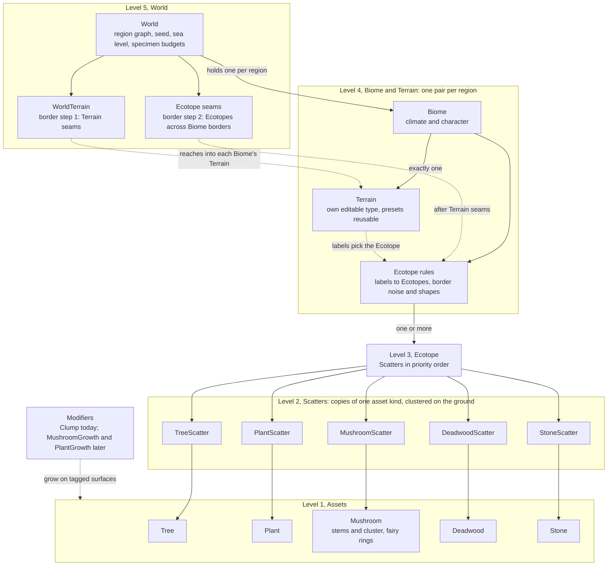
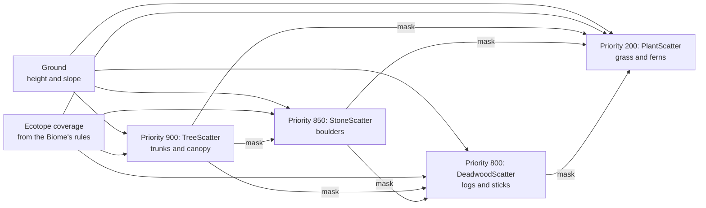

# procgena: architecture and vision

This document describes where procgena is heading: how single assets build
up, level by level, into a whole world, and the rules every asset follows so
that they fit together. Each level's API, phases and tests live in that
level's own plan, linked below where one exists (Ecotope, Biome and World
have none yet).

Everything is in metres, as in the rest of the workspace.

## Bottom line

- **Five levels**, from small to large:
  1. **Asset**: one tree, plant, mushroom, piece of dead wood or stone.
     **Modifiers** such as clumps grow on top of an asset.
  2. **Scatter**: many copies of one kind of asset, and how they cluster on
     the ground. `TreeScatter`, `PlantScatter`, `MushroomScatter`,
     `StoneScatter`, `DeadwoodScatter`.
  3. **Ecotope**: a stack of Scatters in priority order, laid over the same
     ground. Each Scatter can mask the Scatters below it.
  4. **Biome and Terrain**, side by side. A Biome holds exactly one
     **Terrain** (the labelled ground of its region), plus the rules that
     map the Terrain's labels to Ecotopes, plus the noise and shapes that
     break up Ecotope borders. A Terrain is its own type, edited on its
     own, and a Terrain preset can be reused by many Biome presets.
  5. **World**: one Biome per region, stitched together. Its
     **WorldTerrain** part reaches into each Biome's Terrain and stitches
     the Terrains alone, without knowing about Biomes.
- **Two stacks meet at the Biome.** The ground stack (World → WorldTerrain
  → Terrain) decides the shape of the land. The cover stack (Ecotope →
  Scatter → Asset) decides what grows and lies on it. A Biome binds its
  Terrain to its Ecotopes.
- **Borders are negotiated, not blended after the fact.** Terrain already
  agrees on its borders with its neighbours. Biomes do the same in two
  steps: first their Terrains (WorldTerrain), then the Ecotopes on either
  side, so forest thins into meadow across a Biome border as naturally as
  it does inside one.
- **Each level talks to the one below through small, shared interfaces**
  that mostly exist already:
  - `Ground` (today in `procgena_mesh`) gives a Scatter its ground height
    and slope.
    Terrain supplies both, so no level below re-derives slope from heights.
  - A density function `Fn(x, z) -> 0..1` thins a Scatter. This is the mask.
  - Terrain labels (`Landform`, `Flags`, `Measures`) pick the Ecotope.
  - Specimen tags (`procgena_specimen::tags`) let modifiers find the
    surfaces they grow on.
- **Every level stays a pure function** of its options, seed and position,
  as each generator is today. A chunk of the world built alone matches the
  same chunk built in any order.
- **Seeds push in from outside.** Presets keep only a `default_seed`; inside
  the World, every seed is a hash of its parent's seed and its own id.
- **Each Scatter loads to its own range.** Plan per region, place per
  chunk, draw per copy: far away, trees are placed and drawn as impostors
  while grass is never placed. See "Loading by chunk".
- **Extensible from the Scatter level up.** Hooks in code, edits as data,
  and queries at every level, all keyed by stable ids.
- **Assets follow one contract.** CPU and GPU building, one LOD model, one
  content hash, specimen and copy ids, and the same Scatter inputs, including
  masks. Plant is the furthest from it today.
- **Renames this vision asks for:** `TreeGrove` becomes `TreeScatter`, and
  `PlantField` becomes `PlantScatter`. See "Naming" and "Architectural
  TODOs".

## The hierarchy

Solid arrows mean "contains" or "builds". Dotted arrows mean "reads from"
or "negotiates with".

### How masks flow down an Ecotope

The order shown is only an example. The Ecotope sets the order.

## The levels

Each level says what it is, what it owns, what it gets from the level above,
and where it stands today.

### 1. Asset

**What it is.** One object: a tree, a plant (a tuft or small patch), a piece
of dead wood, a stone. Each comes from its own generator crate, as an
engine-free core plus a Bevy crate.

**What it owns.** Its options, presets (each with a `default_seed`),
levels of detail, materials and textures. It makes a tagged `Specimen`
(today `procgena_mesh::Object`).

**What it gets from above.** Its specimen slot (which seeds its shape) and,
for each copy, a transform. An asset does not know where it stands.

**Status.** Built: `procgena_tree`, `procgena_plant`, `procgena_deadwood`,
`procgena_stone`, and `procgena_mushroom`.

**Mushrooms.** A `Mushroom` asset is a whole growth: how many stems, and
how they cluster, including fairy-ring layouts. A single mushroom, a tuft
and a fairy ring are all one `Mushroom`. `MushroomScatter` then places
`Mushroom`s on the ground like any other Scatter. Since C1,
`procgena_mushroom` describes the growth with `ClusterOptions`,
`ClusterLayout` and `FairyRingOptions`, and `MushroomScatter::new` places
whole `Mushroom`s over a `ScatterInput`, setting each member on the ground.
`MushroomScatter::on` still grows on tagged host meshes until
`MushroomGrowth` replaces it.

#### 1.1 Modifiers

**What they are.** Generators that grow on top of an asset, or on any tagged
mesh, instead of standing on their own: `procgena_clump` (snow, moss, mud,
litter). A modifier changes how an asset looks in place; it is not a new kind
of asset.

**What they own.** Their own options, and a `TagFilter` saying which surfaces
they grow on.

**Who owns them.** For now, the asset: a stone or tree says which modifiers
grow on it. Later, higher levels push modifiers down (a Biome's snow line,
an Ecotope's wetness driving moss), but not yet.

**What they get from above.** The host `Specimen` and its tags.

**Status.** Clump is built, CPU and GPU ([PLAN-clump-bevy.md](PLAN-clump-bevy.md)).
Deadwood's studio tab already grows clump covers on a single piece. Further
out, **`MushroomGrowth`** and **`PlantGrowth`** let mushrooms and plants
grow on stumps, logs and rocks as modifiers, the way mushrooms grow on
host meshes today.

### 2. Scatter

**What it is.** Many copies of one kind of asset spread over a stretch of
ground, and how they cluster: density per area, spacing, stands and gaps,
the mix of species or variants, and how copies vary in size, lean and footing.

**What it owns.**

- The mix: which assets, and each one's share of the density.
- Clustering and spacing rules.
- Per-copy variation.
- How copies are drawn: instancing, levels of detail, and promoting single
  copies to entities.

**What it gets from above.**

- **Ground**: a `Ground` for heights and slope (see "Ground carries
  slope").
- **Mask**: a density function from 0 (none) to 1 (full). It combines the
  Ecotope's own coverage with the masks of higher-priority Scatters.
- **Area and seed**.

**What it gives back.** A mask of its own, for the Scatters below it in the
Ecotope: where its copies stand, and how far their influence reaches.

**What it states for loading.** Its draw range (from its specimens' cull
distance), its three reach distances (spacing dependency `S`, displacement
`J` and mask footprint `F`, see "Masks and placement"), and whether its mask
comes from its copies or from its density field. It places one chunk at a
time, and gives its mask over a chunk without drawing anything. See
"Loading by chunk".

**Status.**

| Scatter | Today | Notes |
|---------|-------|-------|
| `TreeScatter` | Built ([tree/docs/scatters.md](tree/docs/scatters.md), [tree/PLAN-tree-grove.md](tree/PLAN-tree-grove.md)) | `TreeScatterPlacement::new` takes a `ScatterInput`: ground, area, seed and mask. |
| `PlantScatter` | Built ([plant/docs/scatters.md](plant/docs/scatters.md)) | Has `density_map` and `with_density_from_fn`: the mask hook exists. Placed on the GPU. |
| `MushroomScatter` | A ground Scatter of `Mushroom`s (`new`, C1), and still grows on tagged host meshes (`on`) | Growing on hosts moves to the later `MushroomGrowth` modifier. |
| `DeadwoodScatter` | Partly: `StickScatter` in `procgena_deadwood` | Scatters sticks and twigs over a `Ground`, with a density function. Needs logs and stumps, and a slope limit. |
| `StoneScatter` | Built (C1): `StoneScatter` in `procgena_stone`, drawn by `StonePool` | Classes of stones, single or in clusters, over a `Ground` with a mask, patches, a slope limit, tilt to the slope and burial. |

### 3. Ecotope

**What it is.** One kind of ground cover with a single character, such as
"pine forest floor", "wet meadow" or "scree slope". It is a set of Scatters,
each named by a frozen key and given a priority, all laid over the same
ground.

**What it owns.**

- Its Scatters, each with a key (see "Seeds") and a `priority` number.
- How each Scatter masks the ones below it. Examples:
  - Tree trunks clear a disc around themselves.
  - Canopy shade thins grass.
  - Boulders and logs clear the plants under them.

**What it gets from above.** Its area, as a coverage function from 0 to 1
that the Biome works out from Terrain labels and border noise. Also the
ground, and a seed.

**How priority works.** The highest-priority Scatter is placed first, against
the Ecotope's coverage alone. Each later Scatter sees the coverage times the
masks of every Scatter above it. A Scatter never reads a Scatter below it,
so the order alone settles every conflict and nothing loops.

**One priority scale for every Ecotope** (decided in
[D3](docs/decisions/D3.md)). A Scatter's `priority` is a number on one
World-wide scale, not a place in its Ecotope's list, so Ecotopes written
apart still interleave sensibly where they blend (see "Masks cross the
blend"). Documented bands give the numbers meaning, for example 900 and up
for big obstacles (boulders, trunks), the 600s for shrubs, and 100 to 300
for ground cover. Two Scatters of one Ecotope with the same priority are a
validation error. A differences file adds a Scatter with its key and
number, without restating the others.

**Status.** New.

### 4. Biome and Terrain

Biome and Terrain live at the same level. Each region of the World has
exactly one Biome, and each Biome exactly one Terrain. A region is one
Biome's whole area: its outline is where the Biome changes, and two
neighbouring regions never share a Biome (decided by the user in D3; how
the region graph achieves this is decision gate D4). Terrain is still its
own type: it is edited on its own (in its own studio tab), and one Terrain
preset can be reused by many Biome presets ("alpine forest" and "alpine
meadow" on the same mountains).

#### 4.1 Biome

**What it is.** One region of the world with one climate and character,
such as "temperate forest" or "alpine". It joins its Terrain to the
Ecotopes that cover it.

**What it owns.**

- **Its Terrain**: exactly one, by preset or inline.
- **Ecotope rules**: which Ecotope grows on which kind of ground. A rule
  matches Terrain labels: the primary `Landform` (Plain, Bluff, Scree,
  Beach, Riverbed and so on), `Flags` (WET, SNOW, ROAD and so on) and
  `Measures` (slope, height above water, distance to water or road). Several
  Ecotopes can match one segment, with weights.
- **Ecotope geometry**: the noise and shapes that keep Ecotope borders from
  following label borders exactly. Examples: patches of meadow inside a
  forest, ragged edges where scree meets grass, a fringe along a river.

**What it gets from above.** Its region (a polygon from the World), its
seed (a hash of the World seed and its region; see "Seeds"), the sea
level, and its border agreements with neighbouring Biomes.

**Borders.** Biomes negotiate their borders the way Terrains do: each side
makes an offer that depends only on itself, a pure, symmetric function
turns two offers into an agreement, and each side conforms to the agreement
within its own margin. A Biome border is negotiated in two steps:

1. **Terrain**: WorldTerrain runs the terrain seam protocol between the two
   Terrains.
2. **Ecotopes**: the Ecotopes on either side agree how they blend across
   the border: how wide the blend is, and how each side's coverage fades
   into the other's, shaped by noise so the line doesn't show.

Ecotopes meeting inside one Biome need the same natural blend, so the
Ecotope step is one protocol used both inside a Biome and across Biome
borders.

**Masks cross the blend.** Inside one Ecotope, each Scatter masks the
ones below it. In a blend zone, the Scatters of both Ecotopes share the
same ground, so the masks must chain across them too, or a tree from one
side can stand inside a boulder from the other. The agreement therefore
also sets one merged priority order for the blend zone: the Scatters of
both Ecotopes, interleaved, each masking every Scatter after it, whichever
side it came from. Because priorities share one World-wide scale, the
merge is a sort by `priority`. A tie between the two sides is broken by
the Scatters' address prefixes (region, Ecotope key, Scatter key; see
"Queries"), which never depends on which side made the offer, so both
sides build the same blend.

**Empty Biomes.** A Biome with a Terrain and no Ecotope rules is valid,
and every Terrain preset has a default empty Biome. A World of bare land
is a World of empty Biomes. So the World, its region graph and its Biome
choice can be built and tested before any Ecotope exists, and the land is
always built through the same path, with or without cover.

**Status.** Started: `procgena_biome` has empty Biomes (one Terrain by
preset or inline, an Ecotope rule list that is always empty) and a
default empty Biome preset per Terrain preset. The Ecotope lives in the
same crate, and an early, Terrain-unaware version of it comes next (roadmap
C3a). Ecotope rules, border noise and the border negotiation are still to
come.

#### 4.2 Terrain

**What it is.** The ground of one Biome's region: heights, water, roads and
rivers, and labels for every point. "Segmented" means labelled: every point
carries a primary `Landform`, `Flags` and `Measures`.

**What it owns.** Everything in [terrain/plan.md](terrain/plan.md): its
relief, erosion, water, roads, volume features, chunks and meshes.

**Terrain features.** Rivers, roads and ponds, and later cliffs, caves,
lakes and general landforms (mesas, terraces, rock outcrops), are
**terrain features**: planned, bounded pieces of the ground, inside the
Terrain, not a level of their own. The design is in
[terrain/features_plan.md](terrain/features_plan.md), and what is adopted
is in [terrain/features_plan_review.md](terrain/features_plan_review.md).

- **Where the line is.** A loose stone is a copy in a Scatter. A formation
  that shapes the ground, makes a cliff or carries the surface is a
  terrain feature.
- **Bounded.** Every feature declares how far it can reach, and adds
  nothing outside that. Chunks never fade a feature at their edges.
- **Borders.** A feature stays inside its region's border margin, or
  crosses through an agreed port (as rivers and roads do), or comes from a
  field both sides share.
- **Canonical ground.** Placement, masks, gameplay and queries read the
  terrain's own height and labels. Drawing may use coarser meshes, but
  never becomes what anything else reads.
- **Reaching the cover.** A feature reaches Ecotopes and Scatters through
  the terrain's height and labels, including where a rock mesh stands.
  How a feature's footprint takes part in the exact exclusion tests of
  "Masks and placement" is open: see the review, Gaps 1 and 3.

Decided 2026-11-23 (user): terrain is meshed as a heightfield by default,
with volume only where a feature needs it (caves, overhangs), and rock
outcrops are meshes the terrain builds and lays into the ground (review,
"Decisions").

**What it gets from above.**

- From its Biome: its options.
- From WorldTerrain: its region and its seam agreements with its neighbours.

**What it gives back.** Height, slope (as a gradient or normal) and labels at
any point, and the same as grids per tile.

**Status.** In progress: `procgena_terrain`. One generator fills one region,
which can be bounded or infinite. Today it gives `height`, `water_level`,
`road_tags` and `HeightTile` (heights only). Slope and the planned
`annotate` labels are not exposed yet.

### 5. World

**What it is.** The whole map: a graph of regions, each region one Biome.
The World holds the Biomes; it does not hold Terrains directly.

**What it owns.**

- The region graph's options: region size, jitter and border warp, or a
  designer's polygons. The terrain crate computes the graph from them (see
  "5.1 WorldTerrain"), because the land needs it before anything grows.
  Each region is one Biome's whole area, so neighbouring regions never
  share a Biome. How the graph and the Biome choice achieve that, while
  keeping each `RegionId` stable and computable from the World's options
  and seed alone, is decision gate D4.
- Which Biome fills each region, chosen field first: rules match the
  world elevation E and the World's own selector fields (ruggedness,
  moisture) at each region, and a user can pin a region's Biome. A pin
  that should also raise the land adds a height bump to E. See "Choosing
  biomes" in [terrain/world_plan.md](terrain/world_plan.md).
- World-wide settings: seed and sea level (`WorldContext` in the terrain
  plan).
- The specimen budget `N` for each pool, where it overrides a preset's
  default (see "Specimen budget").
- Running every Biome border negotiation: step 1 through WorldTerrain,
  step 2 the Ecotope seams (see "4.1 Biome", "Borders").

**Status.** New. The terrain plan calls it "World generator (TBD)".

#### 5.1 WorldTerrain

**What it is.** The part of the World that joins Terrains at their borders.
It reaches into each Biome for that Biome's one Terrain, and this is step 1
of every Biome border.
It runs the terrain seam protocol across the region graph: offers, then
agreements, then each Terrain conforms to its agreements. Rivers and roads
cross borders through the ports those agreements set. Any other terrain
feature either stays inside its region's border margin, crosses through
an agreed port, or comes from a field both sides share. None needs its
neighbour's full plan.

**What it owns.** Geometry and height, not choice: the region graph
(computed from the World's options), the world elevation field E with its
height bumps, and the seam protocol. It gets each region's
`TerrainOptions` from a **terrain source** it is handed; the World's
source reads the region's Biome.

**What it does not know.** Biomes and Ecotopes. It sees regions and their
Terrains, nothing else. Its own tests hand it a closure as the source;
whole worlds of bare land are built through the World with empty Biomes
(see "4.1 Biome").

**Status.** Built inside `procgena_terrain` as `WorldTerrain` (phase W4):
an endless lattice world whose regions are built on demand from a terrain
source, with each region's settings, plan and terrain cached. The
reference "stitcher" (`StitchedWorld`) stays for tests and designer
polygons.

## Interfaces between levels

| From → to | Interface | Exists today |
|-----------|-----------|--------------|
| World → Biome | Region, World seed, sea level, border agreements | New |
| Biome → Terrain | Terrain options (preset or inline) and seed; far tint from Ecotope coverage | New |
| World → WorldTerrain | Region graph options; a terrain source giving each region's Terrain from its Biome | Region types in the terrain plan; the source is new |
| WorldTerrain → Terrain | `Region` and its `EdgeAgreement`s and `CornerAgreement`s | Yes, in `procgena_terrain` |
| Terrain → Biome | `height`, slope and `annotate` at a point; tiles of the same | `height` and height tiles; slope and `annotate` are new |
| Biome → Ecotope | Coverage function from 0 to 1, ground, seed | New |
| Ecotope → Scatter | `Ground` (height and slope), density function, area, seed, copy-address prefix (region and key salts) | `ScatterInput` in `procgena_core::scatter` (see [C1](docs/decisions/C1.md)) without the address prefix; stone and mushroom (`MushroomScatter::new`) take it, and tree and deadwood are moving to it |
| Scatter → Scatter below | Mask: density function from 0 to 1 | New |
| Scatter → Asset | Transform and variant | Yes |
| Modifier → Asset | Host `Specimen` and `TagFilter` | Yes, as `Object` in `procgena_mesh` |

## Rules that hold at every level

- **Pure and deterministic.** A level's output depends only on its options,
  its seed, the inputs from the level above, and position.
- **Seeds come from outside.** See "Seeds".
- **Chunk-friendly.** Every level can be asked for one chunk without
  building the rest. Masks are local to position, never one global grid,
  so a Scatter chunk needs only the masks over its own area plus a margin
  of the Scatter's reach. Masks are stored as 8-bit textures per chunk (see
  "Masks and placement"). Each Scatter loads to its own range; see "Loading
  by chunk".
- **Engine-free core, thin Bevy crate.** Each level keeps the house split: a
  core crate with no Bevy, and a Bevy crate for streaming and drawing.
- **Presets at every level.** Each level ships presets made from presets
  of the level below.
- **Metres everywhere.**

## Ground carries slope

Slope is needed at almost every level: Biome rules match on it, Scatters
reject steep spots (`max_slope` on trees), and pieces of dead wood lean to
the cross-slope. Today each consumer works it out again from heights: the
tree scatter samples points around each trunk, and the stick scatter
samples under each piece. That is several extra height queries per copy,
each of which runs the terrain's whole stack (relief, bending, rivers,
roads).

The terrain knows its slope better than anyone sampling it:

- **Relief** already has an analytic gradient (`relief.gradient`, used for
  the border offers).
- **Bending to the borders** and **carving rivers and roads** are smooth
  blends of known shapes, so their gradients follow by the chain rule. Where
  that is not worth the work, the terrain can take central differences
  itself, at a step that suits its own detail.
- **Tiles** can carry a gradient grid next to the height grid, filled in the
  same pass.

So the plan:

- **`Ground` gains a gradient** at a point, with a default that takes
  central differences of `height`. Decided 2026-11-23 (D1): `Ground` is
  `Send + Sync` and has `height(DVec2) -> f32`, `gradient(DVec2) -> Vec2`
  and `sample(DVec2) -> GroundSample` (both at once, by default from the
  other two), taking World `f64` positions. Flat ground, closures and
  `HeightGrid` keep working; `HeightGrid` answers with central differences
  one cell apart. Where only one side has ground (at an edge or beside a
  hole), the default and `HeightGrid` compare that side with the point
  itself (C1), so the slope is known wherever the height is, except in a
  gap narrower than the step.
- **`Terrain` implements `Ground`** and answers slope from its own stages.
- **Labels reuse it.** `Measures::slope` in `annotate` comes from the same
  gradient, so labels and Scatters always agree on what is steep.
- **Footprint checks stay.** A point slope says how steep the ground is at
  a spot. A Scatter that fits a wide object (a log, a broad trunk) still
  samples heights across its footprint to find where the object rests, but
  can reject steep spots first from the slope alone.
- **GPU Scatters** (plants) get slope as a texture from the tile's gradient
  grid, instead of differencing a height texture in the shader.

## Seeds

Every level gets its seed from the level that holds it, never from its own
preset or options. One World seed fixes everything below it.

- **Presets carry only a `default_seed`.** It is used when the item is built
  on its own: a single tree in its viewer, a Terrain in its studio tab, an
  Ecotope previewed on flat ground. Once the item sits inside a higher
  level, its `default_seed` is ignored.
- **A child's seed is a hash of its parent's seed and the child's stable
  id**: its region for a Biome, and its frozen **key** for an Ecotope in a
  Biome, a Scatter in an Ecotope and an asset in a Scatter's mix (decided
  in [D3](docs/decisions/D3.md)). The chain is World → region's Biome →
  Ecotope → Scatter, so each region places its own cover, and a region
  border is a seam that the Ecotope border protocol blends.
  - **Keys** (`ChildKey`, such as `pines` or `pine_floor`) are short
    lower-case names, unique within their parent, given in the preset file
    or by the hook that inserts the child. A key is frozen, with no
    aliases: renaming it is a removal plus an addition, and a separate
    display `name` may change freely. Never a list position, so inserting
    or reordering children reseeds nothing.
  - `child_seed(parent, kind, key)` is `derive_seed(seed_for(parent,
    kind), key.salt())`, where `kind` is a code seed key such as
    `"ecotope.child.scatter"`, so a data key never meets a code key.
- **Land uses the World seed; what a region decides uses a region seed.**
  The Terrain's relief, the world elevation field and the region graph
  are sampled at World positions with the World seed, so neighbouring
  Terrains converge at their borders (a Terrain rebuilds its neighbours'
  relief from their options alone). Choices made once per region take
  `region_seed(W, role, region)`: `"terrain.region.local"` for the
  Terrain and `"biome.region.local"` for the Biome. The two are siblings,
  so WorldTerrain derives a Terrain's seeds without knowing Biomes. Two
  Biomes on one Terrain preset get different land because they sample the
  shared noise at different places. The gully cells and the seam detail
  keep fixed seeds in every World, so neighbours agree whatever their
  seeds.
- **Inside a Scatter, specimens and copies get different seeds.**
  - A **specimen** (one generated variant of an asset) is seeded from its
    specimen id: the World seed, its pool id (the generator's kind plus
    the hash of its options) and a slot number from the specimen budget
    (see "Specimen budget"). So every copy using that slot shares one
    specimen anywhere in the World, and each World has its own specimens.
  - A **copy** is seeded from the Scatter's seed and its spot. That seed
    drives only what changes per copy without a new mesh: transform,
    scale, tint and wind phase.
  - So copies of one tree preset look different through their variant,
    size, turn and tint, while the number of distinct meshes stays small.
- **The rule is the same at every level**, so the seed of anything in the
  World can be worked out from the World seed and its id alone, without
  building the levels in between. Specimens are the one exception: they
  hang off the World seed directly, not off their Scatter, so they can be
  shared across the World.
- **Seed keys are stable dotted names** such as `"terrain.relief.hills"`
  (`<crate>.<area>.<role>`), hashed into the salt at compile time, never
  hand-picked numbers. A registry per crate tests that its keys and their
  hashes are unique. Keys are frozen: renaming one changes every world built
  from it. (Decided 2026-11-23.) The functions live in `procgena_core`:
  `hash::{salt, derive_seed, seed_for}`, plus `ChildKey` and `child_seed`
  at the crate root. The terrain crate still has its own copies until
  it switches over.
- **Data keys use the same `salt`**, hashed at load time instead of at
  compile time, and always under a code `kind` key. A parent rejects two
  children whose keys share a salt.
- **Sharing is a choice, not an accident.** When two things should come out
  identical, such as the specimens a Scatter draws from, they share an
  id on purpose, and the hash gives them the same seed.

## Specimen budget

Every distinct specimen costs a mesh, its levels of detail, and a draw call
per level. A World with thousands of regions must not grow thousands of
pine variants. So the number of distinct specimens of each pool is capped
over the whole World, and copies are spread over that cap by hashing.

- **Two hashes.**
  - The **options hash** covers an asset's options alone: no seed, no
    detail level. It names a **pool**.
  - The **pool id** (`PoolId`) is the generator's kind plus the options
    hash. A built-in generator's kind is a frozen code key such as
    `"tree.generator.kind"`; a user generator's kind is its key, name and
    version, and it must bump the version when its output changes. Hooks
    add nothing: a hook that changes options already changes the options
    hash, and an output hook changes copies, never specimens (decided in
    D3).
  - The **specimen id** (`SpecimenId { world_seed, pool, slot }` in
    `procgena_core`) is the World seed, the pool id and a
    slot number `k`. It names one specimen, and is the content hash the
    cache uses (rule 3 under "Asset alignment"). `SpecimenId::seed` is the
    one function that turns it into the specimen's seed.
    Because the World seed is in it, every World grows its own specimens.
    An asset built on its own (in
    its viewer or studio tab) uses its `default_seed` in place of the World
    seed.
- **A budget per pool.** Each pool has a specimen budget `N`: the most
  distinct specimens of it anywhere in the World. Copies with the same
  options, in every region and every Scatter, draw from the same `N`
  slots.
- **Stable slot choice: rendezvous hashing** (decided in D3). A copy's slot
  comes from scoring every allowed slot with `hash(key ^ hash(slot))` and
  keeping the highest, ties to the lower slot. It moves as few copies as
  possible when `N` changes (plain modulo would give almost every copy a
  new mesh), scores a subset directly, and nests: a copy whose slot is in
  a subset keeps it when the subset is turned on. D2's spike ran this slot
  function bit for bit on the CPU and in WGSL, at about 2.7 ns per copy
  for `N = 64`. The key is proposed to be the copy's own placement hash
  mixed with the pool, so copies of different pools at related cells
  don't pick related slots; W1 settles it. Jump
  consistent hashing was rejected: it only handles slots `0..N`, so
  subsets would shuffle copies.
  - **`N` is at most 256 per pool**, a validation error above it, which
    bounds the cost per copy.
  - **No excluded slots.** A World can't drop one slot from a pool.

  Slots are equal: every slot is as likely as every other. A rare specimen,
  such as a giant tree, is a separate asset with its own density, not a
  weighted slot.
- **Specimens are the same wherever they are used in a World.** The
  specimen in slot `k` is seeded from its specimen id, so nothing is
  counted or coordinated across chunks.
- **Changing options regrows the pool.** The options hash is part of the
  specimen id, so changing any option, even a colour, gives every specimen
  in that pool a new seed and a new shape. That is accepted: seeds are
  random, and nothing should depend on one specimen keeping its shape
  across option changes.
- **`N` is World data, not a machine setting.** It is fixed in the World's
  definition (the preset gives a default, the World may override it per
  pool), so every machine draws the same mesh for the same copy, and
  colliders, ray casts and promoted entities agree everywhere. The quality
  setting never changes `N`, and every copy draws its own slot at every
  distance, so the tree seen from afar is the tree up close. To draw less
  far away, a Scatter draws fewer copies (see "Loading by chunk"), never
  fewer specimens.
- **Local variety from a shared pool.** A Scatter that wants only a few
  variants nearby (a stand of near-identical pines) picks a small subset
  of the `N` slots, so the World still looks varied, but the total stays
  at `N`. Proposed in D3, to be settled and tested in W1: stands are the
  cells of a coarse World lattice (a Scatter option, say 100 m); each
  stand takes the top `k` slots by rendezvous score with a key from the
  Scatter's seed and the stand cell, and each copy picks among those `k`.
- **A World overrides `N` per pool.** Proposed in D3, to be settled in
  W1: overrides are named by path, such as
  `temperate_forest/pine_floor/pines/scots_pine` (Biome preset, Ecotope
  key, Scatter key, mix key), because an options hash is not something a
  person can write; where several paths reach one pool, the pool takes
  the largest `N` named, with a warning.
- **No cap across pools.** Each pool has its own `N`, and the World does not
  cap the total. The total is the sum of every pool's `N`, so it is known
  from the World's definition before anything is built.
- **The budget counts pools, so pools must not multiply by accident.** Each
  options change made by a Biome, an Ecotope or a hook makes a new pool
  with its own `N`. Levels should change copies through per-copy data
  (scale, tint, a shared variant subset) where they can, and change
  options only when the specimen must differ. Edits that replace a copy (a
  stump for a felled tree) use the replacement's pool.
- **Copies stay unique.** Shared slots only share the mesh. Each copy's
  transform, scale, tint and wind phase still come from its own copy
  seed. SpeedTree's guidance is the same: 3 to 5 base models per species,
  varied by scale, rotation and wind phase, go a long way.
- **Placement is unaffected.** The budget decides which mesh a copy draws,
  never where copies stand, so changing `N` never moves a copy or changes
  its id.

### Prior art

- **SpeedTree** counts memory by unique base trees, not by tree count, and
  recommends a handful of models per species varied per instance
  ([memory](https://docs.unity3d.com/speedtree-runtime-sdk/manual/keeping-memory-usage-low.html),
  [GPU performance](https://docs.unity3d.com/speedtree-runtime-sdk/manual/gpu-performance.html)).
- **Horizon Zero Dawn's** GPU placement was designed to be data driven,
  deterministic and locally stable, the same properties asked of slot
  choice here ([GDC 2017 slides](https://www.guerrilla-games.com/media/News/Files/GDC2017_VanMuijden_GPUBasedProceduralPlacementInHorizonZeroDawn.pdf)).
- **Unreal's PCG** picks each point's mesh from a fixed, weighted list
  (`UPCGMeshSelectorWeighted`), or by a per-point attribute
  ([weighted selector](https://dev.epicgames.com/documentation/unreal-engine/API/Plugins/PCG/UPCGMeshSelectorWeighted)).
  The list is authored by hand; here it is generated and capped.
- **Jump consistent hash** (Lamping and Veach, 2014) and **rendezvous
  hashing** are the standard ways to assign keys to buckets with the fewest
  moves when the bucket count changes
  ([jump hash](https://arxiv.org/abs/1406.2294),
  [rendezvous](https://en.wikipedia.org/wiki/Rendezvous_hashing),
  [weighted rendezvous](https://datatracker.ietf.org/doc/html/draft-ietf-bess-weighted-hrw-01)).

## Loading by chunk

**Loading decides what exists; LOD decides how a copy that exists is
drawn.** They meet at the cull distance of rule 2 ("One LOD model"): a
Scatter is loaded out to where its copies would stop being drawn, and no
further. Loading runs across every level, so it is described once here.

### User stories

1. **Far mountain.** "I see impostor trees on a ridge 2 km away, and none of
   the grass, mushrooms or sticks I couldn't make out anyway."
2. **Same tree up close.** "When I reach the ridge, every tree is the one I
   saw from afar, standing in the same spot."
3. **No trees in boulders.** "A far tree never stands where a boulder
   appears once I get close."
4. **Beyond impostors.** "Past the last impostor, forest is still there, as
   a darker tint in the far terrain."
5. **Teleport or fast flight.** "Coarse things appear first. Nothing hitches,
   and builds for places I've already left are dropped."
6. **Edits hold at every distance.** "A tree I felled is gone from up close,
   from afar, and after its chunk unloads and loads again."
7. **Promotion and unloading.** "A tree I promoted turns back into a copy
   when its chunk unloads, and keeps its state."
8. **No camera.** "My server loads the area around each player for gameplay
   queries, and draws nothing."
9. **Several viewers.** "Split screen, or several players: what each one
   needs is merged."
10. **Editor and export.** "Load this rectangle at full detail, wherever the
    camera is."
11. **Zoom.** "Binoculars pull detail in further away."
12. **Low-end machines.** "The quality setting shrinks every range
    together."

### Three stages: plan, place, draw

Each stage is cached on its own, so a far chunk can stop after any of them.

| Stage | Covers | Cost | Examples |
|-------|--------|------|----------|
| **Plan** | One whole region, once | Up to about a second | Terrain rivers and roads; the Biome's Ecotope layout |
| **Place** | One chunk of one Scatter | Cheap | Spots, specimen slots, masks |
| **Draw** | One copy at one detail level | Varies | Full mesh, far form or impostor |

- **Plan.** Terrain plans a whole region before it can give any chunk of it
  (as measured on 2026-11-23, road routing alone takes about 25 ms on
  plains and up to about a second in mountains, plus 80–170 ms for road-grid
  heights). A region is planned before the viewer can see it: regions are
  planned in a ring one region wider than the view distance, and plans are
  cached on disk. Terrain seam offers depend only on their own region, so a
  far region's terrain needs only its neighbours' offers, never their
  plans. Ecotope border offers must keep the same rule: built from their
  own Biome alone, never from labels that depend on a neighbour's plan.
- **A Terrain's plan comes in stages**, each cached on its own: relief and
  seam offers, then rivers, then roads, then local features (see
  [terrain/features_plan.md](terrain/features_plan.md)). A far region can
  be drawn from its relief and agreements before its roads are routed,
  so a distant mountain never waits for a road search (story 5). Such a
  far tile is **provisional**: only drawing may use it. Placement, masks
  and queries wait for the stages they read.
- **Place.** Placement is decided per Scatter and per chunk. It needs the
  plan, the Ground and the masks from above, and never the drawn meshes.
- **Draw.** Drawing picks a detail level per copy, as rule 2 says. An
  impostor needs its specimen built and baked once; the fixed `N` slots per
  pool (see "Specimen budget") cap how many bakes there are.

### What loads where

**Each Scatter loads to its own range.** What loads is decided per Scatter
and per chunk, not per chunk.

- **Draw range.** A Scatter's draw range is the cull distance of its
  specimens, scaled by their size and by the quality setting, with a
  per-Scatter multiplier. It is worked out, not set by hand: about 2 km
  for big trees, about 30 m for mushrooms.
- **Place range.** A Scatter masks every Scatter after it in priority, so
  it must be placed wherever any of them is. Its place range is the largest
  draw range of itself and every Scatter after it, including the Scatters
  of a neighbouring Ecotope in a blend zone's merged order. Beyond its own
  draw range it is placed but never drawn.
- **Masks come from placement alone.** A Scatter must give its mask over a
  chunk without drawing anything. A Scatter that is too dense to place out
  to a long range (grass above trees, say) gives its mask from its density
  field instead of from its copies, and then does so at every distance, so
  the mask never changes with distance. The Ecotope warns when a dense,
  short-range Scatter sits above a long-range one.

So on the far mountain of story 1, the terrain shows coarse chunks, the
tree Scatter is placed and drawn as impostors, boulders above the trees are
placed but not drawn, and the small Scatters below are not placed at all.

**Distances are in metres**, scaled by each copy's size (rule 2), and by the
viewer's field of view, so a zoomed view pulls detail in (story 11).

**Thinning at a distance happens when drawing.** Far away, a Scatter may
draw fewer of its copies: a copy is drawn when a hash of its copy id is
below a fraction that falls with distance. The fractions nest, so moving
closer only adds copies, and every far copy is a real one. Thinning never
touches placement, so masks and spacing are the same at every distance.

### Placement does not depend on distance

The same tree must stand in the same spot at every distance (story 2), so
placement never depends on chunk size, load tier or load order.

- **Spots sit on a lattice fixed to the World.** Today a grove's lattice is
  fixed to the grove's own centre (`site_id(i, j)`), and plant's 16 m cells
  to their field; both move to World coordinates.
- **A spot belongs to the chunk holding its lattice cell's corner**, so
  every spot has one owner even when the lattice spacing doesn't divide the
  chunk size. A copy may stand outside its chunk by up to the Scatter's
  displacement `J` (see "Masks and placement").
- **Placement samples the true ground**, the terrain's analytic height and
  slope, never a coarse chunk mesh. So far copies can float above or sink
  into coarse terrain by that chunk's height error (open question 9).
- **Hooks never see distance or load tier.** Remove, replace and reserve
  edits apply at placement, out to the place range, and stamps change the
  ground before placement (story 6).

### Masks and placement

Decided by the user on 2026-11-23 (decision gate D2). The details, the
prior art and the prototypes are in
[docs/decisions/D2.md](docs/decisions/D2.md). The GPU spike ran on one GPU
and passed parity and build-order independence. A timing run on a low-end
integrated GPU and on a discrete GPU is still owed.

- **One placement contract for every Scatter.** Candidates sit on a lattice
  fixed to the World, one per cell. A candidate's copy id comes from its
  cell, and its rank is a hash. It is kept while its rank is below the local
  density (the available mask times the Ecotope's coverage). Then come the
  footing check and the slope limit, then spacing, then the mask out. Grass
  may use plant's progressive tile as its candidate source instead, under
  the same contract and with World cells, because its prefixes stay evenly
  spread as density drops.
- **Integer maths, so the CPU and the GPU agree bit for bit.** 32-bit
  hashes, integer ranks compared by cross-multiplying, positions in fixed
  point (1/256 m) relative to the chunk, and integer squared distances. The
  ground's height may differ in its last bit, but the decision to keep a
  copy on a slope uses a quantised slope, so it is exact.
- **Spacing is the bounded rule `K_d`.** `d` rounds of "keep a candidate if
  no lower-ranked conflicting candidate was kept in the round before". A
  candidate's result depends only on candidates within `d × R`, where `R`
  is the Scatter's largest spacing, so a chunk built with that margin gives
  the same copies in any build order. `d` is odd (an even `d` can break
  spacing), 5 by default, and can be set per Scatter. A local mask change
  can change survivors up to `d × R` outside it.
- **Masks are 8-bit textures per chunk** on the shared chunk grid, read
  with fixed-point bilinear filtering instead of hardware filtering. Each
  Scatter writes its own layer over the chunk plus a margin, and the next
  reads the product of the layers above it. The starting resolutions are
  0.5 m for footprints and 2 m for influence. Masks drive density and
  influence only. They are not exact at their edges (a blended read is
  about one texel soft), and footprint masks don't follow a coarse lattice
  cell. **The resolutions are not settled**: the first Ecotope checks them
  again, on coverage with sharp edges.
- **Hard exclusion uses exact disc tests.** A lattice Scatter tests each
  candidate against the exact footprint discs of the kept copies of the
  Scatters above it, with integer maths, so nothing stands inside a trunk,
  boulder or log on the CPU or the GPU. (Not yet tried in the spike; C2
  builds and tests it.)
- **Window B is the streaming build.** A chunk reuses its neighbours'
  finished copies for the masks and discs of the Scatters above. It
  recomputes only each Scatter's own `S + J` margin, so a Scatter's
  neighbour chunks are placed before a chunk of the Scatter below it. A
  chunk's kernels go in one compute pass.
- **Three reach distances per Scatter.** `S = d × R` (spacing
  dependency), `J` (how far a copy can stand from its cell: jitter plus any
  pull) and `F` (the largest radius a copy clears or shades in its mask).
  Margins stack down the Ecotope: a Scatter high in the stack must be
  placed past the chunk by the margins of everything below it.
- **The margin cap.** An Ecotope warns when its widest window goes past one
  ring of chunks. Until the spike gives costs, it does not reject such a
  stack. Long, soft influence such as canopy shade comes from a Scatter's
  density field, not from its copies, so it adds no placement margin. Only
  hard footprints (trunks, boulders, logs) come from copies.
- **No readback for queries.** The CPU places a chunk again itself for a
  query, a collider or a promotion, and keeps a cache of placed copies per
  chunk and Scatter, so it pays only each Scatter's own margin. A query into
  a chunk outside the cache costs more (about 10 ms on the CPU in the
  spike). Reading GPU placement back is for
  tests only. Grass falls back to density-only queries if that is too
  slow.

### One grid, driven by requests

- **One chunk grid.** Terrain's chunks are 64 m across at full detail and
  double at each coarser level. Scatters use the same grid, each at the
  level that suits its range. Plant's 16 m GPU cells are small enough to
  fit inside once they are fixed to the World.
- **Requests, not cameras.** Cameras, areas (an editor, an export, a
  server's players) and queries that ask to pay for unloaded areas (see
  "Queries") all send load requests. One loader merges
  them into the tier each Scatter needs in each chunk (stories 8 to 10).
- **A build queue** ordered by screen size, with a per-frame budget and
  cancellation (story 5). Chunks unload only past a margin, so a chunk at
  the edge doesn't load and unload over and over.
- **Unloading** turns promoted specimens back into copies (story 7). Where
  their state is kept is open question 10.
- **Beyond the last impostor**, the Biome gives Terrain a far tint from its
  Ecotopes' coverage, and Terrain's far material draws it (story 4).

### Prior art

- **Unreal's PCG** generates in partitioned grids, with one generation
  radius per grid size: small, numerous meshes go on small grids, and each
  bigger grid gets a bigger radius. That is the per-Scatter range here
  ([generation modes](https://dev.epicgames.com/documentation/unreal-engine/using-pcg-generation-modes-in-unreal-engine),
  [runtime hierarchical generation](https://dev.epicgames.com/documentation/unreal-engine/runtime-hierarchical-generation)).
- **Unreal's World Partition** gives each HLOD layer its own cell size and
  loading range, and HLODs are replaced by real actors inside the actor
  loading range ([HLOD](https://dev.epicgames.com/documentation/en-us/unreal-engine/world-partition---hierarchical-level-of-detail-in-unreal-engine)).
  Users report that foliage cannot be split across grids by type, so
  undergrowth loads as far as trees
  ([forum](https://forums.unrealengine.com/t/different-runtime-world-partition-grid-for-different-foliage-made-by-procedural-foliage-tool/1971780)).
  Per-Scatter ranges avoid that.
- **Serious Sam 4** layers bare terrain, forest impostors, near trees,
  plants and grass, and splats far forest into the terrain beyond the
  impostors, as story 4 does
  ([GDC 2019 slides](https://gpuopen.com/gdc-presentations/2019/gdc-2019-agtd2-4-million-acres-serious-sam-4.pdf)).
- **Horizon Zero Dawn** places all its vegetation on the GPU at run time,
  deterministic and locally stable, in layers driven by streamed density
  maps, with layered dithering for overlapping footprints. Its slides
  (linked under "Specimen budget") are worth reading before the Ecotope
  crate is designed; how its layers depend on each other was not checked.

## Extensibility

Users bring their own assets from the Scatter level up, and every level
above the asset has hooks for changing what it makes beyond its options.
Three ideas carry
this: **hooks** change how a level generates, **edits** record what
happened in a game, and **queries** read the result.

### Hooks: changing generation in code

Hooks are Rust code only. Presets and files hold options, never hooks; a
level built with hooks is built in code, from a preset or file plus the
hooks added to it.

Every level offers the same three kinds of hook:

| Kind | What it does | Example |
|------|--------------|---------|
| **Replace** | A trait object stands in for a built-in part. | Your own Scatter in an Ecotope; your own Ecotope rule in a Biome. |
| **Inputs** | Adds to what a level reads before it runs: masks, stamps, extra coverage. | Flatten ground for a village; keep every Scatter out of a reserved clearing. |
| **Outputs** | Filters or changes what a level made, item by item. | Drop trees near a path; tint stones by height. |

Hooks follow the same rules as built-in parts:

- **Pure.** A hook's result depends only on its inputs and position, so a
  chunk still builds the same alone or in any order. Hooks are `Send +
  Sync`.
- **Reads only what is built before it.** During generation a hook sees the
  terrain, labels, Ecotope coverage and higher-priority Scatters, never a
  lower-priority Scatter or anything below its own level. This is the
  Ecotope's priority rule applied everywhere, and it is what keeps hooks
  from looping.
- **Keyed.** Rebuilds are found by comparing options, and code can't be
  compared, so each hook carries a key (a name and a version) that the user
  changes when the hook's behaviour changes. The key goes into the level's
  cache hash.
- **Stays inside its own area.** A terrain stamp stays out of the border
  margin, where Terrains meet their neighbours; the terrain's
  `points_of_interest` are the places it leaves for stamps.

What each level lets you hook:

| Level | Replace | Inputs | Outputs |
|-------|---------|--------|---------|
| World | Region graph; Biome choice per region | | |
| WorldTerrain | | Extra seam constraints, such as a road that must cross a given border | |
| Terrain | | Height stamps (flatten, raise, carve) outside the margin | Extra labels |
| Biome | Ecotope rules: your own code over terrain labels | Coverage masks, such as "no forest here" | Ecotope weights per point |
| Ecotope | Your own Scatter at any priority | Masks for all its Scatters | |
| Scatter | Your own asset (see below) | Masks | Per-copy filter and change |
| Asset | | | |

An asset has no hooks of its own: its options are its interface, and
anything beyond them is a new asset.

### Bringing your own assets

Placement is the same for every Scatter; drawing is not. Trees draw through
their own instanced renderer, and plants are built in a shader. So your own
assets come in at two places:

- **Your own meshes** (glTF or a `Specimen`) go into a
  **`MeshScatter`**: a general Scatter that places and draws any meshes
  with levels of detail, masks, promotion and queries, like the built-in
  ones.
- **Your own generator** implements the **`Scatter` trait**: given an area,
  ground, mask and seed, it returns copies with stable ids and the mask it
  leaves for the Scatters below. It states its draw range, reach and mask
  source, as every Scatter does (see "Loading by chunk"), and sits in an
  Ecotope like any built-in Scatter.

### Edits: what happens in a game

A felled tree, a cleared camp, a player's building: this is game state, not
generation, so it is never a hook. Edits are **data keyed by stable id**,
fed into generation as one more input:

- **Remove** a copy: the tree that was cut down.
- **Replace** a copy: a stump where the tree stood.
- **Reserve** an area: a mask every Scatter below obeys.
- **Stamp** the terrain, with the same limits as terrain hooks.

Edits serialise, so a saved game is the World seed plus its edits. Because
ids are stable, an edit made in one session lands on the same copy after a
reload.

- **Edits store addresses as integers** (see "Queries"), exactly as they
  are held in memory, plus two checks: the copy's kind and the Scatter's
  cell size. No key strings are saved; keys are frozen, so a salt names
  its key for good.
- **Orphaned edits are kept.** An edit whose region, Ecotope or Scatter no
  longer exists, whose kind or cell size no longer matches, or whose part
  path's specimen has changed is kept in the save untouched, reported in
  the load result by its salts, and applied to nothing. It is never moved
  onto another copy, and the library never drops it (the game may).

### Queries: reading the result

Queries come in two layers:

- **Core queries** are pure and engine-free. Each query says whether it
  answers for areas that are not loaded. Cheap ones compute on demand
  anywhere: a point query, or a spot search that reads only terrain, labels
  and coverage. Expensive ones, which would have to place a whole Scatter
  (copies along a ray, copies near a point), answer for loaded areas only,
  unless the caller asks for the cost. The kinds of query:
  - **At a point**: which region and Biome, the terrain's height, slope and
    labels, the Ecotope weights, and the masks.
  - **Copies near a point or along a ray**, at any Scatter level.
  - **Find spots that match a test**: "flat, in forest, 20 m from a road,
    at least 10 m across".
- **Bevy queries** cover what is loaded and drawn: within a radius, ray
  casts against meshes, and promotion. `TreeScatterTrees::within` and
  `TreeScatterTrees::ray_cast` are today's examples.

Every copy a query returns carries a **stable address** that names where
it came from. The same address is what edits, picking and promotion use
(decided in [D3](docs/decisions/D3.md), section 7b). Addresses are built
for lookup and programmatic use, not for reading:

- **The copy address** is plain integers:
  `CopyAddress { region: RegionId, ecotope: u32, scatter: u32, cell:
  CellId, index: u16 }`. The two `u32`s are the salts of the Ecotope's and
  Scatter's keys. `CellId` is the Scatter's World lattice cell packed into
  one integer, like `RegionKey::id`, and `index` is the point within the
  cell (0 on a one-per-cell lattice, the tile point for grass). Together
  the cell and index are each Scatter's sparse index of its children: no
  table is stored. The type is `Copy`, hashable and ordered, and its field
  order is the lookup order.
- **A part path** can follow: up to four flat steps `(kind, index)` into
  the specimen's structure, such as `fruit 17 / item 2`. A step indexes
  the skeleton, not the mesh, so it names the same part at every level of
  detail. Each step is pinned to the `SpecimenId` it indexes, so when a
  World's `N` or an asset's options change, a saved path to a part of
  another specimen is set aside, while the copy part still applies. An
  attached copy (one fruit) is its host's address plus a part path.
- **Groups are addressed where they are defined.** A group that an asset
  defines, such as a fairy ring that is part of `Mushroom`, is one copy,
  and its members are part steps; the Scatter settles each member on the
  ground. Members of a group that a Scatter defines would be copies, each
  with its own `index` in the cell (this follows from the rule, but was
  not put to the user separately).
- **`resolve` is the lookup.** It turns an address into the copy or part,
  or into nothing when the spot is masked out or thinned. It is batched:
  addresses are sorted, grouped by the chunk holding each cell, and each
  chunk is placed once on the CPU and cached. So it is an expensive query
  in the sense above.
- **A runtime handle is for drawing and picking only.**
  `DrawHandle { chunk, instance }` indexes a loaded chunk's buffer. Each
  loaded chunk keeps a map from address to handle, so either side finds
  the other in O(1). A handle is never saved.

Queries obey the same layering as hooks. During generation a hook may only
query what is built before it. Gameplay may query everything, and changes
anything only through edits. For example, finding a clearing for a camp
reads the terrain, labels and Ecotope coverage; reserving it is an edit
that every Scatter then obeys, so the search never depends on what the
reservation changes.

**Promotion** turns a copy into an ordinary entity, as grove trees do
today: the Scatter stops drawing its copy, the entity draws the same mesh
at the same spot, and despawning it hands the copy back. Every Scatter
offers it, through a query result's address.

### User stories

1. **World**: "I draw the region map and pick each region's Biome." Replace
   the region graph and the Biome choice.
2. **Terrain**: "I flatten ground for a village." A height stamp on a
   point of interest.
3. **Biome**: "Ferns grow only within 5 m of a river." An Ecotope rule in
   code over `Measures::water_distance`.
4. **Ecotope**: "My fence posts sit at priority 450 and are masked like the
   others." Your own `Scatter` in the Ecotope, under its own key.
5. **Scatter**: "My hand-made bush is scattered, kept out from under trees,
   and can be promoted." A `MeshScatter` with your glTF.
6. **Gameplay query**: "Click any tree, stone or log to harvest it; tell the
   AI what ground an NPC stands on." A ray cast across Scatters; a point
   query.
7. **Placement query**: "Find a flat clearing in forest, at least 10 m
   across and away from roads, and reserve it." A spot search, then a
   reserve edit.
8. **Persistence**: "A tree I cut down stays cut after a reload." A remove
   edit, saved with the game.

## Asset alignment

The asset crates grew one at a time, and each solved the same problems its
own way. This section lists where they differ today, then the single rule
each area should follow.

### Where they stand (surveyed 2026-11-23)

This table summarises a read-through of each crate on that date. Check the
code before relying on a single cell.

Assets and their Scatters:

| Area | Tree | Plant | Stone | Deadwood | Mushroom | Clump |
|------|------|-------|-------|----------|----------|-------|
| Core / Bevy split | Yes | No: one Bevy crate | Yes | Yes | Yes | Yes |
| CPU mesh | Yes | No (CPU copy is test-only) | Yes | Yes | Yes | Yes |
| GPU build | No | Yes, everything | Yes (`gpu` feature) | No | No | Yes, but Bevy doesn't use it |
| `procgena_mesh` Object | Yes | No | Yes | Yes | Yes, own local tags | Yes, reads and writes |
| Detail levels | 4, fixed metres | 3, per blade on GPU | Up to 8, by resolution | 4 + cull | 4 + cull | None |
| LOD scaled by size | No | No | Yes | Yes, also radii | Yes, per copy | No |
| Far form | Billboard leaves | Far ground material | None | Strips | Flat cap + ribbon | None |
| Transition | Crossfade; grove dither | GPU dither | Crossfade; pool GPU dither | Crossfade | Crossfade | None |
| Cache key | Stable hash (`tree_id`) | None | Options JSON | Options JSON | Options JSON | None |
| Meshes shared | Yes, pruned by use | n/a | Yes | Yes | Yes | No |
| Seed | Yes | None | Yes | Yes | Yes | Yes |
| Variant seeding | Hash with salt | n/a | `seed + v` | `sub_seed` | Golden-ratio mix | n/a |
| Scatter type | `TreeScatter` (was `TreeGrove`) | `PlantScatter` (was `PlantField`) | `StonePool` (drawing only) | `StickScatter` | `MushroomScatter`; clusters via `ClusterOptions` | `Placement::Scatter` on a host |
| Placement | Lattice, rank thinning, edit-stable | GPU blue-noise tiles | None | Jittered grid | Random points on host triangles | Random points on host |
| Ground | `Ground` or host mesh | Own `PlantGround` | Flat, own settle | `Ground` or host mesh | Host `Object` only | Host `Object` |
| Mask in | Density function | Density image or function | None | Density function | None | Facing and exposure |
| Slope | Footprint samples, limit | None (blades straight up) | n/a | Plane fit, no limit | Face normal, limit | Facing |
| Copy id | Stable lattice cell | None | None | Index | Index | n/a |
| Many copies drawn by | Own instanced renderer | GPU indirect | GPU-driven pool | Entity per copy per level | Entity per copy per level | Entity per clump |
| Promotion, queries | Yes: within, ray cast | Density sample only | No | No | No | No |
| Wind | Yes | Yes, own system | No | No | No | No (doesn't follow tree wind) |
| Texturing | UV bark | Procedural, no textures | Triplanar, size per level | UV bark + end photos | Triplanar | Triplanar |
| Presets (since F3) | Catalogue struct | Catalogue struct | Catalogue struct | Catalogue struct | Catalogue struct | Catalogue struct |
| Files (since F3) | `.tree.yml`, `.tree_scatter.yml` | `.plant.yml`, `.plant_scatter.yml` | `.stone.yml` | `.deadwood.yml` | `.mushroom.yml` | `.clump.yml` |
| Scatter options serde (since F3) | Yes | Yes, through its file layer | Yes | Yes | Yes | n/a |
| OBJ / glTF export | Yes | No | Yes | Yes | Yes | No |
| Errors | `validate`, `Finished` event | Clamps and warns | `validate`, `Finished` event | `validate`, `Finished` event | `validate`, `Finished` event | `validate`, `Finished` event |
| Runtime edits | Promotion | Brush, mow, regrow | No | No | No | No |
| Interaction | User colliders on promoted trees | Trampling, rapier and avian bridges | No | No | No | No |
| Quality tiers | No | `LOW`..`ULTRA` | `LOW`..`ULTRA` | No | No | No |
| Test style | Silhouette IoU per level | CPU oracle, GPU tests, goldens, bench | CPU/GPU parity, bench | Headless, shader compile | Headless, silhouette | CPU/GPU parity |
| Studio | Tree, Tree Scatter tabs | Plant, Plant Scatter tabs | Stone tab | Single piece and scatter views | Single mushroom only | Covers on tree, stone, dead wood |

Each crate also has things worth spreading:

- **Tree**: the stable content hash, the instanced renderer with dither in
  every pass, promotion and queries, edit-stable placement, the skeletal
  rig.
- **Plant**: runtime edits and brushes, trampling with physics bridges,
  quality tiers, per-camera settings, GPU stats, a far-field material, the
  CPU oracle for shaders, golden images, the browser demo.
- **Stone**: GPU generation that matches the CPU, a GPU-driven pool with
  per-view and shadow culling, texture size per detail level.
- **Deadwood**: settling on uneven ground, LOD scaled by piece size.
- **Mushroom**: per-copy scale feeding LOD, cluster packing.
- **Clump**: growing on any tagged mesh, stacking (snow on moss).

### The rules

Each rule says what every asset does, and which crates have to change.

1. **Both CPU and GPU building.** Every asset builds on the CPU and on the
   GPU. The CPU path is the reference: it serves export, colliders, queries
   and tests, and parity tests hold the GPU to it (plant's CPU oracle and
   stone's settle parity are the models). The GPU path is how Scatters
   build at scale.
   - Change: tree, deadwood and mushroom gain a GPU path; plant gains a
     production CPU path; clump's Bevy crate uses its existing GPU path.
     This is the largest item in this document.
2. **One LOD model.**
   - One shared type: detail levels by distance in metres, with hysteresis
     and a cull distance, written for a reference size and scaled by each
     copy's world size (mushroom does this today).
   - One transition: dither, the same in every render pass, from one shared
     shader module.
   - Every asset names its far form (strips, billboard leaves, a card), and
     its last level drops shadows where it should.
   - **Small repeated parts can use baked cards before the far form.** Tree
     fruit and flowers do this at levels 1 and 2 (decided 2026-11-23): each
     preset's cluster is baked once into a small atlas of a few views,
     keyed by the options hash plus the bake settings (one bake per pool,
     outside the specimen budget). Each kept cluster then draws as a
     two-triangle camera-facing card through the leaf billboard path, so it
     keeps wind and instancing, with its view chosen from the cluster's
     own axis, so hanging, upright and outward facings survive. Level 0 stays
     real meshes. This is a part's form inside the mesh levels, not a
     second impostor level.
   - The levels run in order: meshes, then the far form, then the impostor
     (from `procgena_impostor`, keyed by `SpecimenId`) where the asset has
     one, then the cull distance. The cull distance ends
     the Scatter's draw range (see "Loading by chunk").
   - One quality setting (`LOW`..`ULTRA`) that scales every asset's
     distances together.
   - Change: everyone. Tree gains size scaling; clump follows its host's
     levels.
3. **One content hash.** Every options type gets a stable content hash
   (tree's `tree_id` is the model: floats hashed by their bits, the same
   across runs and machines). Two hashes come from it, as "Specimen
   budget" describes: the **options hash** (options alone) names a pool,
   and the **specimen id** (World seed, pool id and slot, where the pool
   id is the generator's kind plus the options hash) names one specimen.
   The specimen id plus the detail level keys one shared cache, pruned by
   use. `procgena_core` has the hasher (`ContentHash`, `ContentHasher`,
   `OptionsHash`) and the ids (`GeneratorKind`, `PoolId`, `SpecimenId`).
   - Change: stone, deadwood and mushroom drop their JSON-string keys; plant
     and clump gain a hash.
4. **Two ids: one for the specimen, one for the copy.**
   - A **specimen id** (`SpecimenId`) is the content hash: copies with
     equal ids share one specimen.
   - A **copy id** is the integer `CopyAddress` that names a copy's spot
     in the world (see "Queries: reading the result"), so it survives
     edits, reloads and chunking.
   - Each copy carries its own transform, scale, tint and wind phase, drawn
     from its copy seed, so copies of one specimen still look unique.
   - Variants are seeded by one shared function, not four, and the number
     of distinct specimens is capped World-wide by the specimen budget.
   - Change: deadwood and mushroom indexes become copy ids; stone and plant
     gain them; tree's lattice cell becomes world-anchored.
5. **Every Scatter takes the same inputs.** `Ground` (with slope), a mask,
   an area and a seed. It has a slope limit, and gives back the mask it
   leaves for the Scatters below. Placement is shared, and must give the
   same copies on the CPU and the GPU, change smoothly as density changes,
   and keep copy ids stable through edits. Placement uses integer maths, so
   the CPU and the GPU agree bit for bit. Every Scatter places with tree's
   lattice and rank thinning, and grass may draw its candidates from plant's
   tiles (see "Masks and placement"). Every Scatter
   also states what "Loading by chunk" needs: a draw range, its reach
   distances `S`, `J` and `F`, and where its mask comes from; it places by
   chunk on a lattice fixed to the World.
   - Change: plant drops `PlantGround` for `Ground`; stone gains placement;
     deadwood gains a slope limit; mushroom moves to the ground (its host
     placement becomes `MushroomGrowth`).
6. **One renderer for many copies.** A shared, GPU-driven instanced
   renderer, from stone's pool (per-view and shadow culling) and tree's
   grove renderer (dither in every pass). No asset draws an entity per
   copy.
   - Change: deadwood and mushroom move off entity-per-copy; tree and stone
     merge their two renderers into the shared one. Plant keeps building in
     its shader, but its copies follow the same id and query contract.
7. **Promotion and queries everywhere.** Every Scatter supports
   `within`, ray casts and promotion, generalising `TreeScatterTrees` and
   `PromotedTree`.
   - Change: all but tree. Plant needs its CPU path first.
8. **`procgena_specimen` everywhere.** Every asset returns a tagged
   `Specimen`, and every tag lives in `procgena_specimen::tags`. Every
   single asset carries a `GeneratedSpecimen`. A Scatter is too big for
   one merged mesh, so it offers each slot's `Specimen` plus its list of
   copies, as the grove does today with variants.
   - Change: plant joins; mushroom's local tags move; deadwood and mushroom
     scatters offer a `Specimen` per slot.
9. **One wind.** One wind resource and one shader module, for every asset
   that sways. Clumps on a tree sway with it.
   - Change: plant and tree merge their wind; clump follows its host.
10. **One preset and file pattern.** Presets are structs in plant's style:
    a key, name, description, group and the options, gathered in a
    catalogue with groups, a list of all presets and lookup by key. Every
    level uses the same shape, so a Scatter, Ecotope or Biome preset reads
    like an asset preset. Every file is YAML, named
    `.<kind>.yml` (`.tree.yml`, `.stone.yml`, `.mushroom.yml` and so on), so
    people can comment their presets. Files hold a `base` preset plus only
    what differs. Serde on every public options type, Scatter options
    included. `default_seed` in every preset.
    - The shared code is `procgena_core::preset`: the `Preset` trait, the
      `catalogue!` macro that declares a crate's presets, and reading and
      writing files. A file is the preset written out: optional `base`,
      `name`, `description` and `group`, then the options under the kind's
      key (`tree:`, `tree_scatter:`). Its settings merge into the base's:
      groups key by key, lists and plain values replaced whole, and a group
      whose `kind` changes replaced whole (`kind` is kept for that; a plain
      setting named `kind` is written under another name). Unknown and
      wrongly typed settings are errors that name their path.
    - Done in F3 (2026-11-23) for tree, the tree Scatter, plant, the plant
      Scatter, stone, deadwood, mushroom, clump and terrain. Biome presets
      have the shape but no files yet: `Biome` has no serde until B1/W0.
      Stone, stick and mushroom Scatters have serde but no presets yet.
11. **Export everywhere.** Every asset and every Scatter exports OBJ and
    glTF from its CPU path.
    - Change: plant and clump; Scatters as a whole.
12. **One Bevy pattern.** `XParams::{Options, Asset}`, `XGenerating`,
    `XFinished`, `XPart`, a plugin with texture root, size and compression,
    and stats. Errors come from `validate()`, not from clamping.
    - Change: plant moves to this pattern.
13. **Shared plumbing.** One hashing and random-number module (clump copies
    stone's today), one texture loader with `TextureSize` and
    `TextureCompression`, texture size per detail level (stone's), one set
    of test helpers (CPU/GPU parity, silhouette IoU per level, goldens,
    bench).
    - Change: everyone moves onto the shared modules; clump drops its copy
      of stone's random numbers.
14. **Edits and interaction for all.** Plant's brushes and trampling grow
    into the shared edits (remove, reserve) and an interactor contract that
    any swaying asset can read.
    - Change: plant's edit and trample code moves to the shared crates;
      tree reads interactors.

### Plant: the furthest from the rest

Plant is the most advanced at drawing and the furthest from the shared
contract. To align it:

- Split into an engine-free core and a Bevy crate.
- Promote its CPU copy of the shader logic from tests to a real CPU path:
  placement and geometry, producing a tagged `Specimen`.
- Add a seed (today randomness comes only from position) and copy ids.
- Use the shared `Ground` instead of `PlantGround`, and take slope from
  it so blades can follow the ground.
- Add `validate()`, a content hash, export and promotion.
- Keep what it leads on (edits, trampling, quality tiers, stats, far
  material) and make those shared.

### Where shared code lives

Three shared crates, two of them new:

- **`procgena_mesh`**, renamed **`procgena_specimen`** (see "Naming"),
  describes one generated specimen: its detail levels, tagged parts and
  tags. `Ground` moves out of it into the core crate, since it is about
  placement, not about one specimen.
- A new **engine-free core crate, `procgena_core`**
  (`core/crates/procgena_core`), for the rules: content hash, seeds and
  ids, the specimen budget, the LOD type, `Ground`, the `Scatter` trait,
  shared placement, masks, edits and queries, and presets with their
  `.<kind>.yml` files (`procgena_core::preset`, added in F3). It uses no
  game engine, and `procgena_specimen` depends on it, not the other way
  round.
- A new **Bevy crate, `procgena_core_bevy`**
  (`core/crates/procgena_core_bevy`), for shared runtime: the instanced
  renderer, the dither shader, the shared cache, wind, texture loading,
  promotion. It is created in R1 with its first content.

Decided by the user on 2026-11-23 (gate D1, see
[docs/decisions/D1.md](docs/decisions/D1.md)).

One existing utility crate stays apart: **`procgena_impostor`** bakes a
specimen into an octahedral impostor, the last level of the shared LOD
model (rule 2). A bake is keyed by the specimen's `SpecimenId` and its
bake settings. Baking ahead is done per Ecotope: every specimen slot its
Scatters can draw. (Today it is keyed by tree, and prepared per grove.)

Changing `procgena_specimen` rebuilds most of the workspace, so the new
crates take whatever changes often, and the rename is done together with
the move into the new crates rather than on its own.

### Decisions to make

- ~~**YAML crate.**~~ Decided 2026-11-23 (D1): `serde-saphyr`, pinned to
  `"2.2"`, added in F3, with `strict_booleans` off.
- ~~**Placement algorithm.**~~ Decided 2026-11-23: tree's lattice for
  every Scatter, with plant's tiles as grass's candidate source (see "Masks
  and placement").
- ~~**Names of the two new crates.**~~ Decided 2026-11-23 (D1):
  `procgena_core` and `procgena_core_bevy` (see "Where shared code lives").
- ~~**Slot choice.**~~ Decided 2026-11-23 (D3): rendezvous hashing, with
  `N` ≤ 256 per pool and no excluded slots (see "Specimen budget").
- ~~**Scatter file kind.**~~ Decided 2026-11-23: a Scatter's files are
  named `.<asset>_scatter.yml`, matching its type: `.tree_scatter.yml`,
  `.plant_scatter.yml`, `.stick_scatter.yml`, `.mushroom_scatter.yml` and
  so on. Built in F3 for the tree and plant Scatters, the two that have
  presets.

## Naming

- **`procgena_mesh` → `procgena_specimen`.** What a generator hands over is
  one specimen: a generated example of a tree, stone or mushroom, with its
  detail levels and tagged parts, that many placed copies share. Not all
  specimens are meshes (a stone's shape field, plants built on the GPU),
  so "mesh" is too narrow. "Instance" was rejected: here it means a placed
  copy, the opposite of the shared specimen. Done in F1 (2026-11-23); where
  this document still says `procgena_mesh` or `Object` about today's code,
  read `procgena_specimen` and `Specimen`.
- **The types follow the crate:**

  | Today (`procgena_mesh`) | Becomes (`procgena_specimen`) |
  |---|---|
  | `Object` | `Specimen` |
  | `ObjectError` | `SpecimenError` |
  | `GeneratedObject` (Bevy component) | `GeneratedSpecimen` |
  | `Object::single`, `Object::merged`, `HeightGrid::from_object` | `Specimen::single`, `Specimen::merged`, `Specimen::height_grid` (`HeightGrid` lives in `procgena_core`, below `procgena_specimen`) |
  | Each asset's `object()` method, such as `Stone::object` | `specimen()` |
  | Helpers such as `object_parts` and `object_from_meshes` (deadwood, mushroom) | `specimen_parts`, `specimen_from_meshes` |
  | (none) | `SpecimenId`: the content hash naming one specimen |

  `Level`, `Part`, `SurfaceMesh`, `Surface`, `Tag`, `TagSet` and
  `TagFilter` keep their names: they describe pieces of a specimen, not the
  specimen itself.
- **New levels get a crate** in the same layout as the assets. The Biome
  and the Ecotope share one: `procgena_biome` in
  `biome/crates/procgena_biome`, with a `procgena_biome_bevy` beside it for
  drawing (decided by the user, 2026-11-24). The World gets its own.
- **The doc's word "specimen"** also replaces the earlier "shape" for one
  generated variant: specimen id, specimen budget.
- **The level is called Scatter**, and each kind is `<Asset>Scatter`.
  `StickScatter` and `MushroomScatter` already follow this pattern.
- **`TreeGrove` → `TreeScatter`.** "Grove" can stay as the name of tree
  presets (a pine grove, an oak grove), but not of the type.
- **`PlantField` → `PlantScatter`.**
- **`StoneField` keeps its name.** It is the signed-distance field of one
  rock.

## Architectural TODOs

Ordered roughly by what unblocks what. Each item becomes its own plan when
it starts.

### Renames and alignment

- [x] **Rename `TreeGrove` → `TreeScatter`** in `procgena_tree` and
  `procgena_tree_bevy`. Done in F3: `ScatterTree`, `TreeScatterPreset`,
  `TreeScatterPlacement`, `TreeCopy`, `TreeScatterError`,
  `TreeScatterVariation`, the Bevy `TreeScatter*` types and
  `TreeScatterTrees`; `.tree_scatter.yml` files; `tree/docs/scatters.md`;
  the examples and the studio's tab. `PromotedTree` keeps its name: it
  names a tree. Private helpers and prose still say "grove" in places.
- [x] **Rename deadwood's `Placement`**. Done in F3: `RestingPose`,
  `Piece::pose` and `DeadwoodPose` in `procgena_deadwood_bevy`; deadwood
  uses core's `Placement` under its own name.
- [x] **Rename `PlantField` → `PlantScatter`** in `procgena_plant`. Done in
  F3: `ScatterPlant`, `PlantScatterPreset`, `.plant_scatter.yml` files,
  `procgena_plant_web` and the studio's tab.
- [ ] **The same inputs for every Scatter.** Ground, mask, area and seed
  are passed the same way in every Scatter crate. Today trees take
  `&dyn Ground` and `Option<&dyn Fn>`, plants take a density image or a
  closure, sticks take a `Ground` and a density function, and mushrooms take
  a host mesh. The shared type, `ScatterInput` in `procgena_core::scatter`,
  is built (C1, see [docs/decisions/C1.md](docs/decisions/C1.md)), and
  stone takes it. Tree, deadwood and mushroom still have to move to it;
  plant joins at R3.
- [x] **Mushroom as a whole growth**: fold stems and clustering into the
  `Mushroom` asset, moving the existing fairy-ring layout into it, and make `MushroomScatter` a
  ground Scatter of `Mushroom`s. Done in C1: `MushroomScatter::new` takes a
  `ScatterInput`, each copy is one whole `Mushroom` specimen (slot of
  `ScatterOptions::specimens`), and every member is set on the ground with
  `place()` (D3 Q7b). `MushroomScatter::on` (growing on hosts) stays until
  `MushroomGrowth`.

### Ground slope

- [x] **Add a gradient to `Ground`** (in the core crate), with a default
  from central differences of `height`. Done in F1 for `FlatGround`,
  `HeightGrid` and closures; `Terrain` implementing it is G2, and Scatters
  using it is C1.
- [ ] **Terrain slope**: an analytic gradient through relief, border bending
  and carving in `procgena_terrain`, `Ground` implemented for `Terrain`, and
  a gradient grid in `HeightTile`.
- [ ] **Terrain labels**: expose `annotate(x, z)` with `Landform`, `Flags`
  and `Measures` (slope from the same gradient), which the Biome's Ecotope
  rules need.
- [ ] **Scatters use it**: reject steep spots from the slope before any
  footprint sampling, in trees, sticks and stones; plants read slope as a
  texture from the tile's gradient grid.

### New Scatters

- [x] **`DeadwoodScatter`**: grow `StickScatter` to cover logs and stumps,
  and give it a slope limit. Done in C1 under its old name (F3 renames it):
  it takes a `ScatterInput`, has `max_slope`, a `fallen_logs` preset, and
  places with `place()`, logs along the slope and stumps upright.
- [x] **`StoneScatter`**: boulders, rocks and pebbles over a `Ground`, with
  clustering and partial burial. Done in C1: patches in the density, and
  pebble clusters whose members are ordinary copies.
- [ ] **Scatter masks out**: each Scatter reports the mask it leaves for the
  Scatters below it (trunk discs, canopy shade, stone and log footprints).

### New levels

- [ ] **Masks on the GPU** (open question 1): the research and design are
  done (see "Masks and placement" and
  [docs/decisions/D2.md](docs/decisions/D2.md)), and the GPU spike passed on
  one GPU. Still to do: a timing run on a low-end integrated GPU and on a
  discrete GPU.
- [ ] **Ecotope** (in `procgena_biome`, Bevy part in
  `procgena_biome_bevy`): Scatters by frozen key with a `priority` on one
  World-wide scale and its documented bands, mask chaining, presets, and
  a Bevy part that draws one Ecotope over a patch of ground. An early
  version comes before the `Scatter` trait (roadmap C3a): it runs on any
  `Ground`, knows nothing of Terrain, and calls today's Scatters through
  their `ScatterInput`.
- [ ] **Ecotope border protocol**: offers, a symmetric agreement and
  conforming, for Ecotopes meeting inside a Biome and across Biome
  borders, including one merged priority order (a sort by `priority`,
  ties broken by address prefix) so masks chain across the blend zone.
- [ ] **Biome crate**: one Terrain (by preset or inline), Ecotope rules
  matched on terrain labels, border noise and shapes, the two-step border
  negotiation, presets.
- [ ] **WorldTerrain**: grow the terrain crate's reference stitcher into the
  level that runs the seam protocol over a whole region graph, with the
  region graph, E and a terrain source.
- [ ] **Terrain features**: one feature type for rivers, roads and ponds,
  then staged and separately cached planning with
  benchmarks, then cliffs and landforms (see
  [terrain/features_plan_review.md](terrain/features_plan_review.md) for
  the steps and the open points). Feature seeds follow "Seeds": 32-bit,
  from code seed keys for built-in families and frozen data keys for
  children named in data. Proposed, not decided: local features sit on
  World cells wherever they can, so D4 can't move them.
- [x] **Empty Biomes**: the Biome type with a Terrain and no Ecotopes, a
  default empty Biome per Terrain preset. Done in `procgena_biome` (B0).
  The Terrain seed is the World seed for now, passed through
  `terrain_seed`. D3 settled the final derivation: the Terrain keeps the
  World seed for its noise, and `terrain_seed` goes away (W0).
- [ ] **One region per Biome** (decision gate D4): a region graph whose
  regions are whole Biome areas, so neighbouring regions never share a
  Biome, with stable region ids computable from the World's options and
  seed alone.
- [ ] **World crate**: region graph options, Biome choice per region
  (fields, rules, pins), seed derivation for every level below, specimen
  budgets per pool, and running the two-step Biome border negotiation.
  Starts with empty Biomes, before Ecotopes exist.

### Extensibility

- [ ] **`Scatter` trait**: area, ground, mask, seed and copy-address prefix
  in; copies with stable `CopyAddress`es and a mask out; `resolve` for
  one address. The built-in Scatters implement it too.
- [ ] **`MeshScatter`**: places and draws any user mesh, with levels of
  detail, masks, promotion and queries.
- [ ] **Hook traits per level**, with keys that feed the cache hash.
- [ ] **World-stable ids**: the integer `CopyAddress` (region, Ecotope and
  Scatter key salts, `CellId`, index) from a world-anchored lattice, as
  "Queries" describes. Today a grove's spot id is
  its cell counted from the grove's own centre (`site_id` in
  `procgena_tree`).
- [ ] **Edits**: remove, replace, reserve and stamp, keyed by id, with
  serde.
- [ ] **Core queries**: at a point, near a point, along a ray, and spot
  search, at every level.
- [ ] **Bevy queries and promotion** for every Scatter, generalising
  `TreeScatterTrees` and `PromotedTree`.

### Asset alignment

- [ ] **Shared crates**: `procgena_core` is created (F1), holding the hash,
  `Rng` (stone's and clump's) and `Ground`. `procgena_core_bevy` is
  created (R1). Still to do: tree's, deadwood's and mushroom's random
  numbers (F2).
- [x] **Rename `procgena_mesh` → `procgena_specimen`** (done in F1), with the type
  renames in "Naming" (`Object` → `Specimen`, `GeneratedObject` →
  `GeneratedSpecimen`, every asset's `object()` → `specimen()`), and move
  `Ground`, `FlatGround` and `HeightGrid` into the core crate, in the same
  change as the move into the shared crates.
- [ ] **Content hash** for every options type, replacing JSON cache keys.
  The core half is done (F2): `ContentHash`, `ContentHasher`,
  `content_hash` and `OptionsHash` in `procgena_core`. Still to do: each
  asset's options implement it.
- [ ] **Specimen budget**: options hash and `SpecimenId`, a per-pool `N` with
  World overrides by path, fixed per World, rendezvous slot choice with
  `N` ≤ 256 and no excluded slots, and stand subsets. Slots are equal,
  and there is no cap across pools. The core half is done (F2):
  `GeneratorKind`, `PoolId` and `SpecimenId { world_seed, pool, slot }`
  with `SpecimenId::seed` in `procgena_core`. Still to do: the slot
  function, `N` and its overrides, stand subsets, and adoption.
  Today each Scatter sets its own variant count (`GroveTree::variants`,
  `StonePool`, `StickScatter`, mushroom clusters) with no World-wide cap.
- [ ] **Shared LOD type, dither shader and quality setting**, adopted by
  every asset. The shared pieces exist (R1): `Lod`, `LodLevel`,
  `LevelForm`, `FarForm` and `Quality` in `procgena_core`, and the dither
  shader, `LodQuality` and `visibility_range` in `procgena_core_bevy`.
  Still to do: each asset adopts them.
- [ ] **More draws on core's `Rng`**: add `jitter(amount)` (a value in
  `1 ± amount`) and `chance(p)` to `procgena_core::Rng`, and drop
  deadwood's local `RngExt` trait that adds them today. Check tree's and
  mushroom's random numbers for the same draws first.
- [ ] **Content hash for the LOD types**: implement `ContentHash` for
  `Lod<D: ContentHash>`, `LodLevel`, `LevelForm` and `FarForm` in
  `procgena_core`, with a fixed number per form. This replaces
  `procgena_deadwood_bevy`'s local `lod_hash` and `form_number`, which
  panics on a far form it doesn't know because `FarForm` is
  `#[non_exhaustive]`. Every asset's cache key can then hash its levels the
  same way.
- [ ] **Shared instanced renderer**, from stone's pool and tree's grove
  renderer; deadwood and mushroom move onto it.
- [ ] **Impostors per specimen, prepared per Ecotope**: `procgena_impostor`
  keyed by `SpecimenId` for any asset, not only trees, and baking ahead
  per Ecotope instead of per grove.
- [ ] **Cluster impostor cards for tree fruit and flowers** at levels 1 and
  2 (rule 2): a standalone cluster mesher in cluster-local coordinates, a
  per-pool bake with per-bake view count and size (global today), a
  textured, alpha-masked cluster material on the leaf billboard path, and a
  view chosen from the cluster's axis. Check first that each preset has one
  cluster shape and layout. Needs F2's options hash.
- [ ] **CPU and GPU building for every asset**, with parity tests: GPU paths
  for tree, deadwood and mushroom; clump's Bevy crate uses its GPU path.
- [ ] **Plant alignment**: core/Bevy split, production CPU path, seed, copy
  ids, `Ground`, `validate()`, hash, export, promotion, and the shared Bevy
  pattern (`XParams`, `XGenerating`, `XFinished`, `XPart`).
- [ ] **Tags**: mushroom's tags into `procgena_specimen::tags` (done in F1);
  every Scatter offers each slot's `Specimen` plus its copy list (C2).
- [ ] **One wind** for tree, plant and clumps on trees.
- [x] **One preset and file pattern**: done in F3 (see rule 10). Left for
  later: `.biome.yml` files once `Biome` has serde (B1/W0), and presets
  and files for the stone, stick and mushroom Scatters, which have serde
  but no presets yet.
- [ ] **Export** for plant, clump and every Scatter.
- [ ] **Shared plumbing**: one texture loader with `TextureSize` and
  `TextureCompression`, texture size per detail level, and shared test
  helpers (CPU/GPU parity, silhouette IoU, goldens, bench).
- [ ] **Shared edits and interaction**: plant's brushes and trampling grow
  into the shared edits and an interactor contract for every swaying asset.

### Cross-cutting

- [ ] **Streaming** (see "Loading by chunk"): one chunk grid that every
  level shares, a loader that merges load requests from cameras, areas and
  queries, and a build queue with a per-frame budget and cancellation.
- [ ] **Per-Scatter ranges**: draw range from the size-scaled cull distance,
  place range from the Scatters after it, density-field masks for dense
  Scatters, and the Ecotope's warning when a dense Scatter sits above a
  long-range one.
- [ ] **World-anchored lattices**: every Scatter's spots on a lattice fixed
  to the World, each spot owned by one chunk. Groves fix theirs to the
  grove's centre today, and plant's 16 m cells are local to their field.
- [ ] **Region plans ahead of view**: plan regions one region beyond the
  view distance, and cache plans on disk, stage by stage, so a far region
  needs only its relief and seam stage to be drawn.
- [ ] **Thinning at a distance**: nested, by copy-id hash, at draw time.
- [ ] **Far forest tint**: the Biome hands Terrain a tint from Ecotope
  coverage for beyond the last impostor.
- [ ] **Seeds from outside**: one shared seed-hashing function (parent seed
  plus child id), and every preset's and options struct's `seed` renamed to
  `default_seed`, used only when the item is built on its own. The core
  half is done (F2): `hash::{salt, derive_seed, seed_for}`, `ChildKey` and
  `child_seed` in `procgena_core`. The `default_seed` renames are done
  (F3), on every asset, Scatter and Terrain options type; plant gained a
  `default_seed` that nothing reads yet (R3 wires it in). Still to do:
  `region_seed`, and the terrain switching to core's functions.
- [ ] **Studio**: a tab per new level (Ecotope, Biome, World), each built on
  the tabs of the level below. Terrain keeps a tab of its own.

### Later

- [ ] **Modifiers pushed down**: higher levels (Biome, Ecotope) set
  modifiers on the assets below them, such as a snow line or wetness.
- [ ] **`MushroomGrowth` and `PlantGrowth`**: modifiers that grow mushrooms
  and plants on stumps, logs and rocks.

## Open questions

1. ~~**Masks on the GPU.**~~ Decided 2026-11-23 (D2): 8-bit textures per
   chunk, integer placement, and no readback for queries. See "Masks and
   placement". The spike passed on one GPU; other GPUs are still to be
   timed.
2. **Can Ecotopes overlap?** When two Ecotope rules match the same ground,
   do they split it by weight, or does one win? The Ecotope border protocol
   decides how they blend at a border; overlap in the middle of an area is
   a separate question.
3. **Assets wider than a point.** A Scatter hands each copy only a
   transform, but a fairy ring is metres across and a fallen log is long.
   On a slope their members or ends need ground heights. Does the asset get
   the `Ground` at build time, or does the Scatter settle its parts?
   **Decided 2026-11-23 (C1, with D3's Addresses):** the asset never sees
   the `Ground`, so its specimens stay shared.
   - **Placement is declarative.** Each asset declares a `Placement` (in
     `procgena_core::scatter`): `conform` (0 keeps the piece upright, 1
     lies it along the ground, values in between tilt it partway),
     `rest` (`Lowest` so nothing floats, or `Plane`), `embed` (how deep
     it sinks, as a share of its size) and `max_bend` (how much the ground
     may bend under it). A Scatter may override it per class or species.
     One executor, `procgena_core::scatter::place`, puts every piece down
     from the points where it touches flat ground. Placement is not part
     of any options hash or specimen id. Typical values: logs conform 1,
     stumps, trees and mushrooms 0, boulders partway.
   - **A group the asset defines** (a fairy ring in `Mushroom`): one copy,
     whose members are part steps in its address. The Scatter settles each
     member, and drops a member that can't settle while the rest stays.
   - **A group the Scatter defines** (pebble clusters in `StoneScatter`):
     its members are ordinary copies, each with its own `index` within its
     cell.

   See [docs/decisions/C1.md](docs/decisions/C1.md) and "Queries".
4. ~~**Ids from list positions.**~~ Decided 2026-11-23 (D3): Scatters,
   Ecotopes and mix entries have frozen `ChildKey`s, and priority is a
   number on one World-wide scale. See "Seeds" and "3. Ecotope".
5. ~~**Biome and Terrain share an id.**~~ Decided 2026-11-23 (D3): the
   Terrain's noise uses the World seed, and the Terrain and the Biome each
   take a sibling region seed (`"terrain.region.local"`,
   `"biome.region.local"`). See "Seeds".
6. ~~**How far a Scatter reaches across chunks.**~~ Decided 2026-11-23
   (D2): each Scatter states `S`, `J` and `F`, margins stack down the
   Ecotope under a one-ring cap that warns, and spacing becomes the bounded
   rule `K_d`. See "Masks and placement".
7. ~~**Hook keys in the specimen id.**~~ Decided 2026-11-23 (D3): no. The
   pool id is the generator's kind plus the options hash, and a user
   generator's kind includes its version. See "Specimen budget".
8. ~~**Coordinates.**~~ Decided 2026-11-23 (D1): `Ground` takes World
   `f64` positions and returns `f32` heights and gradients. Scatters work
   relative to the chunk inside and convert at the call.
9. **Far copies on coarse terrain.** Placement uses the true ground height,
   but a coarse terrain chunk sits a little above or below it, so far
   copies can float or sink by that chunk's height error. Snap them to the
   drawn terrain in the shader, bound the error per terrain level, or
   accept it?
10. **State of promoted copies after unloading.** When a chunk unloads, a
    promoted tree turns back into a copy. Its game state (damage, a
    harvested fruit) has to live somewhere: a new edit kind next to remove,
    replace, reserve and stamp, or the game's own save data keyed by copy
    id?
