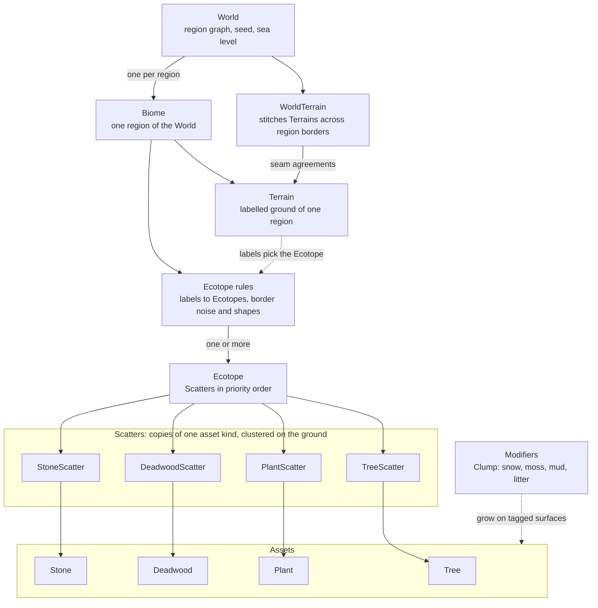
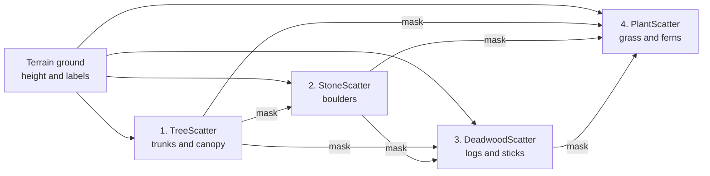

# procgena: architecture and vision

This document describes where procgena is heading: how single assets build
up, level by level, into a whole world. It covers the hierarchy only. Each
level's API, phases and tests live in that level's own plan, linked below.

Everything is in metres, as in the rest of the workspace.

## Bottom line

- **Six levels**, from small to large:
  1. **Asset**: one tree, plant, piece of dead wood or stone. **Modifiers**
     such as clumps grow on top of an asset.
  2. **Scatter**: many copies of one kind of asset, and how they cluster on
     the ground. `TreeScatter`, `PlantScatter`, `StoneScatter`,
     `DeadwoodScatter`.
  3. **Ecotope**: a stack of Scatters in priority order, laid over the same
     ground. Each Scatter can mask the Scatters below it.
  4. **Biome**: one Terrain, plus the rules that map its labelled segments
     to Ecotopes, plus the noise and shapes that break up Ecotope borders.
  5. **Terrain**: the ground of one Biome's area, labelled into segments.
  6. **World**: Biomes stitched together. Its **WorldTerrain** part stitches
     the Terrains alone, without knowing about Biomes.
- **Two stacks meet at the Biome.** The ground stack (World → WorldTerrain
  → Terrain) decides the shape of the land. The cover stack (Ecotope →
  Scatter → Asset) decides what grows and lies on it. A Biome binds one
  Terrain to its Ecotopes.
- **Each level talks to the one below through small, shared interfaces**
  that mostly exist already:
  - `procgena_mesh::Ground` gives a Scatter its ground height and slope.
    Terrain supplies both, so no level below re-derives slope from heights.
  - A density function `Fn(x, z) -> 0..1` thins a Scatter. This is the mask.
  - Terrain labels (`Landform`, `Flags`, `Measures`) pick the Ecotope.
  - `procgena_mesh` tags let modifiers find the surfaces they grow on.
- **Every level stays a pure function** of its options, seed and position,
  as each generator is today. A chunk of the world built alone matches the
  same chunk built in any order.
- **Renames this vision asks for:** `TreeGrove` becomes `TreeScatter`, and
  `PlantField` becomes `PlantScatter`. See "Naming" and "Architectural
  TODOs".

## The hierarchy

Solid arrows mean "contains" or "builds". Dotted arrows mean "reads from".

### How masks flow down an Ecotope

The order shown is only an example. The Ecotope sets the order.

## The levels

Each level says what it is, what it owns, what it gets from the level above,
and where it stands today.

### 1. Asset

**What it is.** One object: a tree, a plant (a tuft or small patch), a piece
of dead wood, a stone. Each comes from its own generator crate, as an
engine-free core plus a Bevy crate.

**What it owns.** Its shape options, presets, seed, levels of detail,
materials and textures. It makes a tagged `procgena_mesh::Object`.

**What it gets from above.** Nothing but a transform. An asset does not know
where it stands.

**Status.** Built: `procgena_tree`, `procgena_plant`, `procgena_deadwood`,
`procgena_stone`, and `procgena_mushroom` (see the open questions on where
mushrooms belong).

#### 1.1 Modifiers

**What they are.** Generators that grow on top of an asset, or on any tagged
mesh, instead of standing on their own: `procgena_clump` (snow, moss, mud,
litter). A modifier changes how an asset looks in place; it is not a new kind
of asset.

**What they own.** Their own options, and a `TagFilter` saying which surfaces
they grow on.

**What they get from above.** The host `Object` and its tags. Later, possibly
Biome or Ecotope settings, such as a snow line or a wetness that drives moss.

**Status.** Clump is built, CPU and GPU ([PLAN-clump-bevy.md](PLAN-clump-bevy.md)).
Deadwood's studio tab already grows clump covers on a single piece.

### 2. Scatter

**What it is.** Many copies of one kind of asset spread over a stretch of
ground, and how they cluster: density per area, spacing, stands and gaps,
the mix of species or variants, and how copies vary in size, lean and footing.

**What it owns.**

- The mix: which assets, and each one's share of the density.
- Clustering and spacing rules.
- Per-copy variation.
- How copies are drawn: instancing, levels of detail, and promoting single
  copies to entities.

**What it gets from above.**

- **Ground**: a `procgena_mesh::Ground` for heights and slope (see "Ground
  carries slope").
- **Mask**: a density function from 0 (none) to 1 (full). It combines the
  Ecotope's own coverage with the masks of higher-priority Scatters.
- **Area and seed**.

**What it gives back.** A mask of its own, for the Scatters below it in the
Ecotope: where its copies stand, and how far their influence reaches.

**Status.**

| Scatter | Today | Notes |
|---------|-------|-------|
| `TreeScatter` | Built as `TreeGrove` ([tree/docs/groves.md](tree/docs/groves.md), [tree/PLAN-tree-grove.md](tree/PLAN-tree-grove.md)) | `GrovePlacement::new` already takes a `Ground` and an optional density function: the mask hook exists. |
| `PlantScatter` | Built as `PlantField` ([plant/PLAN-plant-field.md](plant/PLAN-plant-field.md)) | Has `density_map` and `with_density_from_fn`: the mask hook exists. Placed on the GPU. |
| `DeadwoodScatter` | Partly: `StickScatter` in `procgena_deadwood` | Scatters sticks and twigs over a `Ground`. Needs logs and stumps, and a density input. |
| `StoneScatter` | New | |

### 3. Ecotope

**What it is.** One kind of ground cover with a single character, such as
"pine forest floor", "wet meadow" or "scree slope". It is a list of Scatters
in priority order, all laid over the same ground.

**What it owns.**

- Its Scatters, in priority order.
- How each Scatter masks the ones below it. Examples:
  - Tree trunks clear a disc around themselves.
  - Canopy shade thins grass.
  - Boulders and logs clear the plants under them.
- Its modifier settings, if any, such as moss on everything in a wet forest.

**What it gets from above.** Its area, as a coverage function from 0 to 1
that the Biome works out from Terrain labels and border noise. Also the
ground, and a seed.

**How priority works.** The highest-priority Scatter is placed first, against
the Ecotope's coverage alone. Each later Scatter sees the coverage times the
masks of every Scatter above it. A Scatter never reads a Scatter below it,
so the order alone settles every conflict and nothing loops.

**Status.** New.

### 4. Biome

**What it is.** One area of the world with one climate and character, such
as "temperate forest" or "alpine". It joins one Terrain to the Ecotopes that
cover it.

**What it owns.**

- **Terrain options**: the settings its Terrain is built from.
- **Ecotope rules**: which Ecotope grows on which kind of ground. A rule
  matches Terrain labels: the primary `Landform` (Plain, Bluff, Scree,
  Beach, Riverbed and so on), `Flags` (WET, SNOW, ROAD and so on) and
  `Measures` (slope, height above water, distance to water or road). Several
  Ecotopes can match one segment, with weights.
- **Ecotope geometry**: the noise and shapes that keep Ecotope borders from
  following label borders exactly. Examples: patches of meadow inside a
  forest, ragged edges where scree meets grass, a fringe along a river.

**What it gets from above.** Its region (a polygon from the World), the
World seed and sea level.

**Status.** New.

### 5. Terrain

**What it is.** The ground of one Biome's area: heights, water, roads and
rivers, and labels for every point. "Segmented" means labelled: every point
carries a primary `Landform`, `Flags` and `Measures`.

**What it owns.** Everything in [terrain/plan.md](terrain/plan.md): its
relief, erosion, water, roads, volume features, chunks and meshes.

**What it gets from above.**

- From its Biome: its options.
- From WorldTerrain: its region and its seam agreements with its neighbours.

**What it gives back.** Height, slope (as a gradient or normal) and labels at
any point, and the same as grids per tile.

**Status.** In progress: `procgena_terrain`. One generator fills one region,
which can be bounded or infinite. Today it gives `height`, `water_level`,
`road_tags` and `HeightTile` (heights only). Slope and the planned
`annotate` labels are not exposed yet.

### 6. World

**What it is.** The whole map: a graph of regions, each region one Biome.

**What it owns.**

- The region graph: polygons, shared edges, and corners where three or more
  regions meet.
- Which Biome fills each region.
- World-wide settings: seed and sea level (`WorldContext` in the terrain
  plan).

**Status.** New. The terrain plan calls it "World generator (TBD)".

#### 6.1 WorldTerrain

**What it is.** The part of the World that joins Terrains at their borders.
It runs the terrain seam protocol across the region graph: offers, then
agreements, then each Terrain conforms to its agreements. Rivers and roads
cross borders through the ports those agreements set.

**What it does not know.** Biomes and Ecotopes. It sees regions and their
terrain options, nothing else. So the land can be built and tested alone,
before anything grows on it.

**Status.** The protocol is built inside `procgena_terrain`, with a
reference "stitcher" for tests and examples. WorldTerrain is that stitcher
grown into a real level.

## Interfaces between levels

| From → to | Interface | Exists today |
|-----------|-----------|--------------|
| World → WorldTerrain | Region graph, terrain options per region | Region types in the terrain plan |
| WorldTerrain → Terrain | `Region` and its `EdgeAgreement`s and `CornerAgreement`s | Yes, in `procgena_terrain` |
| Terrain → Biome | `height`, slope and `annotate` at a point; tiles of the same | `height` and height tiles; slope and `annotate` are new |
| Biome → Ecotope | Coverage function from 0 to 1, ground, seed | New |
| Ecotope → Scatter | `Ground` (height and slope), density function, area, seed | `Ground` in `procgena_mesh` gives height only; density functions on groves and plant fields |
| Scatter → Scatter below | Mask: density function from 0 to 1 | New |
| Scatter → Asset | Transform and variant | Yes |
| Modifier → Asset | Host `Object` and `TagFilter` | Yes, in `procgena_mesh` |

## Rules that hold at every level

- **Pure and deterministic.** A level's output depends only on its options,
  its seed, the inputs from the level above, and position. Seeds for lower
  levels are derived from higher ones, so one World seed fixes everything.
- **Chunk-friendly.** Every level can be asked for one chunk without
  building the rest. Masks are local to position, never one global grid,
  so a Scatter chunk needs only the masks over its own area. (Whether a
  mask is a function or a per-chunk grid is open question 3.)
- **Engine-free core, thin Bevy crate.** Each level keeps the house split: a
  core crate with no Bevy, and a Bevy crate for streaming and drawing.
- **Presets at every level.** Each level ships presets made from presets
  of the level below.
- **Metres everywhere.**

## Ground carries slope

Slope is needed at almost every level: Biome rules match on it, Scatters
reject steep spots (`max_slope` on trees), and pieces of dead wood lean to
the cross-slope. Today each consumer works it out again from heights: the
tree scatter samples four points around each trunk, and the stick scatter
samples under each piece. That is several extra height queries per copy,
each of which runs the terrain's whole stack (relief, bending, rivers,
roads).

The terrain knows its slope better than anyone sampling it:

- **Relief** already has an analytic gradient (`relief.gradient`, used for
  the border offers).
- **Bending to the borders** and **carving rivers and roads** are smooth
  blends of known shapes, so their gradients follow by the chain rule. Where
  that is not worth the work, the terrain can take central differences
  itself, at a step that suits its own detail.
- **Tiles** can carry a gradient grid next to the height grid, filled in the
  same pass.

So the plan:

- **`Ground` gains a gradient** (or normal) at a point, with a default that
  takes central differences of `height`. Flat ground, closures and
  `HeightGrid` keep working unchanged; `HeightGrid` can answer from its
  grid.
- **`Terrain` implements `Ground`** and answers slope from its own stages.
- **Labels reuse it.** `Measures::slope` in `annotate` comes from the same
  gradient, so labels and Scatters always agree on what is steep.
- **Footprint checks stay.** A point slope says how steep the ground is at
  a spot. A Scatter that fits a wide object (a log, a broad trunk) still
  samples heights across its footprint to find where the object rests, but
  can reject steep spots first from the slope alone.
- **GPU Scatters** (plants) get slope as a texture from the tile's gradient
  grid, instead of differencing a height texture in the shader.

## Extensibility

Users bring their own assets from the Scatter level up, and every level
has hooks for changing what it makes beyond its options. Three ideas carry
this: **hooks** change how a level generates, **edits** record what
happened in a game, and **queries** read the result.

### Hooks: changing generation in code

Hooks are Rust code only. Presets and files hold options, never hooks; a
level built with hooks is built in code, from a preset or file plus the
hooks added to it.

Every level offers the same three kinds of hook:

| Kind | What it does | Example |
|------|--------------|---------|
| **Replace** | A trait object stands in for a built-in part. | Your own Scatter in an Ecotope; your own Ecotope rule in a Biome. |
| **Inputs** | Adds to what a level reads before it runs: masks, stamps, extra coverage. | Flatten ground for a village; keep every Scatter out of a reserved clearing. |
| **Outputs** | Filters or changes what a level made, item by item. | Drop trees near a path; tint stones by height. |

Hooks follow the same rules as built-in parts:

- **Pure.** A hook's result depends only on its inputs and position, so a
  chunk still builds the same alone or in any order. Hooks are `Send +
  Sync`.
- **Reads only what is built before it.** During generation a hook sees the
  terrain, labels, Ecotope coverage and higher-priority Scatters, never a
  lower-priority Scatter or anything below its own level. This is the
  Ecotope's priority rule applied everywhere, and it is what keeps hooks
  from looping.
- **Keyed.** Rebuilds are found by comparing options, and code can't be
  compared, so each hook carries a key (a name and a version) that the user
  changes when the hook's behaviour changes. The key goes into the level's
  cache hash.
- **Stays inside its own area.** A terrain stamp stays out of the border
  margin, where Terrains meet their neighbours; the terrain's
  `points_of_interest` are the places it leaves for stamps.

What each level lets you hook:

| Level | Replace | Inputs | Outputs |
|-------|---------|--------|---------|
| World | Region graph; Biome choice per region | | |
| WorldTerrain | | Extra seam constraints, such as a road that must cross a given border | |
| Terrain | | Height stamps (flatten, raise, carve) outside the margin | Extra labels |
| Biome | Ecotope rules: your own code over terrain labels | Coverage masks, such as "no forest here" | Ecotope weights per point |
| Ecotope | Your own Scatter at any priority | Masks for all its Scatters | |
| Scatter | Your own asset (see below) | Masks | Per-copy filter and change |
| Asset | | | |

An asset has no hooks of its own: its options are its interface, and
anything beyond them is a new asset.

### Bringing your own assets

Placement is the same for every Scatter; drawing is not. Trees draw through
their own instanced renderer, and plants are built in a shader. So your own
assets come in at two places:

- **Your own meshes** (glTF or a `procgena_mesh::Object`) go into a
  **`MeshScatter`**: a general Scatter that places and draws any meshes
  with levels of detail, masks, promotion and queries, like the built-in
  ones.
- **Your own generator** implements the **`Scatter` trait**: given an area,
  ground, mask and seed, it returns copies with stable ids and the mask it
  leaves for the Scatters below. It sits in an Ecotope like any built-in
  Scatter.

### Edits: what happens in a game

A felled tree, a cleared camp, a player's building: this is game state, not
generation, so it is never a hook. Edits are **data keyed by stable id**,
fed into generation as one more input:

- **Remove** a copy: the tree that was cut down.
- **Replace** a copy: a stump where the tree stood.
- **Reserve** an area: a mask every Scatter below obeys.
- **Stamp** the terrain, with the same limits as terrain hooks.

Edits serialise, so a saved game is the World seed plus its edits. Because
ids are stable, an edit made in one session lands on the same copy after a
reload.

### Queries: reading the result

Queries come in two layers:

- **Core queries** are pure and engine-free. They compute what they need on
  demand, so they also answer for areas that are not loaded:
  - **At a point**: which region and Biome, the terrain's height, slope and
    labels, the Ecotope weights, and the masks.
  - **Copies near a point or along a ray**, at any Scatter level.
  - **Find spots that match a test**: "flat, in forest, 20 m from a road,
    at least 10 m across".
- **Bevy queries** cover what is loaded and drawn: within a radius, ray
  casts against meshes, and promotion. `GroveTrees::within` and
  `GroveTrees::ray_cast` are today's examples.

Every copy a query returns carries a **stable id** that names where it
came from: region, Ecotope, Scatter, and the spot it stands on. The same id
is what edits and promotion use.

Queries obey the same layering as hooks. During generation a hook may only
query what is built before it. Gameplay may query everything, and changes
anything only through edits. For example, finding a clearing for a camp
reads the terrain, labels and Ecotope coverage; reserving it is an edit
that every Scatter then obeys, so the search never depends on what the
reservation changes.

**Promotion** turns a copy into an ordinary entity, as grove trees do
today: the Scatter stops drawing its copy, the entity draws the same mesh
at the same spot, and despawning it hands the copy back. Every Scatter
offers it, through a query result's id.

### User stories

1. **World**: "I draw the region map and pick each region's Biome." Replace
   the region graph and the Biome choice.
2. **Terrain**: "I flatten ground for a village." A height stamp on a
   point of interest.
3. **Biome**: "Ferns grow only within 5 m of a river." An Ecotope rule in
   code over `Measures::water_distance`.
4. **Ecotope**: "My fence posts sit at priority 2 and are masked like the
   others." Your own `Scatter` in the Ecotope's list.
5. **Scatter**: "My hand-made bush is scattered, kept out from under trees,
   and can be promoted." A `MeshScatter` with your glTF.
6. **Gameplay query**: "Click any tree, stone or log to harvest it; tell the
   AI what ground an NPC stands on." A ray cast across Scatters; a point
   query.
7. **Placement query**: "Find a flat clearing in forest, at least 10 m
   across and away from roads, and reserve it." A spot search, then a
   reserve edit.
8. **Persistence**: "A tree I cut down stays cut after a reload." A remove
   edit, saved with the game.

## Naming

- **The level is called Scatter**, and each kind is `<Asset>Scatter`.
  `StickScatter` and `MushroomScatter` already follow this pattern.
- **`TreeGrove` → `TreeScatter`.** "Grove" can stay as the name of tree
  presets (a pine grove, an oak grove), but not of the type.
- **`PlantField` → `PlantScatter`.**
- **`StoneField` keeps its name.** It is the shape field (signed distance)
  of one rock, and no longer collides with anything.

## Architectural TODOs

Ordered roughly by what unblocks what. Each item becomes its own plan when
it starts.

### Renames and alignment

- [ ] **Rename `TreeGrove` → `TreeScatter`** in `procgena_tree` and
  `procgena_tree_bevy`: `GroveTree`, `GrovePreset`, `GrovePlacement`,
  `GroveInstance`, `GroveError`, `TreeGroveParams`, `TreeGroveInstances`,
  `TreeGroveAssets`, `TreeGroveStats`, `GroveTrees`, `PromotedTree`, the
  `.grove.json` format, `tree/docs/groves.md`, the examples, and the
  studio's Tree Grove tab. Wait until the grove work in progress is
  committed.
- [ ] **Rename `PlantField` → `PlantScatter`** in `procgena_plant`:
  `FieldPlant`, `FieldPreset`, the `.grass.ron` loader, `procgena_plant_web`,
  and the studio's field tab.
- [ ] **One shape for every Scatter's inputs.** Ground, mask, area and seed
  are passed the same way in every Scatter crate. Today trees take
  `&dyn Ground` and `Option<&dyn Fn>`, plants take a density image or a
  closure, and sticks take a `Ground` only.
- [ ] **Decide where mushrooms belong** (open question 1), then make
  `MushroomScatter` fit: today it grows on tagged host meshes, which is how
  modifiers work, not how Scatters work.

### Ground slope

- [ ] **Add a gradient to `procgena_mesh::Ground`**, with a default from
  central differences of `height`.
- [ ] **Terrain slope**: an analytic gradient through relief, border bending
  and carving in `procgena_terrain`, `Ground` implemented for `Terrain`, and
  a gradient grid in `HeightTile`.
- [ ] **Scatters use it**: reject steep spots from the slope before any
  footprint sampling, in trees, sticks and stones.

### New Scatters

- [ ] **`DeadwoodScatter`**: grow `StickScatter` to cover logs and stumps,
  and give it a mask input.
- [ ] **`StoneScatter`**: boulders, rocks and pebbles over a `Ground`, with
  clustering and partial burial.
- [ ] **Scatter masks out**: each Scatter reports the mask it leaves for the
  Scatters below it (trunk discs, canopy shade, stone and log footprints).

### New levels

- [ ] **Mask representation** (open question 3): pure functions or per-chunk
  grids. Settle this before the Ecotope crate.
- [ ] **Ecotope crate**: an ordered list of Scatters, mask chaining, presets,
  and a Bevy part that draws one Ecotope over a patch of ground.
- [ ] **Biome crate**: terrain options, Ecotope rules matched on terrain
  labels, border noise and shapes, presets.
- [ ] **WorldTerrain**: grow the terrain crate's reference stitcher into the
  level that runs the seam protocol over a whole region graph.
- [ ] **World crate**: region graph generation, a Biome per region, seed
  derivation for every level below.

### Extensibility

- [ ] **`Scatter` trait**: area, ground, mask and seed in; copies with
  stable ids and a mask out. The built-in Scatters implement it too.
- [ ] **`MeshScatter`**: places and draws any user mesh, with levels of
  detail, masks, promotion and queries.
- [ ] **Hook traits per level**, with keys that feed the cache hash.
- [ ] **World-stable ids**: count spots on a world-anchored lattice and
  prefix them with region, Ecotope and Scatter. Today a grove's spot id is
  its cell counted from the grove's own centre (`site_id` in
  `procgena_tree`).
- [ ] **Edits**: remove, replace, reserve and stamp, keyed by id, with
  serde.
- [ ] **Core queries**: at a point, near a point, along a ray, and spot
  search, at every level.
- [ ] **Bevy queries and promotion** for every Scatter, generalising
  `GroveTrees` and `PromotedTree`.

### Cross-cutting

- [ ] **Streaming**: one chunk grid that every level shares in Bevy, so
  terrain chunks, Ecotope coverage and Scatter copies load and unload
  together.
- [ ] **Seed derivation**: one documented rule for how each level derives
  its children's seeds from its own.
- [ ] **Studio**: a tab per new level (Ecotope, Biome, World), each built on
  the tabs of the level below.

## Open questions

1. **Where do mushrooms belong?** `procgena_mushroom` makes single
   mushrooms (an asset), clusters (a small Scatter), and a scatter that
   grows on tagged host surfaces (like a modifier). Should a ground-standing
   `MushroomScatter` sit next to the others, should mushrooms be a modifier
   on logs and stumps, or both?
2. **Is one Biome always exactly one terrain region?** Or can a large Biome
   span several regions, or a region hold a Biome inside another?
3. **Masks: space and resolution.** Are masks pure functions of position, or
   grids that a Scatter rasterises after placing? Functions are exact and
   chunk-friendly, but a Scatter with thousands of copies is slow to query
   point by point. A grid per chunk, built after placing, may be the
   practical answer. `PlantScatter` places on the GPU, so its masks may need
   to be textures.
4. **What crosses Biome borders?** The terrain seam protocol blends the
   ground. Should Ecotopes also blend across a Biome border (a forest
   thinning into a meadow), or stop at it? If they blend, WorldTerrain's
   `TRANSITION` margin is the natural place.
5. **Can Ecotopes overlap?** When two Ecotope rules match the same ground,
   do they split it by weight, or does one win? Does an Ecotope mask
   another, the way Scatters do inside one Ecotope?
6. **Who owns modifiers?** Is snow and moss set per Ecotope, per Biome
   (from climate), or per Scatter?
7. **Is Terrain a level of its own or part of the Biome?** The list puts
   Terrain (5) below Biome (4), but WorldTerrain builds Terrains without
   Biomes. This document treats Terrain as owned by the Biome for its
   options, and by WorldTerrain for its borders.
