# procgena: roadmap

This document puts the work in [ARCHITECTURE.md](ARCHITECTURE.md) in an
order that respects what depends on what. ARCHITECTURE.md says *where*
procgena is going and lists the work by theme ("Architectural TODOs"); this
document says *in what order*, which pieces can run side by side, and which
decisions must be made before each piece starts. It does not repeat the
design: each milestone links to the TODO items and plans it covers.

Each milestone becomes its own plan when it starts, as ARCHITECTURE.md
asks.

## Bottom line

- **Three tracks run side by side, then meet.**
  - **Foundations**: shared crates, the `procgena_specimen` rename, `Ground`
    with slope, the content hash and specimen id, seeds, the preset
    pattern.
  - **Ground**: finish the terrain, give it slope and labels, then
    WorldTerrain, then its mesher and Bevy crate.
  - **Cover**: align the Scatters, give them one trait and world-anchored
    ids, then build the Ecotope.

  They meet at the **Biome**, then the **World**, then **streaming**.
- **Bare worlds come early.** A Biome with a Terrain and no Ecotopes (an
  **empty Biome**) is valid, so the Biome type and a World of bare land
  (milestones B0 and W0) follow straight on from WorldTerrain, long before
  the Ecotope. The full Biome and World then add cover to types that
  already exist. WorldTerrain gives the land; the World chooses which
  Biome fills each region (decided 2026-11-23).
- **The spine** is: land the work in flight → shared crates with `Ground`
  slope → aligned Scatters → GPU-mask research → `Scatter` trait, masks
  out and world-anchored ids → **Ecotope** → **Biome** → **World** →
  streaming. An early Ecotope (C3a) runs ahead of the `Scatter` trait,
  so Scatters can be combined and looked at long before the spine reaches
  the full Ecotope (moved forward by the user, 2026-11-24).
- **The terrain is the likely long pole.** Slope, labels (Phase 5) and the
  heightfield mesher and Bevy crate (Phases 7 and 8) are built; Phase 3's
  landforms, Phase 4's bridges, lakes (LK), volume patches (Phase 6) and
  exports (Phase 9) are not.
- **The first Ecotope needs no Terrain.** Two or more Scatters with masks in
  and out, on a `HeightGrid` or `FlatGround`, are enough to prove mask
  chaining. That keeps the cover track from waiting on the terrain.
- **The largest item is off the spine.** GPU *building* for tree, deadwood
  and mushroom (rule 1) can run at any time after the shared crates. GPU
  *placement* and masks (open question 1) is on the spine, as a research
  gate (D2), then built as milestone GP after C3, ahead of streaming.
- **The Ecotope profile sets the GPU order** (2026-11-24,
  [docs/decisions/ecotope-gpu.md](docs/decisions/ecotope-gpu.md)). The goal
  stays GPU everywhere. Stone building is about 94% of the CPU work
  (provisional, measured on a loaded machine), and placing copies is under
  20 ms in the studio. So the order is:
  - ED (cheap Ecotope draw wins) and R3a (stone's existing GPU mesher)
    first;
  - then R3's deadwood, mushroom and tree;
  - then GP, whose payoff comes with streaming.
- **Decisions are gates.** Each gate (D1–D6, see "Decision gates") sits
  just before the first work it blocks, not all up front.
- **Two churn windows.** The crate rename and the preset and file rewrite
  each touch every crate and rebuild most of the workspace. Each runs once,
  in a wave of its own, with everything that touches the same code
  batched into it.
- **Canonical ground and roads** (2026-11-25): a road builder redesign
  (RB) and a canonical, feature-constrained ground mesh (CT). The road
  wins that need no new representation (RB0–RB3) start at once. The rest
  waits on gate D6. The track stays off the spine.
- **Open decisions** for the user, with their context, are listed under
  "For the user" at the end, most urgent first.

## The dependency graph

Arrows mean "must be done first". Hexagons are decisions. Bold outlines
mark the spine.

```mermaid
flowchart TD
    M0["M0 Land in-flight work"]

    D1{{"D1 Crate names, YAML crate, coordinates (OQ 8)"}}
    D2{{"D2 GPU masks and placement (OQ 1), chunk reach (OQ 6)"}}
    D3{{"D3 Stable keys (OQ 4, 5), slot choice"}}

    F1["F1 Shared crates, specimen rename, Ground slope"]
    F2["F2 Content hash, SpecimenId, seed hashing"]
    F3["F3 Presets, YAML files, default_seed, Scatter renames"]

    G1["G1 Finish terrain 2.8"]
    G2["G2 Terrain as Ground"]
    G3["G3 Terrain phases 3 and 4"]
    G4["G4 Terrain labels: phase 5"]
    G5["G5 WorldTerrain W1 to W4"]
    G6["G6 Terrain volume, mesher, Bevy, studio: phases 6 to 10"]

    C1["C1 Aligned Scatter inputs, new Scatters"]
    C2["C2 Scatter trait, masks out, world ids"]
    C3a["C3a Early Ecotope, in procgena_biome"]
    C3["C3 Ecotope"]

    R1["R1 Shared LOD, dither, quality"]
    R2["R2 Shared renderer and specimen cache"]
    R3["R3 CPU and GPU building, plant alignment"]
    R4["R4 Promotion and Bevy queries"]
    I1["I1 Impostors per specimen"]
    I1b["I1b Fruit as an attached asset"]
    I2["I2 Impostors prepared per Ecotope"]

    B0["B0 Empty Biomes"]
    W0["W0 World of bare land"]
    B1["B1 Biome with Ecotopes"]
    W1["W1 World with cover"]
    S1["S1 Streaming"]
    X1["X1 Edits, interaction, queries, hooks, MeshScatter"]

    GM0["GM0 Ground materials: engine-free model"]
    GM1["GM1 Ground colours drawn"]
    GM2["GM2 Ground textures"]
    GM3["GM3 Ground on measures and labels, Biome base ground"]
    GM4["GM4 Ground over Ecotope coverage and borders"]
    GM5["GM5 Far grass and forest tints"]

    TE1["TE1 Stop wasted terrain work"]
    TE2["TE2 First picture fast"]
    TE3["TE3 Content-keyed stage cache"]
    TE3b["TE3b Chunk reuse by footprint"]
    TE4a["TE4a Relief bands"]
    TE4b["TE4b Per-tier border negotiation"]
    TE5["TE5 Road planning revamp"]
    TE6["TE6 River speed"]
    TE7["TE7 Intermediate terrain detail levels"]
    GPU1["GPU1 Relief preview on the GPU"]
    GPU2["GPU2 Ground weights on the GPU"]

    D5{{"D5 World and Biome scale"}}
    D6{{"D6 Canonical ground: numeric profile, authority, region constraints"}}

    RB0["RB0 Road baseline and corpus"]
    RB1["RB1 Cheap road search wins"]
    RB2["RB2 Shared reverse cost field"]
    RB3["RB3 Linear-time vertical alignment"]
    RB4["RB4 Canonical road network"]
    RB5["RB5 Cross-sections and earthworks"]
    CT0["CT0 Numeric profile, canonical mesh types"]
    CT1["CT1 Chunk edge contracts, chunk CDT"]
    CT2["CT2 Adaptive refinement"]
    CT3["CT3 Rivers, ponds, stamps in the ground"]
    CT4["CT4 Roads in the ground"]
    CT5["CT5 TIN products and streaming"]
    G7["G7 Scale-aware terrain lengths"]
    RS["RS Region size and shape"]
    LK["LK Lakes"]
    IX["IX Impostor-heavy experiment"]
    IX2["IX2 Impostors that ignore quality"]
    FF["FF Far field to the horizon"]
    ED["ED Ecotope draw speed"]
    R3a["R3a Stone GPU building in the Ecotope"]
    GP["GP GPU placement and masks"]

    ST0["ST0 Studio shell"]
    ST1["ST1 Settings metadata, Inspector"]
    ST2["ST2 Saving presets, project folder"]
    ST3["ST3 Library and Outline"]
    ST4["ST4 Capture and thumbnails"]
    ST5a["ST5a Picking by tags"]
    ST5b["ST5b Picking by part paths"]
    ST6["ST6 Texture library"]
    ST7a["ST7a Problems, overlays, stats"]
    ST7b["ST7b Viewing distance"]
    ST8["ST8 Export and commands"]
    ST9["ST9 Studio later"]

    M0 --> F1
    D1 --> F1
    D1 --> F3
    F1 --> F2
    F1 --> F3
    M0 --> F3

    M0 --> G1
    F1 --> G2
    G1 --> G3
    G2 --> G4
    G3 --> G4
    M0 --> G5
    G3 --> G6
    G4 --> G6

    F1 --> C1
    C1 --> C2
    F2 --> C2
    D2 --> C2
    D3 --> C2
    C1 --> C3a
    F3 --> C3a
    B0 --> C3a
    C3a --> C3
    C2 --> C3
    F3 --> C3
    D2 --> D3

    F1 --> R1
    R1 --> R2
    F2 --> R2
    F1 --> R3
    F2 --> R3
    F3 --> R3
    R2 --> R4
    C2 --> R4
    R1 --> I1
    F2 --> I1
    I1 --> I2
    C3 --> I2
    F1 --> I1b
    F2 --> I1b
    D3 --> I1b
    R1 --> I1b
    I1 --> I1b

    M0 --> B0
    B0 --> W0
    G5 --> W0
    F2 --> W0
    D3 --> W0

    B0 --> B1
    C3 --> B1
    G2 --> B1
    G4 --> B1
    B1 --> W1
    W0 --> W1
    D3 --> W1
    W1 --> S1
    G6 --> S1
    R2 --> S1
    I2 --> S1
    C2 --> X1
    R4 --> X1
    B1 --> X1

    G6 --> GM0
    GM0 --> GM1
    GM1 --> GM2
    GM1 --> GM3
    G4 --> GM3
    GM3 --> GM4
    B1 --> GM4
    W1 --> GM4
    GM1 --> GM5
    R3 --> GM5
    S1 --> GM5

    G6 --> TE1
    TE1 --> TE2
    TE2 --> TE3
    F2 --> TE3
    TE3 --> TE3b
    TE3 --> TE4a
    TE4a --> TE4b
    G6 --> TE5
    TE2 --> GPU1
    GM1 --> GPU2
    G4 --> GPU2

    D5 --> G7
    D5 --> W0
    G7 --> RS
    G6 --> TE6
    G6 --> TE7
    IX --> IX2
    IX --> FF

    TE5 --> RB0
    RB0 --> RB1
    RB1 --> RB2
    RB1 --> RB4
    RB3 --> RB4
    D6 --> RB4
    RB4 --> RB5
    D5 --> D6
    D6 --> CT0
    CT0 --> CT1
    CT1 --> CT2
    CT2 --> CT3
    CT3 --> CT4
    RB5 --> CT4
    CT4 --> CT5
    I1 --> IX
    I1b --> IX
    C3a --> ED
    R2 --> R3a
    C2 --> GP
    C3 --> GP
    R2 --> GP
    R3 -- "P3, P4" --> GP
    D2 --> GP
    GP --> S1

    I1b --> ST0
    ST0 --> ST1
    ST0 --> ST2
    ST1 --> ST3
    ST2 --> ST3
    ST0 --> ST4
    I1b --> ST4
    ST3 --> ST5a
    R4 --> ST5a
    X1 --> ST5b
    ST2 --> ST6
    ST3 --> ST6
    ST4 --> ST6
    GM1 --> ST6
    ST1 --> ST7a
    IX --> ST7b
    ST0 --> ST7b
    ST0 --> ST8
    ST4 --> ST8
    B1 --> ST9
    W1 --> ST9

    classDef spine stroke-width:3px
    class M0,F1,C1,D2,C2,C3,B1,W1,S1 spine
```

The graph has no cycles: every arrow points from an item to one described
later in this document (the gates first, then the milestones in order).

## Decision gates

Each decision is made, with the user, before the first milestone it
blocks. Until then, nothing that depends on it starts.

| Gate | Decides | Blocks | Notes |
|------|---------|--------|-------|
| D1 | Names of the engine-free core crate and the shared Bevy crate; the YAML crate; whether `Ground` takes chunk-local `f32` or World `f64` coordinates (open question 8) | F1 (names, coordinates), F3 (YAML) | Decided 2026-11-23 ([docs/decisions/D1.md](docs/decisions/D1.md)): `procgena_core` and `procgena_core_bevy`, core at the bottom, `serde-saphyr` 2.2 (added in F3), `Ground` on World `f64` positions with `height`, `gradient` and `sample`. |
| D2 | **Masks on the GPU** (TODO, open question 1): how masks live on the GPU and how Scatters place there; tree's lattice or plant's blue-noise tiles; each Scatter's reach across chunks, and how grove spacing stays chunk-local (open question 6) | C2, D3 | Research and design decided 2026-11-23 ([docs/decisions/D2.md](docs/decisions/D2.md), "Masks and placement" in ARCHITECTURE.md). The GPU spike passed on an M1 Max (parity, build order, the stack budget with window B); a timing run on a low-end integrated GPU and on a discrete GPU is still owed. |
| D3 | Stable named keys for Scatters and Ecotopes, instead of list positions (open question 4); a Terrain id distinct from its Biome's (open question 5); jump or rendezvous hashing for slots; hook keys in the specimen id (open question 7); addresses | C2 (ids), W0 (Biome and Terrain seeds), W1 (budget) | Decided 2026-11-23 ([docs/decisions/D3.md](docs/decisions/D3.md)): frozen `ChildKey`s with no aliases; seeds chained World → region's Biome → Ecotope → Scatter; the Terrain's noise on the World seed plus sibling region seeds for the Terrain and the Biome; `priority` on one World-wide scale; rendezvous slots with `N` ≤ 256 and no excluded slots; no hook keys (pool id = generator kind plus options hash); integer `CopyAddress` plus pinned part paths, with batched `resolve`; groups addressed where they are defined. It also decided that each region has its own Biome instance, seeded per region (corrected 2026-11-24: neighbours never share an instance but may share a Biome type), which opened D4. |
| D4 | **Region size and shape** (world_plan open question 2): how large regions are, and whether they are even or a multi-scale mix | Nothing now | **Settled by milestone RS** (the user, 2026-11-25): region size is a World setting, regions can be about 1 km, and larger Biome areas are same-preset neighbours with invisible borders (see RS and the world-generation plan). Research record: [docs/decisions/D4.md](docs/decisions/D4.md). |
| D5 | **World and Biome scale:** how a World sets its scale, from Minecraft-like to Valheim-like and the large open-world games (required), up to real-life (a stretch goal) | G7 (scale-aware terrain lengths), and W0's scale pair and class presets (built at scale 1; its image examples tune the class numbers) | Mechanism decided by the user 2026-11-24 ([docs/decisions/D5.md](docs/decisions/D5.md)): a World scale pair `{ horizontal, vertical }` stretches landscape lengths (Terrain presets written at scale 1, E, selector fields), with only E's background slope limit checked (cliffs and relief are not capped); World presets per class; objects, road and river widths, chunks, LOD and masks never scale; no landscape length fixed in metres; huge Biomes from many same-type regions. Scale 1 is the Valheim-like medium-small class and the default World (the user, 2026-11-24): small 0.5, medium 2, large 6 × 4, real-life 20 × 8; the earlier presets are test fixtures. Draft: the other class numbers. Open: a World-level river-size field, whether the bank reach scales (the rest of the region floor is settled by RS), Ecotope geometry, floating origin. |
| D6 | **Canonical ground** (opened 2026-11-25 by the reviews of the road and TIN plans): D6a the deterministic profile (cross-platform bitwise with pinned maths, or same-platform first); D6b what is authoritative at a distance (TIN, `H*`, or `H*` for placement and labels with the TIN for physical ground); D6c whether region borders are mesh constraints; D6d coordinate units and range | CT0 and RB4, and everything after them. RB0–RB3 are not gated | **Decided 2026-11-25:** same-platform bitwise first; `H*` for spots, masks, slope and labels with the TIN for collision and near rest heights; chunk borders only; integer millimetres (`i64` x/z, `i32` heights). Details under "D6 (gate)". |

Questions that wait for later milestones, and are decided inside them:
open questions 2 (Ecotope overlap, in C3), 9 (far copies on coarse
terrain, in S1) and 10 (state of promoted copies, in X1). Open question
3 (wide assets) was decided in C1, with D3's addresses, and 7 (hook keys)
in D3.

## Churn windows

Two milestones rewrite code in every crate. While one is running, other
agents' work in the same files stalls or conflicts, and every agent
rebuilds Bevy. Each runs in a wave of its own.

- **Window 1 = F1.** The crate move and rename, the type renames, `Ground`
  moving into the core crate with its settled coordinates, and `Ground`
  gaining slope, in one change, as ARCHITECTURE.md asks. Shared hashing
  and random numbers move first.
- **Window 2 = F3.** Preset structs and catalogues, YAML files,
  `seed` → `default_seed`, and the `TreeGrove` → `TreeScatter` and
  `PlantField` → `PlantScatter` renames. The renames change file formats
  (`.grove.json`, `.field.ron`) that F3 rewrites anyway, so they go
  together. F3 lands before C2, which reworks the same grove types.

Before each window: every in-flight change is committed, and the user
confirms no other agent is active. No compatibility shims are kept for old
names or file formats.

## Milestones

Each milestone lists what it covers, what it needs, and what you can see
when it is done. "TODO" names an item under "Architectural TODOs" in
ARCHITECTURE.md.

### M0: Land the work in flight

**Done 2026-11-23.**

- **Covers:** commit the tree impostor and grove-loading work, the
  `procgena_impostor` crate, deadwood's leaf cards, mushroom's whole-growth
  change and terrain Phase 2.8 as far as it goes. Tick Phase 2.5 in
  [terrain/plan.md](terrain/plan.md). Review terrain Phases 1–2.8 with the
  user (see "For the user").
- **Needs:** nothing.
- **Done when:** the coordinator's full suite passes on a clean tree.
  Both churn windows can then start from a committed base, and TODO
  "Rename `TreeGrove` → `TreeScatter`", which waits for the grove work, is
  unblocked.

### Foundations track

#### F1: Shared crates, specimen rename, `Ground` slope (churn window 1)

**Done 2026-11-23** (merged at `6055455`; full suite green except plant
goldens, which have no baseline on this machine).

- **Covers:** TODOs "Shared crates", "Rename `procgena_mesh` →
  `procgena_specimen`" and "Add a gradient to `Ground`". Shared hashing,
  seeds and random numbers move first (clump drops its copy of stone's).
  Mushroom's local tags move into `procgena_specimen::tags` (first half of
  TODO "Tags"). Per D1: F1 creates only `procgena_core` (the Bevy crate
  waits for R1), moves `mesh/` to `specimen/crates/procgena_specimen`,
  and moves only stone's and clump's random numbers. Tree's, deadwood's
  and mushroom's wait for F2. `ChunkFrame` waits for C2.
- **Needs:** M0, D1 (crate names, coordinates).
- **Done when:** every crate builds on `procgena_specimen` and the core
  crate, `FlatGround`, `HeightGrid` and closures answer slope, and the full
  suite passes.

#### F2: Content hash, `SpecimenId`, seed hashing

**Done**, except plant's content hash, which waits for R3.

- **Covers:** TODO "Content hash" for every options type (tree's `tree_id`
  is the model), replacing the JSON-string cache keys in stone, deadwood and
  mushroom and adding one to plant and clump. The options hash and the
  `SpecimenId` type from TODO "Specimen budget" (the budget itself waits
  for W1); open question 7 was decided in D3 (no hook keys; the pool id
  is the generator kind plus the options hash). The one shared seed function
  (parent seed plus child id) from TODO "Seeds from outside". Variants
  seeded by one shared function instead of four (rule 4).
- **Needs:** F1. Additive per crate, so each crate can be a separate worker
  once the core crate holds the hash.
- **Done when:** each options type has a stable hash tested across runs,
  and each generator's cache is keyed by its `SpecimenId`.

#### F3: Presets, YAML files, `default_seed`, Scatter renames (churn window 2)

**Done 2026-11-23.** Left: plant implementing core's `Preset` trait (see
the follow-ups).

- **Covers:** TODO "One preset and file pattern" (rule 10), the `seed` →
  `default_seed` half of "Seeds from outside", TODOs "Rename `TreeGrove` →
  `TreeScatter`" and "Rename `PlantField` → `PlantScatter`", and the
  scatter file kind from "Decisions to make". Serde on every Scatter's
  options.
- **Needs:** F1, M0, D1 (YAML crate).
- **Done when:** every preset is a struct in a catalogue, every file is
  `.<kind>.yml` with a `base` plus differences, and the studio loads them.

### Ground track

#### G1: Finish terrain Phase 2.8

- **Covers:** the planned rest of Phase 2.8 in
  [terrain/plan.md](terrain/plan.md) (valleys from the distance to the
  river, stream-power profiles). Deep cuts from breached hollows wait for
  lakes (LK), as the user decided.
- **Needs:** M0.
- **Done when:** the Phase 2.8 exit measurements are recorded.
- **Status (2026-11-24): done, as a first cut.** Valleys were already
  built. Drainage area (per region, carried along rivers) and the
  steady-state stream-power profile are built as measurements, and the
  exit measurements are in plan.md ("As built in G1"). No height changed.
  Left for the user: river levels, widths and types from drainage area
  (stream-power levels would cut up to 176 m deeper in mountains, so they
  need lakes or ground that conforms to the river first).

#### G2: Terrain as `Ground`

- **Covers:** TODO "Terrain slope": an analytic gradient through relief,
  border bending and carving; `Ground` implemented for `Terrain`; a
  gradient grid in `HeightTile`.
- **Needs:** F1 (`Ground` has slope, in its settled coordinates).
- **Done when:** a grove planted directly on a `Terrain` matches its
  analytic slope against central differences, and the seam suites still
  pass.
- **Status (2026-11-24): done.** `Terrain` implements `Ground`
  (`Terrain::sample`, `Terrain::gradient`), `HeightField::sample` and
  `HeightTile::gradients` carry the gradient. Analytic through relief
  (noise derivatives, erosion through the noise's second derivatives),
  fade, border bending and carving; the border's and fade's pulls are
  differenced 0.5 m apart in f64. Heights are bit-identical to before.
  Test `tests/ground.rs` (`a_grove_on_a_terrain_matches_its_slope`): worst
  error 1.1e-3 against central differences over 4 m spans.

#### G3: Terrain Phases 3 and 4

- **Covers:** Phase 3 (options and presets as data, base relief,
  landforms, analytic erosion) and Phase 4 (rivers, roads, bridges).
  Lakes are milestone LK.
- **Needs:** G1. Not `Ground` or slope.
- **Done when:** Phase 3's landforms and Phase 4's rivers, roads and
  bridges are built, and the feature suites pass with them.
- **Terrain features:** steps 1 and 2 of
  [terrain/features_plan.md](terrain/features_plan.md) (one feature type,
  staged planning, one sample path, benchmarks) come first in G3, before
  Phase 3's landforms and Phase 4. Step 2's sample path is where G2's
  gradient and G4's labels live; see the review's "Milestone order" for
  which goes first. Planning stays per region (macro cells were dropped
  by the user, 2026-11-25).
- **Status (2026-11-24):** steps 1 and 2 are built, with results
  unchanged: one feature type and index, stable ids, a river trace shared
  by offers and build, roads as a stage of their own
  (`Terrain::with_roads`), one sample path (`Terrain::query`), and cold
  and warm benchmarks (plan.md, "Terrain features"). Roads are most of a
  cold region plan (p95 1.6 s); without them p95 is about 0.4 s. Phase
  3's landforms and Phase 4 are next.

#### G4: Terrain labels (Phase 5)

- **Covers:** TODO "Terrain labels": classification, `annotate(x, z)` with
  `Landform`, `Flags` and `Measures`, and labelled `HeightTile`s.
  `Measures::slope` comes from G2's gradient.
- **Needs:** G2, G3. Non-water labels need only Phase 3, so if the Biome
  needs labels sooner, they can land before lakes and water labels follow.
- **Done when:** an image example shows labelled regions.
- **Split (decided by the user 2026-11-24, for ground materials):**
  **G4a** adds `Measures` to `Terrain::query` first (water and road
  distance, height above water, curvature, from the feature index), so
  ground rules (GM3) and Biome rules can use them early. **G4b** adds
  `Landform`, `Flags` and labelled tiles. See
  [docs/decisions/ground-materials.md](docs/decisions/ground-materials.md).
- **Status (2026-11-24): G4a built.** `Terrain::query(p, SampleDetail)`
  gives `Measures` at `SampleDetail::Measures`: slope (sine of the
  angle, from G2's gradient), curvature (4 m stencil on the carved
  ground), height above the nearby water (surfaces mixed by nearness),
  and water and road distance from the feature index, capped at
  `MEASURE_REACH` (40 m, `BANK_REACH`; height above water within
  `WATER_HEIGHT_REACH`, 30 m). The cap keeps the measures per
  region: every feature within 40 m of a border is known to both sides,
  since own features stay `FEATURE_CLEARANCE` from borders and crossing
  pieces are shared. Longer reaches need the neighbours' features (a
  World-level follow-up). Tests in `tests/measures.rs`, images from
  `--example measures_dump`. The relief height (`GroundSite::relief_height`)
  is not filled: see the G4a report. G4b is next.
- **Status (2026-11-25): G4b built.** `Terrain::annotate(p)` (and
  `SampleDetail::Labels` on `query`, `WorldTerrain::annotate`, the
  `LabelField` trait, `HeightTile::sample_labelled`) gives `Labels`: one
  `Landform` (plain, slope, cliff, ridge, peak, valley, basin, riverbed,
  pondbed, road, riverbank, shore), each with a name and a colour, and
  `Flags` (underwater, river, pond, road, road bank, wet). Water and
  roads come first, then cliffs (55°), banks, then shape from the
  height's principal bends on a 3 × 3 stencil, then slope (20°). The
  shape step and bend threshold follow the World's scale (12 m and
  0.012 /m at scale 1, chosen by the user as 24 m and 0.006 /m on the
  medium worlds): the World's `WorldScale` now reaches the terrain crate
  (`WorldTerrainOptions::scale`, `Terrain::with_scale`), default 1. Labels
  from water and roads, and the flags, agree exactly across borders;
  shape labels may differ in a thin strip along borders (2.9% of border
  points on the medium test worlds; accepted by the user 2026-11-25, see
  ARCHITECTURE "4.2 Terrain"). No label needs relief height
  (item 31). Hill, mountain and plateau labels (a 150 m relief ring)
  would need the neighbours' ground at World level. Tests in
  `tests/labels.rs`, images from `--example labels_dump`.
- **Follow-up:** Gully label, separate from Valley by scale (user,
  2026-11-25; parked). Tried briefly: a second, narrow stencil (4 m at
  scale 1, 8 m at medium, to match the carved valley-wall gullies 40 m
  and 20 m apart) concave past its own threshold, taking precedence over
  the broad shape but not over water, roads, cliffs or banks. It costs 8
  more heights per labelled sample. Not judged on maps or border numbers
  before it was parked.

#### G5: WorldTerrain (W1–W4)

- **Covers:** [terrain/world_plan.md](terrain/world_plan.md) phases W1
  (world elevation E and its height bumps), W2 (region graph, which can
  run beside W1), W3 (border warp), W4 (`WorldTerrain` with its region
  cache and `TerrainSource`) and W6 (image example and drainage
  measurement, with a closure source). TODO "WorldTerrain". W5 moved to
  W0.
- **Needs:** M0. W1 needs only Phase 2.5, which is built, so G5 doesn't
  wait for G1. Region size and shape (RS) come later and change the
  graph's merge rule and warp, not W4's region cache.
- **Done when:** a lattice world of many regions builds on demand from a
  closure source, and the seam suites pass on warped borders.
- **Status (2026-11-24):** W1–W3 and W3b are built. W3b skips border pulls
  that can't reach and uses a faster far integral, 10–17% quicker with
  bit-identical heights. Shared border nodes were measured (at most about
  10% gain) and not built. Warped borders still cost about 2.7× straight
  ones, from their piece count; that is left for the performance sweep.
  **W4 is built (2026-11-24):** `WorldTerrain` builds a lattice world's
  regions on demand from a `TerrainSource` closure, caching each region's
  settings, plan (converged generator and offers) and terrain; its seams
  pass on warped borders on flat, tilted and curved land, and its centre
  region matches a `StitchedWorld` of the same polygons bit for bit. The
  region size check moves to RS; the equal preset offsets are item 11
  (deferred, blocking nothing). W6 (image example and drainage
  measurement) is next.

#### G6: Terrain volume, mesher, Bevy crate and studio (Phases 6–10)

- **Covers:** Phase 6 (SDF and volume features), 7 (chunk mesher, after the
  Transvoxel licence check), 8 (`procgena_terrain_bevy`), 9 (exports) and
  10 (textures and the studio's Terrain kind).
- **Needs:** G3 (Phase 6), G4 (Phase 7 splits meshes by label). Phase 8
  sets the one chunk grid (64 m, doubling per level) that streaming uses.
- **Done when:** the studio shows Terrains, and a viewer streams terrain
  chunks around a camera.
- **Decided 2026-11-23:** Phases 6 and 7 mesh a heightfield by default,
  with volume patches only for caves and overhangs, and rock outcrops are
  meshes the terrain builds. See
  [terrain/features_plan_review.md](terrain/features_plan_review.md),
  "Decisions".
- **Status (2026-11-24): heightfield part built.** Chunk meshes on the
  shared grid with crack-free level transitions, feature tiers (rough and
  fine; far chunks and a coarse first load use the rough tier, with
  skirts sized by how far each tier moves the ground), loading progress
  through a hook, water surfaces (`procgena_terrain`, `src/chunk.rs`;
  plan.md "Chunks and meshing", "As built"); `procgena_terrain_bevy`
  streams them around the camera with a slope- and height-coloured
  material, a cull-distance dither and a chunk-level debug overlay, with a
  headless viewer; the studio edits Terrains (presets, `.terrain.yml`
  save and load, seed, every setting). Labels (G4b) and textures (GM2,
  which took over Phase 10's textures) are built since. Not done: Phase 6
  volume patches, parts by label, and exports (Phase 9).

#### G7: Scale-aware terrain lengths

From D5 (decided by the user 2026-11-24; see
[docs/decisions/D5.md](docs/decisions/D5.md)).

- **Covers:** every landscape length in the terrain crate that is fixed in
  metres today (fades, margins, ramps, clearances, the region-size floor)
  derived instead from the World's scale pair and the local size; noise
  octaves scaled with their wavelength; the border, seam and feature
  suites re-run at the small and large scale classes. Object sizes, road
  and river widths, chunks, LOD and masks never scale. Terrain presets
  are written at scale 1, the medium-small (Valheim) class since
  2026-11-24; until G7 lands, the medium, large and real-life classes
  build those Valheim-sized presets on their larger regions.
- **Needs:** D5. Runs before or with W0.
- **Churn:** it changes terrain results everywhere, so it runs in a wave
  where no other terrain work is in flight.
- **Done when:** the seam and feature suites pass at the small, medium
  and large classes, and the region floor follows from scale (about
  1.4 km with today's fixed widths; see D5's "floor tension").
- **Started in G4b (2026-11-25):** the scale pair now reaches the terrain
  crate (`WorldScale` moved to `procgena_terrain` and re-exported by
  `procgena_world`; `WorldTerrainOptions::scale`; `Terrain::scale`).
  Only the labels read it so far.

#### RS: Region size and shape

Decided by the user 2026-11-25; it settles gate D4. Each region holds
one Biome instance. A larger Biome area is not a thing of its own: it is
what appears where neighbouring regions pick the same Biome preset, and
[docs/procgena-world-generation-plan.md](docs/procgena-world-generation-plan.md)
(the guide for how regions and Biomes relate) makes the borders between
them invisible. The goal is regions that can be smaller (about 1 km,
against 4 km² today) and more varied in shape, set directly at the World
level.

- **Today:** `regions.size` is already a World setting, floored at
  1.95 km. The floor is 5 × the minimum edge (390 m), and the minimum
  edge does two jobs: it merges short borders away (shape), and it
  guarantees room for a river or road crossing 195 m clear of each
  corner (features). The 5× ratio is a guard chosen in W2, not measured.
- **Decided:**
  - **Merge as far as it goes.** Drop the 5× rule. Short borders merge
    by a share of the region size, so merging scales with it. Settings
    are refused only when an outline crosses itself or is degenerate (a
    sliver), checked directly; a sweep test over size, jitter, warp and
    seed finds the real limit. Regions losing borders or getting
    irregular outlines is wanted.
  - **No compound regions.** Regions are never merged into larger
    addressable units; elongated or irregular Biome areas come from
    same-preset neighbours meeting across invisible borders.
  - **Stronger border warp** on borders between different Biomes or
    Terrains: larger amplitude and a second, longer wavelength on the
    existing border wiggle, so borders meander, limited only by the
    self-crossing check. Borders between same-Biome, same-Terrain
    regions stay straight, as the world-generation plan specifies.
  - **Rivers and roads on small regions:** revisit whether they can
    cross smaller regions (for example, sizing the crossing clearance
    from the widest river or road this World's presets make, not a fixed
    worst case). Where they can't, they don't go there; that is
    acceptable. Short borders simply carry no crossing.
- **Also covers:**
  - the fixed 500 m corner and road ramps and the border wiggle scaled
    with region size (shared with G7);
  - the World view's readout: the floor this World allows, and the
    measured Biome areas in km² (smallest, median, largest) from the
    Biome map;
  - selector-field wavelengths set as "typical Biome area" in km².
- **Needs:** nothing blocking; runs with or after G7, in a wave with no
  other terrain work in flight (it changes results everywhere).
- **Done when:** a World with 1 km regions builds with clean outlines,
  the seam, feature and shipped suites pass on it, rivers and roads
  either cross or avoid small regions without broken carving, and the
  studio shows the measured Biome areas.

#### LK: Lakes, with rivers flowing in and out

Decided by the user 2026-11-25. LK owns lakes. Today a river that
reaches a hollow cuts through its lowest rim by up to `breach` metres
(about 32 m in mountains), which leaves deep trenches (31% of mountain
river points are cut more than 10 m), and stops in a small pond only
where the rim is higher still. Instead, when a river can't cut through a
small rise, it floods the hollow until it finds a way out or reaches its
limit.

**Tentative design** (agreed by the user 2026-11-25; a more efficient
algorithm may replace it):

- **A small breach first.** A river may still cut through a low rim, but
  only by a few metres (`breach` made much smaller). Anything deeper
  floods, so most of today's trenches become lakes.
- **Fill upwards from the hollow's floor** (a bounded priority flood): a
  queue of the lake's edge cells by ground height. The lowest edge cell
  at or above the water raises the water to its height and joins the
  lake. A cell below the water means the flood has gone over a saddle:
  a candidate outlet.
- **What counts as a way out.** From the far side of the saddle, walk
  downhill for a bounded number of steps:
  - reaching ground that drains (an existing river, a border port, the
    sea, or ground at least `D` metres below the lake) is an outlet: a
    new river starts at the saddle and is traced onward;
  - bottoming out in a shallow dip (floor less than `D` below the lake)
    is more lake: the dip joins it and flooding continues;
  - bottoming out in a deep, separate hollow is a short river into it,
    and that hollow floods as its own lake, giving chains of lakes.

  `D` is a few metres, scaled with the World's `vertical`.
- **Limits:** the lake's area (the "lake size" setting, in m², scaled
  with the World; it also replaces the escape search's fixed 4,096-cell
  limit), its rise above the inflowing water, and the region's border
  clearance (lakes stay inside their region for now). A limit reached
  before an outlet leaves a **terminal lake** with no outflow, where the
  river ends.
- **Stays analytic:** every lake's work is bounded by its limits, and
  everything is per region; no iteration over the World and no
  simulation.
- **Lakebed:** a new label (`Landform::Lakebed` or a flag), carved below
  the water level across the whole flooded area, with shores labelled as
  today. Ground materials and the segmentation overlay pick it up.
- **Still to settle when it starts:** the defaults for `D`, area and
  rise; lake depth and bed shape below the water; whether small ponds
  remain as their own feature; lakes shared across region borders
  (later).
- **Needs:** nothing blocking; keeps to the river, plan and carve files,
  so it is sequenced with TE5 and TE6, which also edit them.
- **Done when:** basins in the shipped presets fill as lakes with rivers
  in and out, terminal lakes appear where a limit applies, mountain
  rivers no longer cut deep trenches, the labels
  and overlay show lakebed, and the seam, feature and shipped suites
  pass.

### Bare worlds

#### B0: Empty Biomes

**Done** (`procgena_biome`, tests in `tests/empty_biomes.rs`).

- **Covers:** TODO "Empty Biomes": the Biome crate's first version, a
  Biome holding exactly one Terrain (by preset or inline) and an empty
  list of Ecotope rules, with a default empty Biome for each Terrain
  preset. Presets in the new struct style from the start.
- **Needs:** M0. Adding the crate edits the root `Cargo.toml`, a shared
  file: one agent, coordinator told first.
- **Done when:** each Terrain preset has an empty Biome, and building it
  gives the same land as building the Terrain alone.

#### W0: World of bare land

- **Covers:** the first part of TODO "World crate": region graph options,
  Biome choice per region (selector fields such as ruggedness and
  moisture, rules from field values to Biome presets, pins), seed
  derivation for each Biome and its Terrain, and the terrain source it
  hands WorldTerrain. This is world_plan's former phase W5. The large-world
  image example, redone through the World. A studio World tab once G6 can
  draw the land.
- **Needs:** B0, G5, F2 (seed hashing), D3 (open question 5: Terrain and
  Biome ids). D4 (region size and shape) sets only the final region size;
  W0 starts on today's 4 km default and chooses each region's Biome type
  freely, so neighbours may share a type. D3 adds: `region_seed` with
  `"terrain.region.local"` and `"biome.region.local"`, `terrain_seed`
  removed, `Biome::terrain_options` passing the World seed, stable ids for
  designer polygons, and gully cells and seam detail kept fixed.
- **Done when:** a World of empty Biomes builds the same land whatever order
  its regions are asked for, pinned regions keep their Biome, and the
  image example shows Biomes following E and the selector fields.
- **Status (2026-11-24): done, at scale 1 on 4 km regions, except stable
  ids for designer polygons (lattice worlds only so far).** New crate
  `procgena_world` (`world/crates/procgena_world`): `WorldOptions` (seed,
  scale pair, region graph, E, convergence, ruggedness and moisture
  fields, ordered Biome rules with a fallback, pins by a point or a
  region id) in F3's
  preset pattern, with one `WorldPreset` per D5 scale class
  (`.world.yml`); `World` picks each region's Biome (pin, else the first
  matching rule at the region's site, else the fallback; neighbours may
  share a type), gives each region its own Biome seed
  (`region_seed(W, "biome.region.local", id)`, `procgena_biome::biome_seed`)
  and Terrain seed (`"terrain.region.local"`,
  `procgena_terrain::region_local_seed`), and hands `WorldTerrain` a source
  reading the Biome. `terrain_seed` is gone; `Biome::terrain_options` sets
  the World seed. The scale pair stretches E's layers and tilt (hand-placed bumps and pins
  stay in real metres, decided by the user 2026-11-24) and the
  selector fields, and the rules' elevation bounds follow `vertical`;
  Terrain presets, region size and border warp are not scaled (G7). Image
  example `--example large_world`; see world_plan.md, "W0 as built", for
  what it shows and what is left.
- **Weighted selection (2026-11-25, plan
  `docs/procgena-world-generation-plan.md`): W0a–W0d done, W0e/W0f in
  part, W0d.1 waiting on the user's answers.** An optional, versioned
  `biome_selection` in `WorldOptions` (absent: the first-match rules, as
  before) draws each unpinned region's Biome from field suitability
  (prevalence and Gaussian preferences) and a symmetric affinity table, then
  redraws it `iterations` times from its six lattice neighbours' previous
  draws (seed key `"world.biome.selection"`). Adjacency is the six
  neighbours of the hexagonal lattice and fields are read at the
  unjittered lattice point (decided by the user 2026-11-25: corners may
  drift by a bounded, Biome-independent amount, and only cross-Biome edges
  are warped, so selection never depends on geometry it sets). One
  selector serves `World::biome`, the batch `World::biomes` and the
  terrain source, with its own graph and E (no cycle, no land built).
  Random access matches a whole-patch simulation. Cost: about 28 µs per
  single query at K = 3 and 2 µs per region in a batch; no cache needed.
  Left: W0d.1 (straight same-Biome edges, drifting corners: a
  `procgena_terrain` graph change), the `world.meta.yml` entries and the
  Studio editor (W0f.1), and tuning the draft settings (W0g).

### Cover track

#### C1: Aligned Scatter inputs and the new Scatters

**Done** ([docs/decisions/C1.md](docs/decisions/C1.md)): tree, stone, dead
wood and mushroom take `ScatterInput`; `StoneScatter` and the dead wood
Scatter's logs, stumps and slope limit are built.

- **Covers:** TODOs "The same inputs for every Scatter", "Scatters use it"
  (reject steep spots from the slope first), "`DeadwoodScatter`" (logs and
  stumps, slope limit), "`StoneScatter`" (placement over a `Ground`,
  clustering, burial), and the rest of "Mushroom as a whole growth"
  (`MushroomScatter` on the ground; growing on hosts waits for
  `MushroomGrowth`). Open question 3 (wide assets on slopes) was decided
  in D3: the asset defines its members' offsets (a fairy ring is part of
  `Mushroom`), and the Scatter settles each member on the ground.
- **Needs:** F1.
- **Parallel:** one worker per asset crate.
- **Done when:** trees, sticks and logs, stones and mushrooms all scatter
  over the same `HeightGrid` with a density function and a slope limit, in
  their viewers and the studio.

#### C2: `Scatter` trait, masks out, world-anchored ids

- **Covers:** TODOs "`Scatter` trait" (filed under Extensibility, but the
  Ecotope needs it), "Scatter masks out", "World-anchored lattices",
  "World-stable ids" and copy ids (rule 4). Each Scatter states its draw
  range, reach distances `S`, `J` and `F`, and mask source (rule 5), and
  offers each slot's `Specimen` plus its list of copies (second half of
  TODO "Tags"). Placement moves to the integer contract in "Masks and
  placement" (ARCHITECTURE.md): window B for streaming, a CPU cache of
  placed copies for queries, and exact disc tests for hard exclusion (new
  in C2, with tests). Tree's spacing step and deadwood's
  scan-order spacing both become `K_d`, so a site's survival never depends
  on sites in another chunk (D2). From D3: copies carry the integer
  `CopyAddress` (region, Ecotope and Scatter key salts, `CellId`, index);
  tree's `site_id` and deadwood's and mushroom's indexes become it; mix
  entries get `ChildKey`s; `Scatter::resolve` for one address.
- **Needs:** C1, F2 (seeds and hash), D2, D3 (stable keys).
- **Done when:** each built-in Scatter implements the trait, places one
  chunk at a time on a World lattice, gives the same copies with the same
  ids whatever order its chunks are built in, and reports its mask over a
  chunk without drawing.
- **Status (2026-11-24):** built for tree, stone, deadwood and mushroom
  ([docs/decisions/C2-plan.md](docs/decisions/C2-plan.md)); plant joins in
  R3. Left: canopy shade as a density mask, part paths, `DrawHandle`, the
  quantised slope byte and a per-Scatter `d` option, and a GPU path (now
  milestone GP).

#### C3a: Early Ecotope (moved forward, 2026-11-24)

- **Covers:** a first, unfinished Ecotope in `procgena_biome`, which the
  Biome and the Ecotope share (with `procgena_biome_bevy` for drawing).
  Scatters by frozen key with a `priority`, a preset in the new file
  pattern, and a Bevy view that draws one Ecotope over a patch of ground.
  It knows nothing of Terrain: it runs on any `Ground` (`FlatGround`,
  `HeightGrid`), and calls today's Scatters (tree, stone, deadwood,
  mushroom; plant through its density hook) through their `ScatterInput`,
  one small adapter per Scatter inside the Ecotope code.
- **Not yet:** the `Scatter` trait, masks out and exact exclusion (C2),
  world-anchored chunked placement, Terrain labels and Ecotope rules (B1).
  Lower-priority Scatters avoid higher ones only as far as today's masks
  in allow it. C3 replaces the adapters with C2's `Scatter` trait.
- **Needs:** C1, F3, B0 (the crate). Not C2, not the terrain.
- **Status (2026-11-24):** built. `Ecotope`, `EcotopePreset`
  (`pine_forest_floor.ecotope.yml`) and `Ecotope::place` in
  `procgena_biome`; adapters in `src/ecotope/scatters.rs`;
  `procgena_biome_bevy` with `spawn_ecotope` and a viewer example. The
  viewer draws without textures. Plants joined in plant's P2
  (2026-11-24, [plant/alignment_plan.md](plant/alignment_plan.md)): a
  `plant` kind whose adapter bakes the ground and density at 0.5 m, with
  the footprints above cleared as exact discs, drawn as one `PlantScatter`
  per layer; the pine forest floor grows an undergrowth.
- **Studio:** built. The studio's Ecotope document lists the built-in
  Ecotopes and loaded `.ecotope.yml` files, edits the seed and each
  Scatter by key (priority, clearance, kind, and the kind's settings with
  the assets' controls; add, remove, rename), saves and loads, and draws
  over flat or rolling ground. `procgena_biome_bevy`'s `EcotopeParams`
  places in the background and redraws only the Scatters an edit can
  move.
- **Done when:** a "pine forest floor" Ecotope preset loads from a
  `.ecotope.yml` file and draws trees, boulders, logs and mushrooms on a
  `HeightGrid` in a viewer or the studio, with each Scatter keyed and
  seeded from the Ecotope's seed.

#### C3: Ecotope

- **Covers:** the full Ecotope, grown from C3a in `procgena_biome`: the
  adapters replaced by the `Scatter` trait, `priority` on one World-wide
  scale (D3) with its documented bands, mask chaining with exact
  exclusion. Open question 2 (overlap) is decided here.
  The Ecotope warning about a dense Scatter above a long-range one (TODO
  "Per-Scatter ranges") lands here too.
- **Needs:** C3a, C2. Not the terrain: it runs on a `HeightGrid` or
  `FlatGround`.
- **Plant can join late.** Plants sit at the bottom of most Ecotopes and
  already take a density function, so a first Ecotope can draw grass
  through that hook. Staged in [plant/alignment_plan.md](plant/alignment_plan.md):
  P1 and P2 put plants in the C3a Ecotope through an adapter. In C3, plant
  joins through P4: a sibling trait for Scatters placed on the GPU, with
  addresses but no listed copies. That changes `procgena_core`, so the
  coordinator agrees it first.
- **Done when:** a "pine forest floor" preset shows trees, boulders, logs and
  grass on uneven ground, and no lower-priority copy stands inside a
  higher one.

### Drawing and alignment track (off the spine)

These make the assets consistent and fast. R2, R4, I1 and I2 feed later
milestones.

#### R1: Shared LOD, dither and quality setting

**Done**, and since reworked by IX: the shared LOD type is now the chain
in `procgena_core::chain`.

- **Covers:** TODO "Shared LOD type, dither shader and quality setting"
  (rule 2): one LOD type, one dither module in every pass, one
  `LOW`..`ULTRA` setting.
- **Needs:** F1 (the shared Bevy crate).

#### R2: Shared instanced renderer and specimen cache

- **Covers:** TODO "Shared instanced renderer" (rule 6), from stone's pool
  and tree's grove renderer, drawing I1's impostors as the last level once
  both land. Deadwood and
  mushroom move off entity-per-copy. One cache keyed by `SpecimenId` and
  detail level, pruned by use. TODO "One wind" (rule 9) fits here, since
  the renderer carries the wind phase per copy.
- **Needs:** R1, F2.
- **Done when:** tree, stone, deadwood and mushroom scatters draw through one
  renderer, with dither in every pass and shadow culling.
- **Status (2026-11-24):** the renderer and specimen cache are built in
  `procgena_core_bevy::instanced`: GPU culling per camera and shadow view
  into per-part indirect draws, each part drawn with its own material's
  pipelines, dither in the main, prepass and deferred passes, one level per
  copy in shadow maps (switching mid-band, only levels that cast shadows),
  and a wind phase per copy. Tree groves (with their baked impostors as
  the last level), stone's pool, deadwood's stick scatters and mushroom's
  scatters draw through it; single pieces stay entities. Done.

#### R3: CPU and GPU building, plant alignment

- **Covers:** TODO "CPU and GPU building for every asset" (rule 1, the
  largest item): GPU paths for tree, deadwood and mushroom with parity
  tests; clump's Bevy crate uses its GPU path. TODO "Plant alignment":
  core and Bevy split, a production CPU path, seed, copy ids, `Ground`,
  `validate()`, hash, export and the shared Bevy pattern. Also TODOs
  "Export" and "Shared plumbing".
- **Needs:** F1, F2, and F3 for plant's part (the plant split and the
  `PlantScatter` rename touch the same files).
- **Parallel:** one worker per asset; none blocks the others.
- **Plant's part is staged** ([plant/alignment_plan.md](plant/alignment_plan.md),
  decided with the user 2026-11-24), so Ecotopes get grass before the full
  move-over:
  - P1: split into the engine-free `procgena_plant` (settings, presets,
    files, with an optional `reflect` feature) and `procgena_plant_bevy`,
    under `plant/crates/`.
  - P2: plants in the early Ecotope, through a bake of ground and density
    over a `ScatterInput`, with a seed and a slope limit.
  - P3: World tile cells and integer placement (one golden bless).
  - P4: a sibling of the `Scatter` trait for GPU-placed Scatters, in C3.
  - The CPU path, export, promotion, hash, shared LOD, Bevy pattern,
    wind and edits come after.

#### R4: Promotion and Bevy queries everywhere

- **Covers:** TODO "Bevy queries and promotion" (rule 7), generalising
  `TreeScatterTrees` and `PromotedTree`. Picking returns a `DrawHandle`, turned
  into an address through each loaded chunk's map (D3).
- **Needs:** R2, C2 (copy ids). Plant's part needs its CPU path from R3.

#### I1: Impostors per specimen

With I2, this is TODO "Impostors per specimen, prepared per Ecotope".
`procgena_impostor` stays a utility crate. Its work belongs to the shared
LOD model: the impostor is the last step of every asset's chain
(rule 2).

- **Covers:** the bake key comes from the `SpecimenId` plus the bake
  settings, instead of a kind name and the tree's own id. Any asset's
  `Specimen` can be baked, not only trees: stone, deadwood and mushroom
  gain an impostor level where their draw range calls for one. The
  impostor's place in the shared LOD type, its dither transition and
  quality scaling come from R1. Bakes per pool are capped by the specimen
  budget's `N` slots (see "Loading by chunk" in ARCHITECTURE.md).
  View coverage becomes a lowest viewer elevation, in the bake key, with
  the octahedral layout warped so the atlas covers only that range. The
  default is −90°, the full sphere. Tree presets declare −45° at 10×10
  views, so trees look right from below on a mountain slope, at today's
  view density. 0° reproduces today's layout exactly. Stone declares its
  own value, and so do deadwood and mushroom if they ever gain an
  impostor. Done when a tree seen from 40° below, up a slope, shows a
  baked view rather than a horizon view.
- **Needs:** R1, F2.
- **Done when:** a tree and a boulder share one bake path and cache keyed
  by `SpecimenId`, and fade from mesh to impostor in the same way.
- **Status: done.** `ImpostorKey` comes from a `SpecimenId` plus
  `BakeSettings` (view count, size and view coverage per bake);
  `Impostors::request` is the one bake path and cache, with a shared
  material per key. Stone's bake keeps its projected textures. Under IX
  every kind ends its chain in an impostor, single pieces and GPU pools
  alike. `ViewCoverage`: trees and stone declare −45° at 8 × 8 views; 0° reproduces the old layout. A tree seen from about 42°
  below, up a 40° hillside, shows a baked view from below. Not built:
  per-pool bake caps (they need the specimen budget's `N`, W1).

#### I1b: Fruit as an attached asset

Decided by the user 2026-11-23. Plan: [fruit/plan.md](fruit/plan.md). Its steps are named AC1, B1, B2, D1
and D2 there; below they are called "fruit steps" so they are not
confused with the B1 milestone or the D1 and D2 gates.

- **Covers:** TODO "Fruit as an attached asset": the `procgena_fruit`
  crate, the tree's `AttachedFruit`, per-tree-specimen slots, fruit LOD
  levels and impostors, cluster-table instancing, and TODO "Impostor
  bake options".
- **Needs:** F1, F2 and D3 with Addresses for the crate and pools (fruit
  step AC1); R1 for fruit levels (fruit step B1); I1 for impostors (fruit
  steps D1 and D2).
- **Done when:**
  - Apple, Flowering Dogwood and Spring Pussy Willow draw their fruit
    from fruit pools with a World `N`, and the slots visibly differ.
  - The outline test passes with fruit composed in.
  - A grove of Willows draws its catkins through the cluster table, with
    no record per cluster, and with a per-cluster detail check only on
    trees that span levels.
  - Catkins draw as full-sphere impostors seen from below.
  - The tree impostor includes the fruit and is rebaked when the fruit
    `N` changes.
  - A part path `/ fruit i / item k` resolves on every level.
- **Studio (decided by the user 2026-11-24):** fruit and flowers are
  each a kind of their own, Fruit and Flower, with their own presets and
  viewer, and the tree's settings pick a fruit preset and a flower preset
  by key.
- **Status: done** (see the "As built" sections in
  [fruit/plan.md](fruit/plan.md)).
  - Fruit step AC1: the crate, slots, part paths and export; the
    superseded cluster cards are removed.
  - Fruit steps B1 and B2: fruit levels, and attached copies in the
    shared renderer (`InstancedAttached`) for tree Scatters and single
    trees. The coarse step per host runs on the GPU (approved
    2026-11-24).
  - Fruit step D1: `ViewCoverage` in the bake key with the warped
    octahedral layout, and a material hook for drawing impostors with a
    host-composed transform and a world offset (`impostor_vertex`,
    `impostor_prepass_vertex`).
  - Fruit step D2: each cluster specimen bakes its own full-sphere
    impostor, drawn attached with the branch's sway; the tree's impostor
    key names its cluster specimens, so a new fruit `N` or seed rebakes
    it.
  - Under IX Step 3, clusters draw game level → lower mesh → impostor by
    size on screen until their tree's impostor takes over.

#### I2: Impostors prepared per Ecotope

- **Covers:** baking ahead moves from the grove to the Ecotope.
  Preparing an Ecotope bakes every specimen slot its Scatters can draw,
  across all their asset kinds, generalising today's `grove_variants` and
  `PrepareGrove`. Streaming (S1) then prepares the Ecotopes of regions it
  plans ahead, and a World prepares the union of its Ecotopes' slots
  without baking a shared slot twice.
- **Needs:** I1, C3 (Ecotopes, and each Scatter offering its slots' `Specimen`s
  from C2).
- **Done when:** preparing a "pine forest floor" Ecotope bakes its trees,
  boulders and logs once each, and the Ecotope then draws its far copies
  as impostors with no bakes while it is on screen.

#### IX: Experiment: lean heavily on impostors

Asked for by the user 2026-11-24, instead of a harsher quality level:
find out how far impostors can carry the scene, so that detail budgets
go to the few copies near the camera.

- **Planning step first (with the user).** Before any build work, a
  planning session talks the experiment through in detail with the user
  and the advisor, and writes `docs/decisions/IX-plan.md`. It settles at
  least:
  - **How detail levels and impostors interact** (the user, 2026-11-24).
    Lower mesh levels serve two different purposes that should not be
    tied together: a simply lower-poly game (low-poly meshes used near the
    camera, for speed or for the look), and distance drawing, which may
    lean heavily on impostors. Both must be configurable per game and per
    asset, so the plan designs a clear API that describes and sets them:
    which mesh levels exist and when each is used near the camera,
    where impostors take over for distance, and how the quality setting
    moves each. It replaces or extends today's shared LOD type and
    quality factors (R1), so the plan says what changes there.
  - **Level 1 is the default for everything** (the user, 2026-11-24).
    Every asset draws at detail level 1 by default, even near the camera,
    and for meshes as well as textures; full-detail level 0 is an opt-in,
    per game or per asset. The plan works out what this means for each
    asset's level table, the quality setting, the studio (which may show
    level 0 for editing), bakes and the specimen budget.
  - **The question and the measures:** how close impostors can come
    (per asset kind and size) before they look wrong, and what that saves
    in frame time, draw calls, triangles, memory and bake time.
  - **What "looks wrong" means:** parallax, lighting and shadow
    mismatches, the fade from mesh, views from below on slopes (view
    coverage), wind, and how it is judged (side-by-side shots, a
    walk-through, the user's eye).
  - **Variants to try:** impostor distances pulled in per asset; more
    views or larger frames for near impostors; depth or normal-based
    impostor lighting and shadows; impostors for clusters of small
    copies (a patch of stones or a stand of grass as one impostor); fewer
    mesh levels between the near mesh and the impostor.
  - **Scenes and hardware:** which Ecotopes and Worlds, which camera
    paths, and which machines (ties to "Test machines and performance
    budgets" under "For the user").
  - **Bake cost and memory:** the specimen budget's `N` slots per pool
    against atlas memory, and baking ahead per Ecotope (I2).
  - **What would make it the default:** the bar for each result to change
    the shared LOD model and the assets' default levels.
  - **The studio's viewing distance** (added 2026-11-24 from
    [procgena/studio_plan.md](procgena/studio_plan.md)): a per-view LOD
    distance override and level forcing, honoured by entity levels, the
    instanced renderer, plant's shader, fruit's detail check and the
    impostor level, plus a read-back of the level drawn. Milestone ST7b
    waits for it.
  - **Build time as well as frame time** (added 2026-11-24 from
    [docs/decisions/ecotope-gpu.md](docs/decisions/ecotope-gpu.md)): a
    stone's level 0 is about 70% of its CPU build, so "level 1 by default"
    also shortens loads and edits if level 0 is built only on demand.
- **Decided by the user (2026-11-25), ahead of the planning talk:**
  - **The game level (`game_level`) is a setting of the preset** (named
    by the user 2026-11-25; first called the "near level"). It is a style, and different kinds
    of object may want different ones, so each preset says which built
    level is the object's game level (level 1 by default; level 0
    opt-in; tree presets default to level 0, the user, 2026-11-25). It
    is more than the level drawn nearest the camera: it is
    the shape the rest of the game uses, so physics colliders, picking,
    CPU queries and impostor bakes all read it, and coarser levels exist
    only for drawing at a distance.
  - **The distance chain is not part of the preset** (the user,
    2026-11-25): a preset says what the thing's shape and style are, not
    how far away it is drawn. For now one default distance chain, from
    the game level out to the impostor, is worked out and used,
    scaled by the quality level; how a Bevy game hooks in to change it
    comes later.
  - **A game cannot override a preset's game level** (the user,
    2026-11-25); a game that wants a different look uses different
    presets.
  - **The chain is `game_level` → a lower mesh level (if there is one)
    → impostor** (the user, 2026-11-25). The ribbon-like far forms are
    dropped in favour of impostors: `FarForm::Strips`,
    `BillboardLeaves`, `Card` and `FlatCapRibbon`, and the levels that
    use them in tree, dead wood and mushroom. Grass's
    `GroundMaterial` is not a ribbon form and stays for now (see the
    plant open item in the planning talk).
    Settled further by the user the same day:
    - **At most one lower mesh level** (revisit if needed), and every
      asset kind has one: mushrooms and small dead wood pass through
      their simple geometry too, just quickly, since the switch is by
      size on screen. The switches are based on size on screen alone,
      with the same thresholds for every kind; no kind has its own
      switching rule.
    - **The preset carries only its `game_level` detail.** The lower
      mesh level is derived from it by a default rule, not listed in
      the preset.
    - **One table, not many:** the shared LOD type shrinks from up to 8
      levels to these three steps.
  - **Levels switch by size on screen, not by metres.** Thresholds are
    in on-screen size, so copy size, field of view and resolution are
    handled together; the quality level moves the thresholds. This
    replaces size-scaled metre distances in the shared LOD type.
  - **Impostors are baked from the game level**, not
    always from level 0, so the fade from mesh to impostor keeps the same
    detail and level 0 need not be built for a game that never draws it.
  - **A cluster is just a specimen** (the user, 2026-11-25). There is no
    separate cluster concept for drawing: a specimen may be one object
    or a cluster of them, and it gets one impostor either way. Follow-up:
    add cluster specimens to stones (today a `StoneScatter` class places
    up to `MAX_CLUSTER_MEMBERS` separate stones per spot, which are
    separate copies with their own impostors, not one specimen).
  - **Impostors for clusters are expected to be the biggest win** (a
    patch of stones, a ring of mushrooms, a stand of grass as one
    impostor). Follow-up: give more objects clusters of their own (trees,
    stones and others), so cluster impostors have more to work on.
  - **The rest of the planning talk, settled 2026-11-25 (the user):**
    - **Unit:** size on screen is a copy's largest dimension (its
      bounding-sphere diameter, so fallen logs don't switch early) as a
      fraction of the screen's height, so the chain is the same at any
      resolution. Good enough to build on; follow-up: revisit the unit
      after the experiment.
    - **Impostor frames are baked once per preset**, sized for the
      largest on-screen size any quality level can show (at
      `Quality::Low`, where the impostor takes over soonest), with
      mipmaps so higher quality levels sample a smaller copy. A quality
      change never rebakes, and an impostor is never shown larger than
      its frame. The experiment reports the memory cost against a
      High-sized bake.
    - **Build answers (2026-11-25):** terrain's chunk table moves into
      `procgena_terrain` as its own type; `procgena_specimen` levels
      drop their metre distances too; cull stays (about 3 px); the
      proposed default thresholds are the starting point; stone keeps
      its six resolutions with Medium Low as the default `game_level`;
      new types land beside the old and the last asset step deletes the
      old. Details: `docs/decisions/IX-plan.md`.
    - **The conversion is one churn window**, after the current wave
      lands, with no compatibility layer: the three-step `Lod` and a
      default chain in the engine-free core first, then stone, then
      dead wood, mushroom, tree and fruit, then the renderers and the
      studio. The impostor experiment runs on the new model. Stone
      cluster specimens are a separate follow-up after it.
    - **Physics is deferred.** Colliders reading `game_level` are not
      built now.
    - **The studio** shows `game_level` by default. ST7b's viewing
      distance becomes previewing the chain: pretend a distance, force
      the lower mesh or the impostor, and read back which is drawn and
      why.
    - **Impostors bake while loading**, cached on disk by the preset's
      content hash plus the impostor settings. The studio runs a
      low-priority background task that pre-bakes the impostors of every
      preset. Shipping pre-baked impostors with a game is a later option.
    - **Grass is deferred**: it keeps its own thinning and far ground
      colour for now.
    - **Machine:** this Mac only, since there is no low-end machine.
      Follow-up: a performance pass on other machines later.
    - **Impostors cast no shadows and carry normals**, so their lighting
      matches the mesh. Shadows and tree sway are later variants. The
      experiment goes stones first, then dead wood and mushrooms, trees
      last, judged by a blind side-by-side on the oak and maple forest,
      the pine floor and one walk through a Valheim-scale World. The bar
      for a new default (no visible difference, at least 20% less frame
      time) is the coordinator's proposal, not yet confirmed by the user.
- **Needs:** I1 and fruit's impostors (I1b's fruit steps D1, D2) for the
  build; the planning step can start any time.
- **Done when:** the plan is agreed with the user, the variants are
  built behind settings and measured on the agreed scenes and machines,
  and the results and the user's decision on defaults are recorded in
  the plan.
- **Build status (plan and API in
  [docs/decisions/IX-plan.md](docs/decisions/IX-plan.md); each step's
  "As built" section there has the details):**
  - **Steps 0–3 done:** `procgena_core::chain` (`Step`, `Lod<D>`,
    `LowerDetail`, `DistanceChain`, `ViewScale`, `ChainError`) and
    `procgena_impostor::frame_size_for`; `game_level` on stone (default
    Medium Low), tree and fruit (trees level 0), mushroom and dead wood
    (default `HIGH`), each with one lower mesh; single pieces, Scatters,
    GPU pools and fruit clusters drawn game level → lower mesh → impostor
    by size on screen, impostors baked from the game level, with no
    impostor shadows. The old metre table (`Lod`, `LodLevel`, `LevelForm`,
    `LodError`, the ribbon `FarForm`s, `ImpostorLevel`,
    `procgena_specimen::Level::start`) and the ribbon, billboard, flat-cap
    and `STRIP` forms are deleted; terrain's chunk table is
    `procgena_terrain::ChunkLevels`. Left: a headless screenshot check of
    mushrooms across the chain, and cluster specimens inside mushroom
    scatters.
  - **Step 4, renderer done:** the instanced renderer takes each slot's
    chain and stepped parts, with per-view bands from each view's field
    of view.
  - **Step 4, left:** the disk cache keyed by the bake
    key; the studio's low-priority background pre-bake; ST7b's chain
    preview. The ED worker's gate that bakes only impostors that can be
    on screen was deferred by the user (2026-11-25); see the follow-up
    below.
  - **Step 5:** the experiment, including the memory cost of Low-sized
    impostor frames against High-sized ones.
  - **Other TODOs:** the Codex comment rewrite for Steps 1–2 (item 21);
    IX2 (the quality-independent impostor switch, later).
- **Follow-up (from IX Step 2, 2026-11-25): real bounds for stones.**
  Done 2026-11-25: a rock's size on screen is now its game-level mesh's
  bounding-box diagonal, measured on the CPU for single rocks
  (`Stone::bounding_diameter`) and by a GPU pass for pooled rocks
  (`GpuStoneStatus::bounding_diameter`, handed back to the pool's copies).
  On the presets it is 1.04–1.43 times the mesh's widest span (it was
  1.5–4.5 times). The pool still culls with a fixed radius.
- **Follow-up TODO (deferred from IX Step 4 by the user, 2026-11-25):
  bake only impostors that can be on screen.** A farthest-view-distance
  resource beside `LodQuality` (default unlimited; the studio sets it from
  its orbit limits), and a shared gate assets ask before requesting a
  bake, so a viewer whose camera stays close (the studio's 40 m Ecotope
  bakes 10 tree and 7 stone impostors it can never show) skips them.
  Partial work, not merged: branch `claude/project-thread-r7ngjq` (core
  resource, gate and `BakeAhead` marker; stone, dead wood and mushroom
  wired; trees, fruit and the studio's limit not done). Design and what
  was settled: `docs/decisions/IX-plan.md`, Step 4. It will need
  rebasing onto the Step 4 renderer change.

#### IX2: Impostors that ignore the quality level (later)

Asked for by the user 2026-11-25, as a later milestone, not part of the
IX build. If impostors are good enough, they should look great at every
quality level, so the quality level should not move where they take
over.

- **The idea:** IX's experiment finds the closest point X where an
  impostor still looks right. Inside X a mesh is needed at every quality
  level; beyond X the impostor looks right at every quality level. So
  the impostor switch is fixed at X for all of them, and the quality
  level moves only the lower-mesh switch and the cull point (and perhaps
  cluster impostors later). The bake is then sized for X alone, which
  removes the extra image memory of IX's bake sized for
  `Quality::Low`.
- **Covers:** experiments that find X per scene (and check whether one
  X holds for every kind), quality scaling taken off `impostor_below`,
  the bake size following X, and frame time on Low measured against
  IX's results.
- **Risk:** Low loses its biggest lever, pulling impostors closer. If Low
  is then too slow, an opt-in "Low pulls impostors in" setting can
  come back.
- **Needs:** IX built and measured. IX's `DistanceChain` applies quality
  scaling per threshold and sizes frames from a threshold, so this is a
  small change.
- **Done when:** X is measured on IX's scenes, the user has judged the
  impostors at every quality level, and the decision is recorded in
  `docs/decisions/IX-plan.md`.

#### FF: The far field, drawn to the horizon (later)

Decided by the user 2026-11-25; the design is in ARCHITECTURE ("The far
field: drawing to the horizon"). The target is the horizon. Beyond the
specimen impostors, copies are drawn per grid tile, each level baked
from the one below it: an impostor made of impostors.

- **Chain beyond IX:** tile impostors on a grid lined up with terrain
  chunks (128 m tiles merging four at a time), baked from the specimen
  impostors of every copy in the tile; then a canopy height, colour and
  normal layer per large tile; then the terrain chunk's far colour and
  height out to the horizon.
- **Decided:**
  - the unit is a grid tile, not an Ecotope;
  - each level bakes from the level below;
  - switching is by size on screen;
  - no shadows at all this far out (darkening under canopy is baked into
    the terrain);
  - normals are carried.
- **Steps (proposed):**
  1. **FF0, measure:** add a far-view option to the Ecotope editor
     (queued after IX by the user): extend the Ecotope's far distance
     with many chunks, or one very large patch. Use it to count copies,
     frame time and memory at distance, judge the look of many far
     impostors, and pick tile sizes and switch points.
  2. **FF1, tile impostors:** GPU bake of a tile from its copies'
     impostors, a few mostly low views per tile, a quadtree of tile
     sizes, a cache keyed by the placing content and the tile.
  3. **FF2, canopy layer:** a top-down height, colour and normal image
     per large tile, drawn as a raised surface with skirts.
  4. **FF3, into the terrain:** fold the canopy into the terrain's far
     colour and height out to the horizon.
- **Deferred:** when a tile re-bakes (edits, seasons), likely a hook for
  the game.
- **Needs:** IX done (an impostor for every kind), and FF0's numbers.
- **Done when (proposed):** forest on a Valheim-scale World draws to the
  horizon through tile impostors, the canopy layer and the terrain's far
  colour, with no visible pop at the switches, and frame time and memory
  are measured against FF0's numbers.

The next three milestones come from profiling the studio's Ecotope tab
(2026-11-24, [docs/decisions/ecotope-gpu.md](docs/decisions/ecotope-gpu.md)).
The goal is settled: GPU placement, masks and building for every Scatter.
The profile sets the order. In the pine forest floor, placing copies costs
under 20 ms of CPU. Building stones is about 94% of the CPU work, and the
first view stalls on shader pipeline compiles. Edits re-place everything,
and lose cached stones.

#### ED: Ecotope draw speed

Real work in its own right, next to the GPU milestones, not instead of
them. Split by the user (2026-11-24): its stone-cache fix and "re-place
only from the edited Scatter down" were built first; the rest follows.

- **Covers:**
  - Edits re-place only from the edited Scatter down, keeping each
    Scatter's prepared shapes by settings and seed.
  - Specimen caches survive a layer redraw. Today stone's prune drops all
    7 cached stones on an edit to the pines.
  - Dead wood is built once per variant, not once per copy (built
    2026-11-24: the Ecotope's logs draw through `DeadwoodPlacedParams`).
  - The render pipelines an Ecotope needs are warmed up when one opens.
    macOS compiles them synchronously, which stalls frames. Deferred
    (2026-11-24): with warm caches the stalls are 0.3–1.6 s and mostly
    first compiles, so a warm-up would only move them; revisit after a
    quiet windowed run.
  - In the studio, impostors are baked only when they could be on screen:
    moved to IX's follow-up TODO "bake only impostors that can be on
    screen" (deferred by the user, 2026-11-25).
- **Needs:** C3a. Its cache and dead wood parts touch only the asset
  Bevy crates. Its re-placing, warm-up and bake parts edit
  `procgena_biome_bevy` and the studio, so they wait for GM1, plant P2
  and ST1.
- **Done when:** on a quiet machine, a mushroom-only edit shows in under
  0.3 s, an edit to the top Scatter rebuilds no unchanged specimen, and a
  second open of an Ecotope in the same session has no frame over 100 ms.

#### R3a: Stone GPU building in the Ecotope

The first piece of R3, pulled forward because stones dominate the
profile. Decided by the user (2026-11-24): R3a goes ahead of the rest of
R3.

- **Covers:**
  - Ecotope stones are built by `procgena_stone`'s existing GPU mesher
    (feature `gpu`; about 25–55× faster per rock than the CPU at level
    0's resolution, provisional).
  - They are drawn through `StonePool` on R2's renderer, instead of one
    entity per copy.
  - One pool per stone class: the class's own settings in the Scatter's
    World already give its variants, so the pool needs no per-variant
    settings.
  - The pool gains an impostor level, baked from the CPU-built baked
    level.
  - `procgena_biome_bevy`'s stone layer spawns pooled stones.
  - The CPU path stays the reference.
  - The footprint measure stays on the CPU, kept across edits.
- **Needs:** R2. Its `procgena_biome_bevy` part waits for GM1 and plant
  P2, as ED's does.
- **Done when:** the pine forest floor's stones come from the GPU in the
  studio, matching the CPU meshes within stone's parity tolerance.
- **Status (2026-11-25): done.** Built 2026-11-24 (`70f01ff`) and checked
  again after IX Steps 2–4 changed the pool:
  - `procgena_biome_bevy`'s `gpu` feature (the studio turns it on) draws
    each stone class as one `StonePool` (`src/stones.rs`), with one
    `PooledStone` per stone.
  - Each pool variant's impostor is baked from its CPU-built game-level
    mesh (`pool/impostor.rs`), now the last step of IX's chain.
  - The footprint measure stays on the CPU, and an edit reuses the
    shapes.
  - Stone's GPU parity tests pass, `gpu_ecotope_stones_match_cpu_at_every_level`
    among them, as does `procgena_biome_bevy`'s pool test.
  - Headless viewer shots, with and without `gpu`, show the same stones,
    and the studio's pine forest floor draws them from the pools.
  - **Left:** the user's OK on the look change. Pooled stones cast a
    ground shadow and shade slightly differently from the old
    per-copy rocks; see [docs/decisions/ecotope-gpu.md](docs/decisions/ecotope-gpu.md).
- **Then R3's other assets, in this order:** deadwood, mushroom, tree
  (each cheap per variant today, but pools reach 256 specimens at World
  scale). Plant's part follows its own plan.

#### GP: GPU placement and masks

- **Covers:** building D2's decided design ("Masks and placement" in
  ARCHITECTURE.md):
  - one placement model on a World-anchored lattice with `K_d` spacing;
  - 8-bit mask textures per chunk, chained down the Ecotope, with exact
    integer disc tests for hard exclusion;
  - integer maths, so the CPU and the GPU agree bit for bit (the
    quantised slope byte included);
  - the CPU twin for queries, never reading back;
  - window B streaming, with each chunk's Scatters in one compute pass,
    so many Scatters run concurrently on the GPU.

  It is C2's missing GPU path. Its first step is the timing runs D2
  still owes, on a low-end integrated GPU and a discrete one.
- **Why it isn't first:** in a 40 m studio patch, placement costs under
  20 ms of CPU. Its payoff is at streaming scale: 0.74 ms per 64 m chunk
  on the GPU, against about 10 ms for the unoptimised CPU twin, across
  hundreds of chunks.
- **Needs:**
  - C3, whose CPU Ecotope is the twin;
  - C2 and R2;
  - plant P3 and P4 (in R3), so that grass joins the same mask chain;
  - D2 (decided).
- **Done when:**
  - The pine forest floor, with grass, is placed on the GPU chunk by
    chunk.
  - It is bit-identical to the CPU twin in any build order, with
    readback only in tests.
  - It stays within D2's budget of 2 ms per chunk on an integrated GPU.
- **Gates:** S1.

### Where the tracks meet

#### B1: Biome with Ecotopes

- **Covers:** the rest of TODO "Biome crate" on top of B0 (Ecotope rules on
  labels, border noise and shapes, presets with cover) and TODO "Ecotope
  border protocol" (offers, a symmetric agreement, one merged priority
  order), used first between Ecotopes inside one Biome. The Biome as a
  studio kind.
- **Needs:** B0, C3, G2, G4.
- **Done when:** one Biome over one bounded Terrain shows forest thinning
  into meadow along a slope or a river, with masks chained across the blend.

#### W1: World with cover

- **Covers:** the rest of TODO "World crate" on top of W0: seed
  derivation down to Ecotopes and Scatters, and the second step of the
  Biome border negotiation (the Ecotope protocol across Biome borders).
  The rest of TODO "Specimen budget": a per-pool `N` (at most 256) with
  World overrides by path, rendezvous slot choice and stand subsets.
  Seeds chained through the region's Biome down to each Scatter; the
  Ecotope protocol's merged order as a sort by `priority`. The studio's
  World kind gains cover (TODO "Studio").
- **Needs:** W0, B1, D3 (slot choice).
- **Done when:** a world of several Biomes, built chunk by chunk in two
  different orders, gives the same copies with the same ids and the same
  specimens.

#### S1: Streaming

- **Covers:** TODOs "Streaming" (the shared chunk grid, a loader merging
  requests, a build queue with a per-frame budget and cancellation),
  "Per-Scatter ranges", "Region plans ahead of view" (with a disk cache),
  "Thinning at a distance" and "Far forest tint". Open question 9 is
  decided here.
- **Needs:** W1, G6 (chunk grid and terrain streaming), R2 (renderer), I2
  (impostors prepared per Ecotope ahead of view), GP (placement and masks
  on the GPU, chunk by chunk).
- **Can start earlier:** streaming one Biome over one Terrain needs only
  B1, G6, R2 and I2. World-wide region planning lands once W1 does.
  Whether single-Biome streaming may start on CPU placement before GP is
  open (question 4 in [docs/decisions/ecotope-gpu.md](docs/decisions/ecotope-gpu.md);
  the recommendation is yes).
- **Done when:** the twelve user stories under "Loading by chunk" pass,
  as tests where they can be.

### Extensibility

#### X1: Edits, interaction, core queries, hooks and `MeshScatter`

- **Covers:** TODOs "Edits", "Shared edits and interaction" (plant's
  brushes and trampling grow into the shared edits and an interactor
  contract; tree reads interactors), "Core queries", "Hook traits per
  level" and "`MeshScatter`". Open question 10 is decided here. From D3:
  edits stored as integer addresses with `kind` and cell-size checks,
  orphans kept and reported by salt; part paths pinned to `SpecimenId`s,
  with each asset that has parts offering `part()` (tree first, then
  fruit and the mushroom ring); batched `World::resolve_all`.
- **Needs:** C2 (stable ids), R4 (promotion), B1 (labels and coverage
  to query). Hooks for the World level wait for W1.
- **Can split:** edits, interaction and Scatter-level queries can start
  right after C2 and R4; Biome and World hooks follow their levels.

### Ground materials

Planned with the user 2026-11-24 in
[docs/decisions/ground-materials.md](docs/decisions/ground-materials.md):
the terrain crates hold the material catalogue and the bare-terrain look,
each Biome a base ground, each Ecotope ground layers on top. A pure CPU
evaluator fills a weight texture per terrain chunk, and GPU2 ports it to
the GPU. Each step below adds to the one before. GM2 took over G6's
Phase 10 textures (`terrain/textures.yml`).

#### GM0: Engine-free ground model

- **Covers:** `procgena_terrain::ground` (material catalogue with
  colours, layers, conditions, compositing, `GroundPainter`, per-chunk
  weights on G6's `ChunkKey` with an 8-material palette, the default
  bare-terrain stack with roads and riverbeds) and the Ecotope's `ground`
  layers in `procgena_biome`, with Scatter influence from footprints,
  `Ecotope::ground_at` and `.ecotope.yml` support. Image dumps.
- **Needs:** G6's engine-free chunks (merged). It starts on the proposed
  answers to "For the user" item 23 unless the user decides otherwise.
- **Done when:** a top-down image of the pine forest floor shows litter
  under pines and dirt round boulders, and tests show equal edges between
  same-level chunks under the cap, build-order independence, file merge
  and `null` removal, and the default stack matching G6's colours.
- **Status (2026-11-24): done.** `procgena_terrain::ground` and the
  Ecotope's `ground` map are built, with image dumps
  (`--example ground_dump` in both crates) and the tests the done-when
  names. Not yet: material presets and `.ground_material.yml` files, far
  (density-field) Scatter influence, coverage, and the relief height
  (no source fills it yet). See "As built" in the plan.

#### GM1: Ground colours drawn

- **Covers:** `procgena_terrain_bevy` draws any painter's chunk weights in
  colour, replacing `TerrainSurface`'s fixed rules; the Ecotope tab draws
  its ground layers (one weight texture over its patch, drawn with the
  terrain material); the Terrain tab shows the default stack; the
  level-ring seam is checked; the build cost per chunk is measured.
- **Needs:** GM0 (G6 is merged).
- **Done when:** headless screenshots of the terrain viewer and the
  Ecotope tab show ground colours, and the cost per chunk is recorded.
- **Status (2026-11-24): done.** Terrain
  chunks draw any painter's weights (bare terrain by default, with roads
  and riverbeds), the Ecotope document draws its ground layers over a
  patch, and the Terrain document shows the default stack. Painting costs
  about 2.5 to 9 times a chunk's samples in dev. The user accepted the
  look, the level-ring seam as it is, 0.5 m weights near the camera, and
  the cost until GM2 and GPU2. See "As built: GM1" and decisions 8 to 11
  in the plan.

#### GM2: Ground textures

- **Covers:** the shared texture loader in `procgena_core_bevy` (TODO
  "Shared plumbing"), ground texture arrays, `terrain/textures.yml` as the
  catalogue's texture list, shared triplanar WESL on steep ground, height
  blending, the far colour, and budget warnings.
- **Needs:** GM1.
- **Done when:** the pine forest floor and a cliff draw with real
  textures, memory matches the plan's arithmetic, and far ground samples
  no textures.
- **Status (2026-11-24): done.**
  - The pine and the oak and maple forest floors draw with CC0 textures:
    soil, needles, moss, fresh and decayed leaf litter. Cliffs are
    triplanar rock.
  - 6 sets at 512 px measure 6.3 MB, matching the arithmetic. Textures
    stop at 140 m, and chunk levels 3 and up never read them.
  - The studio's Ecotope editor edits ground layers.
  - Left for later: premixed far chunks, a resident cap, and moving clump
    and stone onto the shared loader.
  - The `gs://ze_textures/terrain/` upload is the user's.
  - See "As built: GM2" and decisions 12 and 13 in the plan.

#### GM3: Ground on measures and labels, and the Biome base ground

- **Covers:** water and road distance, height above water and curvature
  conditions (G4a), then `Landform` and `Flags` conditions (G4b). The
  Biome's base ground on empty Biomes (B0).
- **Needs:** GM1, G4 (G4a first, G4b for labels).
- **Done when:** mud follows river banks and gravel lines roads on a
  Terrain in an image dump, an empty Biome's base ground replaces the
  default stack, and a cliff label picks cliff rock.

#### GM4: Ground over Ecotope coverage and borders

- **Covers:** the painter over Ecotope coverage, an interim crossfade at
  region borders, then the Ecotope border agreement inside a Biome (B1)
  and across Biomes (W1).
- **Needs:** GM3, B1, W1.
- **Done when:** a Biome shows its roads and riverbeds under two Ecotopes,
  with no seam at Ecotope or Biome borders.

#### GM5: Far grass and forest tints

- **Covers:** far grass from plant's far colour (where that function
  lives, so the terrain crate needn't depend on plant, is settled with the
  plant-align lane), and TODO "Far forest tint" (S1), as distance-gated
  tints in the chunk textures.
- **Needs:** GM1, R3 (plant in an Ecotope), S1 (and density-field masks).
- **Done when:** grass and forest keep their colour past the last blade
  and the last impostor, with no seam.

The GPU port of the rules is GPU2, in the terrain editing track below.

### Terrain editing track

Planned with the user 2026-11-24 in
[terrain/edit_cache_plan.md](terrain/edit_cache_plan.md) (all nine
recommendations accepted).

- **The problem:** today an edit in the studio's Terrain view rebuilds
  the whole world. A cold build of the opening view is about 33 s of CPU
  in release: 23 region plans, 9 region builds, roads in 2 regions and
  86 chunks.
- **The order:** stop wasted work first, then show a provisional
  preview, then a content-keyed stage cache. Then border negotiation per
  tier (TE4a and TE4b, decided 2026-11-24) and a faster road search
  (TE5).
- **The GPU:** it takes the per-point drawing work (ground weights and
  the preview), never the plans.
- **Names:** TE (terrain edits), to keep clear of S1 (Streaming).

#### TE1: Stop wasted work

- **Covers:**
  - `WorldTerrain` takes a cancellation flag, checked between region
    stages and chunk rows. A cancelled build is never cached. This meets
    ARCHITECTURE's story 5.
  - The stream sets the flag on reset.
  - The studio sends ground-colour and debug changes to weights and
    materials without making a new world.
- **Needs:** G6 (merged). Best after GM1 merges, since both edit
  `procgena_terrain_bevy` and the studio's terrain scene.
- **Done when:**
  - after an edit, no thread works on the old world beyond one chunk row;
  - a cancelled world caches nothing and rebuilds bit-identically;
  - a ground-only edit starts no region build.

#### TE2: First picture fast

- **Covers:**
  - A provisional relief-only preview tier (each region's own relief plus
    E, no borders or features), drawn right after an edit and never
    queried.
  - Nearest regions first.
  - While editing, the centre region at full quality and the rest at the
    preview tier.
  - Studio only; the game never shows provisional land near the player.
- **Needs:** TE1.
- **Done when:**
  - a `base.*` edit shows new land in under 1 s in release on an idle
    machine;
  - the centre region reaches full quality waiting on about 7 plans, not
    23.

#### TE3: Content-keyed stage cache

- **Covers:**
  - `ContentHash` for `TerrainOptions`, `ElevationOptions`,
    `RegionGraphOptions` and `Convergence`. The world seed goes into the
    key explicitly, since F2 leaves seeds out.
  - Every `WorldTerrain` cache keyed by what its stage reads, and
    `WorldTerrain::with_source` so the studio keeps the caches across
    edits.
  - Chunk keys in the stream.
  - Only the last one or two versions kept per stage.
- **Needs:** TE2, F2 (done).
- **Done when:**
  - undo and drag-back rebuild nothing, and a ground edit rebuilds
    nothing;
  - a per-field change test shows each stage's key changes whenever its
    output does;
  - cached and cold results are bit-identical;
  - memory per cached entry is measured.

#### TE3b: Chunk reuse by feature footprint

- **Covers:** a chunk key from the relief and agreements it reads plus a
  hash of the features within reach, so only chunks whose ground moved
  are read again.
- **Needs:** TE3.
- **Done when:**
  - a river-width edit re-reads only the chunks along the rivers;
  - for every setting in the plan's probe, the kept chunks are
    bit-identical to fresh reads.
- **Note:** GPU3 (full heights on the GPU, later) would make this
  unnecessary for drawing.

#### TE4a: Relief bands

**Parked (user, 2026-11-25), with TE4b.** The user may come back to
per-tier negotiation; until then neither step is scheduled.

Border negotiation per tier was decided by the user on 2026-11-24 (see
ARCHITECTURE.md, "Border negotiation per tier", and the plan's section of
that name). TE4 is built as two steps; this is the first.

- **Covers:**
  - Each relief layer in the presets gets a band cut: low-band octaves,
    then detail octaves. The cut is a landscape length, so it scales
    with D5.
  - Low-band and detail evaluation paths.
  - A test that detail octaves never change the low band. `fbm`'s
    erosion and `ridged`'s weights already flow only from low octaves to
    high.
  - The rough tier draws the low band.
  - Presets retuned where their look moves.
- **Needs:** TE3.
- **Done when:**
  - on hills and mountains, rough-tier heights equal the fine relief's
    low-band octaves bit for bit;
  - far chunks read the low band only;
  - the change in each preset's look is reported.

#### TE4b: Per-tier border negotiation

**Parked (user, 2026-11-25).** See TE4a.

- **Covers:**
  - Rough offers for every planned region: low band and E, plus the river
    and road crossings, which are fixed at rough.
  - Detail offers and agreements for the near regions and their ring
    only. They are negotiated linearly on detail-band samples and pinned
    to zero at corners.
  - The Fine tier takes its own road settings, not those inside the
    Rough terrain it clones.
  - Mixed-tier borders get a skirt or a detail fade.
  - River routes stay rough and graph-wide; only carving moves to mid and
    fine.
  - The rough, detail and port parts of the plan are cached on their own
    (TE3's keys), with the Rough tier keyed on the rough agreement.
  - This changes the seam protocol, as the user agreed.
- **Needs:**
  - TE4a;
  - the user's answer to question 10 of the plan (exact low-pass for the
    relief, bounded for carving).

  TE5 should land first, since both edit the road planning. That is a
  file-sharing order, with no arrow in the graph.
- **Done when:**
  - a region drawn fine beside a rough neighbour, then beside a fine
    one, gives bit-identical heights (load independence);
  - upgrading a region never moves its rough-tier heights;
  - far regions build no detail offers;
  - a `roads.width` edit keeps every rough plan, and a `rivers.width`
    edit keeps the convergence;
  - the seam, crack and feature suites hold at both tiers.

#### TE5: Road planning revamp

**Status (2026-11-25): landed; the user accepted the new road look.**
Measured and compared in `terrain/roads_plan.md` (timing with
`--example road_cost`):

- **Measurements:**
  - Roads took a median of about 1.1 s per region in release, and up to
    2.1 s.
  - About 80% of that was reading heights and grades on the 8 m grid.
    Most of each read is the border blending.
  - The search, its reruns and `level_on_roads` were about 10%.
- **The change:** roads are first outlined on a 16 m grid
  (`road::coarse_routes`). They are then planned at 8 m only within 48 m of
  that outline (`road::refined_routes`).
- **Result:** about 3× faster. At the same machine load the median fell
  from 1210 ms to 384 ms and the maximum from 2809 ms to 1431 ms. The
  seam, feature and shipped suites pass.
- **Left over:**
  - The outline is the coarse route TE7's middle tier draws.
  - The road builder redesign (RB0 onwards, in "Canonical ground and
    roads track") takes over from here, measured against this result.

#### Border-pull cost (unscheduled)

Not a road cost, so kept out of TE5 by the user: the convergence fade and
the border pulls are 78–86% of every height read (measured 2026-11-24).
Ways to cut it: fewer border pieces; cheaper far-piece integrals;
neighbours' relief evaluated only where its blend share is non-zero.

#### TE6: River speed, to investigate

Asked for by the user 2026-11-25. Rivers look like the opposite of
roads: their planning is probably cheap and their carving is the cost.
Read from the code, not measured; profile first.

- **Likely costs, largest first:**
  1. carving per height read: a valley reaches up to 300 m from the
     water, so a large share of all samples (chunks, overlays, labels,
     measures) finds nearby river segments and works out the valley
     profile, bank, gully grooves and smooth blends between rivers, on
     top of the border pulls in the same read, and more again with
     slope;
  2. the second pass over the 25 m grid with blended heights
     (`with_heights(base)`), about 10,000 full height reads;
  3. hollow escapes, a priority flood of up to 4,096 cells per hollow;
  4. the downhill walk itself, which is cheap.
- **Speed-ups to investigate:**
  - bake the river carving per region once, as a height-change grid at
    2–4 m near rivers, and look it up instead of recomputing per sample
    (a natural fit for the GPU and the TE3 edit cache);
  - tighter feature-index lookups, and skip the gully and groove work
    outside the valley floor;
  - check whether neighbours' river traces are kept across regions
    while agreeing crossings; cache them if each region traces about
    seven times.
- **Needs:** nothing blocking; keeps to the river and carve files, so it
  can run beside TE5 if they agree on `plan.rs`.
- **Done when:** a profile says where river time goes, and the chosen
  speed-ups land with the seam, feature and shipped suites passing.

#### TE7: Intermediate terrain detail levels

Asked for by the user 2026-11-25: in the viewer, near ground shows large
triangles, and far ground shown up close looks blurry. More intermediate
coarseness is wanted. The terrain is a function that can be sampled at
any spacing, so any level of detail can be generated; the costs are in
features and paint.

- **Status (2026-11-25):** levels now switch by size on screen
  (`ChunkDetail`, the same rule as IX): level `L` takes over at
  128 m × 2^L, so a cell is at most about 7 px of a 720 px screen (14 of
  1440), at a cost of about 4× the triangles. Measured with the viewer's
  `--measure` (720p, load average about 20): 64 chunks, 0.56 M triangles
  and about 7 ms a frame before; 252 chunks, 2.2 M triangles and 10–13 ms
  after. `--cell-pixels` tries other targets (5 px: 3.9 M triangles;
  4 px: 6 M). Since then: the stream swaps area by area as chunks are
  read (`ChunkSelection::blend`), splitting coarse drawn chunks into
  stand-ins (`ChunkSamples::stand_in`) beside finer ones (60 m/s, 30 m up:
  coarse ground underfoot 55% → 0%); `TerrainPlugin::detailed` makes the
  levels follow the narrowest viewer's field of view; the studio reads 8
  chunks at once; and a `Mid` feature tier draws roads on TE5's coarse
  outline (studio: fine to 512 m, mid to 2 km, rough beyond). Paint
  resolution per level turned out to follow the mesh already (two texels
  per cell). **Left:** faster flight than about 120 m/s (at 200 m/s
  coarse ground is still underfoot about 30% of the time: main-thread
  swap work and reads), measured mid-tier build costs (the progress
  weights are estimates), and geomorphing. Geomorphing is wanted but
  deferred by the user
  (2026-11-25). The plan: each vertex carries its height and normal on the
  next coarser level, and the vertex shader blends the two by distance.
  The blend must finish inside the level's hysteresis band, so a swap
  shows no change, and must be worked out in world space, so
  neighbouring chunks agree.
- **Before** (read from the code): chunk level `L` has 1 m × 2^L cells
  and starts at 64 m × 2^L (`chunk_lod`, now `chunk_levels`), so every
  level starts with a cell about 1/64 of the view distance across,
  roughly 30 px on a 1440 px
  screen at 45°, shrinking to about 15 px before the next level. Features
  have only two tiers: `Rough` (no roads, from `ROUGH_FROM` = level 3,
  about 512 m in the studio) and `Fine`. Ground paint (weights) is a
  fixed number of texels per chunk.
- **To investigate:**
  - switch chunk levels by size on screen, as IX does for assets, aiming
    for a few pixels per cell; measure triangle count and frame time,
    since moving the switches out multiplies the chunks at the finer
    levels;
  - geomorphing between levels so switches don't pop;
  - an intermediate feature tier between `Rough` and `Fine` (for example
    roads on a coarse route, rivers without gully detail), so mid-range
    ground isn't missing features or waiting for the fine build;
  - progressive refinement while loading: coarse, then intermediate,
    then fine, so a far chunk shown up close sharpens in steps;
  - ground paint resolution per level, matching the mesh.
- **Needs:** TE2 (first picture fast) overlaps on progressive loading;
  TE5 and TE6 make the fine tier cheaper, which reduces how long coarse
  ground is seen up close.
- **Done when:** near and mid-range ground shows no large triangles and
  no blurry close-up ground once loaded, frame time is measured against
  today, and the switches between levels don't pop.

#### GPU1: Relief preview on the GPU

- **Covers:**
  - TE2's preview tier as a compute shader: relief noise, the integer
    hash and E.
  - TE2's CPU path is its twin.
  - Parity: heights within a few millimetres, discrete decisions
    quantised, seams exact within one path, skirts between paths.
- **Needs:** TE2.
- **Done when:**
  - CPU/GPU parity tests pass;
  - a `base.*` edit previews the whole view in milliseconds (measured).

#### GPU2: Ground weights on the GPU

- **Covers:**
  - GM0/GM1's layer stack and G4a's measures evaluated per texel on the
    GPU from each chunk's heights, with the feature index as a buffer.
  - The CPU painter stays the twin.
  - Same parity rules as GPU1, with every layer choice quantised. The
    CPU samples weights only for queries.
- **Needs:** GM1, G4a. Built first of the two GPU steps if GM1 puts
  weights on every drawn chunk.
- **Done when:**
  - parity tests pass;
  - a ground-only edit redraws in one frame's work (measured);
  - weights cost no CPU for drawing.

### Canonical ground and roads track

Asked for by the user 2026-11-25: implement
[docs/procgena-road-builder-redesign.md](docs/procgena-road-builder-redesign.md)
(RB) and
[docs/procgena-canonical-tin-design.md](docs/procgena-canonical-tin-design.md)
(CT). Both were reviewed against the code the same day. Each ends with
a review section: the road plan's is section 17, the TIN plan's is
section 21. ARCHITECTURE.md describes the direction under "Canonical
ground and roads" (4.2).

- **The goal.** Roads about 10× faster end to end than TE5's result
  (about 384 ms median per 2 km region, release), at comparable quality.
  Then a canonical, feature-constrained ground mesh in place of regular
  height chunks.
- **The order.** First the road wins that need no new representation
  (RB0–RB3). These are not gated, and they replace TE5's "left over".
  Then gate D6. Then the numeric profile and canonical mesh (CT0 onwards)
  and the canonical road network (RB4 onwards). They meet at CT4 (roads
  in the ground). GPU stages and research come last.
- **CPU first.** Every stage has a CPU reference. GPU stages become
  canonical only after bitwise parity. This is in line with the GPU
  everywhere goal: the GPU work is scheduled, not dropped.
- **Off the spine.** S1 (streaming) does not wait for CT. Whether S1's
  World-wide streaming should stream canonical TIN chunks instead of
  height chunks is a question for the user (see "For the user").

#### D6 (gate): Canonical ground decisions

Opened 2026-11-25 by the two plans' reviews. **Decided with the user on
2026-11-25:** D6a same-platform bitwise first (keep `std` maths; pinned
maths later); D6b `H*` for spots, masks, slope and labels, the TIN for
collision and near rest heights, far copies on `H*`; D6c chunk borders
only; D6d integer millimetres, `i64` x/z and `i32` heights. CT0 uses
spade 2.15 as the triangulator and the core `ContentHasher` for hashes,
in a `tin` module of `procgena_terrain`.

- **D6a, deterministic profile.** Cross-platform bitwise identity
  (x86-64 and ARM64) needs pinned maths for every authoritative path: the
  analytic terrain calls `exp`, `ln`, `powf`, `asin`, `sin` and `atan2`
  from `std`. A same-platform profile first defers that.
- **D6b, ground authority at a distance.** Options: the TIN everywhere;
  `H*` everywhere; or `H*` for spots, masks, slope and labels with the TIN
  for physical ground and near rest heights (the review recommends this
  one). ARCHITECTURE open question 11.
- **D6c, region borders as constraints.** Constrain chunk borders only,
  and region borders only where a feature or material needs an edge (the
  review's proposal). Or constrain every region border, as the plan
  first said.
- **D6d, coordinate units and range.** For example integer millimetres in
  `i64` world space, with 32-bit chunk-local offsets. This follows from
  D6a and the largest World class (16 km regions).

#### RB0: Road baseline and benchmark corpus

- **Covers:** road plan Stage 0. Extend `--example road_cost` into a
  repeatable baseline: time per stage (grades, field, search, retries,
  alignment), expanded states, peak memory, and the road quality measures
  of section 14 under one evaluator, over a fixed corpus (flat, hills,
  mountains, passes, rivers, crowded switchbacks). It covers every World
  scale class.
- **Needs:** nothing (TE5 landed).
- **Done when:** two runs on a quiet machine give the same quality
  numbers and timings within a stated noise band, and the corpus is
  checked in.
- **Status: done 2026-11-25.** `road_cost --corpus --scale --stats`,
  `RouteStats` (`Terrain::road_stats`) and `road_quality`; the corpus is
  the shipped presets × seeds 1–3 × 3 regions, recorded in
  [terrain/roads_baseline.md](terrain/roads_baseline.md). It found that
  route searches are about 6% of the fine tier at 2 km: ground sampling
  and carving dominate. The larger classes are not in the recorded
  corpus yet (`--scale` runs them).

#### RB1: Cheap search wins

- **Covers:** road plan Stage 2: cached step costs, turn successor lists,
  search buffers reused across retries (generation stamps instead of
  fresh 17-heading arrays), and join levels cached per network cell in
  place of `level_on_roads`' linear scan.
- **Needs:** RB0.
- **Done when:** RB0's corpus shows the gain, routes change only where
  ties are broken differently (each such test reported), and the seam,
  feature and shipped suites pass.
- **Status: done 2026-11-25, re-aimed by RB0.** Parallel ground and
  grade sampling (grid, grades, levels, banks, tier difference), compact
  generation-stamped search state, the turn table built once, and join
  levels looked up once per start. Corpus: fine tier median 360 → 72 ms,
  max 963 → 145 ms, peak search memory 44.6 → 6.4 MB, routes identical.
  Cached step costs were left out: the search is no longer the
  bottleneck.

#### RB2: Shared reverse cost field

- **Covers:** road plan Stages 3–4. An incremental reverse multi-source
  field per region over the same step costs (turn-free, every network cell
  a source, entering steps discounted) replaces `network_distance`. It is
  updated by decreases as roads commit. Candidate extraction straight from
  the field, heading-aware A* with the field as heuristic only when the
  candidate fails, a Weighted A* sweep, and the `Mid` tier's outline from
  the extracted candidates.
- **Needs:** RB1.
- **Done when:** the incremental field equals a full recompute on every
  corpus case, the cost and quality trade-off of each weight is reported,
  and failures are bounded and reported (no silent spin).
- **Status: deferred 2026-11-25** (user, after RB0). Searches take about
  14 ms of a 72 ms fine tier at 2 km. Revisit when `road_cost --scale
  large` or `real_life` shows the search dominating. RB4 no longer waits
  on it.

#### RB3: Linear-time vertical alignment

- **Covers:** road plan Stage 5: `grade_limited`'s 40-step bisection
  replaced by the closed-form tolerance (prefix and suffix extrema), then
  one band pass.
- **Needs:** nothing. It touches `grade_limited` only, so it can run
  beside RB1.
- **Done when:** randomized tests agree with the bisection within its
  last interval, and the existing level tests hold.
- **Status: done 2026-11-25.** `least_gap` in `road/level.rs`; agrees
  with bisection on more than 8,000 random roads (levels within 0.1 mm).

#### CT0: Numeric profile and canonical mesh types

- **Covers:** TIN milestone 1, and road plan Stage 1's shared encoding:
  the numeric profile from D6a and D6d, canonical vertex, triangle and
  constraint types, planar predicates (`robust` or the chosen
  triangulator's), canonical serialization and stage hashes, and
  deterministic sampling of `H*` on canonical probe addresses.
- **Needs:** D6. New dependencies (a CDT crate, a hash such as BLAKE3,
  maybe `libm`) go through the coordinator, with options and download
  counts for the user.
- **Done when:** exact plane tests pass, golden hashes are fixed, and
  probe samples hash the same across thread counts (and across platforms
  if D6a chose cross-platform).

#### CT1: Chunk edge contracts and chunk triangulation

- **Covers:** TIN milestone 2: chunk edge and corner contracts on lattice
  addresses, one shared intersection resolver, and constrained
  triangulation of a level-0 chunk against its locked contracts (plus
  region patches if D6c keeps them).
- **Needs:** CT0.
- **Done when:** adjacent chunks built alone, in any order, share their
  edges exactly, and randomized request orders give identical hashes.

#### CT2: Adaptive refinement

- **Covers:** TIN milestone 3: error-driven insertion with a stable
  priority order, budgets and reported unmet tolerances, and the
  tolerance profiles of section 7.
- **Needs:** CT1.
- **Done when:** height and gradient error and the triangle counts per
  terrain class are measured against today's regular chunks at equal
  error, and topology is stable under reordered probes.
- **Status (CT0–CT2): done 2026-11-25**, in `procgena_terrain::tin`
  (spade 2.15 as the triangulator; hashes from the core
  `ContentHasher`). Each chunk samples its ground once on a 1 m lattice
  in one batch. It then splits the worst triangle at its worst sample
  (Garland–Heckbert over the lattice, exact integer tests), so there are
  no per-probe samples to reorder. Edge contracts are pure functions of
  the edge and `H*`, and chunks built alone in any order share their
  edges (`tests/tin.rs`). A plane chunk's hash is pinned.
  `--example tin_cost` (seed 1, 16 chunks, 0.5 m tolerance), against the
  regular mesh's 8,192 triangles:

  | Preset | Triangles | Error between samples, p95 / max | Build per chunk |
  |---|---|---|---|
  | plains | 27 | 0.10 / 0.31 m | 2.4 ms |
  | rolling hills | 66 | 0.33 / 0.54 m | 2.5 ms |
  | mountains | 657 | 0.38 / 0.79 m (grid 1.04 m) | 6.1 ms |

  Not yet: gradient error, per-domain tolerance profiles (CT3/CT4), a
  contract cache, and `ChunkSource::lines_within`, moved to CT3, which is
  its first user.

#### CT3: Rivers, ponds and stamps in the ground

- **Covers:** TIN milestone 4: river thalwegs, beds, banks and shores,
  pond shores and terrain stamps as constraints, and the composed surface
  `H*`'s feature evaluators.
- **Needs:** CT2. It shares the river and carve files with TE6, so they
  agree on order.
- **Done when:** every mandatory constraint is present as edges, the
  feature suites' river checks pass on the TIN, and intersections are
  resolved by the shared resolver.

#### RB4: Canonical road network and alignments

- **Covers:** road plan Stage 6: `RoadNetwork` with stable seed-derived
  ids, line-and-arc horizontal alignments with minimum radius per class,
  vertical profiles from RB3, explicit junction events, river crossings
  as linked node pairs (see below), and canonical hashing.
- **Bridges are not road work** (decided by the user 2026-11-25). Where a
  road crosses a river, the road network ends in two linked nodes, one
  on each bank, like a pair of points of interest: position, height,
  heading, width and road class at each end. The road's alignment and
  profile stop at the nodes. A later pass fills the gap (a bridge, or
  anything else); the road builder plans no deck, span or structure.
- **Needs:** RB1, RB3, D6 (encodings). (RB2 was a need until it was
  deferred on 2026-11-25.)
- **Done when:** network hashes are stable across runs and thread counts,
  and grade and curvature limits hold on the fitted alignment.

#### RB5: Cross-sections and earthworks

- **Covers:** road plan Stage 7: cross-sections with daylight lines,
  cut and fill volumes, and junction footprints. Earthworks end at a
  crossing's nodes; no bridge structures (see RB4).
- **Needs:** RB4.
- **Done when:** swept footprints are valid on the corpus, and between a
  crossing's two nodes the river channel and banks are left untouched.

#### CT4: Roads in the ground

- **Covers:** TIN milestone 5 and road plan Stage 8: road breaklines in
  the chunk contracts and triangulation, junction perimeters, and
  validation of the realized surface.
- **Needs:** CT3, RB5.
- **Done when:** independently realized chunks are watertight across
  roads, grade, crossfall and width hold on the final mesh, and feature
  hashes do not depend on chunk order.

#### CT5: Products and streaming

- **Covers:** TIN milestone 6: the chunk spatial index and `GroundSurface`
  queries per D6b, render meshes and LODs, collision and height textures,
  and `procgena_terrain_bevy` streaming TIN chunks (stand-ins and
  provisional Rough and Mid tiers kept). Ground paint keeps its
  chunk-space textures.
- **Needs:** CT4.
- **Done when:** mixed-level seams have no cracks, query throughput is
  measured against today's analytic reads, and camera and LOD never
  change a canonical hash.

#### Later in the track

- **CT6, GPU sampling and error probes** (TIN milestone 8), after CT2.
- **RBG, GPU road cost field** (road Stage 9 and TIN milestone 9): integer
  delta-stepping with exact parity to RB2's field, after RB2 and CT0.
- **CT7, GPU-resident derived products** (TIN milestone 10), after CT5.
- **RB7, portal graphs and motion primitives** (road Stage 10 and TIN
  milestone 7): research, adopted only on measured benefit.
- **CT8, hierarchical bisection and GPU CDT** (TIN milestone 11):
  research. It also decides how geomorphing (TE7) works on a TIN.
- **RB8 and CT9, conformance and integrated benchmarks** (road Stage 11):
  the determinism matrix of TIN section 14.9 and the end-to-end gates.
- **Maybe: roads over gullies** (asked about by the user 2026-11-25, not
  scheduled). Gullies (`gully.rs`) are a pattern evaluated per point, not
  lines, and today a road fades them out within 10 m (plus 30 m), so it
  fills every gully it passes over. Two options, after RB4:
  - **Mark only** (about half a day): walk each road's stations, find
    where a gully floor deep enough to matter would pass under the road
    (its depth without the road's fade), and record a gully crossing (or
    culvert) point of interest there. The ground is unchanged; a later
    pass decides culvert or bridge.
  - **Open gaps like rivers** (about 2–3 days): treat gully floors deeper
    than a threshold as crossings in RB4's gap finder, so the road stops on
    both sides with linked nodes and the gully stays open. This needs a
    depth threshold (gullies are a few tens of metres apart on every valley
    wall, so without one roads get many tiny gaps), gaps longer than the
    gully's road clearance or a shorter fade inside gaps, optionally a
    gully cost in the route search, and moves the labels and measures
    figures.

### Studio track

Planned with the user 2026-11-24 in
[procgena/studio_plan.md](procgena/studio_plan.md): one window with a
Library, an Outline, a view frame and one Inspector replaces the tabs;
settings metadata lives in `<kind>.meta.yml` beside each crate's
presets; user presets live in a project folder over the built-in
catalogues. Each milestone's needs and done-when are in the plan; the
summary below is for ordering.

| Milestone | Covers | Needs |
|---|---|---|
| **ST0** Studio shell | Kind registry replacing the per-kind enumerations, documents, the new layout, environment and detail on the view frame, headless `type`/`hover`/`select`/`command` | I1b's Fruit and Flower kinds merged; runs alone in `procgena/src/` (churn window) |
| **ST1** Metadata | `procgena_core::meta`, a `<kind>.meta.yml` and drift test per crate, the generated Inspector with parts and tooltips. **Status (2026-11-24): mostly built.** Core module, metadata for tree, tree Scatter, stone, clump, mushroom, dead wood, fruit, flower, terrain and World; the generated Inspector for every kind but plant, plant Scatter and Ecotope (later, with their metadata) | Core module, then per-crate workers beside ST0; studio half after ST0 |
| **ST2** Saving presets | Runtime preset registry (user bases, references resolved through it), project folder, Save as new and Update (whole-file rewrite, lossy for comments for now), namespaced keys (`builtin:` or the project/bundle id), undo, unsaved state, reset to base, used by. **Status (2026-11-25): built** (see the plan's "ST2 as built"): the registry, the project folder, documents with undo, redo and unsaved state, Save, Save as new with a key dialog, Reset to base, the Library and the Ecotope's and tree Scatter's preset pickers listing project presets, and saved presets picked in an Ecotope still resolving after reopening. **Left:** the per-setting "differs from base" mark and reset in the Inspector (ST1's Inspector), renaming an existing preset with its references, autosave, reloading open documents after outside edits, the Biome's Terrain reference; plant and plant Scatter are in the registry and save (2026-11-25), but plant files read through it lay a file over its base with the shared merge, not plant's own reader (the F3 follow-up "Plant: implement core's `Preset` trait, and replace its `levels` list whole in files" is otherwise still open), and the Plant Scatter's plant pickers list built-in plants only (waits for `.biome.yml`). **Follow-ups:** comment-keeping saves (long-term goal, plan decision 5); the full GPU suite is slow on a loaded machine (headless `settle` timeouts at load averages near 235) | Registry beside ST0; studio half after ST0; new dependency through the coordinator |
| **ST3** Library and Outline | Search, filters, shared selection, editing a referenced preset in context | ST1, ST2 |
| **ST4** Capture and thumbnails | `procgena_core_bevy::capture`, the impostor bake on it, cached thumbnails | ST0; `procgena_impostor` agreed with fruit D2 and IX; studio half after ST3 |
| **ST5a** Picking by tags | CPU ray picks to parts, hover, highlight | ST3; R4 for Scatters other than trees |
| **ST5b** Picking by part paths | D3 part paths for single parts | X1's `part()`, fruit AC1 |
| **ST6** Texture library | One `TextureCatalogue` shared with GM2, import to BC7 KTX2 with `ctt` | ST2, ST3, ST4; agreement with GM2 |
| **ST7a** Problems, overlays, stats | Problems panel, debug overlays, live stats, one Detail and Quality control | ST0, ST1 |
| **ST7b** Viewing distance and level 0 | View-frame distance; game default (level 1) apart from level 0 preview; level readout with its reason; game profile in the project | IX's per-view LOD distance override and default-level API |
| **ST8** Export and commands | One Export, screenshot, turntable, command palette, shortcuts | ST0; turntable after ST4 |
| **ST9** Later | A/B compare, seed browser, node diagram, preview contexts, Biome and World kinds | B1, W1 for their kinds |
| Far future | The studio as an extension of the Bevy editor (decided by the user 2026-11-24: not planned until Bevy offers editor extensions; research in the plan's "Bevy editor") | Bevy editor extensions |

- **IX gains a studio requirement:** a per-view LOD distance override and
  level forcing honoured by every renderer, with a read-back of the level
  drawn (see the plan's "Viewing distance"). It can be pulled forward on
  its own for ST7b.
- **GM2 and ST6 share one texture catalogue** in `procgena_core`
  (decided 2026-11-24); the ground material catalogue stays in the
  terrain crates and names texture ids from it. Whichever starts first
  lands the type.
- **A churn window inside ST2, if needed:** moving `Preset` and the
  `catalogue!` macro from `&'static` presets to owned ones rebuilds the
  workspace and runs alone.
- **In parallel:** after ST0, each milestone adds its own folder under
  `procgena/src/studio/`, so up to three lanes run at once; the plan's
  "Running them in parallel" gives the waves.

### Documentation

#### DS: Documentation clean-up (high priority)

Asked for by the user 2026-11-25. The sweep in
[docs/coordination/doc-sweep-2026-11-25.md](docs/coordination/doc-sweep-2026-11-25.md)
(taken at `5a061d9`) found about 200 places where documents contradict
each other, keep superseded decisions, or report stale status. Every
document is treated by its class:

- **Evergreen** (ARCHITECTURE.md, ROADMAP.md, CLAUDE.md, READMEs, and
  reference docs such as `tree/docs/scatters.md` and `plant/docs/`):
  corrected in place, so they describe only the current design and
  current status, with no history.
- **Obsolete plans** for finished work (for example
  `tree/PLAN-tree-grove.md`, `tree/fruit_flower_plan.md`, and the port
  plans): deleted. Anything still relevant (open follow-ups,
  measurements, unbuilt items) moves first to ROADMAP or to the crate's
  evergreen doc. Git keeps the history.
- **Decision records** (`docs/decisions/`): kept as the record of why.
  Each gets a status banner at the top (decided, or superseded by a
  named milestone or decision) and its open-question lists marked as
  answered. The bodies are not rewritten.
- **Live plans** (`terrain/plan.md`, `terrain/edit_cache_plan.md`,
  `procgena/studio_plan.md`, `fruit/plan.md`): the current design is kept
  and corrected. Dated build logs and the sketches their "As built"
  sections replaced are cut down or deleted.
- **Coordination notes** (`docs/coordination/`): deleted once acted on,
  with leftovers moved to ROADMAP. That includes `terrain-review.md` and,
  at the end, the sweep report itself.

- **Covers:**
  - the user's answers to the sweep's "needs your decision" items
    first, since many fixes depend on them;
  - then the evergreen fixes, the deletions, banners and plan trims;
  - two rules added to CLAUDE.md, so drift doesn't come back. First,
    status lives only in ROADMAP, and other documents link to it rather
    than restating it. Second, a decision that supersedes another
    updates or bans every echo of the earlier one in the same change;
  - one list of milestone and step IDs in ROADMAP, with local step
    names prefixed so they no longer collide (for example world_plan's
    W1–W6, and fruit's B1, D1 and D2).
- **Needs:** nothing. It edits ARCHITECTURE.md, ROADMAP.md and
  CLAUDE.md, so one agent at a time, and the agent re-checks the sweep's
  line numbers against current master before editing.
- **Done when:**
  - the sweep's decision items are answered;
  - every finding is fixed, or marked as intentionally kept;
  - a link check over every `.md` file passes;
  - a grep for the retired names (`procgena_mesh`, `GeneratedObject`,
    `TreeGrove`, `PlantField`, `.grove.json`, `.field.ron`) finds them
    only in decision records and the changelog;
  - the sweep report is deleted.

### Later

- TODO "Modifiers pushed down" (a Biome's snow line, an Ecotope's
  wetness), after B1.
- TODO "`MushroomGrowth` and `PlantGrowth`", after C1 moves mushrooms off
  their hosts, and after R3 for plants.
- Investigation: should Scatter live inside the Ecotope? (asked by the
  user 2026-11-25; no ARCHITECTURE TODO until it ends in a
  recommendation). Today a Scatter is its own type (and C2's `Scatter`
  trait), and a lower Scatter sees the copies above it only as
  footprints that exclude it. The question is whether Scatters should
  instead be layers of the Ecotope that can read the copies placed before
  them as attractors too: a tuft of mushrooms around each stone, ferns
  along fallen logs, litter under a crown. The gain the user is after is
  fine control over the feel of an Ecotope: how its pieces gather and
  relate, not only where each kind may go. Weigh that against:
  - what it means for C3's `Scatter` trait and for a game using one
    Scatter on its own;
  - placement order, chunk independence and border negotiation when one
    layer reads another's copies across a chunk edge;
  - GPU everywhere: a layer waits only for the layers it reads. The user
    suggests building the dependency graph of the layers, so independent
    branches still run concurrently on the GPU and only real chains run
    in sequence. ED's profiling found placing a whole Ecotope takes under
    20 ms on the CPU, and building specimens (stones above all) is the
    cost. Specimen pools don't depend on placement, so a chain delays
    only the cheap placement step;
  - overlap with the Ecotope's ground layers (`under: scatter`), which
    already follow copies, and with `MushroomGrowth` and `PlantGrowth`.
  Ends in a recommendation for the user, and an ARCHITECTURE change if
  accepted.
- Terrain follow-ups already listed in its plan: hub placement, river
  crossing cost for roads, clearings at points of interest (which become
  terrain stamps, X1), GPU road routing.

## Running the work in parallel

Suggested waves, each starting when the one before it lands. Arrows inside
a cell run in order within the wave.

| Wave | Run together | Notes |
|------|--------------|-------|
| 1–7 | Landed | Every milestone in them is done except R3 (plant P1–P3 only), C3, R4, B1, I2 and X1, which carry over to wave 8; D4 is settled by RS. |
| 8 | C3; R4; B1; I2; X1 (Scatter part); ED; R3a → R3's remaining asset parts (deadwood → mushroom → tree); GP (after C3 and plant P4; D2's owed timing runs any time); W1; S1 (single Biome; see GP's question); GM3; GM4 (B1 part); ST1; ST2; ST4; ST7a; ST8; IX Step 4 and Step 5 | Each studio milestone works in its own folder under `procgena/src/studio/`, so up to three run at once. ST1's per-crate metadata workers wait for the crate's other writers. ST4 touches `procgena_impostor` and agrees it with IX. ST2's move from `&'static` presets to owned ones, if needed, is a workspace churn window of its own. R3a works in `stone/` plus one studio feature flag. |
| 9 | S1 (World-wide); X1 (Biome and World hooks); GM4 (W1 part); GM5; ST3; ST5a; ST6 (with GM2's texture catalogue); ST7b (after IX's chain preview); IX2 and FF (after IX's experiment); Later | ST5b follows X1's `part()`; ST9 follows B1 and W1. |
| Terrain results (any wave with no other terrain work in flight) | G7 → RS; LK; TE6; TE7 | Each changes terrain results everywhere, so each runs in a wave of its own. LK, TE6 and CT3 share the river, plan and carve files, so they run one at a time. |
| TE (from wave 8) | TE1 → TE2 → TE3 → TE3b (TE4a → TE4b parked by the user, 2026-11-25); TE5 beside them, landing before TE4b; GPU2 (after GM1 and G4a); GPU1 (after TE2) | The terrain editing track, decided 2026-11-24, with border negotiation per tier (TE4a, TE4b). TE4a also edits the presets and `noise.rs`/`relief.rs`. TE1–TE4b all edit `world.rs`, `procgena_terrain_bevy`'s stream and the studio's terrain scene, so they run one at a time. TE1 waits for GM1 to merge, since both touch the Bevy crate and the scene. TE5 keeps to the road files and lands before TE4. GPU2 works in new shader and Bevy files beside the CPU painter, so it can run beside TE2 or TE3. |

| CR (from now) | RB0 → RB1, with RB3 beside RB1 (done); D6 (decided); CT0 → CT1 → CT2 (done) → CT3, and RB4 → RB5, meeting at CT4 → CT5; RB2 deferred | The canonical ground and roads track (2026-11-25). CT0–CT2 live in new modules, or a new crate if CT0 decides so (added to the workspace members only after its files exist). CT3 shares the river and carve files with TE6, and CT5 shares the Bevy stream with TE1–TE3, so those pairs run one at a time. |

Workers follow the scoped-check rules in [CLAUDE.md](CLAUDE.md); the
coordinator runs the full suite once per wave.

## For the user

These need a decision before the milestone named. They are surfaced here,
not resolved.

1. ~~**WorldTerrain's scope.**~~ Decided 2026-11-23: the terrain crate
   owns geometry and height (region graph, E, height bumps) and takes a
   terrain source; the World owns the Biome choice (selector fields,
   rules, pins); bare land is a World of empty Biomes, with no terrain-type
   table in the terrain crate. Recorded in ARCHITECTURE.md and
   [terrain/world_plan.md](terrain/world_plan.md).
2. ~~**Where `procgena_impostor` lives.**~~ Decided 2026-11-23: it stays
   a utility crate, and its work is part of the shared LOD model. Its
   units move from the tree and the grove to the specimen and the Ecotope
   (I1 and I2). Recorded in ARCHITECTURE.md.
3. ~~**Plant consumers outside this repository.**~~ Settled 2026-11-23:
   zeapp, named in plant's old field plan (now removed), no longer exists, so the plant split and the `PlantScatter` rename stay
   inside this repository.
4. ~~**Terrain review** (in M0).~~ Signed off by the user 2026-11-23:
   "Terrains look good." Recorded in
   [docs/coordination/terrain-review.md](docs/coordination/terrain-review.md).

Still open, most urgent first. Each says what is being decided, the
options with what they change, the recommendation where there is one, and
where the details are.

### Blocking a milestone

5. ~~**Region size and shape (D4).**~~ Settled by milestone RS (the user,
   2026-11-25).
6. ~~**Fruit cluster cards versus the fruit crate.**~~ Decided by the user
   2026-11-24. The cluster cards (built in wave 5 under I1b's earlier
   scope, set by `LodDetail::cluster_cards`, off by default) are removed
   in the fruit crate's first step, and fruit's own levels and impostor
   replace them. In the studio, fruit and flowers each get their own tab,
   and the tree panels pick a fruit preset and a flower preset by key.
   See the "I1b" milestone above.
22. **World and Biome scale (D5): what is still open.**
    - *Decided by the user 2026-11-24:*
      - Game scales first; real-life is a stretch goal.
      - A World scale pair `{ horizontal, vertical }` with World presets
        per class.
      - No landscape length fixed in metres: fades, margins, ramps and
        clearances derive from scale and local size, which will lower
        the region floor.
      - Huge Biomes come from many same-type regions.
      - Real-life limits are recorded.
    - *Still open:*
      - The class numbers (pair, region size, Biome extent and E per
        class), tuned with W0's image examples. Scale 1 is the
        medium-small (Valheim) class since 2026-11-24 (the user).
      - Whether the 40 m bank reach scales with the World (in G7). The
        rest of the region floor question is settled by RS.
      - A World-level, analytic river-size field, so rivers widen
        downstream across regions. Opened by the user.
      - Whether Ecotope geometry scales.
      - E's slope bound under unequal pairs.
      - When large-world coordinates are needed (S1's choice, per D1).
    - *Details:* [docs/decisions/D5.md](docs/decisions/D5.md), "Decisions",
      "Scale classes" and "Open questions".

23. **Ground materials: what is still open.**
    - *Decided by the user 2026-11-24:* three tiers (terrain catalogue and
      bare-terrain look, Biome base ground, Ecotope layers); the model
      first, then colours, then textures; CPU weight textures per chunk;
      G4 split into G4a (Measures) and G4b (labels).
    - *Also decided 2026-11-24:* ground never feeds placement (Scatter
      density rules get the same condition types instead); a rule's height
      is an enum, either absolute (scaling with the World's `vertical`) or
      relative to the region's relief; texture defaults go well down,
      with a 128 px version of every material baked too, and full
      resolution an opt-in level ("level 1 is the default for everything,
      level 0 optional").
    - *Still open:* exact texture sizes per level and the resident cap,
      in GM2 with the machines from item 18.
    - *Settled in GM1:* the level-ring seam in the weight textures stays
      as it is.
    - *Also open:* where plant's far colour function lives (before GM5, with the
      plant-align lane).
    - *Details:* [docs/decisions/ground-materials.md](docs/decisions/ground-materials.md),
      "Open questions".
24. **Studio revamp: what is still open.**
    - *Decided by the user 2026-11-24:* Library, Outline, view frame and
      one Inspector replace the tabs; an outliner first, a diagram later;
      metadata in `<kind>.meta.yml` beside each crate's presets; a
      project folder; updates rewrite the whole file and lose comments for
      now (keeping them is a long-term goal); namespaced keys
      (`builtin` or the project/bundle id, bare when unambiguous;
      `builtin` reserved);
      thumbnails cached, not committed; textures converted on import
      with `ctt` (BC7); one texture catalogue in `procgena_core`;
      viewing distance a requirement on IX; editing in context edits the
      referenced preset; which extras come early.
    - *Proposed, not decided:* the kind registry, document and selection
      model, the runtime preset registry and the `Preset` change, the
      capture service's home, and the "what is saved where" table.
    - *Open:* whether a reference written in a built-in file always
      means `builtin:` (see item 30), enum
      coverage in the metadata drift test, whether built-in thumbnails
      ship pre-rendered, where the capture module lives, Biome climate
      on the view frame, and the tree's Fruit chip.
    - *Needed by:* ST0 for the registry and layout, ST2 for key clashes,
      ST4 for thumbnails and capture.
    - *Details:* [procgena/studio_plan.md](procgena/studio_plan.md),
      "Proposed, not decided" and "Open questions".
32. **Canonical ground (D6).** **Decided 2026-11-25:** same-platform
    first, `H*` plus TIN split, chunk borders only, integer millimetres.
    Only the S1 streaming question below stays open. The options were:
    - *D6a, deterministic profile:* cross-platform bitwise (pinned maths
      such as `libm` on every authoritative path, with a speed cost) or
      same-platform first.
    - *D6b, ground at a distance:* the TIN everywhere (every chunk in a
      2 km place range realized), `H*` everywhere (the TIN only a
      physical and render mesh), or `H*` for spots, masks, slope and labels
      with the TIN for collision and near rest heights. The review
      recommends the last.
    - *D6c, region borders:* constrain chunk borders only (the review's
      proposal, since terrains already meet in height and slope there), or
      every region border too.
    - *D6d, units:* for example integer millimetres in `i64`, with 32-bit
      chunk-local offsets.
    - *Also:* should S1's World-wide streaming wait for CT5 and stream TIN
      chunks, or stream height chunks first and switch later?
    - *Details:* TIN plan section 21, road plan section 17, ARCHITECTURE
      open question 11.

### From wave 6 (W0, GM0, fruit B2)

25. **Do hand-placed height bumps stretch with the World's scale? (W0)**
    A World can add a hand-placed bump or dip to the large-scale
    elevation E, for example to put a mountain range where a story needs
    one. W0 stretches each bump with the scale pair, like the rest of E:
    on a World scaled ×4 horizontally, a bump 10 km across becomes 40 km.
    **Stretch (as built)** keeps a hand-made layout looking the same
    at every scale class. **Fixed metres** keeps a bump a known real
    size, but its place in the landscape changes with scale.
    **Decided by the user (2026-11-24): bumps stay in real metres.**
    Built in W0 (5ad5388).
26. **How World pins name a region (W0).** A pin forces a region to one
    Biome ("this region is a mountain"). W0 names the region by its
    id number, which is exact but means nothing to someone writing the
    file by hand. The alternatives are a lattice cell (`[12, -3]`) or a
    world point (the region containing `x, z`). A point is easiest to
    write and survives region-size changes best, but two pins may land in
    the same region. **Decided by the user (2026-11-24): a pin takes
    either a point or a region id.** Built in W0 (5ad5388).
27. **Making fruit cheap to draw (fruit B2 measured).** 1,007 willows, the
    camera plus four shadow cascades, on an M1 Max: catkins add about
    32 ms a frame near the grove and 10 ms in the middle distance, while
    the GPU cull costs only 1.2–1.7 ms. Drawing, not culling, is the
    cost. The worker's proposals, in order of payoff:
    1. only fruit level 0 casts shadows, and catkins thin out at the
       tree's middle levels (changes the look: needs your eye);
    2. the per-row cull runs only over trees its first stage keeps,
       which removes most of the far camera's 1.5 ms (no look change);
    3. smaller cull entries, saving memory more than time.

    **Decided by the user (2026-11-24):** all three wait for the
    impostor and LOD sweep (IX), so nobody picks them up early.
    Details: [fruit/plan.md](fruit/plan.md), "Measured".
28. **Ground look choices (GM0).** GM0 picked the ground material
    colours, the bare terrain's layer order, and the pine forest floor's
    opacities, and these need your eye. The images are in GM0's notes
    folder: `gm0-pine-forest-floor.png` and `gm0-bare-terrain.png`. The
    needle litter under the pines looks fairly round and hard-edged. GM0
    also made calls you may want to check:
    - a plain `Ground` reports "no water, no roads", so riverbeds and
      roads don't paint everywhere;
    - a height rule relative to the region's relief counts as everywhere
      until something fills in relief;
    - pine litter reaches a fixed 3 m, because trees expose only their
      trunk.

29. **Saved-file format (preset bundles).** The proposal is a zipped
    project folder with every entry stored uncompressed, named
    `.procgena`, and mounted in Bevy as `procgena://<bundle>/<path>`.
    **Decided by the user (2026-11-24):**
    - the folder is the working form, and export writes a chosen subset
      with its dependencies;
    - Open and Import are separate actions;
    - stored zip with a strict profile, named `.procgena`;
    - namespaced keys: `builtin:` or the project/bundle id, bare when
      unambiguous, `builtin` reserved;
    - game loading, wasm, and the zip library are deferred to the build.

    The last three questions are also decided: Open unpacks into a new
    project folder, Import renames an item on a key conflict, and the
    reader rejects compressed (Finder/Explorer) zips. Details:
    [docs/decisions/saved-file-format.md](docs/decisions/saved-file-format.md),
    "Questions for the user".

30. **What a name inside a built-in preset means (ST2).** A project saves
    its own `pine_small`. The built-in `pine_forest_floor` Ecotope says
    `tree: pine_small`, meaning the built-in tree. A project Ecotope based
    on `pine_forest_floor` inherits that line. Today the bare name is then
    ambiguous (built-in or project), and you can't add the prefix because
    the line lives in the built-in file. **Decided by the user
    (2026-11-24):** a name resolves first in the namespace of the file it
    was written in, so
    names in built-in files always mean `builtin:`, and project files see
    their own presets first. This needs the merge to remember which file
    each line came from. The alternative is to keep it ambiguous and make
    the user override the line in their own file.
31. **Relief height for ground rules (G4a, for GM3).** A ground rule can
    ask for height relative to the region's relief ("the top 20 % of this
    region"). Nothing fills it yet. A per-region min/max scan is slow and
    jumps at region borders. G4a suggests an analytic normalisation from
    the terrain's own relief spreads, blended through the border fade. You
    decide how it behaves at borders. Details:
    [docs/decisions/ground-materials.md](docs/decisions/ground-materials.md).

### Looks of work already built (wave 5)

7. **Plant goldens.** None of the 48 golden images has a baseline for this
   machine (there is no
   `plant/crates/procgena_plant_bevy/tests/golden/apple-m1-max/` folder), so
   `cargo run --example golden` fails in every full suite. Only the user
   blesses goldens: run `cargo run --example golden -- --bless` from
   `plant/crates/procgena_plant_bevy/` once the look in `target/golden/`
   is accepted.
8. **Stone placement on one lattice (C2).** Every stone class (boulders,
   rocks, pebbles) now shares one World lattice of small cells, and each
   cell picks its class, so that each stone has one stable address (D3).
   Spacing now thins rocks more than before, so stone scenes look
   different, though the density test still passes. Accept the look, or
   ask for per-class lattices back (which needs a different address
   scheme). Details: [docs/decisions/C2-plan.md](docs/decisions/C2-plan.md).
9. **Tree species keys in files (C2).** Each species in a tree Scatter now
   has a key that seeds its own trees, so editing one species no longer
   moves another's. In `.tree_scatter.yml` and `.ecotope.yml` files a
   species that names a tree preset may leave out `key` and takes the
   preset's key; a species with inline tree settings must give one; two
   species with the same key are an error. Is that the wanted policy, or
   should every species always name its key? Details: C2-plan.md, "As
   built".
10. ~~**Shared renderer (R2).**~~ Decided by the user 2026-11-24:
    - *Shadows:* keep one undithered level per copy in shadow maps.
      Shadows are expensive, and the switch is unlikely to be noticed.
    - *Small differences:* accepted (at most 0.2% of pixels, at shadow
      edges).
    - *Wind:* trees sway by world position **plus a small per-tree offset**
      from the copy's wind phase, keeping travelling gusts with some
      individuality. **Built (2026-11-24):** each tree is shifted by up to
      0.15 of a sway cycle (`WIND_PHASE_SPREAD` in `tree_wind.wesl`);
      promoted trees and single trees' fruit keep their grove copy's phase.
11. **One base elevation for the terrain presets (W4).** Plains, rolling
    hills and mountains sit 20, 50 and 120 m above the World's elevation
    field E. Unequal offsets bring back a step of up to 100 m at every
    plains–mountains border, so world_plan sets them equal and lets E
    carry the differences. **20 m** (recommended, the smallest
    change) leaves plains as they are and lowers hills by 30 m and
    mountains by 100 m; **50 m** raises plains by 30 m and lowers
    mountains by 70 m; **0** puts plains' mean at sea level and lowers
    every preset. Every option changes the signed-off hills and mountains
    worlds, and the border-gap and river-crossing figures are re-recorded.
    **Deferred by the user (2026-11-24),** who is considering a hybrid: a
    terrain preset declares where on the large low-frequency E it wants to
    sit, and can also adjust E locally in its own region. Blocks nothing.
    Details: [terrain/world_plan.md](terrain/world_plan.md), open
    question 5.

### Terrain choices (G1, G3)

12. **River depth from water flow.** G1 measured each river's drainage
    area and the profile stream-power erosion would carve. Wiring that in
    would set river levels, widths and types from how much water flows
    along them, which is more natural, but it only ever deepens cuts: up
    to 176 m deeper in mountains. The user decided earlier to leave deep
    cuts until lakes exist (milestone LK), so nothing changed. **Waiting, by the
    user's choice (2026-11-24).** The user's guiding concern: terrain stays
    analytic and fast. Drainage and erosion can easily grow into
    simulation (iterated flow, erosion passes, global solves), and any
    version of this must stay closed-form or per-region bounded work, not
    a simulation. Details: [terrain/plan.md](terrain/plan.md), "As built
    in G1".
13. **Exact slope in border negotiation.** Neighbouring regions agree on
    their shared border from each side's slope. G2 added an exact slope,
    but the border offers still use the old estimate from nearby heights,
    which averages across sharp ridge tops (one crest jumps from 1.97 to
    −1.0). **Decided and done (2026-11-24): switched.** The offers read
    the exact slope and the old estimate is gone. Agreed borders moved by
    at most 3.3 cm in the test worlds; every test, seed and probe figure
    stayed the same. Details: terrain/plan.md, G2 notes.
14. ~~**Macro cells.**~~ Dropped by the user (2026-11-25): with regions of
    about 1 km (RS), coarse 1 km cells inside a region are moot, and RB0's
    road corpus replaced the benchmark rerun.

### Shared settings and release (earlier waves)

15. **Quality, far forms and file defaults (R1).**
    - ~~*A fifth `Competitive` quality level:*~~ **no** (the user,
      2026-11-24). Rather than cutting detail harder, the project leans
      heavily into impostors (see the "IX" experiment). Plant keeps its own
      tier for now.
    - ~~*Far form names:*~~ **add both** (the user, 2026-11-24): a
      `FarForm` variant for mushroom's "flat cap plus ribbon" and one for
      plant's "far ground material". **Built (2026-11-24):**
      `FarForm::FlatCapRibbon` and `FarForm::GroundMaterial`. Under IX,
      `FlatCapRibbon` is gone with the other ribbon forms; only
      `GroundMaterial` is left, unused for now.
    - ~~*In files, every detail level must spell out `form` and
      `casts_shadows`.*~~ Moot under IX: presets no longer hold detail
      levels.
16. ~~**Tree sizes for detail distances.**~~ Decided by the user
    2026-11-24: **by each tree's actual height**, the shared rule every
    other asset follows (distances written for a reference size, scaled by
    the copy's size). Today every tree counts as 10 m tall, so a 4 m
    dogwood keeps full detail as far out as a 30 m pine. This moves tree
    level distances (visible). It also replaces C2's fixed 2000 m tree
    draw range with one from the tree's cull distance. **Built
    (2026-11-24):** each tree's size is its height as built (the top of
    its nearest level) times its scale. Trees gained a cull distance,
    `LOD_CULL_DISTANCE`, 1500 m for a 10 m tree (accepted by the user
    with the before/after shots and the 0.15-cycle wind spread,
    2026-11-24), and a tree Scatter's draw range is that distance for
    its tallest possible tree (`TreeOptions::height_bound` times the
    largest scale). The preset trees are 1.3 to 10 m tall, so every one
    now switches detail sooner than before.

#### Decided, to build

Done (2026-11-24): items 10, 15 and 16 above.
17. **Releasing plant and core.** `procgena_plant` is marked
    `publish = false` because it now depends on `procgena_core`, which is
    not on crates.io. Before the next plant release: publish
    `procgena_core` too, or move the shared preset code it uses back into
    plant.
18. **Test machines and performance budgets.** The D2 GPU spike passed on
    an M1 Max, but its timing run on a low-end integrated GPU and on a
    discrete GPU is still owed (is either machine available?). The terrain
    features review's Conflict 6 asks the same: which machines count for
    streaming and far-view budgets, and what the budgets are. Details:
    [terrain/features_plan_review.md](terrain/features_plan_review.md),
    Conflict 6.
19. **Large features across region borders (later).** An escarpment or
    geological field spanning regions must look the same from both sides.
    It can enter through the natural height field before the border
    offers, or through a shared field both sides sample. Nothing needs it
    until the first such feature. Details: features_plan_review.md,
    Conflict 5.

### Housekeeping that needs the user

20. **Disk.** The main `target/` is about 295 GB and the disk had under
    20 GB free during wave 5; agents may not delete under `target/`.
    Clearing it (or parts of it, such as `target/wave5/`, a leftover
    shared build folder nothing uses now) is the user's call.
21. **Codex comment rewrites.** Paused while Codex has no credits. Every
    package's list is in
    [docs/coordination/codex-comment-backlog.md](docs/coordination/codex-comment-backlog.md).

### Follow-ups noted, no decision needed

- **High priority: documentation clean-up (milestone DS).** Work through
  [docs/coordination/doc-sweep-2026-11-25.md](docs/coordination/doc-sweep-2026-11-25.md),
  starting with its decision items.
- **High priority: A/B test plant P3** (the user, 2026-11-25). P3 (grass
  blades on a World-fixed grid, chosen by seed alone) merged to master
  at `2180527`; the last commit before it is `2180527^1`. Compare the
  two with `tools/plant/bench_ab.py` on a quiet machine, and the look
  side by side. Not yet done for P3: the bench run (the user sets the
  speed bar), golden blessing (no goldens for this Mac; the stored
  NVIDIA, llvmpipe and WARP goldens are now stale), and the Codex
  comment pass (list in the P3 worker's report).
- **The full workspace suite** (CLAUDE.md, "The full suite") has not
  run since wave 5. Run it on a quiet machine: under load, two studio
  GPU tests that reopen a project (`ecotopes_save_and_load` and the
  detail-picker test) time out in a batch but pass alone.
- Plant: implement core's `Preset` trait, and replace its `levels` list
  whole in files instead of merging it entry by entry (F3).
- Private "grove" and "field" names left from the Scatter renames, and the
  public fields `PromotedTree::grove` and `TreeScatterHit::grove`;
  studio module names (C2).
- Tree shaders still call the per-copy input `GROVE` instead of the shared
  renderer's shader functions (R2).
- Merge the two `ScaledGround` types (tree_bevy, deadwood_bevy); rename
  `ObjectTags` to `SpecimenTags` in clump_bevy; a shared candidate-loop
  helper for Scatters (C2).
- `tree/tests/export_images.rs` needs `required-features`.
- Segmentation overlay (ST7a; see `procgena/studio_plan.md`):
  - move the chunk Levels and Borders toggles from the terrain
    Inspector onto the view frame's overlays;
  - add a `TerrainStream::world_shared` that takes an `Arc<WorldTerrain>`,
    so the studio no longer repeats `TerrainStream::world`'s setup to
    share the world with the overlay;
  - sample the Ecotope overlay at its patch weights' own size (0.5 m)
    instead of 33² texels;
  - draw region ids (and later Biome types) in the view, not only in the
    hover readout;
  - check by eye that the overlay lines up with drawn roads on terrain
    chunks (the start camera has none in reach, and fog hides far views);
  - take a Landform shot and record its cost per chunk;
  - the Codex comment pass (Codex was out of credits; the item list is
    in the overlay worker's report, `seg-overlay-report.md`).
- Long term: keep comments and layout when the studio updates a preset
  file. Decided by the user on 2026-11-24: for now, writing a preset is
  lossy for comments (a full rewrite through serde). The ST2 spike
  compared `yamlpatch` + `yamlpath` (about 11 new crates, including C
  builds through tree-sitter), `yaml-edit` (reported to misplace
  comments), and our own patcher on `granit-parser` (no new crates).
  The table is in `procgena/studio_plan.md`.
- Long term, a possible optimisation: work on a `.procgena` bundle entirely
  inside the zip, with no unpacking to disk. Open would read through the
  mount source, and saves would rewrite the archive. A simpler middle step
  the user suggested: Open unpacks into a temporary folder the user never
  sees, the studio works there as usual, and Save packs it back into the
  `.procgena` file. The final goal is a copy-on-write layer over both:
  reads come from the zip, only edited files are written to the
  temporary folder, and Save merges the two into a new archive. Editing
  one small thing in a large project then never copies the whole
  project. Today Open unpacks into a folder the user picks
  (saved-file format, question 1). Details:
  [docs/decisions/saved-file-format.md](docs/decisions/saved-file-format.md).
- One studio GPU test logs that plant's shared shader module isn't found
  (the test passes).
- Two timing-sensitive tree Bevy spawn tests each failed once in about a
  dozen runs.
- Changing the quality setting doesn't rebuild trees already built, and
  tree's per-level `casts_shadows` is passed through but unused (R1).
- Stale text: ROADMAP's "Where things stand (2026-11-23)",
  `procgena_mesh`, `Object` and `tree_id` in ARCHITECTURE.md, "review
  pending" in terrain/plan.md, and D2 decision 4 (mask resolutions) still
  marked unsettled.
