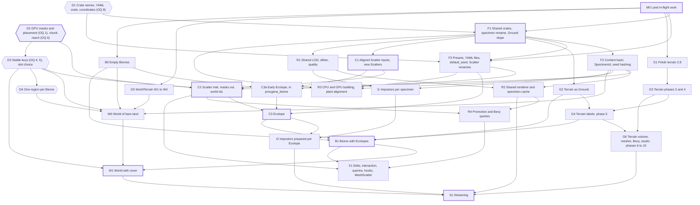

# procgena: roadmap

This document puts the work in [ARCHITECTURE.md](ARCHITECTURE.md) in an
order that respects what depends on what. ARCHITECTURE.md says *where*
procgena is going and lists the work by theme ("Architectural TODOs"); this
document says *in what order*, which pieces can run side by side, and which
decisions must be made before each piece starts. It does not repeat the
design: each milestone links to the TODO items and plans it covers.

Each milestone becomes its own plan when it starts, as ARCHITECTURE.md
asks.

## Bottom line

- **Three tracks run side by side, then meet.**
  - **Foundations**: shared crates, the `procgena_specimen` rename, `Ground`
    with slope, the content hash and specimen id, seeds, the preset
    pattern.
  - **Ground**: finish the terrain, give it slope and labels, then
    WorldTerrain, then its mesher and Bevy crate.
  - **Cover**: align the Scatters, give them one trait and world-anchored
    ids, then build the Ecotope.

  They meet at the **Biome**, then the **World**, then **streaming**.
- **Bare worlds come early.** A Biome with a Terrain and no Ecotopes (an
  **empty Biome**) is valid, so the Biome type and a World of bare land
  (milestones B0 and W0) follow straight on from WorldTerrain, long before
  the Ecotope. The full Biome and World then add cover to types that
  already exist. WorldTerrain gives the land; the World chooses which
  Biome fills each region (decided 2026-11-23).
- **The spine** is: land the work in flight → shared crates with `Ground`
  slope → aligned Scatters → GPU-mask research → `Scatter` trait, masks
  out and world-anchored ids → **Ecotope** → **Biome** → **World** →
  streaming. An early Ecotope (C3a) runs ahead of the `Scatter` trait,
  so Scatters can be combined and looked at long before the spine reaches
  the full Ecotope (moved forward by the user, 2026-11-24).
- **The terrain is the likely long pole.** Terrain Phases 3 to 10 are all
  unbuilt, and the Biome needs labels (Phase 5) while streaming needs the
  mesher and Bevy crate (Phases 7 and 8). Phases 3 and 4 don't need
  `Ground` or slope, so they can start as soon as Phase 2.8 is done.
- **The first Ecotope needs no Terrain.** Two or more Scatters with masks in
  and out, on a `HeightGrid` or `FlatGround`, are enough to prove mask
  chaining. That keeps the cover track from waiting on the terrain.
- **The largest item is off the spine.** GPU *building* for tree, deadwood
  and mushroom (rule 1) can run at any time after the shared crates. GPU
  *placement* and masks (open question 1) is on the spine, as a research
  gate.
- **Decisions are gates.** Four gates (crate names, YAML crate and
  coordinates; GPU masks and chunk reach; stable keys and slot choice;
  one region per Biome) block specific milestones (see "Decision gates"). Each sits just before
  the first work it blocks, not all up front.
- **Two churn windows.** The crate rename and the preset and file rewrite
  each touch every crate and rebuild most of the workspace. Each runs once,
  in a wave of its own, with everything that touches the same code
  batched into it.
- **One question** (the terrain review) still needs the user's call before the milestones that touch them (see "For the user").

## Where things stand (2026-11-23)

The survey table in ARCHITECTURE.md ("Where they stand") is the baseline,
and dated the same day. The points below were checked in the code for this
roadmap; the per-crate status of earlier phases is taken from each crate's
plan.

- **Work in flight, uncommitted** (73 files):
  - Tree: impostor far level (`procgena_tree_bevy/src/impostor.rs`), grove
    preparation behind a loading screen (`grove/prepare.rs`,
    `examples/grove_loading.rs`), grove changes.
  - `procgena_impostor`: a new utility crate that bakes octahedral
    impostors; tree and the studio already depend on it. Today its units
    are the tree (keys are built from `"tree"` and the tree's id) and the
    grove (`PrepareGrove` bakes every tree a grove can use). They become
    the specimen and the Ecotope (milestones I1 and I2).
  - Mushroom: "Mushroom as a whole growth" is under way.
    `MushroomCluster` is gone, and `ClusterOptions::stems`, fairy rings and
    `MushroomBody` are in. `MushroomScatter` still grows on host meshes.
  - Deadwood: leaf cards (`leaves.rs`).
  - Terrain: river valleys and erosion (Phase 2.8, built in part).
- **Terrain.** Phases 1, 2, 2.5, 2.6 and 2.7 are built. (2.5 is not ticked
  in the phase table of [terrain/plan.md](terrain/plan.md), but its code,
  `converge.rs`, and its tests, `tests/convergence.rs`, exist, and 2.6 is
  built on it.) `Terrain` gives `height`, `water_level`, `road_tags`,
  rivers, roads, ponds and points of interest, in 64-bit coordinates. It
  does **not** implement `Ground`, and has no gradient, no `annotate`, no
  mesher and no Bevy crate. WorldTerrain is planned in
  [terrain/world_plan.md](terrain/world_plan.md) (phases W1–W6), not
  started; its phase W5 (Biome choice) now belongs to the World (W0 here).
- **`Ground`** (`procgena_mesh/src/ground.rs`) has `height` only, in 32-bit
  coordinates.
- **Grove spacing is order-dependent.** Grove placement keeps sites in rank
  order and drops any too close to a site already kept. Whether a site
  survives therefore depends on which neighbours survived, and that chain
  can cross any chunk border. So world-anchored, chunked placement
  (open question 6) is a redesign of the spacing step, not a change of
  origin.
- **Plant** is one Bevy crate with no seed: its randomness comes from
  position, plus a seed used only by edits.

## The dependency graph

Arrows mean "must be done first". Hexagons are decisions. Bold outlines
mark the spine.

The graph has no cycles: every arrow points from an item to one described
later in this document (the gates first, then the milestones in order).

## Decision gates

Each decision is made, with the user, before the first milestone it
blocks. Until then, nothing that depends on it starts.

| Gate | Decides | Blocks | Notes |
|------|---------|--------|-------|
| D1 | Names of the engine-free core crate and the shared Bevy crate; the YAML crate; whether `Ground` takes chunk-local `f32` or World `f64` coordinates (open question 8) | F1 (names, coordinates), F3 (YAML) | Decided 2026-11-23 ([docs/decisions/D1.md](docs/decisions/D1.md)): `procgena_core` and `procgena_core_bevy`, core at the bottom, `serde-saphyr` 2.2 (added in F3), `Ground` on World `f64` positions with `height`, `gradient` and `sample`. |
| D2 | **Masks on the GPU** (TODO, open question 1): how masks live on the GPU and how Scatters place there; tree's lattice or plant's blue-noise tiles; each Scatter's reach across chunks, and how grove spacing stays chunk-local (open question 6) | C2, D3 | Research and design decided 2026-11-23 ([docs/decisions/D2.md](docs/decisions/D2.md), "Masks and placement" in ARCHITECTURE.md). The GPU spike passed on an M1 Max (parity, build order, the stack budget with window B); a timing run on a low-end integrated GPU and on a discrete GPU is still owed. |
| D3 | Stable named keys for Scatters and Ecotopes, instead of list positions (open question 4); a Terrain id distinct from its Biome's (open question 5); jump or rendezvous hashing for slots; hook keys in the specimen id (open question 7); addresses | C2 (ids), W0 (Biome and Terrain seeds), W1 (budget) | Decided 2026-11-23 ([docs/decisions/D3.md](docs/decisions/D3.md)): frozen `ChildKey`s with no aliases; seeds chained World → region's Biome → Ecotope → Scatter; the Terrain's noise on the World seed plus sibling region seeds for the Terrain and the Biome; `priority` on one World-wide scale; rendezvous slots with `N` ≤ 256 and no excluded slots; no hook keys (pool id = generator kind plus options hash); integer `CopyAddress` plus pinned part paths, with batched `resolve`; groups addressed where they are defined. It also decided one region per Biome, which opened D4. |
| D4 | **One region per Biome**: how the region graph and the Biome choice make each region one Biome's whole area, so neighbouring regions never share a Biome, while every `RegionId` stays stable and computable from the World's options and seed alone, in any build order. Region size and shape (world_plan open question 2) move here | W0 (Biome choice per region, region seeds) | Opened by the user in D3, 2026-11-23. **G5 is not gated:** it keeps building W2–W4 on today's lattice graph, at the risk that D4 asks for rework there (the graph's construction, W3's warp, W4's region cache). Region size also sets how long a whole-region plan takes, which S1's "Region plans ahead of view" depends on (through W0 and W1). B1 is not blocked: it works inside one Biome. Draft, not decided: [docs/decisions/D4.md](docs/decisions/D4.md). |

Questions that wait for later milestones, and are decided inside them:
open questions 2 (Ecotope overlap, in C3), 9 (far copies on coarse
terrain, in S1) and 10 (state of promoted copies, in X1). Open questions
3 (wide assets) and 7 (hook keys) were decided in D3.

## Churn windows

Two milestones rewrite code in every crate. While one is running, other
agents' work in the same files stalls or conflicts, and every agent
rebuilds Bevy. Each runs in a wave of its own.

- **Window 1 = F1.** The crate move and rename, the type renames, `Ground`
  moving into the core crate with its settled coordinates, and `Ground`
  gaining slope, in one change, as ARCHITECTURE.md asks. Shared hashing
  and random numbers move first.
- **Window 2 = F3.** Preset structs and catalogues, YAML files,
  `seed` → `default_seed`, and the `TreeGrove` → `TreeScatter` and
  `PlantField` → `PlantScatter` renames. The renames change file formats
  (`.grove.json`, `.field.ron`) that F3 rewrites anyway, so they go
  together. F3 lands before C2, which reworks the same grove types.

Before each window: every in-flight change is committed, and the user
confirms no other agent is active. No compatibility shims are kept for old
names or file formats.

## Milestones

Each milestone lists what it covers, what it needs, and what you can see
when it is done. "TODO" names an item under "Architectural TODOs" in
ARCHITECTURE.md.

### M0: Land the work in flight

- **Covers:** commit the tree impostor and grove-loading work, the
  `procgena_impostor` crate, deadwood's leaf cards, mushroom's whole-growth
  change and terrain Phase 2.8 as far as it goes. Tick Phase 2.5 in
  [terrain/plan.md](terrain/plan.md). Review terrain Phases 1–2.8 with the
  user (see "For the user").
- **Needs:** nothing.
- **Done when:** the coordinator's full suite passes on a clean tree.
  Both churn windows can then start from a committed base, and TODO
  "Rename `TreeGrove` → `TreeScatter`", which waits for the grove work, is
  unblocked.

### Foundations track

#### F1: Shared crates, specimen rename, `Ground` slope (churn window 1)

**Done 2026-11-23** (merged at `6055455`; full suite green except plant
goldens, which have no baseline on this machine).

- **Covers:** TODOs "Shared crates", "Rename `procgena_mesh` →
  `procgena_specimen`" and "Add a gradient to `Ground`". Shared hashing,
  seeds and random numbers move first (clump drops its copy of stone's).
  Mushroom's local tags move into `procgena_specimen::tags` (first half of
  TODO "Tags"). Per D1: F1 creates only `procgena_core` (the Bevy crate
  waits for R1), moves `mesh/` to `specimen/crates/procgena_specimen`,
  and moves only stone's and clump's random numbers. Tree's, deadwood's
  and mushroom's wait for F2. `ChunkFrame` waits for C2.
- **Needs:** M0, D1 (crate names, coordinates).
- **Done when:** every crate builds on `procgena_specimen` and the core
  crate, `FlatGround`, `HeightGrid` and closures answer slope, and the full
  suite passes.

#### F2: Content hash, `SpecimenId`, seed hashing

- **Covers:** TODO "Content hash" for every options type (tree's `tree_id`
  is the model), replacing the JSON-string cache keys in stone, deadwood and
  mushroom and adding one to plant and clump. The options hash and the
  `SpecimenId` type from TODO "Specimen budget" (the budget itself waits
  for W1); open question 7 was decided in D3 (no hook keys; the pool id
  is the generator kind plus the options hash). The one shared seed function
  (parent seed plus child id) from TODO "Seeds from outside". Variants
  seeded by one shared function instead of four (rule 4).
- **Needs:** F1. Additive per crate, so each crate can be a separate worker
  once the core crate holds the hash.
- **Done when:** each options type has a stable hash tested across runs,
  and each generator's cache is keyed by its `SpecimenId`.

#### F3: Presets, YAML files, `default_seed`, Scatter renames (churn window 2)

- **Covers:** TODO "One preset and file pattern" (rule 10), the `seed` →
  `default_seed` half of "Seeds from outside", TODOs "Rename `TreeGrove` →
  `TreeScatter`" and "Rename `PlantField` → `PlantScatter`", and the
  scatter file kind from "Decisions to make". Serde on every Scatter's
  options.
- **Needs:** F1, M0, D1 (YAML crate).
- **Done when:** every preset is a struct in a catalogue, every file is
  `.<kind>.yml` with a `base` plus differences, and the studio loads them.

### Ground track

#### G1: Finish terrain Phase 2.8

- **Covers:** the planned rest of Phase 2.8 in
  [terrain/plan.md](terrain/plan.md) (valleys from the distance to the
  river, stream-power profiles). Deep cuts from breached hollows wait for
  lakes in G3, as the user decided.
- **Needs:** M0.
- **Done when:** the Phase 2.8 exit measurements are recorded.
- **Status (2026-11-24): done, as a first cut.** Valleys were already
  built. Drainage area (per region, carried along rivers) and the
  steady-state stream-power profile are built as measurements, and the
  exit measurements are in plan.md ("As built in G1"). No height changed.
  Left for the user: river levels, widths and types from drainage area
  (stream-power levels would cut up to 176 m deeper in mountains, so they
  need lakes or ground that conforms to the river first).

#### G2: Terrain as `Ground`

- **Covers:** TODO "Terrain slope": an analytic gradient through relief,
  border bending and carving; `Ground` implemented for `Terrain`; a
  gradient grid in `HeightTile`.
- **Needs:** F1 (`Ground` has slope, in its settled coordinates).
- **Done when:** a grove planted directly on a `Terrain` matches its
  analytic slope against central differences, and the seam suites still
  pass.
- **Status (2026-11-24): done.** `Terrain` implements `Ground`
  (`Terrain::sample`, `Terrain::gradient`), `HeightField::sample` and
  `HeightTile::gradients` carry the gradient. Analytic through relief
  (noise derivatives, erosion through the noise's second derivatives),
  fade, border bending and carving; the border's and fade's pulls are
  differenced 0.5 m apart in f64. Heights are bit-identical to before.
  Test `tests/ground.rs` (`a_grove_on_a_terrain_matches_its_slope`): worst
  error 1.1e-3 against central differences over 4 m spans.

#### G3: Terrain Phases 3 and 4

- **Covers:** Phase 3 (options and presets as data, base relief,
  landforms, analytic erosion) and Phase 4 (macro-cell caches, lakes at
  hollows, rivers, roads, bridges).
- **Needs:** G1. Not `Ground` or slope.
- **Done when:** lakes fill hollows and overflow as rivers, and the feature
  suites pass with them.
- **Terrain features:** steps 1 and 2 of
  [terrain/features_plan.md](terrain/features_plan.md) (one feature type,
  staged planning, one sample path, benchmarks) come first in G3, before
  Phase 3's landforms and Phase 4. Step 2's sample path is where G2's
  gradient and G4's labels live; see the review's "Milestone order" for
  which goes first. Lakes stay in G3, and planning stays per region, with
  macro cells added only if step 2's benchmarks call for them (decided
  2026-11-23, see
  [terrain/features_plan_review.md](terrain/features_plan_review.md)).
- **Status (2026-11-24):** steps 1 and 2 are built, with results
  unchanged: one feature type and index, stable ids, a river trace shared
  by offers and build, roads as a stage of their own
  (`Terrain::with_roads`), one sample path (`Terrain::query`), and cold
  and warm benchmarks (plan.md, "Terrain features"). Roads are most of a
  cold region plan (p95 1.6 s); without them p95 is about 0.4 s. Phase
  3's landforms and Phase 4 are next.

#### G4: Terrain labels (Phase 5)

- **Covers:** TODO "Terrain labels": classification, `annotate(x, z)` with
  `Landform`, `Flags` and `Measures`, and labelled `HeightTile`s.
  `Measures::slope` comes from G2's gradient.
- **Needs:** G2, G3. Non-water labels need only Phase 3, so if the Biome
  needs labels sooner, they can land before lakes and water labels follow.
- **Done when:** an image example shows labelled regions.

#### G5: WorldTerrain (W1–W4)

- **Covers:** [terrain/world_plan.md](terrain/world_plan.md) phases W1
  (world elevation E and its height bumps), W2 (region graph, which can
  run beside W1), W3 (border warp), W4 (`WorldTerrain` with its region
  cache and `TerrainSource`) and W6 (image example and drainage
  measurement, with a closure source). TODO "WorldTerrain". W5 moved to
  W0.
- **Needs:** M0. W1 needs only Phase 2.5, which is built, so G5 doesn't
  wait for G1. G5 does not wait for D4 (one region per Biome), but D4 may
  change the region graph that W2 built and W3 and W4 build on, so expect
  some rework there.
- **Done when:** a lattice world of many regions builds on demand from a
  closure source, and the seam suites pass on warped borders.
- **Status (2026-11-24):** W1–W3 and W3b are built. W3b skips border pulls
  that can't reach and uses a faster far integral, 10–17% quicker with
  bit-identical heights. Shared border nodes were measured (at most about
  10% gain) and not built. Warped borders still cost about 2.7× straight
  ones, from their piece count; that is left for the performance sweep.
  **W4 is built (2026-11-24):** `WorldTerrain` builds a lattice world's
  regions on demand from a `TerrainSource` closure, caching each region's
  settings, plan (converged generator and offers) and terrain; its seams
  pass on warped borders on flat, tilted and curved land, and its centre
  region matches a `StitchedWorld` of the same polygons bit for bit. Not
  done: the region size check, and the equal preset offsets, which wait
  for the user (world_plan open question 5). W6 (image example and
  drainage measurement) is next.

#### G6: Terrain volume, mesher, Bevy crate and studio (Phases 6–10)

- **Covers:** Phase 6 (SDF and volume features), 7 (chunk mesher, after the
  Transvoxel licence check), 8 (`procgena_terrain_bevy`), 9 (exports) and
  10 (textures and the studio Terrain tab).
- **Needs:** G3 (Phase 6), G4 (Phase 7 splits meshes by label). Phase 8
  sets the one chunk grid (64 m, doubling per level) that streaming uses.
- **Done when:** the studio shows a Terrain tab, and a viewer streams terrain
  chunks around a camera.
- **Decided 2026-11-23:** Phases 6 and 7 mesh a heightfield by default,
  with volume patches only for caves and overhangs, and rock outcrops are
  meshes the terrain builds. See
  [terrain/features_plan_review.md](terrain/features_plan_review.md),
  "Decisions".

### Bare worlds

#### B0: Empty Biomes

- **Covers:** TODO "Empty Biomes": the Biome crate's first version, a
  Biome holding exactly one Terrain (by preset or inline) and an empty
  list of Ecotope rules, with a default empty Biome for each Terrain
  preset. Presets in the new struct style from the start.
- **Needs:** M0. Adding the crate edits the root `Cargo.toml`, a shared
  file: one agent, coordinator told first.
- **Done when:** each Terrain preset has an empty Biome, and building it
  gives the same land as building the Terrain alone.

#### W0: World of bare land

- **Covers:** the first part of TODO "World crate": region graph options,
  Biome choice per region (selector fields such as ruggedness and
  moisture, rules from field values to Biome presets, pins), seed
  derivation for each Biome and its Terrain, and the terrain source it
  hands WorldTerrain. This is world_plan's former phase W5. The large-world
  image example, redone through the World. A studio World tab once G6 can
  draw the land.
- **Needs:** B0, G5, F2 (seed hashing), D3 (open question 5: Terrain and
  Biome ids), D4 (one region per Biome). D3 adds: `region_seed` with
  `"terrain.region.local"` and `"biome.region.local"`, `terrain_seed`
  removed, `Biome::terrain_options` passing the World seed, stable ids for
  designer polygons, and gully cells and seam detail kept fixed.
- **Done when:** a World of empty Biomes builds the same land whatever order
  its regions are asked for, pinned regions keep their Biome, and the
  image example shows Biomes following E and the selector fields.

### Cover track

#### C1: Aligned Scatter inputs and the new Scatters

- **Covers:** TODOs "The same inputs for every Scatter", "Scatters use it"
  (reject steep spots from the slope first), "`DeadwoodScatter`" (logs and
  stumps, slope limit), "`StoneScatter`" (placement over a `Ground`,
  clustering, burial), and the rest of "Mushroom as a whole growth"
  (`MushroomScatter` on the ground; growing on hosts waits for
  `MushroomGrowth`). Open question 3 (wide assets on slopes) was decided
  in D3: the asset defines its members' offsets (a fairy ring is part of
  `Mushroom`), and the Scatter settles each member on the ground.
- **Needs:** F1.
- **Parallel:** one worker per asset crate.
- **Done when:** trees, sticks and logs, stones and mushrooms all scatter
  over the same `HeightGrid` with a density function and a slope limit, in
  their viewers and studio tabs.

#### C2: `Scatter` trait, masks out, world-anchored ids

- **Covers:** TODOs "`Scatter` trait" (filed under Extensibility, but the
  Ecotope needs it), "Scatter masks out", "World-anchored lattices",
  "World-stable ids" and copy ids (rule 4). Each Scatter states its draw
  range, reach distances `S`, `J` and `F`, and mask source (rule 5), and
  offers each slot's `Specimen` plus its list of copies (second half of
  TODO "Tags"). Placement moves to the integer contract in "Masks and
  placement" (ARCHITECTURE.md): window B for streaming, a CPU cache of
  placed copies for queries, and exact disc tests for hard exclusion (new
  in C2, with tests). Tree's spacing step and deadwood's
  scan-order spacing both become `K_d`, so a site's survival never depends
  on sites in another chunk (D2). From D3: copies carry the integer
  `CopyAddress` (region, Ecotope and Scatter key salts, `CellId`, index);
  tree's `site_id` and deadwood's and mushroom's indexes become it; mix
  entries get `ChildKey`s; `Scatter::resolve` for one address.
- **Needs:** C1, F2 (seeds and hash), D2, D3 (stable keys).
- **Done when:** each built-in Scatter implements the trait, places one
  chunk at a time on a World lattice, gives the same copies with the same
  ids whatever order its chunks are built in, and reports its mask over a
  chunk without drawing.
- **Status (2026-11-24):** built for tree, stone, deadwood and mushroom
  ([docs/decisions/C2-plan.md](docs/decisions/C2-plan.md)); plant joins in
  R3. Left: canopy shade as a density mask, part paths, `DrawHandle`, the
  quantised slope byte and a per-Scatter `d` option, and a GPU path.

#### C3a: Early Ecotope (moved forward, 2026-11-24)

- **Covers:** a first, unfinished Ecotope in `procgena_biome`, which the
  Biome and the Ecotope share (with `procgena_biome_bevy` for drawing).
  Scatters by frozen key with a `priority`, a preset in the new file
  pattern, and a Bevy view that draws one Ecotope over a patch of ground.
  It knows nothing of Terrain: it runs on any `Ground` (`FlatGround`,
  `HeightGrid`), and calls today's Scatters (tree, stone, deadwood,
  mushroom; plant through its density hook) through their `ScatterInput`,
  one small adapter per Scatter inside the Ecotope code.
- **Not yet:** the `Scatter` trait, masks out and exact exclusion (C2),
  world-anchored chunked placement, Terrain labels and Ecotope rules (B1).
  Lower-priority Scatters avoid higher ones only as far as today's masks
  in allow it. The adapters are thrown away when C2 lands.
- **Needs:** C1, F3, B0 (the crate). Not C2, not the terrain.
- **Status (2026-11-24):** built. `Ecotope`, `EcotopePreset`
  (`pine_forest_floor.ecotope.yml`) and `Ecotope::place` in
  `procgena_biome`; adapters in `src/ecotope/scatters.rs`;
  `procgena_biome_bevy` with `spawn_ecotope` and a viewer example. Plant
  is left out: it is a Bevy crate placed on the GPU, with no `Ground` and
  no seed, so it joins in C3 after R3. The viewer draws without textures.
- **Done when:** a "pine forest floor" Ecotope preset loads from a
  `.ecotope.yml` file and draws trees, boulders, logs and mushrooms on a
  `HeightGrid` in a viewer or studio tab, with each Scatter keyed and
  seeded from the Ecotope's seed.

#### C3: Ecotope

- **Covers:** the full Ecotope, grown from C3a in `procgena_biome`: the
  adapters replaced by the `Scatter` trait, `priority` on one World-wide
  scale (D3) with its documented bands, mask chaining with exact
  exclusion, and a studio Ecotope tab. Open question 2 (overlap) is decided here.
  The Ecotope warning about a dense Scatter above a long-range one (TODO
  "Per-Scatter ranges") lands here too.
- **Needs:** C3a, C2. Not the terrain: it runs on a `HeightGrid` or
  `FlatGround`.
- **Plant can join late.** Plants sit at the bottom of most Ecotopes and
  already take a density function, so a first Ecotope can draw grass
  through that hook. Plant implements the trait once R3 gives it a seed,
  copy ids and `Ground`.
- **Done when:** a "pine forest floor" preset shows trees, boulders, logs and
  grass on uneven ground, and no lower-priority copy stands inside a
  higher one.

### Drawing and alignment track (off the spine)

These make the assets consistent and fast. R2, R4, I1 and I2 feed later
milestones.

#### R1: Shared LOD, dither and quality setting

- **Covers:** TODO "Shared LOD type, dither shader and quality setting"
  (rule 2): one LOD type with size scaling (tree gains it), one dither
  module in every pass, named far forms, one `LOW`..`ULTRA` setting.
- **Needs:** F1 (the shared Bevy crate).

#### R2: Shared instanced renderer and specimen cache

- **Covers:** TODO "Shared instanced renderer" (rule 6), from stone's pool
  and tree's grove renderer, drawing I1's impostors as the last level once
  both land. Deadwood and
  mushroom move off entity-per-copy. One cache keyed by `SpecimenId` and
  detail level, pruned by use. TODO "One wind" (rule 9) fits here, since
  the renderer carries the wind phase per copy.
- **Needs:** R1, F2.
- **Done when:** tree, stone, deadwood and mushroom scatters draw through one
  renderer, with dither in every pass and shadow culling.
- **Status (2026-11-24):** the renderer and specimen cache are built in
  `procgena_core_bevy::instanced`: GPU culling per camera and shadow view
  into per-part indirect draws, each part drawn with its own material's
  pipelines, dither in the main, prepass and deferred passes, one level per
  copy in shadow maps (switching mid-band, only levels that cast shadows),
  and a wind phase per copy. Stone's pool, deadwood's stick scatters and
  mushroom's scatters draw through it; single pieces stay entities. Tree is
  left: its move needs `tree_bevy/src/scatter.rs` (C2's this wave), so it
  follows C2's merge. Impostors join as a last level once tree moves (the
  impostor material already reads the same per-copy input).

#### R3: CPU and GPU building, plant alignment

- **Covers:** TODO "CPU and GPU building for every asset" (rule 1, the
  largest item): GPU paths for tree, deadwood and mushroom with parity
  tests; clump's Bevy crate uses its GPU path. TODO "Plant alignment":
  core and Bevy split, a production CPU path, seed, copy ids, `Ground`,
  `validate()`, hash, export and the shared Bevy pattern. Also TODOs
  "Export" and "Shared plumbing".
- **Needs:** F1, F2, and F3 for plant's part (the plant split and the
  `PlantScatter` rename touch the same files).
- **Parallel:** one worker per asset; none blocks the others.

#### R4: Promotion and Bevy queries everywhere

- **Covers:** TODO "Bevy queries and promotion" (rule 7), generalising
  `GroveTrees` and `PromotedTree`. Picking returns a `DrawHandle`, turned
  into an address through each loaded chunk's map (D3).
- **Needs:** R2, C2 (copy ids). Plant's part needs its CPU path from R3.

#### I1: Impostors per specimen

With I2, this is TODO "Impostors per specimen, prepared per Ecotope".
`procgena_impostor` stays a utility crate. Its work belongs to the shared
LOD model: the impostor is the level after the far form for every asset
that has one (rule 2).

- **Covers:** the bake key comes from the `SpecimenId` plus the bake
  settings, instead of a kind name and the tree's own id. Any asset's
  `Specimen` can be baked, not only trees: stone, deadwood and mushroom
  gain an impostor level where their draw range calls for one. The
  impostor's place in the shared LOD type, its dither transition and
  quality scaling come from R1. Bakes per pool are capped by the specimen
  budget's `N` slots (see "Loading by chunk" in ARCHITECTURE.md).
- **Needs:** R1, F2.
- **Done when:** a tree and a boulder share one bake path and cache keyed
  by `SpecimenId`, and fade from mesh to far form to impostor in the same
  way.
- **Status (2026-11-24):** built for the entity path. `ImpostorKey` comes
  from a `SpecimenId` plus `BakeSettings` (view count and size per bake);
  `Impostors::request` is the one bake path and cache, with a shared
  material per key; `ImpostorLevel` is the shared impostor level, used by
  `TreePlugin::impostor` and the new `StonePlugin::impostor` (80 m for a
  2.5 m rock, scaled by size and quality). Stone's bake keeps its
  projected textures. Deadwood and mushroom gain none (see the TODO). Not
  built: impostors in stone's GPU pool (R2), per-pool bake caps (need `N`).

#### I1b: Cluster impostor cards for tree fruit and flowers

Decided by the user 2026-11-23.

- **Covers:** TODO "Cluster impostor cards for tree fruit and flowers":
  each preset's fruit or flower cluster baked once (keyed by options hash
  plus bake settings) and drawn at levels 1 and 2 as camera-facing cards on
  the leaf billboard path, with wind. Level 3 keeps the kept-and-enlarged
  items and may move to the same cards.
- **Needs:** F2 (options hash). It shares the bake path with I1, so it runs
  beside or after I1.
- **Done when:** Willow and Dogwood draw their level-1 and level-2 clusters
  as cards with their triangle counts recorded (today 45,414 and 13,440 at
  level 2), the outline test passes, and a headless screenshot comparison
  shows the clusters keep their facing.
- **Status (2026-11-24):** built, opt-in. `LodDetail::cluster_cards` (the
  variant count) draws each kept cluster as one card, and
  `cluster_card_mesh` builds the lone cluster that each variant's picture
  shows. The pictures are baked per pool part through `Impostors::request`,
  with a new `BakeLayout::Elevations` strip (4 × 4 views of 64 px), and the
  tree shaders' `CLUSTER_CARD` path draws them with wind.
  - Measured at level 2: Willow 45,530 → 1,570 cluster triangles, Dogwood
    13,440 → 3,360. The recorded 45,414 predates the F3 preset rewrite.
  - The outline test passes with cards on at levels 1 and 2.
  - Headless shots show the clusters keep their facing.
  - Cards are not yet on in `default_lod`. With them on, level 3 costs
    more than level 2 for fruit trees (Apple 3,144 vs 5,106 / 2). So
    level 3 moving to cards, and the default variant count, are the
    user's decisions.

#### I2: Impostors prepared per Ecotope

- **Covers:** baking ahead moves from the grove to the Ecotope.
  Preparing an Ecotope bakes every specimen slot its Scatters can draw,
  across all their asset kinds, generalising today's `grove_variants` and
  `PrepareGrove`. Streaming (S1) then prepares the Ecotopes of regions it
  plans ahead, and a World prepares the union of its Ecotopes' slots
  without baking a shared slot twice.
- **Needs:** I1, C3 (Ecotopes, and each Scatter offering its slots' `Specimen`s
  from C2).
- **Done when:** preparing a "pine forest floor" Ecotope bakes its trees,
  boulders and logs once each, and the Ecotope then draws its far copies
  as impostors with no bakes while it is on screen.

### Where the tracks meet

#### B1: Biome with Ecotopes

- **Covers:** the rest of TODO "Biome crate" on top of B0 (Ecotope rules on
  labels, border noise and shapes, presets with cover) and TODO "Ecotope
  border protocol" (offers, a symmetric agreement, one merged priority
  order), used first between Ecotopes inside one Biome. A studio Biome tab.
- **Needs:** B0, C3, G2, G4.
- **Done when:** one Biome over one bounded Terrain shows forest thinning
  into meadow along a slope or a river, with masks chained across the blend.

#### W1: World with cover

- **Covers:** the rest of TODO "World crate" on top of W0: seed
  derivation down to Ecotopes and Scatters, and the second step of the
  Biome border negotiation (the Ecotope protocol across Biome borders).
  The rest of TODO "Specimen budget": a per-pool `N` (at most 256) with
  World overrides by path, rendezvous slot choice and stand subsets.
  Seeds chained through the region's Biome down to each Scatter; the
  Ecotope protocol's merged order as a sort by `priority`. The studio World tab gains
  cover (with B1's and C3's tabs, TODO "Studio").
- **Needs:** W0, B1, D3 (slot choice).
- **Done when:** a world of several Biomes, built chunk by chunk in two
  different orders, gives the same copies with the same ids and the same
  specimens.

#### S1: Streaming

- **Covers:** TODOs "Streaming" (the shared chunk grid, a loader merging
  requests, a build queue with a per-frame budget and cancellation),
  "Per-Scatter ranges", "Region plans ahead of view" (with a disk cache),
  "Thinning at a distance" and "Far forest tint". Open question 9 is
  decided here.
- **Needs:** W1, G6 (chunk grid and terrain streaming), R2 (renderer), I2
  (impostors prepared per Ecotope ahead of view).
- **Can start earlier:** streaming one Biome over one Terrain needs only
  B1, G6, R2 and I2. World-wide region planning lands once W1 does.
- **Done when:** the twelve user stories under "Loading by chunk" pass,
  as tests where they can be.

### Extensibility

#### X1: Edits, interaction, core queries, hooks and `MeshScatter`

- **Covers:** TODOs "Edits", "Shared edits and interaction" (plant's
  brushes and trampling grow into the shared edits and an interactor
  contract; tree reads interactors), "Core queries", "Hook traits per
  level" and "`MeshScatter`". Open question 10 is decided here. From D3:
  edits stored as integer addresses with `kind` and cell-size checks,
  orphans kept and reported by salt; part paths pinned to `SpecimenId`s,
  with each asset that has parts offering `part()` (tree first, then
  fruit and the mushroom ring); batched `World::resolve_all`.
- **Needs:** C2 (stable ids), R4 (promotion), B1 (labels and coverage
  to query). Hooks for the World level wait for W1.
- **Can split:** edits, interaction and Scatter-level queries can start
  right after C2 and R4; Biome and World hooks follow their levels.

### Later

- TODO "Modifiers pushed down" (a Biome's snow line, an Ecotope's
  wetness), after B1.
- TODO "`MushroomGrowth` and `PlantGrowth`", after C1 moves mushrooms off
  their hosts, and after R3 for plants.
- Terrain follow-ups already listed in its plan: hub placement, river
  crossing cost for roads, clearings at points of interest (which become
  terrain stamps, X1), GPU road routing.

## Running the work in parallel

Suggested waves, each starting when the one before it lands. Arrows inside
a cell run in order within the wave.

| Wave | Run together | Notes |
|------|--------------|-------|
| 1 | M0; D1 research; D2 research | M0 is commits and review. D1 and D2 are reading and spikes, and touch no shared files. |
| 2 | F1 alone | Churn window 1. |
| 3 | F2 (one worker per crate); G1 → G3; G2; G5; B0; C1 (one worker per crate); R1; D3 | D3's slot choice uses D2's GPU spike. G5 can run beside G1, but both edit `procgena_terrain`, so give them separate files or run them one after the other. |
| 4 | F3 alone; D4 research | Churn window 2, before C2 reworks the grove types. D4 is design work that touches no shared files, and must land before W0 in wave 5. |
| 5 | C3a; C2; G4; W0; R2; R3; I1 | C3a works in `procgena_biome` and its new Bevy crate only, so it runs beside C2; C2's trait then replaces C3a's adapters in wave 6. |
| 6 | C3; G6; R4 | |
| 7 | B1; I2; X1 (Scatter part) | |
| 8 | W1; S1 (single Biome) | |
| 9 | S1 (World-wide); X1 (Biome and World hooks); Later | |

Workers follow the scoped-check rules in [CLAUDE.md](CLAUDE.md); the
coordinator runs the full suite once per wave.

## For the user

These need a decision before the milestone named. They are surfaced here,
not resolved.

1. ~~**WorldTerrain's scope.**~~ Decided 2026-11-23: the terrain crate
   owns geometry and height (region graph, E, height bumps) and takes a
   terrain source; the World owns the Biome choice (selector fields,
   rules, pins); bare land is a World of empty Biomes, with no terrain-type
   table in the terrain crate. Recorded in ARCHITECTURE.md and
   [terrain/world_plan.md](terrain/world_plan.md).
2. ~~**Where `procgena_impostor` lives.**~~ Decided 2026-11-23: it stays
   a utility crate, and its work is part of the shared LOD model. Its
   units move from the tree and the grove to the specimen and the Ecotope
   (I1 and I2). Recorded in ARCHITECTURE.md.
3. ~~**Plant consumers outside this repository.**~~ Settled 2026-11-23:
   zeapp, named in plant's old field plan (now removed), no longer exists, so the plant split and the `PlantScatter` rename stay
   inside this repository.
4. **Terrain review** (in M0). Terrain Phases 1, 2, 2.6, 2.7 and 2.8 are
   marked "review pending", and Phase 1 asked to stop for a review with the
   user. The Ground track builds on them.
5. **One region per Biome** (D4, before W0). The user decided in D3 that a
   region is one Biome's whole area. How the region graph and the Biome
   choice achieve it, and how big regions get, is for the user to decide
   in D4.
