# procgena: roadmap

This document puts the work in [ARCHITECTURE.md](ARCHITECTURE.md) in an
order that respects what depends on what. ARCHITECTURE.md says *where*
procgena is going and lists the work by theme ("Architectural TODOs"); this
document says *in what order*, which pieces can run side by side, and which
decisions must be made before each piece starts. It does not repeat the
design: each milestone links to the TODO items and plans it covers.

Each milestone becomes its own plan when it starts, as ARCHITECTURE.md
asks.

## Bottom line

- **Three tracks run side by side, then meet.**
  - **Foundations**: shared crates, the `procgena_specimen` rename, `Ground`
    with slope, the content hash and specimen id, seeds, the preset
    pattern.
  - **Ground**: finish the terrain, give it slope and labels, then
    WorldTerrain, then its mesher and Bevy crate.
  - **Cover**: align the Scatters, give them one trait and world-anchored
    ids, then build the Ecotope.

  They meet at the **Biome**, then the **World**, then **streaming**.
- **Bare worlds come early.** A Biome with a Terrain and no Ecotopes (an
  **empty Biome**) is valid, so the Biome type and a World of bare land
  (milestones B0 and W0) follow straight on from WorldTerrain, long before
  the Ecotope. The full Biome and World then add cover to types that
  already exist. WorldTerrain gives the land; the World chooses which
  Biome fills each region (decided 2026-11-23).
- **The spine** is: land the work in flight → shared crates with `Ground`
  slope → aligned Scatters → GPU-mask research → `Scatter` trait, masks
  out and world-anchored ids → **Ecotope** → **Biome** → **World** →
  streaming. An early Ecotope (C3a) runs ahead of the `Scatter` trait,
  so Scatters can be combined and looked at long before the spine reaches
  the full Ecotope (moved forward by the user, 2026-11-24).
- **The terrain is the likely long pole.** Terrain Phases 3 to 10 are all
  unbuilt, and the Biome needs labels (Phase 5) while streaming needs the
  mesher and Bevy crate (Phases 7 and 8). Phases 3 and 4 don't need
  `Ground` or slope, so they can start as soon as Phase 2.8 is done.
- **The first Ecotope needs no Terrain.** Two or more Scatters with masks in
  and out, on a `HeightGrid` or `FlatGround`, are enough to prove mask
  chaining. That keeps the cover track from waiting on the terrain.
- **The largest item is off the spine.** GPU *building* for tree, deadwood
  and mushroom (rule 1) can run at any time after the shared crates. GPU
  *placement* and masks (open question 1) is on the spine, as a research
  gate.
- **Decisions are gates.** Four gates (crate names, YAML crate and
  coordinates; GPU masks and chunk reach; stable keys and slot choice;
  region size and shape) block specific milestones (see "Decision gates"). Each sits just before
  the first work it blocks, not all up front.
- **Two churn windows.** The crate rename and the preset and file rewrite
  each touch every crate and rebuild most of the workspace. Each runs once,
  in a wave of its own, with everything that touches the same code
  batched into it.
- **Open decisions** for the user, with their context, are listed under
  "For the user" at the end, most urgent first.

## Where things stand (2026-11-23)

The survey table in ARCHITECTURE.md ("Where they stand") is the baseline,
and dated the same day. The points below were checked in the code for this
roadmap; the per-crate status of earlier phases is taken from each crate's
plan.

- **Work in flight, uncommitted** (73 files):
  - Tree: impostor far level (`procgena_tree_bevy/src/impostor.rs`), grove
    preparation behind a loading screen (`grove/prepare.rs`,
    `examples/grove_loading.rs`), grove changes.
  - `procgena_impostor`: a new utility crate that bakes octahedral
    impostors; tree and the studio already depend on it. Today its units
    are the tree (keys are built from `"tree"` and the tree's id) and the
    grove (`PrepareGrove` bakes every tree a grove can use). They become
    the specimen and the Ecotope (milestones I1 and I2).
  - Mushroom: "Mushroom as a whole growth" is under way.
    `MushroomCluster` is gone, and `ClusterOptions::stems`, fairy rings and
    `MushroomBody` are in. `MushroomScatter` still grows on host meshes.
  - Deadwood: leaf cards (`leaves.rs`).
  - Terrain: river valleys and erosion (Phase 2.8, built in part).
- **Terrain.** Phases 1, 2, 2.5, 2.6 and 2.7 are built. (2.5 is not ticked
  in the phase table of [terrain/plan.md](terrain/plan.md), but its code,
  `converge.rs`, and its tests, `tests/convergence.rs`, exist, and 2.6 is
  built on it.) `Terrain` gives `height`, `water_level`, `road_tags`,
  rivers, roads, ponds and points of interest, in 64-bit coordinates. It
  does **not** implement `Ground`, and has no gradient, no `annotate`, no
  mesher and no Bevy crate. WorldTerrain is planned in
  [terrain/world_plan.md](terrain/world_plan.md) (phases W1–W6), not
  started; its phase W5 (Biome choice) now belongs to the World (W0 here).
- **`Ground`** (`procgena_mesh/src/ground.rs`) has `height` only, in 32-bit
  coordinates.
- **Grove spacing is order-dependent.** Grove placement keeps sites in rank
  order and drops any too close to a site already kept. Whether a site
  survives therefore depends on which neighbours survived, and that chain
  can cross any chunk border. So world-anchored, chunked placement
  (open question 6) is a redesign of the spacing step, not a change of
  origin.
- **Plant** is one Bevy crate with no seed: its randomness comes from
  position, plus a seed used only by edits.

## The dependency graph

Arrows mean "must be done first". Hexagons are decisions. Bold outlines
mark the spine.

```mermaid
flowchart TD
    M0["M0 Land in-flight work"]

    D1{{"D1 Crate names, YAML crate, coordinates (OQ 8)"}}
    D2{{"D2 GPU masks and placement (OQ 1), chunk reach (OQ 6)"}}
    D3{{"D3 Stable keys (OQ 4, 5), slot choice"}}
    D4{{"D4 Region size and shape"}}

    F1["F1 Shared crates, specimen rename, Ground slope"]
    F2["F2 Content hash, SpecimenId, seed hashing"]
    F3["F3 Presets, YAML files, default_seed, Scatter renames"]

    G1["G1 Finish terrain 2.8"]
    G2["G2 Terrain as Ground"]
    G3["G3 Terrain phases 3 and 4"]
    G4["G4 Terrain labels: phase 5"]
    G5["G5 WorldTerrain W1 to W4"]
    G6["G6 Terrain volume, mesher, Bevy, studio: phases 6 to 10"]

    C1["C1 Aligned Scatter inputs, new Scatters"]
    C2["C2 Scatter trait, masks out, world ids"]
    C3a["C3a Early Ecotope, in procgena_biome"]
    C3["C3 Ecotope"]

    R1["R1 Shared LOD, dither, quality"]
    R2["R2 Shared renderer and specimen cache"]
    R3["R3 CPU and GPU building, plant alignment"]
    R4["R4 Promotion and Bevy queries"]
    I1["I1 Impostors per specimen"]
    I1b["I1b Fruit as an attached asset"]
    I2["I2 Impostors prepared per Ecotope"]

    B0["B0 Empty Biomes"]
    W0["W0 World of bare land"]
    B1["B1 Biome with Ecotopes"]
    W1["W1 World with cover"]
    S1["S1 Streaming"]
    X1["X1 Edits, interaction, queries, hooks, MeshScatter"]

    GM0["GM0 Ground materials: engine-free model"]
    GM1["GM1 Ground colours drawn"]
    GM2["GM2 Ground textures"]
    GM3["GM3 Ground on measures and labels"]
    GM4["GM4 Biome base ground and borders"]
    GM5["GM5 Far grass and forest tints"]

    D5{{"D5 World and Biome scale"}}
    G7["G7 Scale-aware terrain lengths"]
    IX["IX Impostor-heavy experiment"]

    ST0["ST0 Studio shell"]
    ST1["ST1 Settings metadata, Inspector"]
    ST2["ST2 Saving presets, project folder"]
    ST3["ST3 Library and Outline"]
    ST4["ST4 Capture and thumbnails"]
    ST5a["ST5a Picking by tags"]
    ST5b["ST5b Picking by part paths"]
    ST6["ST6 Texture library"]
    ST7a["ST7a Problems, overlays, stats"]
    ST7b["ST7b Viewing distance"]
    ST8["ST8 Export and commands"]
    ST9["ST9 Studio later"]

    M0 --> F1
    D1 --> F1
    D1 --> F3
    F1 --> F2
    F1 --> F3
    M0 --> F3

    M0 --> G1
    F1 --> G2
    G1 --> G3
    G2 --> G4
    G3 --> G4
    M0 --> G5
    G3 --> G6
    G4 --> G6

    F1 --> C1
    C1 --> C2
    F2 --> C2
    D2 --> C2
    D3 --> C2
    C1 --> C3a
    F3 --> C3a
    B0 --> C3a
    C3a --> C3
    C2 --> C3
    F3 --> C3
    D2 --> D3

    F1 --> R1
    R1 --> R2
    F2 --> R2
    F1 --> R3
    F2 --> R3
    F3 --> R3
    R2 --> R4
    C2 --> R4
    R1 --> I1
    F2 --> I1
    I1 --> I2
    C3 --> I2
    F1 --> I1b
    F2 --> I1b
    D3 --> I1b
    R1 --> I1b
    I1 --> I1b

    M0 --> B0
    B0 --> W0
    G5 --> W0
    F2 --> W0
    D3 --> W0
    D3 --> D4
    D4 --> W0

    B0 --> B1
    C3 --> B1
    G2 --> B1
    G4 --> B1
    B1 --> W1
    W0 --> W1
    D3 --> W1
    W1 --> S1
    G6 --> S1
    R2 --> S1
    I2 --> S1
    C2 --> X1
    R4 --> X1
    B1 --> X1

    G6 --> GM0
    GM0 --> GM1
    GM1 --> GM2
    GM1 --> GM3
    G4 --> GM3
    GM3 --> GM4
    B1 --> GM4
    W1 --> GM4
    GM1 --> GM5
    R3 --> GM5
    S1 --> GM5

    D5 --> G7
    D5 --> W0
    I1 --> IX
    I1b --> IX

    I1b --> ST0
    ST0 --> ST1
    ST0 --> ST2
    ST1 --> ST3
    ST2 --> ST3
    ST0 --> ST4
    I1b --> ST4
    ST3 --> ST5a
    R4 --> ST5a
    X1 --> ST5b
    ST2 --> ST6
    ST3 --> ST6
    ST4 --> ST6
    GM1 --> ST6
    ST1 --> ST7a
    IX --> ST7b
    ST0 --> ST7b
    ST0 --> ST8
    ST4 --> ST8
    B1 --> ST9
    W1 --> ST9

    classDef spine stroke-width:3px
    class M0,F1,C1,D2,C2,C3,B1,W1,S1 spine
```

The graph has no cycles: every arrow points from an item to one described
later in this document (the gates first, then the milestones in order).

## Decision gates

Each decision is made, with the user, before the first milestone it
blocks. Until then, nothing that depends on it starts.

| Gate | Decides | Blocks | Notes |
|------|---------|--------|-------|
| D1 | Names of the engine-free core crate and the shared Bevy crate; the YAML crate; whether `Ground` takes chunk-local `f32` or World `f64` coordinates (open question 8) | F1 (names, coordinates), F3 (YAML) | Decided 2026-11-23 ([docs/decisions/D1.md](docs/decisions/D1.md)): `procgena_core` and `procgena_core_bevy`, core at the bottom, `serde-saphyr` 2.2 (added in F3), `Ground` on World `f64` positions with `height`, `gradient` and `sample`. |
| D2 | **Masks on the GPU** (TODO, open question 1): how masks live on the GPU and how Scatters place there; tree's lattice or plant's blue-noise tiles; each Scatter's reach across chunks, and how grove spacing stays chunk-local (open question 6) | C2, D3 | Research and design decided 2026-11-23 ([docs/decisions/D2.md](docs/decisions/D2.md), "Masks and placement" in ARCHITECTURE.md). The GPU spike passed on an M1 Max (parity, build order, the stack budget with window B); a timing run on a low-end integrated GPU and on a discrete GPU is still owed. |
| D3 | Stable named keys for Scatters and Ecotopes, instead of list positions (open question 4); a Terrain id distinct from its Biome's (open question 5); jump or rendezvous hashing for slots; hook keys in the specimen id (open question 7); addresses | C2 (ids), W0 (Biome and Terrain seeds), W1 (budget) | Decided 2026-11-23 ([docs/decisions/D3.md](docs/decisions/D3.md)): frozen `ChildKey`s with no aliases; seeds chained World → region's Biome → Ecotope → Scatter; the Terrain's noise on the World seed plus sibling region seeds for the Terrain and the Biome; `priority` on one World-wide scale; rendezvous slots with `N` ≤ 256 and no excluded slots; no hook keys (pool id = generator kind plus options hash); integer `CopyAddress` plus pinned part paths, with batched `resolve`; groups addressed where they are defined. It also decided that each region has its own Biome instance, seeded per region (corrected 2026-11-24: neighbours never share an instance but may share a Biome type), which opened D4. |
| D4 | **Region size and shape** (world_plan open question 2): how large regions are, and whether they are even or a multi-scale mix | W0's final region size only. W0's Biome choice is not blocked: it picks each region's Biome type freely and starts on today's 4 km default | Opened by the user in D3, 2026-11-23, as "one region per Biome"; premise corrected 2026-11-24 (neighbouring regions may share a Biome type, so no graph, warp or W4-cache change is needed). Waits on the quiet-machine rerun of the G3 step 2 cold benchmarks; W0's image example is done (world_plan.md, "W0 image example": nothing in it argues against 4 km). Region size sets how long a whole-region plan takes, which S1's "Region plans ahead of view" depends on (through W0 and W1). **G5 is not gated.** B1 is not blocked: it works inside one Biome. Draft, not decided: [docs/decisions/D4.md](docs/decisions/D4.md). Region size becomes a per-class World setting under D5. |
| D5 | **World and Biome scale:** how a World sets its scale, from Minecraft-like to Valheim-like and the large open-world games (required), up to real-life (a stretch goal) | Nothing yet: W0 may start at scale 1, then gains the scale pair and class presets, and its image examples tune the class numbers. A new terrain task, "scale-aware lengths", which derives every fade, margin, ramp and clearance from scale and local size | Mechanism decided by the user 2026-11-24 ([docs/decisions/D5.md](docs/decisions/D5.md)): a World scale pair `{ horizontal, vertical }` stretches landscape lengths (Terrain presets written at scale 1, E, selector fields), with only E's background slope limit checked (cliffs and relief are not capped); World presets per class; objects, road and river widths, chunks, LOD and masks never scale; no landscape length fixed in metres; huge Biomes from many same-type regions. Draft: the class numbers. Open: a World-level river-size field, the region floor, Ecotope geometry, floating origin. |

Questions that wait for later milestones, and are decided inside them:
open questions 2 (Ecotope overlap, in C3), 9 (far copies on coarse
terrain, in S1) and 10 (state of promoted copies, in X1). Open questions
3 (wide assets) and 7 (hook keys) were decided in D3.

## Churn windows

Two milestones rewrite code in every crate. While one is running, other
agents' work in the same files stalls or conflicts, and every agent
rebuilds Bevy. Each runs in a wave of its own.

- **Window 1 = F1.** The crate move and rename, the type renames, `Ground`
  moving into the core crate with its settled coordinates, and `Ground`
  gaining slope, in one change, as ARCHITECTURE.md asks. Shared hashing
  and random numbers move first.
- **Window 2 = F3.** Preset structs and catalogues, YAML files,
  `seed` → `default_seed`, and the `TreeGrove` → `TreeScatter` and
  `PlantField` → `PlantScatter` renames. The renames change file formats
  (`.grove.json`, `.field.ron`) that F3 rewrites anyway, so they go
  together. F3 lands before C2, which reworks the same grove types.

Before each window: every in-flight change is committed, and the user
confirms no other agent is active. No compatibility shims are kept for old
names or file formats.

## Milestones

Each milestone lists what it covers, what it needs, and what you can see
when it is done. "TODO" names an item under "Architectural TODOs" in
ARCHITECTURE.md.

### M0: Land the work in flight

- **Covers:** commit the tree impostor and grove-loading work, the
  `procgena_impostor` crate, deadwood's leaf cards, mushroom's whole-growth
  change and terrain Phase 2.8 as far as it goes. Tick Phase 2.5 in
  [terrain/plan.md](terrain/plan.md). Review terrain Phases 1–2.8 with the
  user (see "For the user").
- **Needs:** nothing.
- **Done when:** the coordinator's full suite passes on a clean tree.
  Both churn windows can then start from a committed base, and TODO
  "Rename `TreeGrove` → `TreeScatter`", which waits for the grove work, is
  unblocked.

### Foundations track

#### F1: Shared crates, specimen rename, `Ground` slope (churn window 1)

**Done 2026-11-23** (merged at `6055455`; full suite green except plant
goldens, which have no baseline on this machine).

- **Covers:** TODOs "Shared crates", "Rename `procgena_mesh` →
  `procgena_specimen`" and "Add a gradient to `Ground`". Shared hashing,
  seeds and random numbers move first (clump drops its copy of stone's).
  Mushroom's local tags move into `procgena_specimen::tags` (first half of
  TODO "Tags"). Per D1: F1 creates only `procgena_core` (the Bevy crate
  waits for R1), moves `mesh/` to `specimen/crates/procgena_specimen`,
  and moves only stone's and clump's random numbers. Tree's, deadwood's
  and mushroom's wait for F2. `ChunkFrame` waits for C2.
- **Needs:** M0, D1 (crate names, coordinates).
- **Done when:** every crate builds on `procgena_specimen` and the core
  crate, `FlatGround`, `HeightGrid` and closures answer slope, and the full
  suite passes.

#### F2: Content hash, `SpecimenId`, seed hashing

- **Covers:** TODO "Content hash" for every options type (tree's `tree_id`
  is the model), replacing the JSON-string cache keys in stone, deadwood and
  mushroom and adding one to plant and clump. The options hash and the
  `SpecimenId` type from TODO "Specimen budget" (the budget itself waits
  for W1); open question 7 was decided in D3 (no hook keys; the pool id
  is the generator kind plus the options hash). The one shared seed function
  (parent seed plus child id) from TODO "Seeds from outside". Variants
  seeded by one shared function instead of four (rule 4).
- **Needs:** F1. Additive per crate, so each crate can be a separate worker
  once the core crate holds the hash.
- **Done when:** each options type has a stable hash tested across runs,
  and each generator's cache is keyed by its `SpecimenId`.

#### F3: Presets, YAML files, `default_seed`, Scatter renames (churn window 2)

- **Covers:** TODO "One preset and file pattern" (rule 10), the `seed` →
  `default_seed` half of "Seeds from outside", TODOs "Rename `TreeGrove` →
  `TreeScatter`" and "Rename `PlantField` → `PlantScatter`", and the
  scatter file kind from "Decisions to make". Serde on every Scatter's
  options.
- **Needs:** F1, M0, D1 (YAML crate).
- **Done when:** every preset is a struct in a catalogue, every file is
  `.<kind>.yml` with a `base` plus differences, and the studio loads them.

### Ground track

#### G1: Finish terrain Phase 2.8

- **Covers:** the planned rest of Phase 2.8 in
  [terrain/plan.md](terrain/plan.md) (valleys from the distance to the
  river, stream-power profiles). Deep cuts from breached hollows wait for
  lakes in G3, as the user decided.
- **Needs:** M0.
- **Done when:** the Phase 2.8 exit measurements are recorded.
- **Status (2026-11-24): done, as a first cut.** Valleys were already
  built. Drainage area (per region, carried along rivers) and the
  steady-state stream-power profile are built as measurements, and the
  exit measurements are in plan.md ("As built in G1"). No height changed.
  Left for the user: river levels, widths and types from drainage area
  (stream-power levels would cut up to 176 m deeper in mountains, so they
  need lakes or ground that conforms to the river first).

#### G2: Terrain as `Ground`

- **Covers:** TODO "Terrain slope": an analytic gradient through relief,
  border bending and carving; `Ground` implemented for `Terrain`; a
  gradient grid in `HeightTile`.
- **Needs:** F1 (`Ground` has slope, in its settled coordinates).
- **Done when:** a grove planted directly on a `Terrain` matches its
  analytic slope against central differences, and the seam suites still
  pass.
- **Status (2026-11-24): done.** `Terrain` implements `Ground`
  (`Terrain::sample`, `Terrain::gradient`), `HeightField::sample` and
  `HeightTile::gradients` carry the gradient. Analytic through relief
  (noise derivatives, erosion through the noise's second derivatives),
  fade, border bending and carving; the border's and fade's pulls are
  differenced 0.5 m apart in f64. Heights are bit-identical to before.
  Test `tests/ground.rs` (`a_grove_on_a_terrain_matches_its_slope`): worst
  error 1.1e-3 against central differences over 4 m spans.

#### G3: Terrain Phases 3 and 4

- **Covers:** Phase 3 (options and presets as data, base relief,
  landforms, analytic erosion) and Phase 4 (macro-cell caches, lakes at
  hollows, rivers, roads, bridges).
- **Needs:** G1. Not `Ground` or slope.
- **Done when:** lakes fill hollows and overflow as rivers, and the feature
  suites pass with them.
- **Terrain features:** steps 1 and 2 of
  [terrain/features_plan.md](terrain/features_plan.md) (one feature type,
  staged planning, one sample path, benchmarks) come first in G3, before
  Phase 3's landforms and Phase 4. Step 2's sample path is where G2's
  gradient and G4's labels live; see the review's "Milestone order" for
  which goes first. Lakes stay in G3, and planning stays per region, with
  macro cells added only if step 2's benchmarks call for them (decided
  2026-11-23, see
  [terrain/features_plan_review.md](terrain/features_plan_review.md)).
- **Status (2026-11-24):** steps 1 and 2 are built, with results
  unchanged: one feature type and index, stable ids, a river trace shared
  by offers and build, roads as a stage of their own
  (`Terrain::with_roads`), one sample path (`Terrain::query`), and cold
  and warm benchmarks (plan.md, "Terrain features"). Roads are most of a
  cold region plan (p95 1.6 s); without them p95 is about 0.4 s. Phase
  3's landforms and Phase 4 are next.

#### G4: Terrain labels (Phase 5)

- **Covers:** TODO "Terrain labels": classification, `annotate(x, z)` with
  `Landform`, `Flags` and `Measures`, and labelled `HeightTile`s.
  `Measures::slope` comes from G2's gradient.
- **Needs:** G2, G3. Non-water labels need only Phase 3, so if the Biome
  needs labels sooner, they can land before lakes and water labels follow.
- **Done when:** an image example shows labelled regions.
- **Split (decided by the user 2026-11-24, for ground materials):**
  **G4a** adds `Measures` to `Terrain::query` first (water and road
  distance, height above water, curvature, from the feature index), so
  ground rules (GM3) and Biome rules can use them early. **G4b** adds
  `Landform`, `Flags` and labelled tiles. See
  [docs/decisions/ground-materials.md](docs/decisions/ground-materials.md).

#### G5: WorldTerrain (W1–W4)

- **Covers:** [terrain/world_plan.md](terrain/world_plan.md) phases W1
  (world elevation E and its height bumps), W2 (region graph, which can
  run beside W1), W3 (border warp), W4 (`WorldTerrain` with its region
  cache and `TerrainSource`) and W6 (image example and drainage
  measurement, with a closure source). TODO "WorldTerrain". W5 moved to
  W0.
- **Needs:** M0. W1 needs only Phase 2.5, which is built, so G5 doesn't
  wait for G1. G5 does not wait for D4 (region size and shape). D4 may
  change the region graph's size options, but not the graph's
  construction, W3's warp or W4's region cache.
- **Done when:** a lattice world of many regions builds on demand from a
  closure source, and the seam suites pass on warped borders.
- **Status (2026-11-24):** W1–W3 and W3b are built. W3b skips border pulls
  that can't reach and uses a faster far integral, 10–17% quicker with
  bit-identical heights. Shared border nodes were measured (at most about
  10% gain) and not built. Warped borders still cost about 2.7× straight
  ones, from their piece count; that is left for the performance sweep.
  **W4 is built (2026-11-24):** `WorldTerrain` builds a lattice world's
  regions on demand from a `TerrainSource` closure, caching each region's
  settings, plan (converged generator and offers) and terrain; its seams
  pass on warped borders on flat, tilted and curved land, and its centre
  region matches a `StitchedWorld` of the same polygons bit for bit. Not
  done: the region size check, and the equal preset offsets, which wait
  for the user (world_plan open question 5). W6 (image example and
  drainage measurement) is next.

#### G6: Terrain volume, mesher, Bevy crate and studio (Phases 6–10)

- **Covers:** Phase 6 (SDF and volume features), 7 (chunk mesher, after the
  Transvoxel licence check), 8 (`procgena_terrain_bevy`), 9 (exports) and
  10 (textures and the studio Terrain tab).
- **Needs:** G3 (Phase 6), G4 (Phase 7 splits meshes by label). Phase 8
  sets the one chunk grid (64 m, doubling per level) that streaming uses.
- **Done when:** the studio shows a Terrain tab, and a viewer streams terrain
  chunks around a camera.
- **Decided 2026-11-23:** Phases 6 and 7 mesh a heightfield by default,
  with volume patches only for caves and overhangs, and rock outcrops are
  meshes the terrain builds. See
  [terrain/features_plan_review.md](terrain/features_plan_review.md),
  "Decisions".
- **Status (2026-11-24): heightfield part built.** Chunk meshes on the
  shared grid with crack-free level transitions, feature tiers (rough and
  fine; far chunks and a coarse first load use the rough tier, with
  skirts sized by how far each tier moves the ground), loading progress
  through a hook, water surfaces (`procgena_terrain`, `src/chunk.rs`;
  plan.md "Chunks and meshing", "As built"); `procgena_terrain_bevy`
  streams them around the camera with a slope- and height-coloured
  material, a cull-distance dither and a chunk-level debug overlay, with a
  headless viewer; the studio has a Terrain tab (presets, `.terrain.yml`
  save and load, seed, every setting). Not done: Phase 6 volume patches,
  labels (G4, so no parts by label or label texturing), exports (Phase 9),
  `terrain/textures.yml` (Phase 10 textures).

#### G7: Scale-aware terrain lengths

From D5 (decided by the user 2026-11-24; see
[docs/decisions/D5.md](docs/decisions/D5.md)).

- **Covers:** every landscape length in the terrain crate that is fixed in
  metres today (fades, margins, ramps, clearances, the region-size floor)
  derived instead from the World's scale pair and the local size; noise
  octaves scaled with their wavelength; the border, seam and feature
  suites re-run at the small and large scale classes. Object sizes, road
  and river widths, chunks, LOD and masks never scale.
- **Needs:** D5. Runs before or with W0.
- **Churn:** it changes terrain results everywhere, so it runs in a wave
  where no other terrain work is in flight.
- **Done when:** the seam and feature suites pass at the small, medium
  and large classes, and the region floor follows from scale (about
  1.4 km with today's fixed widths; see D5's "floor tension").

### Bare worlds

#### B0: Empty Biomes

- **Covers:** TODO "Empty Biomes": the Biome crate's first version, a
  Biome holding exactly one Terrain (by preset or inline) and an empty
  list of Ecotope rules, with a default empty Biome for each Terrain
  preset. Presets in the new struct style from the start.
- **Needs:** M0. Adding the crate edits the root `Cargo.toml`, a shared
  file: one agent, coordinator told first.
- **Done when:** each Terrain preset has an empty Biome, and building it
  gives the same land as building the Terrain alone.

#### W0: World of bare land

- **Covers:** the first part of TODO "World crate": region graph options,
  Biome choice per region (selector fields such as ruggedness and
  moisture, rules from field values to Biome presets, pins), seed
  derivation for each Biome and its Terrain, and the terrain source it
  hands WorldTerrain. This is world_plan's former phase W5. The large-world
  image example, redone through the World. A studio World tab once G6 can
  draw the land.
- **Needs:** B0, G5, F2 (seed hashing), D3 (open question 5: Terrain and
  Biome ids). D4 (region size and shape) sets only the final region size;
  W0 starts on today's 4 km default and chooses each region's Biome type
  freely, so neighbours may share a type. D3 adds: `region_seed` with
  `"terrain.region.local"` and `"biome.region.local"`, `terrain_seed`
  removed, `Biome::terrain_options` passing the World seed, stable ids for
  designer polygons, and gully cells and seam detail kept fixed.
- **Done when:** a World of empty Biomes builds the same land whatever order
  its regions are asked for, pinned regions keep their Biome, and the
  image example shows Biomes following E and the selector fields.
- **Status (2026-11-24): done, at scale 1 on 4 km regions, except stable
  ids for designer polygons (lattice worlds only so far).** New crate
  `procgena_world` (`world/crates/procgena_world`): `WorldOptions` (seed,
  scale pair, region graph, E, convergence, ruggedness and moisture
  fields, ordered Biome rules with a fallback, pins by a point or a
  region id) in F3's
  preset pattern, with one `WorldPreset` per D5 scale class
  (`.world.yml`); `World` picks each region's Biome (pin, else the first
  matching rule at the region's site, else the fallback; neighbours may
  share a type), gives each region its own Biome seed
  (`region_seed(W, "biome.region.local", id)`, `procgena_biome::biome_seed`)
  and Terrain seed (`"terrain.region.local"`,
  `procgena_terrain::region_local_seed`), and hands `WorldTerrain` a source
  reading the Biome. `terrain_seed` is gone; `Biome::terrain_options` sets
  the World seed. The scale pair stretches E's layers and tilt (hand-placed bumps and pins
  stay in real metres, decided by the user 2026-11-24) and the
  selector fields, and the rules' elevation bounds follow `vertical`;
  Terrain presets, region size and border warp are not scaled (G7). Image
  example `--example large_world`; see world_plan.md, "W0 as built", for
  what it shows and what is left.

### Cover track

#### C1: Aligned Scatter inputs and the new Scatters

- **Covers:** TODOs "The same inputs for every Scatter", "Scatters use it"
  (reject steep spots from the slope first), "`DeadwoodScatter`" (logs and
  stumps, slope limit), "`StoneScatter`" (placement over a `Ground`,
  clustering, burial), and the rest of "Mushroom as a whole growth"
  (`MushroomScatter` on the ground; growing on hosts waits for
  `MushroomGrowth`). Open question 3 (wide assets on slopes) was decided
  in D3: the asset defines its members' offsets (a fairy ring is part of
  `Mushroom`), and the Scatter settles each member on the ground.
- **Needs:** F1.
- **Parallel:** one worker per asset crate.
- **Done when:** trees, sticks and logs, stones and mushrooms all scatter
  over the same `HeightGrid` with a density function and a slope limit, in
  their viewers and studio tabs.

#### C2: `Scatter` trait, masks out, world-anchored ids

- **Covers:** TODOs "`Scatter` trait" (filed under Extensibility, but the
  Ecotope needs it), "Scatter masks out", "World-anchored lattices",
  "World-stable ids" and copy ids (rule 4). Each Scatter states its draw
  range, reach distances `S`, `J` and `F`, and mask source (rule 5), and
  offers each slot's `Specimen` plus its list of copies (second half of
  TODO "Tags"). Placement moves to the integer contract in "Masks and
  placement" (ARCHITECTURE.md): window B for streaming, a CPU cache of
  placed copies for queries, and exact disc tests for hard exclusion (new
  in C2, with tests). Tree's spacing step and deadwood's
  scan-order spacing both become `K_d`, so a site's survival never depends
  on sites in another chunk (D2). From D3: copies carry the integer
  `CopyAddress` (region, Ecotope and Scatter key salts, `CellId`, index);
  tree's `site_id` and deadwood's and mushroom's indexes become it; mix
  entries get `ChildKey`s; `Scatter::resolve` for one address.
- **Needs:** C1, F2 (seeds and hash), D2, D3 (stable keys).
- **Done when:** each built-in Scatter implements the trait, places one
  chunk at a time on a World lattice, gives the same copies with the same
  ids whatever order its chunks are built in, and reports its mask over a
  chunk without drawing.
- **Status (2026-11-24):** built for tree, stone, deadwood and mushroom
  ([docs/decisions/C2-plan.md](docs/decisions/C2-plan.md)); plant joins in
  R3. Left: canopy shade as a density mask, part paths, `DrawHandle`, the
  quantised slope byte and a per-Scatter `d` option, and a GPU path.

#### C3a: Early Ecotope (moved forward, 2026-11-24)

- **Covers:** a first, unfinished Ecotope in `procgena_biome`, which the
  Biome and the Ecotope share (with `procgena_biome_bevy` for drawing).
  Scatters by frozen key with a `priority`, a preset in the new file
  pattern, and a Bevy view that draws one Ecotope over a patch of ground.
  It knows nothing of Terrain: it runs on any `Ground` (`FlatGround`,
  `HeightGrid`), and calls today's Scatters (tree, stone, deadwood,
  mushroom; plant through its density hook) through their `ScatterInput`,
  one small adapter per Scatter inside the Ecotope code.
- **Not yet:** the `Scatter` trait, masks out and exact exclusion (C2),
  world-anchored chunked placement, Terrain labels and Ecotope rules (B1).
  Lower-priority Scatters avoid higher ones only as far as today's masks
  in allow it. The adapters are thrown away when C2 lands.
- **Needs:** C1, F3, B0 (the crate). Not C2, not the terrain.
- **Status (2026-11-24):** built. `Ecotope`, `EcotopePreset`
  (`pine_forest_floor.ecotope.yml`) and `Ecotope::place` in
  `procgena_biome`; adapters in `src/ecotope/scatters.rs`;
  `procgena_biome_bevy` with `spawn_ecotope` and a viewer example. Plant
  is left out: it is a Bevy crate placed on the GPU, with no `Ground` and
  no seed, so it joins in C3 after R3. The viewer draws without textures.
- **Studio tab (wave 6, 2026-11-24):** built. The studio's Ecotope tab
  lists the built-in Ecotopes and loaded `.ecotope.yml` files, edits the
  seed and each Scatter by key (priority,
  clearance, kind, and the kind's settings with the asset tabs' controls;
  add, remove, rename), saves and loads, and draws over flat or rolling
  ground. `procgena_biome_bevy`'s `EcotopeParams` places in the background
  and redraws only the Scatters an edit can move. C3's studio tab grows
  from it.
- **Done when:** a "pine forest floor" Ecotope preset loads from a
  `.ecotope.yml` file and draws trees, boulders, logs and mushrooms on a
  `HeightGrid` in a viewer or studio tab, with each Scatter keyed and
  seeded from the Ecotope's seed.

#### C3: Ecotope

- **Covers:** the full Ecotope, grown from C3a in `procgena_biome`: the
  adapters replaced by the `Scatter` trait, `priority` on one World-wide
  scale (D3) with its documented bands, mask chaining with exact
  exclusion, and a studio Ecotope tab. Open question 2 (overlap) is decided here.
  The Ecotope warning about a dense Scatter above a long-range one (TODO
  "Per-Scatter ranges") lands here too.
- **Needs:** C3a, C2. Not the terrain: it runs on a `HeightGrid` or
  `FlatGround`.
- **Plant can join late.** Plants sit at the bottom of most Ecotopes and
  already take a density function, so a first Ecotope can draw grass
  through that hook. Plant implements the trait once R3 gives it a seed,
  copy ids and `Ground`.
- **Done when:** a "pine forest floor" preset shows trees, boulders, logs and
  grass on uneven ground, and no lower-priority copy stands inside a
  higher one.

### Drawing and alignment track (off the spine)

These make the assets consistent and fast. R2, R4, I1 and I2 feed later
milestones.

#### R1: Shared LOD, dither and quality setting

- **Covers:** TODO "Shared LOD type, dither shader and quality setting"
  (rule 2): one LOD type with size scaling (tree gains it), one dither
  module in every pass, named far forms, one `LOW`..`ULTRA` setting.
- **Needs:** F1 (the shared Bevy crate).

#### R2: Shared instanced renderer and specimen cache

- **Covers:** TODO "Shared instanced renderer" (rule 6), from stone's pool
  and tree's grove renderer, drawing I1's impostors as the last level once
  both land. Deadwood and
  mushroom move off entity-per-copy. One cache keyed by `SpecimenId` and
  detail level, pruned by use. TODO "One wind" (rule 9) fits here, since
  the renderer carries the wind phase per copy.
- **Needs:** R1, F2.
- **Done when:** tree, stone, deadwood and mushroom scatters draw through one
  renderer, with dither in every pass and shadow culling.
- **Status (2026-11-24):** the renderer and specimen cache are built in
  `procgena_core_bevy::instanced`: GPU culling per camera and shadow view
  into per-part indirect draws, each part drawn with its own material's
  pipelines, dither in the main, prepass and deferred passes, one level per
  copy in shadow maps (switching mid-band, only levels that cast shadows),
  and a wind phase per copy. Tree groves (with their baked impostors as
  the last level), stone's pool, deadwood's stick scatters and mushroom's
  scatters draw through it; single pieces stay entities. Done.

#### R3: CPU and GPU building, plant alignment

- **Covers:** TODO "CPU and GPU building for every asset" (rule 1, the
  largest item): GPU paths for tree, deadwood and mushroom with parity
  tests; clump's Bevy crate uses its GPU path. TODO "Plant alignment":
  core and Bevy split, a production CPU path, seed, copy ids, `Ground`,
  `validate()`, hash, export and the shared Bevy pattern. Also TODOs
  "Export" and "Shared plumbing".
- **Needs:** F1, F2, and F3 for plant's part (the plant split and the
  `PlantScatter` rename touch the same files).
- **Parallel:** one worker per asset; none blocks the others.

#### R4: Promotion and Bevy queries everywhere

- **Covers:** TODO "Bevy queries and promotion" (rule 7), generalising
  `GroveTrees` and `PromotedTree`. Picking returns a `DrawHandle`, turned
  into an address through each loaded chunk's map (D3).
- **Needs:** R2, C2 (copy ids). Plant's part needs its CPU path from R3.

#### I1: Impostors per specimen

With I2, this is TODO "Impostors per specimen, prepared per Ecotope".
`procgena_impostor` stays a utility crate. Its work belongs to the shared
LOD model: the impostor is the level after the far form for every asset
that has one (rule 2).

- **Covers:** the bake key comes from the `SpecimenId` plus the bake
  settings, instead of a kind name and the tree's own id. Any asset's
  `Specimen` can be baked, not only trees: stone, deadwood and mushroom
  gain an impostor level where their draw range calls for one. The
  impostor's place in the shared LOD type, its dither transition and
  quality scaling come from R1. Bakes per pool are capped by the specimen
  budget's `N` slots (see "Loading by chunk" in ARCHITECTURE.md).
  View coverage becomes a lowest viewer elevation, in the bake key, with
  the octahedral layout warped so the atlas covers only that range. The
  default is −90°, the full sphere. Tree presets declare −45° at 10×10
  views, so trees look right from below on a mountain slope, at today's
  view density. 0° reproduces today's layout exactly. Stone declares its
  own value, and so do deadwood and mushroom if they ever gain an
  impostor. Done when a tree seen from 40° below, up a slope, shows a
  baked view rather than a horizon view.
- **Needs:** R1, F2.
- **Done when:** a tree and a boulder share one bake path and cache keyed
  by `SpecimenId`, and fade from mesh to far form to impostor in the same
  way.
- **Status (2026-11-24):** built for the entity path. `ImpostorKey` comes
  from a `SpecimenId` plus `BakeSettings` (view count and size per bake);
  `Impostors::request` is the one bake path and cache, with a shared
  material per key; `ImpostorLevel` is the shared impostor level, used by
  `TreePlugin::impostor` and the new `StonePlugin::impostor` (80 m for a
  2.5 m rock, scaled by size and quality). Stone's bake keeps its
  projected textures. Deadwood and mushroom gain none (see the TODO). Not
  built: impostors in stone's GPU pool (R2), per-pool bake caps (need `N`).
  View coverage was built with fruit step D1 (I1b): `ViewCoverage` in
  `BakeSettings`; trees declare −45° at 10 × 10 views and stone −45° at
  8 × 8; 0° reproduces the old layout. A tree seen from about 42° below,
  up a 40° hillside, now shows a baked view from below instead of a
  horizon view.

#### I1b: Fruit as an attached asset

Decided by the user 2026-11-23, superseding the cluster-card plan.
Plan: [fruit/plan.md](fruit/plan.md). Its steps are named AC1, B1, B2, D1
and D2 there; below they are called "fruit steps" so they are not
confused with the B1 milestone or the D1 and D2 gates.

- **Covers:** TODO "Fruit as an attached asset": the `procgena_fruit`
  crate, the tree's `AttachedFruit`, per-tree-specimen slots, fruit LOD
  levels and impostors, cluster-table instancing, and TODO "Impostor
  bake options".
- **Needs:** F1, F2 and D3 with Addresses for the crate and pools (fruit
  step AC1); R1 for fruit levels (fruit step B1); I1 for impostors (fruit
  steps D1 and D2).
- **Done when:**
  - Apple, Flowering Dogwood and Spring Pussy Willow draw their fruit
    from fruit pools with a World `N`, and the slots visibly differ.
  - The outline test passes with fruit composed in.
  - A grove of Willows draws its catkins through the cluster table, with
    no record per cluster, and with a per-cluster detail check only on
    trees that span levels.
  - Catkins draw as full-sphere impostors seen from below.
  - The tree impostor includes the fruit and is rebaked when the fruit
    `N` changes.
  - A part path `/ fruit i / item k` resolves on every level.
- **Built before this decision was applied (2026-11-24):** the superseded
  cluster cards. `LodDetail::cluster_cards` (the variant count) draws each
  kept cluster at levels 1 and 2 as one card, showing one of that many
  seeded cluster variants. The pictures are baked per pool part through
  `Impostors::request`, with a `BakeLayout::Elevations` strip (4 × 4 views
  of 64 px), and the tree shaders' `CLUSTER_CARD` path draws them with
  wind.
  - Measured at level 2: Willow 45,530 → 1,570 cluster triangles, Dogwood
    13,440 → 3,360. The outline test passes with cards on at levels 1 and
    2, and headless shots show the clusters keep their facing.
  - They are off by default in `default_lod`. **Decided by the user
    2026-11-24: remove them** as part of fruit step AC1; fruit's own
    levels and impostor replace them.
- **Status (2026-11-24): fruit step D1 done.** `ViewCoverage` in the bake
  key with the warped octahedral layout (trees −45° at 10 × 10, stone −45°),
  and a material hook for drawing impostors with a host-composed transform
  and a world offset (`impostor_vertex`, `impostor_prepass_vertex`; see
  `procgena_impostor`'s crate docs and the `impostor` example's `--hang`).
- **Status (2026-11-24): fruit step D2 done.** Each cluster specimen bakes
  its own impostor (full sphere, 6 × 6 views of 32 px, baked from fruit
  level 1), drawn as the last fruit level from 20 m for a 10 cm cluster
  (`default_fruit_impostor`, `TreePlugin::fruit_impostor`). It is drawn
  attached, through the D1 hook, with the branch's sway. The tree's
  impostor key names its cluster specimens, so a new fruit `N` or seed
  rebakes it. See "As built (fruit step D2)" in
  [fruit/plan.md](fruit/plan.md).
- **Studio (decided by the user 2026-11-24):** fruit and flowers each get
  their own tab, a Fruit tab and a Flower tab, with their own presets and
  viewer, and the tree panels pick a fruit preset and a flower preset by
  key.
- **Status (2026-11-24):** fruit step AC1 done (the crate, slots, part
  paths, export; cluster cards removed; see "As built" in
  [fruit/plan.md](fruit/plan.md)). Fruit steps B1 and B2 and the Fruit
  and Flower tabs are done in the fruit lane: B2 extends the shared
  renderer with attached copies (`InstancedAttached`) and draws grove and
  single-tree clusters through it. Its coarse step runs on the GPU, which
  awaits the coordinator's sign-off ("As built (fruit step B2)"). Fruit
  steps D1 → D2 are in another lane.

#### I2: Impostors prepared per Ecotope

- **Covers:** baking ahead moves from the grove to the Ecotope.
  Preparing an Ecotope bakes every specimen slot its Scatters can draw,
  across all their asset kinds, generalising today's `grove_variants` and
  `PrepareGrove`. Streaming (S1) then prepares the Ecotopes of regions it
  plans ahead, and a World prepares the union of its Ecotopes' slots
  without baking a shared slot twice.
- **Needs:** I1, C3 (Ecotopes, and each Scatter offering its slots' `Specimen`s
  from C2).
- **Done when:** preparing a "pine forest floor" Ecotope bakes its trees,
  boulders and logs once each, and the Ecotope then draws its far copies
  as impostors with no bakes while it is on screen.

#### IX: Experiment: lean heavily on impostors

Asked for by the user 2026-11-24, instead of a harsher quality level:
find out how far impostors can carry the scene, so that detail budgets
go to the few copies near the camera.

- **Planning step first (with the user).** Before any build work, a
  planning session talks the experiment through in detail with the user
  and the advisor, and writes `docs/decisions/IX-plan.md`. It settles at
  least:
  - **How detail levels and impostors interact** (the user, 2026-11-24).
    Lower mesh levels serve two different purposes that should not be
    tied together: a simply lower-poly game (low-poly meshes used near the
    camera, for speed or for the look), and distance drawing, which may
    lean heavily on impostors. Both must be configurable per game and per
    asset, so the plan designs a clear API that describes and sets them:
    which mesh levels exist and when each is used near the camera,
    where impostors take over for distance, and how the quality setting
    moves each. It replaces or extends today's shared LOD type and
    quality factors (R1), so the plan says what changes there.
  - **Level 1 is the default for everything** (the user, 2026-11-24).
    Every asset draws at detail level 1 by default, even near the camera,
    and for meshes as well as textures; full-detail level 0 is an opt-in,
    per game or per asset. The plan works out what this means for each
    asset's level table, the quality setting, the studio (which may show
    level 0 for editing), bakes and the specimen budget.
  - **The question and the measures:** how close impostors can come
    (per asset kind and size) before they look wrong, and what that saves
    in frame time, draw calls, triangles, memory and bake time.
  - **What "looks wrong" means:** parallax, lighting and shadow
    mismatches, the fade from mesh, views from below on slopes (view
    coverage), wind, and how it is judged (side-by-side shots, a
    walk-through, the user's eye).
  - **Variants to try:** impostor distances pulled in per asset; more
    views or larger frames for near impostors; depth or normal-based
    impostor lighting and shadows; impostors for clusters of small
    copies (a patch of stones or a stand of grass as one impostor); fewer
    mesh levels between the near mesh and the impostor.
  - **Scenes and hardware:** which Ecotopes and Worlds, which camera
    paths, and which machines (ties to "Test machines and performance
    budgets" under "For the user").
  - **Bake cost and memory:** the specimen budget's `N` slots per pool
    against atlas memory, and baking ahead per Ecotope (I2).
  - **What would make it the default:** the bar for each result to change
    the shared LOD model and the assets' default levels.
  - **The studio's viewing distance** (added 2026-11-24 from
    [procgena/studio_plan.md](procgena/studio_plan.md)): a per-view LOD
    distance override and level forcing, honoured by entity levels, the
    instanced renderer, plant's shader, fruit's detail check and the
    impostor level, plus a read-back of the level drawn. Milestone ST7b
    waits for it.
- **Needs:** I1 and fruit's impostors (I1b's fruit steps D1, D2) for the
  build; the planning step can start any time.
- **Done when:** the plan is agreed with the user, the variants are
  built behind settings and measured on the agreed scenes and machines,
  and the results and the user's decision on defaults are recorded in
  the plan.

### Where the tracks meet

#### B1: Biome with Ecotopes

- **Covers:** the rest of TODO "Biome crate" on top of B0 (Ecotope rules on
  labels, border noise and shapes, presets with cover) and TODO "Ecotope
  border protocol" (offers, a symmetric agreement, one merged priority
  order), used first between Ecotopes inside one Biome. A studio Biome tab.
- **Needs:** B0, C3, G2, G4.
- **Done when:** one Biome over one bounded Terrain shows forest thinning
  into meadow along a slope or a river, with masks chained across the blend.

#### W1: World with cover

- **Covers:** the rest of TODO "World crate" on top of W0: seed
  derivation down to Ecotopes and Scatters, and the second step of the
  Biome border negotiation (the Ecotope protocol across Biome borders).
  The rest of TODO "Specimen budget": a per-pool `N` (at most 256) with
  World overrides by path, rendezvous slot choice and stand subsets.
  Seeds chained through the region's Biome down to each Scatter; the
  Ecotope protocol's merged order as a sort by `priority`. The studio World tab gains
  cover (with B1's and C3's tabs, TODO "Studio").
- **Needs:** W0, B1, D3 (slot choice).
- **Done when:** a world of several Biomes, built chunk by chunk in two
  different orders, gives the same copies with the same ids and the same
  specimens.

#### S1: Streaming

- **Covers:** TODOs "Streaming" (the shared chunk grid, a loader merging
  requests, a build queue with a per-frame budget and cancellation),
  "Per-Scatter ranges", "Region plans ahead of view" (with a disk cache),
  "Thinning at a distance" and "Far forest tint". Open question 9 is
  decided here.
- **Needs:** W1, G6 (chunk grid and terrain streaming), R2 (renderer), I2
  (impostors prepared per Ecotope ahead of view).
- **Can start earlier:** streaming one Biome over one Terrain needs only
  B1, G6, R2 and I2. World-wide region planning lands once W1 does.
- **Done when:** the twelve user stories under "Loading by chunk" pass,
  as tests where they can be.

### Extensibility

#### X1: Edits, interaction, core queries, hooks and `MeshScatter`

- **Covers:** TODOs "Edits", "Shared edits and interaction" (plant's
  brushes and trampling grow into the shared edits and an interactor
  contract; tree reads interactors), "Core queries", "Hook traits per
  level" and "`MeshScatter`". Open question 10 is decided here. From D3:
  edits stored as integer addresses with `kind` and cell-size checks,
  orphans kept and reported by salt; part paths pinned to `SpecimenId`s,
  with each asset that has parts offering `part()` (tree first, then
  fruit and the mushroom ring); batched `World::resolve_all`.
- **Needs:** C2 (stable ids), R4 (promotion), B1 (labels and coverage
  to query). Hooks for the World level wait for W1.
- **Can split:** edits, interaction and Scatter-level queries can start
  right after C2 and R4; Biome and World hooks follow their levels.

### Ground materials

Planned with the user 2026-11-24 in
[docs/decisions/ground-materials.md](docs/decisions/ground-materials.md):
the terrain crates hold the material catalogue and the bare-terrain look,
each Biome a base ground, each Ecotope ground layers on top. A pure CPU
evaluator fills a weight texture per terrain chunk. Each step below adds
to the one before; only GM0 can start now. GM2 takes over G6's Phase 10
textures (`terrain/textures.yml`), and GM1 replaces Phase 8's
label-chosen material.

#### GM0: Engine-free ground model

- **Covers:** `procgena_terrain::ground` (material catalogue with
  colours, layers, conditions, compositing, `GroundPainter`, per-chunk
  weights on G6's `ChunkKey` with an 8-material palette, the default
  bare-terrain stack with roads and riverbeds) and the Ecotope's `ground`
  layers in `procgena_biome`, with Scatter influence from footprints,
  `Ecotope::ground_at` and `.ecotope.yml` support. Image dumps.
- **Needs:** G6's engine-free chunks (merged). It starts on the proposed
  answers to "For the user" item 23 unless the user decides otherwise.
- **Done when:** a top-down image of the pine forest floor shows litter
  under pines and dirt round boulders, and tests show equal edges between
  same-level chunks under the cap, build-order independence, file merge
  and `null` removal, and the default stack matching G6's colours.
- **Status (2026-11-24): done.** `procgena_terrain::ground` and the
  Ecotope's `ground` map are built, with image dumps
  (`--example ground_dump` in both crates) and the tests the done-when
  names. Not yet: material presets and `.ground_material.yml` files, far
  (density-field) Scatter influence, coverage, and the relief height
  (no source fills it yet). See "As built" in the plan.

#### GM1: Ground colours drawn

- **Covers:** `procgena_terrain_bevy` draws any painter's chunk weights in
  colour, replacing `TerrainSurface`'s fixed rules; the Ecotope tab draws
  its ground layers (one weight texture over its patch, drawn with the
  terrain material); the Terrain tab shows the default stack; the
  level-ring seam is checked; the build cost per chunk is measured.
- **Needs:** GM0 (G6 is merged).
- **Done when:** headless screenshots of the terrain viewer and the
  Ecotope tab show ground colours, and the cost per chunk is recorded.

#### GM2: Ground textures

- **Covers:** the shared texture loader in `procgena_core_bevy` (TODO
  "Shared plumbing"), ground texture arrays, `terrain/textures.yml` as the
  catalogue's texture list, shared triplanar WESL on steep ground, height
  blending, the far colour, and budget warnings.
- **Needs:** GM1.
- **Done when:** the pine forest floor and a cliff draw with real
  textures, memory matches the plan's arithmetic, and far ground samples
  no textures.

#### GM3: Ground on measures and labels, and the Biome base ground

- **Covers:** water and road distance, height above water and curvature
  conditions (G4a), then `Landform` and `Flags` conditions (G4b). The
  Biome's base ground on empty Biomes (B0).
- **Needs:** GM1, G4 (G4a first, G4b for labels).
- **Done when:** mud follows river banks and gravel lines roads on a
  Terrain in an image dump, an empty Biome's base ground replaces the
  default stack, and a cliff label picks cliff rock.

#### GM4: Ground over Ecotope coverage and borders

- **Covers:** the painter over Ecotope coverage, an interim crossfade at
  region borders, then the Ecotope border agreement inside a Biome (B1)
  and across Biomes (W1).
- **Needs:** GM3, B1, W1.
- **Done when:** a Biome shows its roads and riverbeds under two Ecotopes,
  with no seam at Ecotope or Biome borders.

#### GM5: Far grass and forest tints

- **Covers:** far grass from plant's far colour (where that function
  lives, so the terrain crate needn't depend on plant, is settled with the
  plant-align lane), and TODO "Far forest tint" (S1), as distance-gated
  tints in the chunk textures.
- **Needs:** GM1, R3 (plant in an Ecotope), S1 (and density-field masks).
- **Done when:** grass and forest keep their colour past the last blade
  and the last impostor, with no seam.

A GPU port of the rules (GM6) is built only if GM1's measurements call
for it.

### Studio track

Planned with the user 2026-11-24 in
[procgena/studio_plan.md](procgena/studio_plan.md): one window with a
Library, an Outline, a view frame and one Inspector replaces the tabs;
settings metadata lives in `<kind>.meta.yml` beside each crate's
presets; user presets live in a project folder over the built-in
catalogues. Each milestone's needs and done-when are in the plan; the
summary below is for ordering.

| Milestone | Covers | Needs |
|---|---|---|
| **ST0** Studio shell | Kind registry replacing the per-kind enumerations, documents, the new layout, environment and detail on the view frame, headless `type`/`hover`/`select`/`command` | The Fruit and Flower tabs (I1b) merged; runs alone in `procgena/src/` (churn window) |
| **ST1** Metadata | `procgena_core::meta`, a `<kind>.meta.yml` and drift test per crate, the generated Inspector with parts and tooltips | Core module, then per-crate workers beside ST0; studio half after ST0 |
| **ST2** Saving presets | Runtime preset registry (user bases, references resolved through it), project folder, Save as new and Update keeping comments (`yamlpatch` + `yamlpath`), undo, unsaved state, reset to base, used by | Registry beside ST0; studio half after ST0; new dependency through the coordinator |
| **ST3** Library and Outline | Search, filters, shared selection, editing a referenced preset in context | ST1, ST2 |
| **ST4** Capture and thumbnails | `procgena_core_bevy::capture`, the impostor bake on it, cached thumbnails | ST0; `procgena_impostor` agreed with fruit D2 and IX; studio half after ST3 |
| **ST5a** Picking by tags | CPU ray picks to parts, hover, highlight | ST3; R4 for Scatters other than trees |
| **ST5b** Picking by part paths | D3 part paths for single parts | X1's `part()`, fruit AC1 |
| **ST6** Texture library | One `TextureCatalogue` shared with GM2, import to BC7 KTX2 with `ctt` | ST2, ST3, ST4; agreement with GM2 |
| **ST7a** Problems, overlays, stats | Problems panel, debug overlays, live stats, one Detail and Quality control | ST0, ST1 |
| **ST7b** Viewing distance and level 0 | View-frame distance; game default (level 1) apart from level 0 preview; level readout with its reason; game profile in the project | IX's per-view LOD distance override and default-level API |
| **ST8** Export and commands | One Export, screenshot, turntable, command palette, shortcuts | ST0; turntable after ST4 |
| **ST9** Later | A/B compare, seed browser, node diagram, preview contexts, Biome and World kinds | B1, W1 for their kinds |
| Far future | The studio as an extension of the Bevy editor (decided by the user 2026-11-24: not planned until Bevy offers editor extensions; research in the plan's "Bevy editor") | Bevy editor extensions |

- **IX gains a studio requirement:** a per-view LOD distance override and
  level forcing honoured by every renderer, with a read-back of the level
  drawn (see the plan's "Viewing distance"). It can be pulled forward on
  its own for ST7b.
- **GM2 and ST6 share one texture catalogue** in `procgena_core`
  (decided 2026-11-24); the ground material catalogue stays in the
  terrain crates and names texture ids from it. Whichever starts first
  lands the type.
- **Tabs promised elsewhere become kinds.** The studio tabs named under
  C3, B1, W1 and I1b (Fruit and Flower) are, after ST0, kinds in the
  studio's registry, opened from the Library; their milestones add a
  kind, not a tab.
- **A churn window inside ST2, if needed:** moving `Preset` and the
  `catalogue!` macro from `&'static` presets to owned ones rebuilds the
  workspace and runs alone.
- **In parallel:** after ST0, each milestone adds its own folder under
  `procgena/src/studio/`, so up to three lanes run at once; the plan's
  "Running them in parallel" gives the waves.

### Later

- TODO "Modifiers pushed down" (a Biome's snow line, an Ecotope's
  wetness), after B1.
- TODO "`MushroomGrowth` and `PlantGrowth`", after C1 moves mushrooms off
  their hosts, and after R3 for plants.
- Terrain follow-ups already listed in its plan: hub placement, river
  crossing cost for roads, clearings at points of interest (which become
  terrain stamps, X1), GPU road routing.

## Running the work in parallel

Suggested waves, each starting when the one before it lands. Arrows inside
a cell run in order within the wave.

| Wave | Run together | Notes |
|------|--------------|-------|
| 1 | M0; D1 research; D2 research | M0 is commits and review. D1 and D2 are reading and spikes, and touch no shared files. |
| 2 | F1 alone | Churn window 1. |
| 3 | F2 (one worker per crate); G1 → G3; G2; G5; B0; C1 (one worker per crate); R1; D3 | D3's slot choice uses D2's GPU spike. G5 can run beside G1, but both edit `procgena_terrain`, so give them separate files or run them one after the other. |
| 4 | F3 alone; D4 research | Churn window 2, before C2 reworks the grove types. D4 is design work that touches no shared files. After its premise was corrected (2026-11-24) it no longer blocks W0, which starts on today's 4 km region size. |
| 5 | C3a; C2; G4; W0; R2; R3; I1 | C3a works in `procgena_biome` and its new Bevy crate only, so it runs beside C2; C2's trait then replaces C3a's adapters in wave 6. |
| 6 | C3; G6; R4; I1b fruit steps AC1 → B1 | I1b's AC1 needs `tree/` free of other writers, so it runs before or after R4 (which edits `procgena_tree_bevy`), not beside it. It also waits on the user's answer about the cluster cards (see "For the user"). The fruit plan put AC1 and B1 in wave 5, but wave 5 had already run when the decision was applied. |
| 7 | B1; I2; X1 (Scatter part); I1b fruit steps B2, D1, D2; GM0 → GM1; ST0 (alone in `procgena/src/`, after the Fruit and Flower tabs merge); IX planning | G4 (wave 5, not built yet) runs as G4a, then G4b. GM0 writes a new `ground` module in `procgena_terrain` and the Ecotope's ground in `procgena_biome`; it runs beside B1 only if they don't share files in `procgena_biome`. ST0 is a churn window for the studio only: no other lane edits `procgena/src/` while it runs. IX's planning step needs no code and can run any time. |
| 8 | W1; S1 (single Biome); GM2; GM3 (after G4a, labels after G4b); GM4 (B1 part); ST1; ST2; ST4; ST7a; ST8 | After ST0 each studio milestone works in its own folder under `procgena/src/studio/`, so up to three run at once. ST1's per-crate metadata workers wait for the crate's other writers (fruit AC1 in `tree/`, plant alignment, GM0 and B1 in `procgena_biome`). ST4 touches `procgena_impostor` and agrees it with fruit D2 and IX. ST2's move from `&'static` presets to owned ones, if needed, is a workspace churn window of its own. |
| 9 | S1 (World-wide); X1 (Biome and World hooks); GM4 (W1 part); GM5; ST3; ST5a; ST6 (with GM2's texture catalogue); ST7b (after IX's per-view distance override); Later | ST5b follows X1's `part()`; ST9 follows B1 and W1. |

Workers follow the scoped-check rules in [CLAUDE.md](CLAUDE.md); the
coordinator runs the full suite once per wave.

## For the user

These need a decision before the milestone named. They are surfaced here,
not resolved.

1. ~~**WorldTerrain's scope.**~~ Decided 2026-11-23: the terrain crate
   owns geometry and height (region graph, E, height bumps) and takes a
   terrain source; the World owns the Biome choice (selector fields,
   rules, pins); bare land is a World of empty Biomes, with no terrain-type
   table in the terrain crate. Recorded in ARCHITECTURE.md and
   [terrain/world_plan.md](terrain/world_plan.md).
2. ~~**Where `procgena_impostor` lives.**~~ Decided 2026-11-23: it stays
   a utility crate, and its work is part of the shared LOD model. Its
   units move from the tree and the grove to the specimen and the Ecotope
   (I1 and I2). Recorded in ARCHITECTURE.md.
3. ~~**Plant consumers outside this repository.**~~ Settled 2026-11-23:
   zeapp, named in plant's old field plan (now removed), no longer exists, so the plant split and the `PlantScatter` rename stay
   inside this repository.
4. ~~**Terrain review** (in M0).~~ Signed off by the user 2026-11-23:
   "Terrains look good." Recorded in
   [docs/coordination/terrain-review.md](docs/coordination/terrain-review.md).

Still open, most urgent first. Each says what is being decided, the
options with what they change, the recommendation where there is one, and
where the details are.

### Blocking a milestone

5. **Region size and shape (D4, no longer blocks W0).**
   - *Premise corrected 2026-11-24:* D3 was first recorded as "two
     neighbouring regions never share a Biome". The user clarified that
     neighbours never share a Biome *instance* (each region has its own,
     seeded per region) but may share a Biome *type* (preset). Two
     neighbouring "pine forest" regions differ in seed, and the Ecotope
     border protocol blends them like any other border. The forced
     differ-from-neighbours choice, fallback Biomes and options A, B1, B2
     and C in D4.md are superseded.
   - *What is still open:* how large regions are, and whether they are
     even or a multi-scale mix (world_plan.md open question 2). Today's
     graph uses cells of about 4 km. Region size sets how long a region's
     plan takes (and so the plan-ahead ring and its memory), the share of
     land in border blend zones, and how large one Biome patch can be.
   - *What W0 needs:* only a region size. W0 chooses each region's Biome
     type freely from the selector fields and pins, on today's region
     graph, and can start on the 4 km default.
   - *Waits on:* the quiet-machine rerun of the G3 step 2 cold benchmarks
     (item 14). W0's image example is done: see world_plan.md, "W0 image
     example" (4 km regions make Biome areas clusters of regions; nothing
     argues against 4 km).
   - *Details:* [docs/decisions/D4.md](docs/decisions/D4.md), "Bottom
     line" and "Region size".
   - *Scale (D5, 2026-11-24):* region size becomes a per-class World
     setting. D4 still sets the default shape and the medium class's size.
6. ~~**Fruit cluster cards versus the fruit crate.**~~ Decided by the user
   2026-11-24. The cluster cards (built in wave 5 under I1b's earlier
   scope, set by `LodDetail::cluster_cards`, off by default) are removed
   in the fruit crate's first step, and fruit's own levels and impostor
   replace them. In the studio, fruit and flowers each get their own tab,
   and the tree panels pick a fruit preset and a flower preset by key.
   See the "I1b" milestone above.
22. **World and Biome scale (D5): what is still open.**
    - *Decided by the user 2026-11-24:*
      - Game scales first; real-life is a stretch goal.
      - A World scale pair `{ horizontal, vertical }` with World presets
        per class.
      - No landscape length fixed in metres: fades, margins, ramps and
        clearances derive from scale and local size, which will lower
        the region floor.
      - Huge Biomes come from many same-type regions.
      - Real-life limits are recorded.
    - *Still open:*
      - The class numbers (pair, region size, Biome extent and E per
        class), tuned with W0's image examples. W0 starts at scale 1.
      - How low the region floor goes. With road and river widths fixed
        (the user's choice), the floor is about 1.4 km unless the 40 m
        bank reach also scales. If Minecraft-sized regions of about 1 km
        need narrower roads and rivers, fixed widths would have to be
        revisited (D5, open question 3).
      - A World-level, analytic river-size field, so rivers widen
        downstream across regions. Opened by the user.
      - Whether Ecotope geometry scales.
      - E's slope bound under unequal pairs.
      - When large-world coordinates are needed (S1's choice, per D1).
    - *Details:* [docs/decisions/D5.md](docs/decisions/D5.md), "Decisions",
      "Scale classes" and "Open questions".

23. **Ground materials: what is still open.**
    - *Decided by the user 2026-11-24:* three tiers (terrain catalogue and
      bare-terrain look, Biome base ground, Ecotope layers); the model
      first, then colours, then textures; CPU weight textures per chunk;
      G4 split into G4a (Measures) and G4b (labels).
    - *Also decided 2026-11-24:* ground never feeds placement (Scatter
      density rules get the same condition types instead); a rule's height
      is an enum, either absolute (scaling with the World's `vertical`) or
      relative to the region's relief; texture defaults go well down,
      with a 128 px version of every material baked too, and full
      resolution an opt-in level ("level 1 is the default for everything,
      level 0 optional").
    - *Still open:* exact texture sizes per level and the resident cap,
      in GM2 with the machines from item 18.
    - *Also open:* the level-ring seam in the weight textures (GM1), and
      where plant's far colour function lives (before GM5, with the
      plant-align lane).
    - *Details:* [docs/decisions/ground-materials.md](docs/decisions/ground-materials.md),
      "Open questions".
24. **Studio revamp: what is still open.**
    - *Decided by the user 2026-11-24:* Library, Outline, view frame and
      one Inspector replace the tabs; an outliner first, a diagram later;
      metadata in `<kind>.meta.yml` beside each crate's presets; a
      project folder; updates keep comments (`yamlpatch` + `yamlpath`);
      thumbnails cached, not committed; textures converted on import
      with `ctt` (BC7); one texture catalogue in `procgena_core`;
      viewing distance a requirement on IX; editing in context edits the
      referenced preset; which extras come early.
    - *Proposed, not decided:* the kind registry, document and selection
      model, the runtime preset registry and the `Preset` change, the
      capture service's home, and the "what is saved where" table.
    - *Open:* key clashes between project and built-in presets, enum
      coverage in the metadata drift test, whether built-in thumbnails
      ship pre-rendered, where the capture module lives, Biome climate
      on the view frame, and the tree's Fruit chip.
    - *Needed by:* ST0 for the registry and layout, ST2 for key clashes,
      ST4 for thumbnails and capture.
    - *Details:* [procgena/studio_plan.md](procgena/studio_plan.md),
      "Proposed, not decided" and "Open questions".

### From wave 6 (W0, GM0, fruit B2)

25. **Do hand-placed height bumps stretch with the World's scale? (W0)**
    A World can add a hand-placed bump or dip to the large-scale
    elevation E, for example to put a mountain range where a story needs
    one. W0 stretches each bump with the scale pair, like the rest of E:
    on a World scaled ×4 horizontally, a bump 10 km across becomes 40 km.
    **Stretch (as built)** keeps a hand-made layout looking the same
    at every scale class. **Fixed metres** keeps a bump a known real
    size, but its place in the landscape changes with scale.
    **Decided by the user (2026-11-24): bumps stay in real metres.**
    Built in W0 (5ad5388).
26. **How World pins name a region (W0).** A pin forces a region to one
    Biome ("this region is a mountain"). W0 names the region by its
    id number, which is exact but means nothing to someone writing the
    file by hand. The alternatives are a lattice cell (`[12, -3]`) or a
    world point (the region containing `x, z`). A point is easiest to
    write and survives region-size changes best, but two pins may land in
    the same region. **Decided by the user (2026-11-24): a pin takes
    either a point or a region id.** Built in W0 (5ad5388).
27. **Making fruit cheap to draw (fruit B2 measured).** 1,007 willows, the
    camera plus four shadow cascades, on an M1 Max: catkins add about
    32 ms a frame near the grove and 10 ms in the middle distance, while
    the GPU cull costs only 1.2–1.7 ms. Drawing, not culling, is the
    cost. The worker's proposals, in order of payoff:
    1. only fruit level 0 casts shadows, and catkins thin out at the
       tree's middle levels (changes the look: needs your eye);
    2. the per-row cull runs only over trees its first stage keeps,
       which removes most of the far camera's 1.5 ms (no look change);
    3. smaller cull entries, saving memory more than time.

    **Decided by the user (2026-11-24):** all three wait for the
    impostor and LOD sweep (IX), so nobody picks them up early.
    Details: [fruit/plan.md](fruit/plan.md), "Measured".
28. **Ground look choices (GM0).** GM0 picked the ground material
    colours, the bare terrain's layer order, and the pine forest floor's
    opacities, and these need your eye. The images are in GM0's notes
    folder: `gm0-pine-forest-floor.png` and `gm0-bare-terrain.png`. The
    needle litter under the pines looks fairly round and hard-edged. GM0
    also made calls you may want to check:
    - a plain `Ground` reports "no water, no roads", so riverbeds and
      roads don't paint everywhere;
    - a height rule relative to the region's relief counts as everywhere
      until something fills in relief;
    - pine litter reaches a fixed 3 m, because trees expose only their
      trunk.

### Looks of work already built (wave 5)

7. **Plant goldens.** None of the 48 golden images has a baseline for this
   machine (there is no `plant/tests/golden/apple-m1-max/` folder), so
   `cargo run --example golden` fails in every full suite. Only the user
   blesses goldens: run `cargo run --example golden -- --bless` from
   `plant/` once the look in `target/golden/` is accepted.
8. **Stone placement on one lattice (C2).** Every stone class (boulders,
   rocks, pebbles) now shares one World lattice of small cells, and each
   cell picks its class, so that each stone has one stable address (D3).
   Spacing now thins rocks more than before, so stone scenes look
   different, though the density test still passes. Accept the look, or
   ask for per-class lattices back (which needs a different address
   scheme). Details: [docs/decisions/C2-plan.md](docs/decisions/C2-plan.md).
9. **Tree species keys in files (C2).** Each species in a tree Scatter now
   has a key that seeds its own trees, so editing one species no longer
   moves another's. In `.tree_scatter.yml` and `.ecotope.yml` files a
   species that names a tree preset may leave out `key` and takes the
   preset's key; a species with inline tree settings must give one; two
   species with the same key are an error. Is that the wanted policy, or
   should every species always name its key? Details: C2-plan.md, "As
   built".
10. ~~**Shared renderer (R2).**~~ Decided by the user 2026-11-24:
    - *Shadows:* keep one undithered level per copy in shadow maps.
      Shadows are expensive, and the switch is unlikely to be noticed.
    - *Small differences:* accepted (at most 0.2% of pixels, at shadow
      edges).
    - *Wind:* trees sway by world position **plus a small per-tree offset**
      from the copy's wind phase, keeping travelling gusts with some
      individuality. To build (see "Decided, to build" below).
11. **One base elevation for the terrain presets (W4).** Plains, rolling
    hills and mountains sit 20, 50 and 120 m above the World's elevation
    field E. Unequal offsets bring back a step of up to 100 m at every
    plains–mountains border, so world_plan sets them equal and lets E
    carry the differences. **20 m** (recommended, the smallest
    change) leaves plains as they are and lowers hills by 30 m and
    mountains by 100 m; **50 m** raises plains by 30 m and lowers
    mountains by 70 m; **0** puts plains' mean at sea level and lowers
    every preset. Every option changes the signed-off hills and mountains
    worlds, and the border-gap and river-crossing figures are re-recorded.
    **Deferred by the user (2026-11-24),** who is considering a hybrid: a
    terrain preset declares where on the large low-frequency E it wants to
    sit, and can also adjust E locally in its own region. Needed by W0.
    Details: [terrain/world_plan.md](terrain/world_plan.md), open
    question 5.

### Terrain choices (G1, G3)

12. **River depth from water flow.** G1 measured each river's drainage
    area and the profile stream-power erosion would carve. Wiring that in
    would set river levels, widths and types from how much water flows
    along them, which is more natural, but it only ever deepens cuts: up
    to 176 m deeper in mountains. The user decided earlier to leave deep
    cuts until lakes exist (Phase 4), so nothing changed. **Waiting, by the
    user's choice (2026-11-24).** The user's guiding concern: terrain stays
    analytic and fast. Drainage and erosion can easily grow into
    simulation (iterated flow, erosion passes, global solves), and any
    version of this must stay closed-form or per-region bounded work, not
    a simulation. Details: [terrain/plan.md](terrain/plan.md), "As built
    in G1".
13. **Exact slope in border negotiation.** Neighbouring regions agree on
    their shared border from each side's slope. G2 added an exact slope,
    but the border offers still use the old estimate from nearby heights,
    which averages across sharp ridge tops (one crest jumps from 1.97 to
    −1.0). Switching moves every agreed border profile and may unsettle
    test seeds, for borders that follow ridges more exactly. Switch, or
    keep the estimate? Details: terrain/plan.md, G2 notes.
14. **Macro cells, after a quiet benchmark rerun.** The user decided
    macro cells (planning on coarse 1 km cells inside a region) are added
    only if the benchmarks call for them. G3 step 2 measured a cold
    region plan at p50 0.50 s and p95 2.0 s with roads, and 0.12 s and
    0.43 s without; roads are most of the cost. Those numbers were taken
    with the machine under heavy load and need a rerun on a quiet machine
    (`cargo test -p procgena_terrain --release --test bench -- --ignored
    --nocapture --test-threads 1`). Then: are macro cells needed? The
    rerun also feeds D4's region size.

### Shared settings and release (earlier waves)

15. **Quality, far forms and file defaults (R1).**
    - ~~*A fifth `Competitive` quality level:*~~ **no** (the user,
      2026-11-24). Rather than cutting detail harder, the project leans
      heavily into impostors (see the "IX" experiment). Plant keeps its own
      tier for now.
    - ~~*Far form names:*~~ **add both** (the user, 2026-11-24): a
      `FarForm` variant for mushroom's "flat cap plus ribbon" and one for
      plant's "far ground material". To build.
    - *Still open:* in files, every detail level must spell out `form` and
      `casts_shadows`. Default them to `Mesh` and `true`? Files would get
      shorter and only unusual levels say anything; the cost is that a
      missing value no longer errors. Recommended: default them.
16. ~~**Tree sizes for detail distances.**~~ Decided by the user
    2026-11-24: **by each tree's actual height**, the shared rule every
    other asset follows (distances written for a reference size, scaled by
    the copy's size). Today every tree counts as 10 m tall, so a 4 m
    dogwood keeps full detail as far out as a 30 m pine. This moves tree
    level distances (visible). It also replaces C2's fixed 2000 m tree
    draw range with one from the tree's cull distance. To build.

#### Decided, to build

One worker after the fruit crate lane merges (it edits the tree shaders
and tree_bevy at the same time): tree wind as world position plus a small
per-tree offset (item 10); the two new `FarForm` names (item 15); tree
detail distances scaled by actual height, with the draw range from the
cull distance (item 16).
17. **Releasing plant and core.** `procgena_plant` is marked
    `publish = false` because it now depends on `procgena_core`, which is
    not on crates.io. Before the next plant release: publish
    `procgena_core` too, or move the shared preset code it uses back into
    plant.
18. **Test machines and performance budgets.** The D2 GPU spike passed on
    an M1 Max, but its timing run on a low-end integrated GPU and on a
    discrete GPU is still owed (is either machine available?). The terrain
    features review's Conflict 6 asks the same: which machines count for
    streaming and far-view budgets, and what the budgets are. Details:
    [terrain/features_plan_review.md](terrain/features_plan_review.md),
    Conflict 6.
19. **Large features across region borders (later).** An escarpment or
    geological field spanning regions must look the same from both sides.
    It can enter through the natural height field before the border
    offers, or through a shared field both sides sample. Nothing needs it
    until the first such feature. Details: features_plan_review.md,
    Conflict 5.

### Housekeeping that needs the user

20. **Disk.** The main `target/` is about 295 GB and the disk had under
    20 GB free during wave 5; agents may not delete under `target/`.
    Clearing it (or parts of it, such as `target/wave5/`, a leftover
    shared build folder nothing uses now) is the user's call.
21. **Codex comment rewrites.** Paused while Codex has no credits. Every
    package's list is in
    [docs/coordination/codex-comment-backlog.md](docs/coordination/codex-comment-backlog.md).

### Follow-ups noted, no decision needed

- Plant: implement core's `Preset` trait, and replace its `levels` list
  whole in files instead of merging it entry by entry (F3).
- Private "grove" and "field" names left from the Scatter renames, and the
  public fields `PromotedTree::grove` and `TreeScatterHit::grove`;
  studio module names (C2).
- Tree shaders still call the per-copy input `GROVE` instead of the shared
  renderer's shader functions (R2).
- Merge the two `ScaledGround` types (tree_bevy, deadwood_bevy); rename
  `ObjectTags` to `SpecimenTags` in clump_bevy; a shared candidate-loop
  helper for Scatters (C2).
- `tree/tests/export_images.rs` needs `required-features`.
- One studio GPU test logs that plant's shared shader module isn't found
  (the test passes).
- Two timing-sensitive tree Bevy spawn tests each failed once in about a
  dozen runs.
- Changing the quality setting doesn't rebuild trees already built, and
  tree's per-level `casts_shadows` is passed through but unused (R1).
- Stale text: ROADMAP's "Where things stand (2026-11-23)",
  `procgena_mesh`, `Object` and `tree_id` in ARCHITECTURE.md, "review
  pending" in terrain/plan.md, and D2 decision 4 (mask resolutions) still
  marked unsettled.
