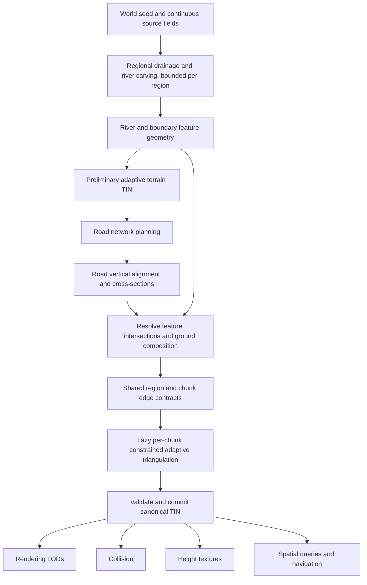
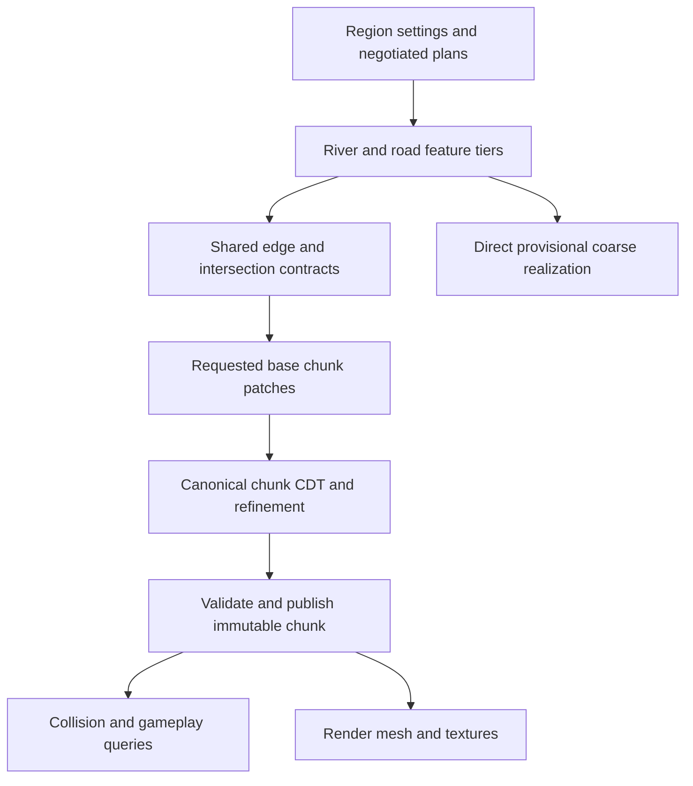
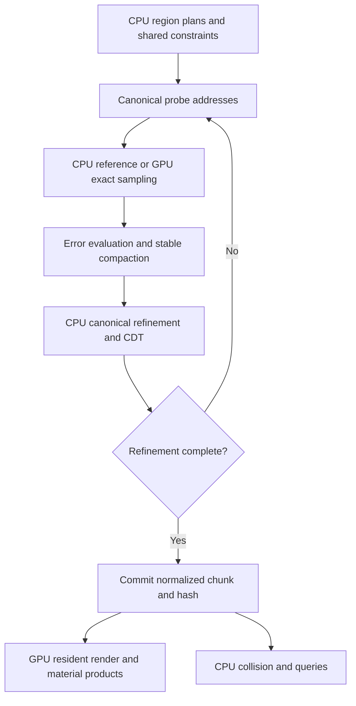

# Procgena: Canonical TIN Terrain Architecture

**Status:** Proposed greenfield technical design (revision 4: deterministic GPU-accelerated world generation). Reviewed against the code 2026-11-25: see section 21 for corrections and the open decisions (gate D6). Scheduled as the CT milestones in [ROADMAP.md](../ROADMAP.md).  
**Revised 2026-11-26 (the user):** every chunk level, not only level 0, is a canonical TIN level, and the TIN is the ground everywhere (D6b, section 21.2). Where this document says canonical geometry is realized "per level-0 chunk", read "per chunk at each level". See [terrain/terrain_lod.md](../terrain/terrain_lod.md).  
**Scope:** Terrain generation, representation, feature integration, queries, streaming and derived runtime products

## 1. Executive summary

Procgena should use a chunk-conforming, feature-constrained, adaptive triangulated irregular network (TIN) as its authoritative generated ground surface. Regular height grids remain useful temporary computational representations, but are not the permanent terrain format. Roads, rivers, shores, banks, cuttings, embankments and region seams become explicit geometric constraints rather than features that must survive raster sampling.

The proposed design separates the continuous source terrain, transient computation buffers, semantic feature geometry, canonical ground mesh and derived runtime products. A constrained Delaunay triangulation (CDT) provides the planar topology; adaptive error-driven refinement determines where extra samples are needed. Road routing may use the same preliminary terrain mesh, but its routing graph is a distinct data structure and must account for directional terrain costs and heading constraints.

The canonical topology conforms to the existing world-aligned 64 m level-0 chunk lattice as well as irregular region boundaries and feature breaklines. No canonical triangle crosses either boundary. Regions own planning and biome semantics; chunks own independently loadable ground geometry. Higher rendering LODs may remove internal chunk edges, and distant provisional terrain must not require every fine chunk to be realized.

Seed reproducibility is a mandatory architectural invariant: canonical terrain and gameplay-relevant feature geometry must be independent of request order, scheduling, cache state, camera and graphics quality. Cross-platform bitwise identity is the design target for supported platforms, with an explicit numerical contract and conformance tests.

Use a deterministic CPU reference with batched WGPU/WGSL acceleration of sampling, refinement analysis and road distance fields, and GPU-resident derived rendering products. Investigate constrained root meshes with hierarchical bisection and fully GPU CDT as measured research alternatives.

This is a greenfield architecture, not a migration plan. Performance and accuracy targets must be validated against representative generated worlds before fixing defaults.

## 2. Goals and non-goals

### Goals

- Represent narrow engineered features accurately without imposing their resolution on an entire region.
- Allocate triangles according to geometric complexity and feature importance.
- Support deterministic, independently generated regions with watertight shared seams.
- Reproduce canonical chunk bytes and feature identities from the same world definition and ordered edits, independently of scheduling, eviction and load order. Target bitwise agreement across supported CPU architectures and any canonical GPU backend.
- Provide an authoritative surface for elevation, normals, collision, materials and downstream generation.
- Allow efficient construction of rendering LODs, raster height textures and routing graphs.
- Preserve semantic road and water geometry for later queries and regeneration.
- Make preprocessing parallelizable and avoid unnecessary full-resolution raster allocation.

### Non-goals

- Eliminate all regular grids or require every algorithm to operate on triangles.
- Represent overhangs, tunnels and bridge decks in a single-valued ground surface.
- Guarantee continuous globally optimal road routing using standard Polyanya.
- Require one mesh topology to serve every rendering, physics and navigation workload.
- Guarantee exact reconstruction of arbitrary procedural noise from finite samples.
- Require identical rendered pixels, camera-dependent LODs or visual-only effects across hardware.

## 3. Representation hierarchy

| Representation | Role | Lifetime |
|---|---|---|
| Procedural source field | Base elevation, climate and material functions | Reconstructible from world configuration and seed |
| Computation grids | Bounded per-region drainage, river tracing, routing rasters and other stencil computation (analytic or bounded per region; no iterated simulation) | Temporary or cached intermediate |
| Semantic feature model | Road alignments, watercourses, cross-sections, seam contracts | Persistent generation data |
| Preliminary TIN | Adaptive approximation of pre-road terrain; optional routing substrate | Intermediate |
| Canonical TIN | Final authoritative piecewise-linear ground surface | Persistent or deterministically rebuildable level-0 chunk artifact |
| Derived products | Render LODs, collision meshes, height textures, routing graphs | Rebuildable caches |

The canonical mesh is authoritative for the generated ground, while the source field and semantic features remain authoritative inputs to regeneration. Once a canonical chunk is committed, downstream elevation queries must not silently sample the uncarved source field.



The preliminary TIN is optional: raster road routing can remain the simpler first implementation. Do not assume triangulating twice is cheaper than sampling a grid; benchmark both.

## 4. Mathematical terrain model

Represent the terrain as a piecewise-linear graph over the horizontal plane:

`y = H(x, z)`

A vertex contains a horizontal position and elevation. Each nondegenerate triangle defines an affine surface:

`H_t(x, z) = a_t x + b_t z + c_t`

The triangle's gradient is constant, `g_t = (a_t, b_t)`. The directional grade along a horizontal unit vector `v` is `abs(dot(g_t, v))`. An upward normal is proportional to `(-a_t, 1, -b_t)`.

Inside a triangle, elevation is evaluated by barycentric interpolation. Adjacent triangles share identical endpoint elevations, so their surface agrees along the shared edge; gradients may differ, deliberately at terrain breaklines.

This model supports steep slopes but not genuinely vertical walls or multiple elevations at a single horizontal position. Bridges, tunnels, caves and retaining-wall faces that violate the heightfield model require separate geometry. A bridge deck should not overwrite the riverbed beneath it.

## 5. Canonical chunk data model

The following Rust types are illustrative; exact serialization and indexing are implementation decisions.

```rust
#[derive(Clone, Copy, Debug)]
pub struct TerrainVertex {
    // Canonical integer centimetres (D6d; built as `TinVertex` with
    // `Cm` x/z and a `CmHeight` height).
    pub x_q: i64,
    pub z_q: i64,
    pub height_q: i64,
}

#[derive(Clone, Copy, Debug)]
pub struct TerrainTriangle {
    pub vertices: [u32; 3],
    pub material: u32,
}

#[derive(Clone, Copy, Debug)]
pub struct ConstraintEdge {
    pub vertices: [u32; 2],
    pub feature_id: u64,
    pub kind: ConstraintKind,
}

#[derive(Clone, Copy, Debug)]
pub enum ConstraintKind {
    RegionBoundary,
    ChunkBoundary,
    RoadCentre,
    RoadShoulder,
    CuttingCrest,
    EmbankmentToe,
    RiverThalweg,
    RiverBank,
    Shoreline,
    Ridge,
    MaterialBoundary,
}

pub struct TerrainChunk {
    pub key: ChunkKey,
    pub origin: [f64; 2],
    pub vertices: Vec<TerrainVertex>,
    pub triangles: Vec<TerrainTriangle>,
    pub constraints: Vec<ConstraintEdge>,
    // Boundary contract references, bounds, version and provenance omitted.
}
```

Prefer canonical quantized integer world coordinates for topology, shared identities and serialization. Compact chunk-local integer offsets may be encoded losslessly relative to a canonical origin; derive local f32 GPU vertices from this representation, never the reverse. Millimetre units are an illustrative starting point, not a fixed decision. Establish the supported world extent, precision, integer widths, overflow behavior and rounding before selecting the encoding. World-space f64 may be used for non-authoritative calculations, or for canonical calculations only under the deterministic numeric contract in section 14. Independent conversions must never produce different shared coordinates.

Keep build-time adjacency, half-edge structures and spatial indices separate from the serialized mesh unless benchmarks justify persisting them. Store stable feature IDs separately from transient triangulation handles. Triangle order, winding, coordinate units, material semantics and schema versions must be specified.

## 6. Constrained triangulation

Use a planar straight-line graph (PSLG) as the input to constrained Delaunay triangulation. Its vertices and segments describe the region boundary and all geometry that must appear in the triangulation. CDT preserves required segments (possibly split into subsegments), while choosing the remaining edges using a constrained Delaunay criterion.

A constraint is an edge in the horizontal domain, not an elevation discontinuity. All features meeting at a vertex must agree on the final ground height there. The triangulator solves topology; it does not resolve contradictory height prescriptions.

### Input preparation

1. Assemble the intersection of the owning region and the level-0 chunk, including all disconnected components if present.
2. Collect feature polylines and sample curved geometry to a chord-error tolerance.
3. Detect intersections, split segments at shared vertices, and normalize overlapping or duplicate segments.
4. Resolve competing ground-height prescriptions and feature semantics at intersections.
5. Insert immutable seam vertices and constraints.
6. Insert interior feature constraints and seed samples.
7. Triangulate and refine the interior; clip or classify faces outside the patch.
8. Assign elevations from the composed target ground surface and validate.

Use robust geometric predicates for orientation and intersection decisions. Normalize and sort vertices and segments before insertion, define exact-zero tie-breaking for co-circular configurations, and use deterministic intersection construction (not merely robust predicates). A pinned CDT library is not itself a cross-platform determinism guarantee. A CDT is not guaranteed to produce well-shaped triangles in the presence of arbitrarily acute input angles. Apply quality refinement with minimum feature separation, a vertex budget and termination safeguards; never split a locked seam independently.

## 7. Adaptive refinement

The target is to minimize mesh complexity subject to acceptable approximation error and feature fidelity, rather than target a fixed global spacing.

For a triangle `t`, sample the target surface `H*` at interior probes and edge midpoints. Define:

- Height error: `max(abs(H*(p) - H_t(p)))`.
- Gradient error: `max(norm(grad(H*)(p) - grad(H_t)))` where the target gradient is meaningful.
- Normal error: angular deviation between target and triangle normals.
- Edge length: longest horizontal triangle edge.
- Shape quality: minimum angle or radius-to-edge ratio.

Height and gradient error must be evaluated within smooth feature domains, not across intentional sharp breaklines. Near a road or river, geometric cross-section tolerances take precedence. Finite sampling provides an empirical approximation criterion, not a rigorous continuous error bound; use conservative maximum spacing or analytic bounds for high-frequency source fields.

### Refinement algorithm

```text
construct constrained seed triangulation
compute violation score for each triangle
push violating triangles into a priority queue
while queue is nonempty and vertex budget remains:
    remove highest-priority valid triangle
    choose worst-error sample or quality-refinement point
    if insertion would violate a locked boundary or minimum spacing:
        record unresolved error and apply permitted local policy
        continue
    insert sample with elevation from target surface
    update affected triangles and their error scores
validate all remaining triangles and report unmet tolerances
```

Use deterministic priority tie-breaking and stable sample order, with explicit probe coordinates, quantized error comparisons where appropriate, stable geometric face keys, and deterministic stale-entry and budget handling. Parallel probe evaluation may return in any order but must be reduced in canonical order. Commit topology changes in a deterministic sequence. Avoid rescanning the entire mesh on each insertion: only affected faces need reevaluation. Cache expensive source samples where practical.

### Initial tolerance policy

Use configurable profiles rather than one universal tolerance. The following values are starting hypotheses for metre-scale terrain, not validated defaults.

| Domain | Height error | Gradient error (rise/run) | Maximum edge length |
|---|---:|---:|---:|
| Road and shoulder | 0.10 m (0.05 m before the cm units of 2026-11-26) | 0.01 | 2–5 m along alignment |
| River bed and banks | 0.10 m | 0.03 | 2–5 m |
| General terrain | 0.5 m | 0.05 | 25–50 m |
| Distant low-detail terrain | 2 m | 0.10 | 100 m |

Road cross-section edges must be represented explicitly even when narrower than the local maximum edge length. Set source bandwidth, feature spacing, refinement budgets and allowable errors together. A steep but perfectly planar slope can be represented by large triangles if the approximation criteria are satisfied.

## 8. Feature composition and engineered terrain

### 8.1 Roads

Road generation produces a horizontal centreline, vertical alignment, widths, curvature and cross-section parameters. Generate longitudinal breaklines for the centre, shoulders and any crest or toe where the engineered ground transitions into natural terrain.

For each alignment station, derive a stable local tangent and normal. Evaluate road surface elevation, crossfall, shoulder geometry and cut/fill side slopes. Find daylight intersections where the designed side slope meets surrounding terrain, using a bounded search and a documented fallback when no intersection exists. Connect compatible cross-section points into longitudinal constraints.

Do not simply offset a polyline and assume the result is valid. Tight curves can create offset self-intersections, and junctions can produce conflicting overlapping footprints. Construct and normalize junction polygons and cross-sections before triangulation. Preserve road widths, turning geometry and grades after meshing; test the final piecewise-linear surface rather than only the centreline.

### 8.2 Rivers and lakes

Represent the river thalweg, bed edges, bank tops and shoreline as constraints where relevant. *(Decided by the user 2026-11-25, in CT3: the composed surface has no crease at a bank top, so banks are a tolerance band beyond the water's edge, not a constraint line. The thalweg, the water's edge and pond shores are constraints.)* Use flow simulation outputs to determine channel layout and water levels. Ground geometry and water surfaces remain distinct: a water surface may be represented by a separate mesh or analytical surface. Ensure downstream continuity of channel elevation and water level according to the hydrology model.

### 8.3 Intersections and precedence

Resolve feature interactions explicitly before CDT:

| Interaction | Resolution |
|---|---|
| Road meets road | Construct common junction footprint and compatible vertical alignment |
| Road crosses river | Road breaklines end at the crossing's two bank nodes; preserve ground and riverbed between them (any bridge is a later pass's structure) |
| Road crosses river at ford | Define one compatible ground profile and water interaction |
| River enters lake | Match channel and shoreline/water level semantics |
| Road or river reaches region edge | Use shared seam crossing geometry and elevation contract |
| Overlapping cut/fill footprints | Resolve engineered surface composition and retain applicable breaklines |

A blanket precedence rule such as roads always override rivers is insufficient. Treat incompatible feature overlaps as explicit design cases with validation and diagnostic reporting.

### 8.4 Composed target surface

Define a deterministic target elevation function combining base terrain, hydrological modifications and engineered features. Use feature-local evaluators and spatial indexing to avoid scanning every feature per sample. Match the target surface at transition boundaries; avoid blending away intentional slope breaks. The final TIN approximates this composed surface, not the original source noise alone.

## 9. Road routing on the preliminary terrain mesh

An adaptive TIN can reduce road-planning state count by representing planar or slowly varying terrain with large faces. It also exposes constant per-face gradients for directional grade calculations.

However, a conventional navmesh shortest path minimizes distance, or in some variants scalar regional cost. Procgena needs a direction-dependent construction metric that penalizes grades, earthworks, river crossing angle and heading changes. The previous road design additionally uses path-dependent junction feasibility. These constraints invalidate a direct claim of standard Polyanya optimality.

### Proposed routing substrate

- Sample shared triangle edges at adaptive portal positions; include road starts, junction candidates and bridge crossing candidates.
- Connect portal samples within each navigable face using directed edges.
- Evaluate edge cost using length, directional grade, local grade limits, earthworks approximation and feature crossing penalties.
- Retain incoming heading or motion-primitive state during constrained refinement.
- Compute a relaxed reverse multi-source cost field from the existing road network to guide multiple road searches.
- Incrementally propagate distance decreases when new network targets are added, provided the relaxed edge costs only decrease or remain constant.
- Extract candidate routes and refine horizontal curvature, vertical alignment and junction feasibility against the full target terrain.

Portal spacing controls accuracy and state count. Large triangles are not automatically safe for a planner: the graph can miss feasible contour-following paths or crossing locations. Use adaptive portal refinement, candidate diversity and a raster fallback for difficult regions. A heading-independent field is admissible only if it uses lower-bound edge weights and a superset of feasible terminal states; otherwise treat it as an approximate heuristic.

Keep routing topology separate from final terrain topology. A road network can be planned on a preliminary mesh, then inserted as constraints into the final TIN. Do not require final road geometry to exist before planning it.

## 10. Region contracts, seams and deterministic generation

Independently generated regions must share the exact same boundary polyline and elevation samples. Deterministic seeding alone is not enough if adaptive refinement decisions depend on local interior geometry.

### Shared boundary contract

For each shared edge, use a canonical edge identifier and orientation. Generate one ordered sequence of samples in world coordinates, with elevations, constraint tags and feature crossings. Both neighboring regions consume that sequence, reversing orientation where necessary.

The contract should contain:

- Boundary identity, endpoints and ordered vertex coordinates.
- Ground elevation at every boundary vertex.
- Road crossing centreline, profile, width and relevant shoulder/side-slope intersections.
- River channel and bank crossings, water level and downstream identity where applicable.
- Generation version and deterministic seed inputs.
- Any optional tangent/normal information used to reduce lighting or slope discontinuities.

Compute shared boundary subdivision from boundary-local source and feature data before independent interior generation. Lock those segments. If an interior refinement algorithm requires splitting a boundary edge, either reject that insertion or coordinate a new shared contract before either neighbor commits. Never introduce an unpaired T-junction.

Shared vertices guarantee positional continuity, not derivative continuity. If smooth visual seams are required, derive consistent boundary shading normals from a shared source/halo or use a seam-compatible normal policy. Intentional cliffs and road banks may retain sharp normals.

### LOD and streaming

Keep canonical boundary samples fixed on the external perimeter of every independently selectable derived LOD initially. Internal base-chunk edges need not survive coarse simplification. Simplify interiors freely under error constraints. This may retain more boundary vertices than necessary, but avoids cracks. A later optional seam hierarchy can allow coordinated boundary simplification or transition strips. LOD meshes are derived artifacts and must not modify the canonical mesh.

### Chunk topology and ownership

The inspected source at commit `4664649cc415c9c6b7e594f39fc617ae90adf8d3` separates irregular warped regions (2 km in the default medium-small World class; 2–16 km across the D5 scale classes, a per-class World setting) from square chunks (`CHUNK_SIZE = 64.0`, `CHUNK_CELLS = 64`). Each level doubles the chunk width and covers four children. Existing rendering spacing is 1 m at level 0, 2 m at level 1, and so on. `RegionEdge` already stores a canonical orientation and shared ID; `CornerId` identifies shared region corners. Use that design pattern for chunk edges.

**Mandatory canonical invariant:** every level-0 chunk boundary is a continuous chain of mesh edges. No canonical triangle crosses it. Because the lattice is nested, higher-level boundaries are already represented; do not add redundant constraints. The constraint is topological, not a physical ridge or routing barrier.

*(Superseded by D6c, section 21.3: each level-0 chunk is triangulated as a whole and region borders are not constraints.)* For each region R and base chunk C, triangulate the planar intersection R ∩ C. Handle multiple disconnected components and all feature intersections. A mixed-region chunk aggregates these patches, with consistent winding and welded shared edges or identical duplicated vertices. Region ownership remains independent of the chunk grid. Use a deterministic half-open ownership rule for exact boundary queries and stable feature/region IDs for semantics.

### Chunk edge contract

Represent a shared edge by integer lattice coordinates and axis, in a canonical orientation. Corners use shared lattice addresses. Include the world generation/version and relevant source/feature dependency identities in cache keys. The contract contains ordered world-space coordinates and elevations, feature and region intersections, optional shared normal data, and constraint semantics. At a region/chunk/feature intersection, all participating contracts must reference the same geometric vertex. Resolve intersecting or overlapping constraints before triangulation, with robust predicates and deterministic intersection encoding.

Generate the edge from composed ground and feature plans on both sides, not from whichever chunk happens to load first. Refine the edge using height, gradient, feature and maximum segment-length criteria; lock its ordered vertices before independent interior CDT. No mandatory uniform spacing. Interior quality refinement may not insert a seam vertex unilaterally. Report unmet tolerances under a deterministic policy, or compute a revised contract from explicit, order-independent inputs before publishing either affected version. Do not revise an edge because one neighbor happened to be built first. Use deterministic shared corner elevations and shared normals for smooth surfaces; preserve intentional hard normals on breaklines.

```rust
pub struct ChunkEdgeKey {
    pub x: i64,
    pub z: i64,
    pub axis: EdgeAxis,
}
pub enum EdgeAxis { X, Z }
pub struct ChunkEdgeContract {
    pub key: ChunkEdgeKey,
    pub version: u64,
    pub vertices: Vec<BoundaryVertex>, // canonical order, world coordinates
}
```

These are illustrative interfaces, not existing APIs. The region edge contract must also be subdivided at chunk crossings; a single shared intersection resolver should own this operation to avoid near-duplicate vertices. Handle acute intersections, short segments and near-coincident features without silently removing required breaklines. A conforming triangulation is not guaranteed to be well-shaped at arbitrarily acute angles.

### Lazy realization and cache lifecycle



Retain region-level planning, including neighbor-dependent border negotiation. Do not eagerly triangulate an entire region to serve one chunk. Cache region plans, edge contracts, canonical chunks and derived products separately, keyed by the exact inputs and versions they depend on. Use single-flight builds per key, cancellation or generation counters for stale jobs, and memory-bounded eviction. Edge contracts can be computed without neighboring interior meshes. Prefetch canonical chunks for the gameplay simulation radius, not only camera visibility. Avoid synchronous queries triggering expensive planning; distinguish pending, unavailable and outside-world states.

The existing `edit_cache_plan.md` reports that chunk height sampling accounted for about 23% of cold-build CPU work in its single-thread workload without ground weights, with convergence and border evaluation dominating per-point sampling. A TIN may amortize those evaluations across consumers and reloads, but adds triangulation, edge-contract and indexing costs. Measure cold first-use separately from warm reuse; do not count caching as eliminating initial generation.

### Streaming and mixed LOD

Retain `ChunkKey`, `ChunkSelection`, `ChunkLevels`, distance hysteresis, nearest-first async reads, generation counters and the target/drawn swap lifecycle from `procgena_terrain_bevy/src/stream.rs`. Replace regular `ChunkSamples` payloads with appropriate canonical or derived mesh products. The present `Transitions` logic is regular-grid specific and needs irregular seam topology support.

A parent LOD may combine child geometry, unlock internal chunk edges, simplify under geometric/feature error and retain an externally compatible boundary. Initially preserve the full shared external edge chain, including where a large parent meets multiple fine neighbors. Identical endpoints alone are insufficient: both sides must represent the same piecewise-linear seam and compatible edge subdivision. If boundary density dominates, use nested edge simplification and explicit transition strips or coordinated stitching. Do not rely on skirts as a physical seam solution. Higher-level mesh construction from children is suitable only where children are already available or affordable; far vistas need direct coarse generation from regional rough plans, not recursive realization of all fine descendants.

Parent stand-ins currently allow coarse terrain to be subdivided while finer reads are pending. Clip the derived parent at requested child boundaries using deterministic intersections, or cache parent subpatches; reuse identical split vertices on both sides. A stand-in is provisional rendering only, never authoritative collision or ground. Keep coverage while asynchronous requests complete, and invalidate stale stand-ins on generation changes.

Rough/Mid/Fine feature tiers (`FeatureTier`; `Mid` draws roads on the coarse outline since TE7) may change elevations and feature geometry, not just tessellation. The current independent upgrade mechanism must not assume an old and new boundary are identical. Either require identical seam geometry across tiers or coordinate adjacent swaps and transition geometry; verify mixed tiers at edges and corners. Provisional far terrain must be clearly distinguished from committed canonical Fine terrain. Physical terrain is never selected by camera LOD or silently replaced by Rough geometry.

## 11. Spatial queries

Expose a stable regional terrain API independent of the triangulation library.

```rust
pub struct GroundSample {
    pub height: f64,
    pub normal: [f64; 3],
    pub material: u32,
    pub triangle: u32,
}

pub trait GroundSurface {
    fn sample(&self, x: f64, z: f64) -> Option<GroundSample>;
}
```

Use the level-0 chunk lattice as the first-level spatial index (floor world coordinates / chunk width, including negative coordinates). Locate the resident canonical chunk, then build a local spatial acceleration structure over horizontal triangle bounds: a BVH, R-tree or coarse uniform bin index. A query locates candidate triangles, tests containment and interpolates height. Use a deterministic tie-break on shared edges and vertices; material and normal discontinuities need an explicit edge policy. Return no sample for points outside the region or in holes.

Cache the last triangle with its chunk key and generation/version so stale handles cannot survive edits or eviction. Use adjacency walking for coherent queries (e.g. sampling along a road or moving object), with indexed lookup as a fallback. Batch queries for rasterization, vegetation and collision preprocessing. A uniform raster has constant-time direct lookup; a TIN does not inherently provide this and the index must be benchmarked.

Provide separate APIs for ground elevation and topmost traversable surface. The latter may consider bridges or other layered geometry. Keep the distinction explicit to avoid placing vegetation on bridge decks or routing boats on road surfaces.

## 12. Derived runtime products

### Rendering and LOD

Render the canonical indexed triangles directly when practical. Generate optional simplified meshes using feature-aware edge collapse or hierarchical triangulation. Preserve constraints, material boundaries and seam contracts; reject collapses that create inverted triangles or exceed geometric error. Generate normals with feature-specific hard edges or smooth shading, and optimize indices for GPU vertex reuse. Use chunk-local coordinates for precision and origin rebasing as needed.

### Collision

Derive a collision mesh from the canonical surface, optionally with a separate tolerance and acceleration structure. Preserve road and bank geometry necessary for vehicles. Physics simplification must not create unacceptable discrepancies with the rendered surface. Bridge decks and other separate structures contribute separate collision geometry.

### Height textures

Rasterize the canonical triangles into height textures on demand for GPU sampling, shader effects, vegetation or simulation. Specify sample locations, filtering, border padding and no-data policy. Bilinear filtering can blur sharp breaklines and should not be treated as the authoritative ground query. Use a tile cache with explicit resolution and error budgets.

### Navigation

Generate navigation graphs or walkable meshes from the final surface plus semantic road, water and obstacle data. The construction-cost road planner and runtime agent navigation have different objectives and should remain separate. Standard Polyanya may be useful for runtime distance-based navigation on suitable meshes.

### Materials and vegetation

Assign semantic surface types through feature polygons or triangle labels, and use textures or procedural fields for continuous material weights. Keep fine visual detail in shading where it does not need to affect ground geometry. Sample the final ground surface when placing vegetation; apply road, water and clearance masks from semantic features.

### Gameplay and physical consistency

Canonical Fine terrain defines the physical ground independently of camera distance. Rendering LODs may approximate it; collision simplification is controlled by separate physical tolerances, especially at roads, ramps and junctions. Bound the mismatch among canonical queries, collider contacts and visible nearby terrain. Triangle face normals are physical; shading normals may be smoothly interpolated except at hard breaklines. Validate vehicle suspension, character slope limits, footsteps and traction across edges and chunk seams. Build stable chunk colliders and agent-specific navmeshes; portal links must agree across adjacent chunks and support crossing artificial partition edges without treating them as obstacles. Bridge decks, tunnels and caves have independent colliders and navigation layers. Use explicit APIs for ground versus traversable surfaces.

Keep face/feature semantics for surface type, roads, riverbeds, cuttings, foundations and region identity; continuous material blends, soil moisture and vegetation density can remain procedural or texture-based. Preserve the existing world-space placement/address semantics; chunk ownership is not a replacement for region/biome identity. GPU consumers may use derived height/material textures, with error limits for placement and slope decisions.

Occasional terrain edits can identify affected chunks, update shared contracts when an edit touches a seam, retriangulate local patches and rebuild dependent spatial indices, collision, navigation and render products. Publish a consistent version across affected neighbors; avoid physical changes mid-step. Extensive continuous terraforming is a separate workload requiring benchmarks and potentially a different editable representation.

## 13. Storage, performance and GPU strategy

For a square 2 km region sampled every 2 m, a regular raster contains 1,002,001 height samples, consuming approximately 4.0 MB as f32 values. An interior triangulated mesh typically has approximately twice as many triangles as vertices. With 12 bytes per vertex (three 32-bit chunk-local values, the compact lossless encoding of section 5; the illustrative `i64` world encoding would be 24) and 12 bytes per triangle (three u32 indices), the simplified storage estimate is 36 bytes per vertex, excluding attributes, constraints and indices for queries.

| Adaptive vertices | Approximate core mesh size | Comparison with 4.0 MB raster |
|---:|---:|---|
| 200,000 | 7.2 MB | Larger |
| 100,000 | 3.6 MB | Slightly smaller |
| 50,000 | 1.8 MB | Smaller |
| 10,000 | 0.36 MB | Much smaller |

The break-even point is roughly a ninefold vertex reduction under this model. The actual ratio depends on terrain roughness, feature density, boundary size, coordinate encoding and metadata. The raster comparison excludes raster-derived rendering indices; the two representations should be compared at equivalent output accuracy.

### Boundary overhead and chunk sizing

For an infinite square lattice of width L and uniformly sampled edge segments of length d dividing L, the unique shared boundary vertex density is `(2*L/d - 1)/L^2` per square metre. At L=64 m and d=8 m this is approximately 3,662 vertices/km² (0.366% of a 1 m heightmap's sample count). This excludes interior vertices, feature intersections and duplicated GPU buffers. Adaptive edge sampling may reduce or increase the count. A flat featureless base chunk can theoretically use two triangles rather than the current 8,192 regular triangles; actual counts depend on edge length, shape and feature constraints. Keep 64 m as the initial size and benchmark alternatives; it is not a proven optimum. Measure complete storage, including indices, semantic attributes, seam metadata, local indices, and duplicated vertices, rather than comparing vertex count alone.

### CPU/GPU division

| Stage | Preferred starting implementation |
|---|---|
| Source height and gradient evaluation | Parallel CPU; GPU batching when source supports it |
| Drainage and river carving (bounded per region) | Regular-grid GPU or parallel CPU |
| Constraint intersection and CDT | CPU robust geometry |
| Error probe evaluation | Batched CPU or GPU |
| Refinement topology updates | CPU initially |
| Weighted road distance propagation | CPU Dijkstra or GPU delta-stepping |
| Rasterizing derived height textures | GPU or parallel CPU |
| Render mesh processing | CPU preprocessing and GPU rendering |

Topology mutation and robust geometric predicates are irregular workloads. Do not move them to the GPU merely because other terrain stages benefit from GPU compute. Batch independent regions and source evaluations; track transfer costs and peak memory.

### 13.1 GPU architecture and authority

Design for GPU acceleration from the start, without requiring a GPU to build a world. The engine-free CPU backend is the normative reference and remains available for servers, tests and unsupported hardware. GPU backends must implement the same versioned canonical numeric and algorithmic contract; changing backend is not a world-generation setting. A GPU proposal may be used only if the final canonical selection is independent of the proposal or exactly equivalent to the reference. Approximate GPU computations remain useful for previews and visual products, but cannot decide canonical vertices, elevations or topology merely because their output looks similar.

| Work | Initial backend | Longer-term option |
|---|---|---|
| Region graph, feature negotiation, shared edge contracts | CPU | Parallel independent region tasks |
| Height, slope, curvature and error probes | Parallel CPU reference | Batched deterministic WGPU kernels |
| Drainage, carving and directional edge costs | CPU reference | Regular-grid compute with exact update semantics |
| Constraint intersections and topology mutation | Robust CPU geometry | GPU CDT experiment with canonical equivalence |
| Road distance propagation | CPU Dijkstra | Integer GPU delta-stepping |
| Road turns, junctions, vertical alignment | CPU | Batched independent profile solves |
| LOD and physical product preparation | CPU | GPU mesh processing / hierarchical refinement |
| Materials, visual vegetation, culling, indirect drawing | GPU where supported | Fully GPU-resident derived data |

The existing [GPU terrain progress notes](https://github.com/phayes/procgena/blob/4664649cc415c9c6b7e594f39fc617ae90adf8d3/terrain/gpu_progress.md) describe retained `GroundGrid` samples, ordered GPU material evaluation into two RGBA8 textures, stable material palettes, CPU fallbacks and independent repainting. Reuse these concepts. The recorded Metal test allows one byte per channel in material weights, which is appropriate for visual-only paint, not a canonical geometry conformance test. The notes explicitly report no measured cold-build gain and retain CPU site/measure sampling. Planned relief previews and GPU convergence/carving evaluation are useful foundations; approximate millimetre parity is insufficient when an evaluation influences canonical topology.

### 13.2 Batched adaptive sampling and refinement

Separate geometric discovery from topology mutation. Initially use the CPU CDT and the deterministic refinement rule of section 7. Evaluate a predetermined batch of candidate positions on the CPU or GPU, compute source heights and error against the current triangle planes, compact candidates, and return their stable IDs and values. The authoritative algorithm selects vertices using the specified total ordering. Parallel probe evaluation is compatible with serial insertion; inserting every candidate from a batch is a different algorithm unless the reference explicitly defines that batch policy.



Use a coarse candidate hierarchy or bounded sample lattice with deterministic positions and sample spacing. Dense sampling can detect errors efficiently on the GPU but is not inherently adaptive in computational cost; compare it against progressive probe evaluation. Neither sparse samples nor GPU error flags prove a continuous error bound without a source regularity bound. Preserve the error validation and termination policy from section 7. Mandatory feature vertices and locked boundary contracts always take precedence over refinement budgets.

Batch independent chunks to amortize command submission and readback. At 1 m spacing a 64 m chunk has 4,225 candidate samples; 64 chunks have 270,400 samples, or approximately 3.1 MiB for three 32-bit height/gradient values per sample. At 0.5 m spacing the same batch has 1,065,024 samples (about 12.2 MiB), excluding constraints and scratch storage. Benchmark 1, 16, 64 and 256 chunks per batch, including latency for the first required chunk. Batch size, compaction ordering and dispatch geometry must not alter the canonical result.

### 13.3 GPU memory and scheduling

Use WGPU/WGSL storage buffers with packed arrays and explicit offsets, not pointer-heavy topology. Keep regional feature plans and source parameters resident when shared by many chunks. Use chunk-relative coordinates for visual computation; canonical coordinates must follow section 14. Retain probe, cost and material buffers across dependent passes. Use prefix scans to compact selected candidates, and canonical sort or stable indexing when the order influences results. Bound scratch allocations and queue depth; split oversized jobs without changing canonical semantics.

Read back compact canonical candidate records, paths or final mesh artifacts asynchronously, not a dense intermediate field on every iteration. Where the CPU refinement loop requires repeated synchronization, measure whether a CPU-only loop is faster. A GPU-native path extractor can return a compact route, but CPU heading-aware A* may need a corridor of distance values; include that transfer in comparisons. Never block synchronous gameplay queries on GPU readback. Canonical CPU artifacts should be prefetched and retained within the simulation radius. Visual-only buffers can stay entirely GPU-resident.

```rust
#[repr(C)]
pub struct GpuTerrainVertex {
    pub position: [f32; 3], // chunk-local, derived visual representation
    pub packed_attributes: u32,
}

#[repr(C)]
pub struct GpuTerrainTriangle {
    pub vertices: [u32; 3],
    pub flags: u32,
}
```

Specify shader layout, alignment, offsets and packing in tests rather than assuming Rust and WGSL structs agree. Generation counters and cancellation prevent stale GPU results from being committed after edits; use the existing stream lifecycle and content-keyed caches. Schedule background compute with bounded per-frame budgets so terrain generation does not monopolize the renderer. A failed or unavailable GPU job falls back to the reference without changing world identity.

### 13.4 Deterministic GPU road distance fields

Prefer temporary regular grids initially: implicit adjacency, predictable addressing and coalesced accesses simplify propagation. The canonical TIN need not be the computation graph. Compare raster and adaptive portal graphs using the same route quality objectives. Compute deterministic nonnegative directed edge weights for grade, earthworks, river crossings and relaxed network reuse. Reverse multi-source propagation must use the original forward edge cost in reverse traversal. Seed new network vertices and propagate decreases; if an edit increases costs, use a correct invalidation/recompute policy. For A* admissibility, the relaxed graph must include every feasible constrained transition at no greater cost, and its destination set must be a superset of feasible joins.

Implement CPU integer Dijkstra first and test GPU bucketed relaxation/delta-stepping against it. Atomic minimum computes distances, not authoritative predecessors. Use a separate deterministic extraction step: choose an edge satisfying `D(u) = w(u,v) + D(v)` with stable tie-breaking and strictly decreasing distance (require positive quantized edge costs or specify an acyclic secondary rank for zero-cost edges). Do not stop at a fixed iteration budget and call the result exact; prove convergence or mark it provisional. The heading-aware CPU refinement, junction compatibility and final grade/crowding validation remain necessary. Retain the full constrained-search fallback when a corridor fails.

```wgsl
// candidate is computed with checked range semantics, INF reserved.
atomicMin(&distances[next], candidate);
```

Portable WGSL integer atomics are 32-bit; define cost units, maximum path cost, sentinel, checked addition and overflow policy before selecting a representation. If the bound cannot fit in a u32, choose a proven wider representation or the CPU reference rather than silently saturating distinct finite paths to the same value. Verify relaxed distances, extracted routes and final feature hashes independently. Canonical CPU and GPU algorithms must agree, not simply have similar route costs.

### 13.5 Hierarchical refinement and GPU triangulation research

Prototype two canonical topology strategies before choosing one:

| Strategy | Strength | Risk |
|---|---|---|
| Error-driven constrained Delaunay insertion | Flexible arbitrary feature alignment and point placement | Mutable topology and irregular work; repeated LOD simplification |
| Constrained root triangulation + conforming longest-edge bisection | Stable subdivision addresses, reusable error hierarchy, parallel refinement and LOD | Conformity propagation, root triangle quality and feature preservation |

For the second strategy, first insert the complete boundary contracts and engineered breaklines into a coarse constrained root mesh. Refine by deterministic bisection, propagate splits to compatible neighbours, and encode the hierarchy using stable root IDs and subdivision paths. Shared chunk boundary subdivisions are determined in advance by the edge contract; no interior refinement may unilaterally split a locked boundary. If conformity cannot be achieved without new boundary points, revise the predetermined contract or use a deterministic alternative refinement policy. Do not allow generation order to determine edge density.

```rust
pub struct TerrainNode {
    pub vertices: [VertexId; 3],
    pub children: Option<[NodeId; 2]>,
    pub geometric_error: u32,
    pub flags: TerrainFlags,
}
```

The canonical mesh is the fully refined, conforming leaf set. Runtime LOD selects conforming cuts of the hierarchy using conservative error bounds; camera-dependent subdivision must not mutate canonical topology. Collision may use a stable physical-error-bounded cut independent of camera. Coarse rendering chunks spanning multiple base chunks still need aggregation and simplification that can remove internal root/chunk constraints; a bisection hierarchy alone cannot accomplish that. Benchmark hierarchy storage, mandatory feature overhead and worst-case conformity propagation. Concurrent Binary Trees are a candidate GPU scheduling/subdivision structure, not a guaranteed drop-in implementation for arbitrary CDT roots.

Investigate gCDT and earlier GPU constrained triangulators as a separate research track. Published large-batch GPU results (including reported gCDT throughput of up to ten million vertices in roughly 0.1 s on an RTX 4090) are not Procgena measurements. Verify the primary paper, workload, code availability, license, exact predicates, degeneracy policy and portable WGPU feasibility before relying on those figures. CUDA-oriented implementations may require substantial redesign. A GPU CDT backend is acceptable for canonical output only if its normalized topology and coordinates match the reference, including degenerate cases; otherwise use it for previews or other non-authoritative products. Prefer CPU parallel CDT across small independent chunks until a measured bottleneck justifies this work.

### 13.6 GPU-resident rendering and derived products

Upload compact committed canonical chunk geometry or cached derived LODs once. Use GPU frustum/occlusion culling, screen-space error selection, indirect drawing, material evaluation and visual scatter where supported. Hierarchical bisection or meshlets may improve runtime geometry management; compare against simple chunked indexed meshes before increasing complexity. Preserve feature edges and mixed-LOD seam contracts. Visual normals and texture weights may use approximate arithmetic; gameplay-relevant vegetation, collision and placement must consume canonical ground and stable addresses. Derived GPU height textures can accelerate bulk visual sampling, but are not automatically exact substitutes for triangle queries near breaklines.

### 13.7 Performance model and prototype gates

The pinned cache plan reports approximately 76% of cold-build CPU work in planning and 23% in chunk height sampling, excluding ground weights, with substantial measurement caveats. If those fractions held, eliminating sampling alone would yield at most about 1.30x overall speedup. Amdahl's law, `S = 1 / ((1-f) + f/s)`, makes the need for faster regional routing and fewer analytic evaluations explicit. The TIN architecture changes the workload, so remeasure rather than treating historical shares as permanent. For a 10x end-to-end target, at least 90% of original work must be removed or accelerated in the ideal infinite-speed limit; finite acceleration and overhead demand more.

Measure CPU reference, parallel CPU, hybrid GPU sampling, GPU routing and experimental GPU CDT separately, including cold/warm wall time, time to first visible and playable chunk, p95 latency, CPU and GPU time, queue wait, dispatch/readback bandwidth, peak host/device memory, renderer frame-time impact, and canonical parity. Report generation work separately from asynchronous latency hiding. Compare equal-quality terrain and road constraints, across plains, mountains, feature-heavy and mixed-region chunks, multiple batch sizes and GPU classes. Test headless fallback, cancellation, eviction and partial failures. Require exact canonical hashes for supported backends before enabling canonical GPU stages by default. No GPU performance target is considered achieved without representative end-to-end measurements.

## 14. Determinism, numerical contract and serialization

### 14.1 World identity and reproducibility contract

Canonical terrain is a pure function of the normalized world definition, not of the execution history:

```text
WorldDefinition = (seed, normalized settings, generator version, numeric profile)
CanonicalChunk = G(WorldDefinition, ChunkKey, relevant ordered edits)
```

The generator version identifies the algorithms, constants, seed derivation, tie-breaking, dependency versions and numerical rules that affect canonical output. A schema version separately identifies the asset encoding. Changing an output-affecting algorithm may change a seed's world; reproducibility is defined within a generation version, not across arbitrary revisions.

Mandatory guarantees within a supported deterministic profile:

- Same inputs produce identical canonical vertices, heights, face topology, constraints, feature identities and semantic attributes.
- Chunk and region request order, worker count, task scheduling, cancellation, cache hits, eviction and neighboring interior availability do not change output.
- Camera, rendering quality, provisional feature tiers and LOD selection do not change canonical ground or gameplay-relevant placement.
- Independently generated adjacent chunks and regions agree exactly on shared boundary contracts.
- Ordered terrain edits reproduce the same edited canonical surface.

Cross-platform bitwise identity across supported x86-64 and ARM64 targets is the recommended initial design target. Do not advertise it until verified. If additional platforms or GPU backends cannot satisfy it, they may consume canonical assets or run non-authoritative stages; they must not silently generate a different canonical world under the same identity.

### 14.2 Numerical contract

A seed alone does not guarantee reproducibility. Floating-point fused operations, compiler settings, transcendental implementations, GPU precision, reduction order and near-degenerate geometric decisions can alter output. Define a versioned numerical profile before implementing the canonical generator.

| Concern | Required policy |
|---|---|
| Coordinates and elevations | Canonical integer/fixed-point encoding, defined units and supported range; lossless local offsets permitted |
| Arithmetic | Explicit rounding, intermediate widths, overflow checks and handling of invalid inputs |
| Source height and noise | Deterministic implementation and fixed evaluation order; no unspecified platform math for authoritative decisions |
| Geometric predicates | Exact or robust orientation/incircle tests, deterministic zero cases |
| Intersections | Exact rational or deterministically rounded constructions with topology validation; no independent epsilon snapping |
| Error priorities | Stable comparisons, fixed probes and tie-breaks; quantization only under controlled arithmetic |
| Graph costs | Nonnegative deterministic integer or fixed-point costs, explicit saturation/infinity rules and sufficient accumulator width |
| Reductions | Fixed ordering or mathematically order-independent exact operations |

Quantizing a platform-dependent floating-point result does not prove determinism: values can fall on opposite sides of the rounding threshold. Use deterministic source mathematics or exact arithmetic for decisions that affect topology, feature placement and canonical values. Establish bounds for intermediate products, especially incircle determinants and rational intersections at large coordinates; use wider or arbitrary precision arithmetic where necessary. Validate minimum feature spacing after snapping. A quantization grid must not silently collapse narrow roads or invalidate constraints.

Use canonical local coordinates where useful to reduce numeric range, but derive all shared positions from one world-space representation. Rendering f32 positions, shading normals and texture filtering may be approximate derived data. If a gameplay system needs a normal or gradient deterministically, specify its arithmetic and encoding too.

### 14.3 Identity, randomness and shared boundaries

Build on Procgena's existing `RegionId`, `RegionEdge`, `CornerId` and hierarchical seed conventions. Give chunk edges and corners canonical integer lattice addresses (including negative coordinates, with specified floor division). Seed feature decisions from stable domain-separated keys such as world seed, region ID, feature role and candidate ID. Use a pinned PRNG or counter-based generator with specified integer-to-value conversion. Do not share mutable PRNG streams across tasks or derive persistent identity from array indices, thread IDs or allocation order.

A shared edge contract is a pure function of its edge key and explicit source/feature dependencies from both sides. Specify canonical axis direction, endpoints, sorted intersection events, adaptive boundary probes and elevations. Region/chunk/feature intersections must pass through the same deterministic resolver, including coincident segments and corner events. Both consumers refer to the same encoded positions and heights. Boundary subdivision is independent of neighbor interior refinement and immutable for that input version.

Dependency discovery must itself be deterministic and bounded. A chunk may require neighboring region plans, but not neighboring realized meshes. A cache miss is not a reason to substitute a different canonical result. Cache provisional work separately and publish only complete, validated canonical artifacts.

### 14.4 Deterministic triangulation and refinement

Constrained Delaunay triangulation can admit multiple valid topologies, notably for co-circular points. Specify canonical input ordering, duplicate handling, constraint splitting, exact-zero predicate policy and deterministic tie-breaking (for example, a consistent symbolic perturbation keyed by stable vertex identity). Validate that the chosen library implements the policy or supply a controlled implementation. Pin and test dependency versions; insertion order alone does not prove uniqueness or platform parity.

Use stable geometric keys for vertices and faces, rather than mutable triangulator handles. A refinement priority can be represented as:

```rust
struct RefinementPriority {
    error_q: u64,
    face_key: CanonicalFaceKey,
    probe_key: ProbeKey,
}
```

Define a total ordering for this tuple, including tie direction. Specify candidate positions, score aggregation, quality constraints, minimum spacing, budget limits, rejected insertions and unresolved-error reporting. Evaluate independent probes in parallel if desired, then consume them in a fixed order. Initially mutate each chunk's topology serially; parallelize chunks rather than allowing competing topology edits. Stable keys and deterministic invalidation of stale queue entries prevent task timing from influencing refinement.

### 14.5 Road routing and feature planning

The road network is canonical world geometry. The earlier road-routing proposal must satisfy the same determinism contract, whether it uses a grid, portal graph or adaptive mesh.

- Sort road starts, river events, candidate junctions and feature conflicts by specified stable keys. Incremental network reuse makes the sequence of committed roads significant.
- Define graph adjacency order, priority-queue ties, equal-cost predecessor rules, retry limits and blocked-cell updates. Include path-dependent climb feasibility in the state/label policy; determinism is not a substitute for correctness.
- Define portal coordinates and IDs independently of mesh traversal order. Resolve equivalent paths using stable IDs rather than discovery timing.
- Quantize edge costs using the numeric profile, with positive traversal costs where practical; verify that quantization preserves meaningful construction-cost differences. Specify weighted-A* weights and tie rules.
- Use controlled arithmetic for smoothing, grade-limited alignment, road widths, bank geometry, river carving and feature intersection precedence. Validate final road grades and cut/fill bounds after canonical rounding.

A GPU-compatible reverse distance field can remain deterministic. Compute fixed-point nonnegative distances using exact integer relaxations (e.g. atomic minimum, with explicit overflow and convergence checks). GPU scheduling may change work order but must not change the converged distance values. Reconstruct paths in a separate deterministic pass: choose among successors satisfying the shortest-path equality using a stable total order. Require strictly decreasing distance or an explicit acyclic tie policy for zero-cost edges. Do not use the winner of an atomic update as the authoritative predecessor. An approximate field, early termination or nondeterministic fallback cannot be authoritative unless its output is independently canonicalized and validated against the defined algorithm. Test incremental updates against a full rebuild of the relaxed graph.

### 14.6 Parallelism and CPU/GPU authority

| Stage | Deterministic implementation policy |
|---|---|
| Region planning and seed derivation | Independent keyed tasks; stable feature ordering |
| Boundary contracts | Pure shared computations; single-flight cache optional |
| Canonical CDT | CPU initially, deterministic serial topology mutations per chunk |
| Source/probe evaluation | Parallel CPU or verified deterministic GPU; fixed reduction semantics |
| Drainage and carving | Deterministic updates, tie rules and boundary conditions; no unordered floating-point accumulation |
| Road distance field | CPU baseline; integer GPU backend only after parity tests |
| Rendering meshes and material textures | Derived from canonical data; visual-only variation permitted |
| Placement, collision and gameplay navigation | Stable canonical inputs; deterministic outputs where they affect persistent world identity |

Do not require bitwise rendering or physics simulation parity merely to reproduce terrain assets. Multiplayer lockstep simulation, if required, is a separate determinism contract. GPU acceleration is desirable, but canonical CPU/GPU parity is a gate, not an assumption. Nonconforming GPU stages may still accelerate previews, visuals or non-authoritative proposals.

### 14.7 Canonical serialization, hashing and cache identity

Define a versioned canonical asset containing chunk key, canonical coordinate origin and units, vertices, indices, constraint metadata, semantic attributes, feature references, seam contract hashes and generation provenance. Normalize records before hashing:

1. Sort vertices by their canonical geometric identity; remap every index.
2. Normalize face winding and cyclic index order, then sort face records.
3. Normalize constraint orientation and sort constraint records and semantic attributes.
4. Serialize using fixed-width encodings, specified byte order and schema version; exclude padding, transient handles, timings, cache state and nondeterministic metadata.
5. Compute a content hash (BLAKE3 is a candidate) over normalized bytes, not over in-memory structs or arbitrary compressed output.

Use separate dependency keys (what must be built) and content hashes (what was built). Derived caches depend on canonical content identity, product settings and product version. Cache eviction, concurrent duplicate computation and cancellation must not change the returned canonical artifact. Persistent feature identities must not depend on mesh array indices; triangulation changes must not inadvertently readdress unrelated world objects.

Record unresolved refinement errors deterministically. A failed or incomplete build must not be published as a validated canonical asset. If a bounded algorithm permits an approximate result, its acceptance policy and diagnostics must be defined as part of the versioned generator.

### 14.8 Edits and regeneration

Keep the procedural base reproducible from its world definition. If gameplay edits are supported, model them as explicit versioned operations with stable identities and a canonical ordering or deterministic conflict-resolution policy. Rebuild the affected chunk patches and shared boundary contracts from the base plus the relevant edit history (or a verified equivalent snapshot). Invalidate collision, navigation, material and rendering products consistently; publish coordinated seam versions. Arrival order of asynchronous edit jobs is not the edit ordering policy.

### 14.9 Determinism conformance tests

| Test | Required result |
|---|---|
| Golden seeds and versions | Identical normalized canonical hashes for fixed world definitions |
| Request order | Permutations of region/chunk requests agree |
| Thread counts | 1, 2, 4 and 8 workers agree; stress randomized schedules |
| Isolation and concurrency | Isolated requests and concurrent neighborhood builds agree |
| Cache behavior | Cold, warm, evicted, cancelled and regenerated builds agree |
| Cross-platform CI | Supported x86-64/ARM64 OS and compiler profiles agree before claiming parity |
| CPU/GPU parity | Canonical backends agree on distance fields, path extraction and final chunk hashes |
| Degenerate PSLGs | Co-circular, collinear, near-coincident and overlapping constraints resolve consistently |
| Boundary identity | Region, chunk, corner and feature intersections encode identical shared vertices |
| LOD and feature tier | Camera motion, quality settings and provisional work never alter canonical hashes |
| Road ties and retries | Equal-cost alternatives, junction refusals and crowding retries produce identical features |
| Edit replay | Same ordered edits produce identical hashes and seam versions |

Store intermediate stage hashes as well as final chunk hashes to isolate divergences. Test negative and large coordinates, quantization thresholds, overflow limits and precision-sensitive source samples. Run conformance tests before performance optimization and after any output-affecting dependency, compiler or backend change. A difference in a canonical hash is a correctness failure for a supported profile, even if visually imperceptible.

### 14.10 GPU conformance

For every canonical GPU kernel, specify bit-exact input/output encodings, rounding, overflow, termination and stable ordering. Test CPU/GPU parity at intermediate stages and final chunk hashes across supported adapters and backends, including threshold-adjacent values, large and negative world coordinates, ties, degenerate constraints, different workgroup sizes and batch partitions. A quantized output from approximate floating-point arithmetic is not automatically deterministic. Unverified backends are visual-only or use the CPU reference.

## 15. Validation and test strategy

### Geometry invariants

- Every triangle has valid indices, positive horizontal area and consistent winding.
- Triangles cover the intended planar domain without overlap or unintended holes.
- Every interior edge has two incident faces and each boundary edge has one, subject to the defined domain topology.
- All constraints exist as edges or ordered edge chains.
- No canonical triangle crosses a base chunk or region boundary; all shared edge chains agree exactly in world coordinates and elevation.
- Mixed-region chunks cover their square without gaps or overlap.
- Canonical geometry and physical queries are independent of camera, LOD, request order and stand-ins.
- Mixed LOD/tier swaps preserve coverage and compatible seams; edits invalidate all affected versions.
- Adjacent regions have identical shared world-space boundary geometry and compatible elevations.
- No duplicate or contradictory ground elevations occur at the same horizontal vertex.

### Accuracy and feature invariants

Measure height, gradient and normal error using independent validation probes, not only refinement samples. Test road width, longitudinal grade, crossfall, bank slope, junction continuity, riverbed continuity, shoreline error and bridge clearance. Validate feature intersections and verify that derived collision and raster products remain within their own tolerances.

### Test corpus

| Case | Purpose |
|---|---|
| Flat plane | Minimal triangles, exact interpolation |
| Inclined plane | Exact gradient and anisotropic cost |
| Smooth hill and valley | Adaptive error distribution |
| Rough multi-frequency terrain | Refinement budgets and missed extrema |
| Narrow road on hillside | Explicit shoulders and cut/fill |
| Hairpin and junction | Offset intersection and surface compatibility |
| Meandering river and lake | Banks, shorelines and hydrology |
| River crossing | Road ends at both bank nodes; riverbed unchanged between them |
| Acute intersecting constraints | Robustness and termination |
| Adjacent independently generated regions | Seam identity and LOD cracks |
| Large region with many features | Memory, throughput and spatial queries |
| Road/river crossing a chunk corner | Shared intersection identity and feature fidelity |
| Warped region border through chunk | Patch coverage, acute constraint robustness |
| Negative world coordinates and large coordinates | Stable lattice addresses and precision |
| Mixed parent/child LOD and provisional stand-ins | Seam continuity, clipping and asynchronous coverage |
| Rough-to-Fine upgrade next to older neighbor | Compatible edge geometry or coordinated swaps |
| Random load order, eviction and concurrent requests | Determinism, cache and single-flight correctness |
| Vehicle/character traversal over chunk seams | No artificial steps, collision and query agreement |
| Edit on shared boundary | Coordinated version changes and derived cache invalidation |

Add property-based tests for valid random PSLGs and degenerate configurations. Run the full determinism conformance matrix in section 14.9, including golden hashes and supported platform parity. Use visual inspection as a supplement, not a substitute for numeric invariants.

## 16. Benchmarking and acceptance criteria

Compare uniform raster terrain, unconstrained adaptive approximation and feature-constrained adaptive TIN at equivalent surface error and feature fidelity. Compare raster and portal-based road planners separately, including mesh construction cost.

Record:

- Total regional build time and time per stage; cold first chunk, warm cache, p50/p95 request latency, and seam-contract cost.
- Time to first coarse vista, fine upgrade latency, moving-camera frame time, stand-in clipping cost, and peak resident cache size.
- Triangle counts by LOD, seam overhead, draw calls, streaming bandwidth, GPU upload cost and visible/physical mismatch.
- Collision seam traversal, random versus coherent point query throughput and prefetch misses.
- Vertex/triangle count, serialized size and peak working memory.
- Height, gradient and normal error distributions (median, p95, maximum).
- Unresolved refinement violations and feature failures.
- Random and coherent height-query throughput.
- Render triangle counts, GPU memory and collision build/query time.
- Road planning wall time, expanded states, route cost, length, grade violations, cut/fill and retry count.
- Shared seam mismatches, deterministic build differences and LOD cracks.

Hard acceptance criteria include zero canonical hash mismatches within each supported deterministic profile, zero shared boundary encoding mismatches, zero invalid triangles, zero missing mandatory constraints, zero uncoordinated seam cracks and zero accepted violations of mandatory road grade/geometry constraints. Configurable numerical tolerances must be met or explicitly reported. Establish performance thresholds from measured baselines; a 10× road-generation improvement is an engineering target inherited from the road-routing proposal, not a proven TIN outcome.

## 17. Greenfield implementation sequence

| Milestone | Deliverable | Exit criterion |
|---|---|---|
| 1 | Canonical mesh types, planar geometry, sampling and serialization | Exact plane tests, specified numeric profile, canonical serialization and golden hashes |
| 2 | Region and chunk boundary contracts, intersection resolver, lazy patch CDT | Independently realized adjacent chunks and regions match exactly across request orders; mixed patches tile |
| 3 | Error-driven adaptive refinement | Error and triangle-count measurements; stable topology under reordered probes and degenerate inputs |
| 4 | River, shoreline and engineered feature composition | Mandatory constraints and compatible intersections |
| 5 | Road alignments, cross-sections and junction geometry | Final mesh satisfies road geometry, grade and deterministic feature hash tests |
| 6 | Chunk index, rendering/collision/texture products and streaming | Measured query performance, mixed-LOD/tier seams, stand-ins and gameplay fidelity |
| 7 | Adaptive portal graph and shared distance-field road planning | Quality and end-to-end routing comparison against raster baseline |
| 8 | Parallel CPU reference and GPU-compatible buffers, batched sampling/error kernels | Exact parity, measured cold/warm latency and bounded readback |
| 9 | Integer GPU road distance fields and deterministic extraction | Exact CPU distance/feature parity, route quality and measured end-to-end gain |
| 10 | GPU-resident derived meshes, culling and material products | Frame-time and memory benchmarks, seam correctness, no gameplay dependence on visual LOD |
| 11 | Compare hierarchical bisection and GPU CDT research prototypes | Adopt only if quality, determinism, portability and end-to-end performance gates pass |

Use small end-to-end test regions from the beginning. Implement a simple correct raster-based routing baseline if necessary to decouple road construction from research into adaptive routing. This is an implementation dependency choice, not a legacy compatibility requirement.

## 18. Risks and open design decisions

| Risk | Mitigation |
|---|---|
| Cross-platform numeric divergence | Versioned numeric profile, robust predicates, deterministic math and conformance hashes |
| Parallel or GPU tie races change feature geometry | Exact distance relaxation, deterministic reconstruction and fixed commit ordering |
| Adaptive mesh has more storage overhead than raster | Measure triangle count and complete asset size at equal error |
| Noise causes excessive refinement | Band-limit geometric source detail; enforce budgets and error diagnostics |
| Acute constraints produce slivers | Normalize geometry, quality refinement and explicit termination policy |
| Road offsets intersect | Robust footprint/junction construction before CDT |
| Shared seams restrict refinement | Boundary-local adaptive contracts and locked vertices |
| Fine chunk boundaries inflate coarse meshes | Remove internal boundaries in derived LODs; optimize external seam hierarchy if needed |
| Rough/Fine geometry disagrees at seams | Tier-compatible edge contract or coordinated swaps |
| Lazy realization stalls gameplay | Simulation-radius prefetch and explicit pending state |
| Artificial chunk constraints create slivers | Robust shared intersections, quality budgets and diagnostics |
| Queries slower than raster | Spatial index, adjacency walking and derived texture cache |
| Road portal graph misses feasible routes | Adaptive portal sampling, local refinement and fallback |
| Triangulation dominates generation time | Profile, parallelize independent chunks; compare hierarchical refinement and GPU CDT |
| GPU dispatch/readback dominates small jobs | Batch independently keyed chunks, compact transfers and benchmark first-chunk latency |
| GPU arithmetic overflows or diverges | Formal numeric range analysis, exact parity and CPU fallback |
| GPU refinement creates boundary cracks | Locked edge contracts, deterministic conformity propagation and mixed-LOD tests |
| Compute competes with frame rendering | Bounded queues, asynchronous scheduling and per-frame budgets |
| Final ground differs from road planning surface | Validate final road profiles and replan when required |
| Bridge or cliff geometry exceeds heightfield model | Separate layered structures and explicit query semantics |

Open decisions include coordinate quantization and supported deterministic numeric profiles (including platform coverage and exact arithmetic implementation), tolerance profiles, maximum region extent, material encoding, hydrology boundary inputs, feature-intersection policies, spatial-index selection and LOD simplification strategy. Resolve these with prototypes and representative benchmarks rather than committing unvalidated constants.

## 19. Candidate libraries and research references

- [Spade](https://crates.io/crates/spade): Rust Delaunay and constrained Delaunay triangulation; evaluate constraint handling, refinement and robust predicates.
- [Delaunator](https://crates.io/crates/delaunator): fast unconstrained triangulation; not a complete replacement for CDT.
- [Delatin](https://github.com/mapbox/delatin): error-driven simplification of raster terrain into irregular triangles; useful refinement reference.
- [MARTINI](https://github.com/mapbox/martini): hierarchical right-triangle terrain meshes and LOD; alternative reference for raster-derived products, not arbitrary feature-constrained CDT.
- [rstar](https://crates.io/crates/rstar): candidate Rust spatial index for query acceleration.
- [meshoptimizer](https://github.com/zeux/meshoptimizer): rendering mesh optimization and simplification; preservation of semantic features must be verified separately.
- [Polyanya](https://docs.rs/polyanya/latest/polyanya/): any-angle navmesh routing; useful for portal/interval ideas and suitable runtime navigation, not an out-of-the-box anisotropic road solver.
- [Vleue Navigator](https://github.com/vleue/vleue_navigator): Bevy-oriented navigation integration.
- [Procgena road builder reference](https://github.com/phayes/procgena/blob/4664649cc415c9c6b7e594f39fc617ae90adf8d3/terrain/crates/procgena_terrain/src/road.rs): reference for terrain-dependent road cost, heading limits, river crossings and vertical alignment.
- [Optimal grid-free path planning across arbitrarily-contoured terrain](https://faculty.nps.edu/ncrowe/elevation2.htm): directional terrain-routing research relevant to contour following and switchbacks.

GPU research candidates (verify primary papers, implementation portability and licensing before adoption):

- [gCDT](https://min-tang.github.io/home/gCDT/): GPU constrained triangulation research.
- [GPU-CDT](https://www.comp.nus.edu.sg/~tants/cdt.html): earlier GPU constrained triangulation.
- [Concurrent Binary Trees (2020)](https://onrendering.com/data/papers/cbt/ConcurrentBinaryTrees.pdf): adaptive GPU triangle subdivision.
- [Concurrent Binary Trees for Large-Scale Game Components (2024)](https://ggx-research.github.io/publication/2024/07/27/publication-cbt.html): arbitrary polygon mesh subdivision research.
- [Parallel triangular mesh refinement](https://doi.org/10.1137/140973840): longest-edge bisection reference.

Procgena source review (pinned commit):

- [chunk.rs](https://github.com/phayes/procgena/blob/4664649cc415c9c6b7e594f39fc617ae90adf8d3/terrain/crates/procgena_terrain/src/chunk.rs): lattice, sample/mesh split, current analytic query contract.
- [chunk_levels.rs](https://github.com/phayes/procgena/blob/4664649cc415c9c6b7e594f39fc617ae90adf8d3/terrain/crates/procgena_terrain/src/chunk_levels.rs): distance selection and hysteresis.
- [stream.rs](https://github.com/phayes/procgena/blob/4664649cc415c9c6b7e594f39fc617ae90adf8d3/terrain/crates/procgena_terrain_bevy/src/stream.rs): asynchronous selection, generation counters, stand-ins and tier upgrades.
- [region.rs](https://github.com/phayes/procgena/blob/4664649cc415c9c6b7e594f39fc617ae90adf8d3/terrain/crates/procgena_terrain/src/region.rs): shared edge and corner identity.
- [D4](https://github.com/phayes/procgena/blob/4664649cc415c9c6b7e594f39fc617ae90adf8d3/docs/decisions/D4.md): region sizing constraints and default.
- [edit_cache_plan.md](https://github.com/phayes/procgena/blob/4664649cc415c9c6b7e594f39fc617ae90adf8d3/terrain/edit_cache_plan.md): staged region caches and reported cold-build cost split.

- [gpu_progress.md](https://github.com/phayes/procgena/blob/4664649cc415c9c6b7e594f39fc617ae90adf8d3/terrain/gpu_progress.md): existing GPU painting, retained buffers, fallbacks and outstanding terrain evaluation work.

The current source explicitly keeps placement, masks and queries independent of rendering meshes and the cache plan retains analytic terrain. The greenfield decision here intentionally makes the committed canonical TIN authoritative instead; derived render meshes remain non-authoritative. This is a design decision, not a claim that the current code already behaves this way.

These are candidate references, not verified dependency selections. Exact current library APIs, licensing compatibility, performance and feature support should be checked during implementation.

## 20. Architectural decision

Adopt a chunk-conforming, feature-constrained adaptive TIN as the authoritative generated ground geometry. Plan features per region; realize canonical geometry lazily per level-0 chunk. Keep regular grids as computational tools and derived textures; retain semantic features as explicit persistent generation inputs. Use deterministic seam contracts, robust planar constraint preparation, error-driven refinement and separate runtime products. Treat adaptive road routing as a complementary optimization that must independently demonstrate route quality and performance.

**Core invariant:** plan by region, realize by chunk, render by LOD, and derive everything canonical from the versioned seed and explicit world inputs. Determinism takes precedence over unconstrained acceleration of canonical generation; visual-only products need not be bitwise identical.

**GPU decision:** retain a deterministic CPU reference; accelerate bulk computation using portable WGPU backends only after canonical parity is established; keep visual derived products GPU-resident. Treat hierarchical bisection and fully GPU CDT as research alternatives, not mandatory dependencies.

The expected architectural benefit is feature fidelity and a unified ground representation without uniform high-resolution sampling. Memory and speed improvements are plausible but not guaranteed; no new Procgena benchmarks or full subsystem audit were performed for this proposal. The chunk architecture was reviewed at commit `4664649`; the design remains unimplemented. The numeric profile, quantization units, triangulator tie policy and cross-platform/GPU parity have not been verified; they are design requirements and prototype decisions, not established capabilities.

## 21. Review against the code and the architecture (2026-11-25)

Checked against `procgena_terrain` (`chunk.rs`, `chunk_levels.rs`, `region.rs`, `graph.rs`, `relief.rs`, `converge.rs`, `border.rs`), `procgena_terrain_bevy`'s `stream.rs`, the World presets, [ARCHITECTURE.md](../ARCHITECTURE.md) and [ROADMAP.md](../ROADMAP.md) at `a5b4131`. The small factual fixes are made inline above: region size, the Mid tier, the vertex encoding in the storage estimate, and "hydrology and erosion" reworded to the project's rule. This section lists what is left.

### 21.1 Confirmed

`CHUNK_SIZE = 64.0`, `CHUNK_CELLS = 64`, `ChunkKey`, `ChunkSelection`, `ChunkLevels`, `ChunkSamples::stand_in` and the regular-grid `Transitions` exist as described. `RegionEdge` and `CornerId` give canonical shared identities. The arithmetic in sections 10 and 13 checks out: the boundary density `(2L/d - 1)/L²`, the batch sample counts and sizes, and Amdahl's 1.30×.

### 21.2 Gap: what is authoritative, and at what distance (decision D6b)

This plan makes the canonical TIN the authoritative ground and realizes it lazily per level-0 chunk. ARCHITECTURE currently says the opposite in several places, and they conflict:

- **Placement.** "Placement samples the true ground, the terrain's analytic height and slope, never a coarse chunk mesh", and placement never depends on distance. Big trees have a place range of about 2 km, so they are placed (and drawn as impostors) far beyond any simulation radius. If placement reads the TIN, every level-0 chunk within about 2 km must be canonically realized: roughly 3,000 chunks around the camera. That defeats lazy realization, and that is before larger World classes.
- **Labels and measures.** `annotate` and `Measures` read stencils at landscape scale (shape steps of tens to hundreds of metres, growing with D5's horizontal scale). Biome rules and Ecotope choice read them for far regions too.
- **Slope.** `Ground::gradient` feeds `max_slope` tests and the labels. A TIN gradient is constant per face, so slope-masked cover would show triangle facets and jump at edges.

The plan already defines the composed target surface `H*` (section 8.4): base terrain plus carving plus engineered features, as a deterministic per-point function. The options are:

- **(a) TIN everywhere.** Every query, including far placement, reads the realized canonical TIN. This is the purest model, but it is the most expensive. It makes realization cost scale with the largest place range.
- **(b) `H*` everywhere.** `H*` stays the queryable ground: placement, labels, masks and slope. The TIN is a derived, error-bounded physical and render mesh. Collision then differs from the queried height by up to the TIN tolerance (5 cm on roads, up to 0.5 m on general terrain).
- **(c) Split by role.** `H*` decides everything placement and labels decide: which spots exist, masks, slope tests and labels, all independent of distance. The physical surface (the canonical TIN where it is realized) gives the rest height of near copies, collision and gameplay ground. Far copies rest on `H*`, which is ARCHITECTURE's open question 9, which already exists. A copy's identity never includes its rest height.

Option (c) keeps "placement does not depend on distance" and the analytic slope, and matches lazy realization. Its cost is two height answers in the near field that differ within the TIN tolerance, so a copy's height can settle when its chunk realizes. **Decided 2026-11-25: option (c).**

**Revised by the user 2026-11-26: (a), at every chunk level.** The TIN is the ground and `H*` is only the generator the TINs sample. The cost objection to (a) is met by making every chunk level a canonical TIN level: level `L` covers 64 m × 2^L, samples 1 m × 2^L, and follows `H*` within the base tolerance × 2^L. Each Scatter places on one level, so a long-range Scatter reads a coarse level instead of realizing level 0 out to its place range, and a level costs about the same per chunk at any `L`. Near copies settle onto level 0. Slope for placement comes from smoothed vertex normals, as this section already asks. See `terrain/terrain_lod.md` and ROADMAP CT-T.

Whichever is chosen, `Ground::gradient` for placement should come from `H*` or from smoothed vertex normals, never raw face gradients. Section 11's `GroundSurface` sits beside `Ground`, not in place of it, unless (a) is chosen.

### 21.3 Gap: region borders as mesh constraints (decision D6c)

Section 10 makes every irregular region boundary a constraint and triangulates `R ∩ C` patches. The seam protocol already makes neighbouring terrains meet in height *and slope* along their border (ARCHITECTURE 4.2, "Labels at region borders"). So `H*` has no crease there, and a constraint adds nothing geometric. It still costs slivers where a warped border (up to 100 m wiggles over 800 m in the larger classes) cuts acute angles through chunks, plus the mixed-region aggregation and a region-chunk intersection resolver.

Proposed: triangulate each level-0 chunk as a whole, and answer region ownership from the region graph (as today), not from triangles. Constrain a region border only where something needs an edge there: a material boundary or a feature ending at the border. Chunk boundaries stay mandatory constraints. If accepted, sections 10 ("Chunk topology and ownership"), 14.3 and the test corpus drop the `R ∩ C` patch work. **Decided 2026-11-25: chunk borders only.** The `R ∩ C` patch work in section 10 is superseded.

### 21.4 Gap: deterministic source maths (decision D6a)

`H*` is built from the existing analytic stack, and it calls `std` transcendentals: `exp` in `relief.rs`, `ln`, `powf`, `asin` and `sin` in `converge.rs`, and `powf` and `atan2` in `border.rs`. Their results come from the platform's maths library. Section 14.2 requires "no unspecified platform math for authoritative decisions", but does not say that today's source field violates it. The options are:

- pinned pure-Rust maths (for example `libm`) on authoritative paths, with the speed cost measured;
- or a same-platform-only first profile, with cross-platform bitwise identity deferred.

The GPU kernels of section 13 face the same question, since WGSL's `exp` and `pow` are not exact. So exact GPU parity for any stage that evaluates `H*` needs either the same deterministic approximations implemented on both sides, or that stage kept off the canonical path.

**Decided 2026-11-25: same-platform bitwise first.** `std` maths stays; pinned maths for cross-platform identity is a later milestone. Coordinates are canonical integer centimetres (`i64` x/z, `i32` heights; D6d; decided by the user 2026-11-26: cm, superseding mm).

### 21.5 Fit with work already built or planned

- **GPU1** (relief preview on the GPU) uses millimetre parity. It is a visual-only product and stays valid under this plan (section 13.1). GPU2 (ground weights) was removed with ground paint on 2026-11-26. GPU3 (full heights on the GPU) would be canonical only under 21.4's exact rules.
- **Feature tiers.** Only the Fine tier is canonical. Rough and Mid stay provisional and keep today's skirts and stand-ins. So chunk edge contracts exist for Fine chunks only, which removes most of section 10's Rough-to-Fine seam work. TE4a and TE4b (per-tier borders) are parked and are not needed. *(Superseded 2026-11-26 by the user: every chunk level is canonical, with edge contracts per level, and feature tiers give way to a highest level per feature type; see `terrain/terrain_lod.md`.)*
- **Ground paint** was removed on 2026-11-26; `TerrainMaterial` draws flat grey. Biome ground paint (ROADMAP BP) will read TIN vertex attributes.
- **TE7.** Size-on-screen level switching carries over. Geomorphing (deferred) would need a per-vertex parent height, which a TIN parent with different topology does not give directly. Revisit it with section 13.5's bisection hierarchy, which does.
- **TE3 and TE3b caches.** Section 14.7's dependency keys extend TE3's content-keyed stage cache. TE3b's feature-footprint chunk keys are the same idea as a canonical chunk's dependency key.
- **Analytic rule.** The project rule (user, 2026-11-24) is that terrain stays analytic or bounded per region. Sections 3, 13 and 14.6 now say so.
- **Edits.** ARCHITECTURE's stamps change the ground before placement. Under this plan they are features in `H*` (section 8.4), so they are constraints and the edit model in section 14.8 applies.
- **D5 scale.** Feature tolerances are in metres and do not scale (road and river widths never scale). General-terrain refinement is error-driven, so larger, smoother landscapes refine less on their own.

### 21.6 Milestone mapping

Section 17 is scheduled in the roadmap as CT0–CT8, gated by D6. Milestones 7 and 9 here are the road plan's work, scheduled as RB7 and RBG.
