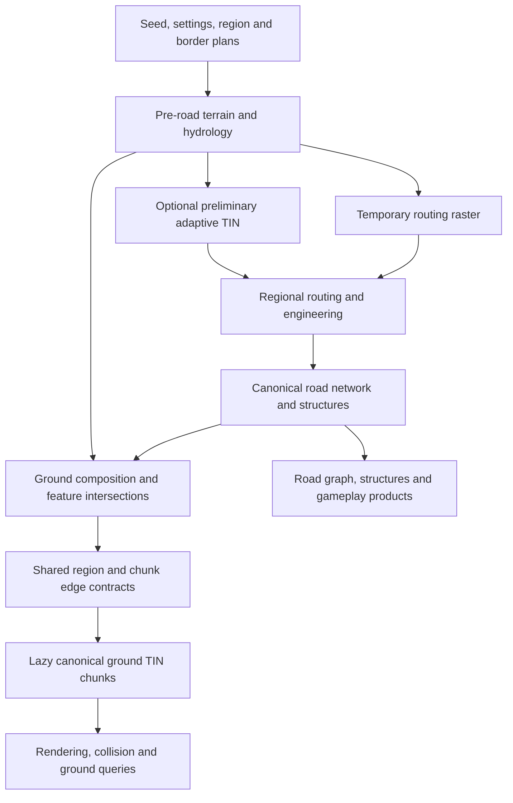
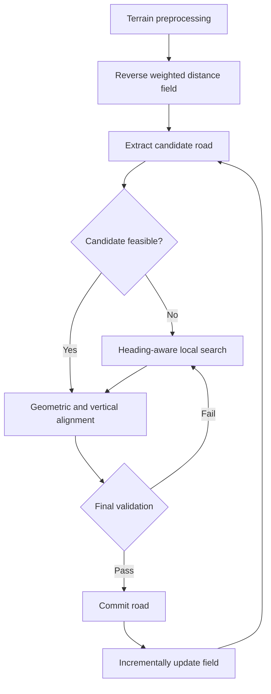

# Procgena Road Builder — Algorithmic Redesign

**Status:** Proposed greenfield technical design (revision 2; aligned with [Canonical TIN Architecture v4](procgena-canonical-tin-design.md)). Reviewed against the code 2026-11-25: see section 17 for corrections and open decisions. Scheduled as the RB milestones in [ROADMAP.md](../ROADMAP.md).  
**Scope:** Regional road planning, engineering, deterministic computation and chunk-conforming terrain realization  
**Baseline:** `4664649cc415c9c6b7e594f39fc617ae90adf8d3`

## 1. Executive summary

The existing road builder uses hierarchical, heading-aware A* over a regular terrain grid. It accounts for terrain gradients, construction costs, river crossings, road reuse, junction elevations, turning constraints and earthworks.

The objective is an order-of-magnitude improvement in end-to-end road generation performance while retaining comparable road quality. This is an engineering target, not a measured prediction.

The recommended architecture is an incremental, anisotropic, multi-source distance field followed by a small heading-aware search and geometric/vertical refinement. Implement and benchmark this on CPU first, retaining a GPU-compatible representation. Investigate adaptive triangulation and Polyanya-inspired portal search only after establishing the raster baseline. Road planning operates on pre-construction terrain, not the final ground TIN. The canonical road network is a separate semantic artifact whose engineered surface and earthworks supply constraints to lazy, chunk-conforming triangulation. Seed reproducibility and backend-independent canonical output are mandatory. This is a greenfield design; the existing implementation is a measurement and correctness reference, not a compatibility requirement.

## 2. Existing implementation

The pinned [road.rs](https://github.com/phayes/procgena/blob/4664649cc415c9c6b7e594f39fc617ae90adf8d3/terrain/crates/procgena_terrain/src/road.rs) uses:

- Sixteen movement directions, including knight moves, with a maximum 45-degree heading change per step.
- Direction-dependent terrain grades and quadratic penalties above preferred and maximum grades.
- Estimated cutting/filling penalties, water traversal penalties and angle-dependent bridge costs.
- Dynamic discounts for existing roads, conditional on junction feasibility.
- Accumulated permissible climb as a junction acceptance criterion.
- A 16 m coarse grid followed by fine routing within a 48 m corridor of the coarse network.
- Chaikin smoothing, grade-limited vertical alignment, road width adjustment and crowding detection.
- Repeated routing when junctions fail vertical alignment or road legs crowd each other.

The search already has a hierarchical structure. Adding another coarse grid alone does not address its principal inefficiencies.

### 2.1 State-space and memory costs

A search state is `(cell, incoming_heading)`, including a sentinel heading for the initial state. For N cells, the implementation allocates 17N entries in each of three arrays: cost (`f64`), accumulated climb (`f64`) and predecessor (`usize`). On a 64-bit system this is 408N bytes, or 408 MB per million cells, excluding the heap and terrain arrays. These arrays are allocated and initialized again on every retry.

The corridor reduces the number of viable cells, but dense indexing may still allocate state for cells outside the corridor. Verify the actual allocation and active-cell ratio in profiling.

### 2.2 Weak, expensive heuristic

`network_distance()` runs a complete reverse multi-source Dijkstra search before each road. Its edge weights represent geometric distance and a network discount rather than the actual terrain costs. It therefore does substantial work without informing A* about hills, expensive bridges or earthworks.

### 2.3 Repeated inner-loop work

| Current operation | Proposed improvement |
|---|---|
| Recalculate grade and construction cost per expansion | Precompute or lazily cache static directed edge costs |
| Scan every existing road point in `level_on_roads()` | Cache exact nearest-point junction elevations per network cell; update when roads are committed |
| Test all potential moves against turn constraints | Precompute heading successor lists |
| Allocate and initialize dense state arrays on every retry | Compact active cells, reuse buffers and use generation stamps or touched-state resets |
| Full grid distance propagation per road | Incremental weighted distance field |
| Forty vertical alignment bisection passes | Direct linear-time minimax solution |

Precomputed costs trade memory bandwidth for arithmetic. Benchmark full edge arrays against compact or lazy representations. Preserve deterministic tie-breaking where required.

## 3. Polyanya and Vleue Navigator

[Polyanya](https://docs.rs/polyanya/latest/polyanya/) searches geometric intervals across a navigation mesh instead of individual raster cells. Conventional Polyanya finds any-angle shortest paths through polygonal free space. [Vleue Navigator](https://github.com/vleue/vleue_navigator) provides Bevy integration; the underlying Rust crate is the more relevant dependency for Procgena.

The main incompatibility is anisotropy. For terrain height H and a horizontal unit direction v, local grade is `abs(grad(H) · v)`. A road following a contour may be much cheaper than one crossing it, even within the same triangle. Costs also depend on incoming heading, crossing geometry and accumulated climbing capacity.

Scalar traversal costs, even when supported by a navmesh implementation, do not solve this problem. Standard geometric interval pruning and Euclidean optimality guarantees cannot simply be transferred to this cost model.

Use Polyanya as inspiration for geometric compression and portal search, not as a drop-in road solver. A conventional Polyanya path could be used as a candidate in simple terrain, subject to validation and fallback, but it should not be assumed terrain-optimal.

## 4. Preliminary adaptive terrain mesh (experimental routing alternative)

Construct a triangulated irregular network (TIN), retaining fine geometry where terrain gradients change rapidly and using large triangles in smooth terrain. Include constrained boundaries, river geometry, potential bridge crossings and region clearance. Preserve narrow valleys, passes and switchback opportunities.

This is a pre-construction planning mesh, not the canonical ground TIN. It need not conform to the 64 m streaming lattice: chunk borders are not routing obstacles. Each triangle approximates a planar heightfield with constant gradient. Directional grade can be evaluated analytically within it.

### 4.1 Directionally weighted portal graph

Sample crossing points on shared polygon edges and connect them with directed candidate segments. Integrate the existing terrain cost model along segments, preserve heading state as needed, and search the resulting sparse graph. Refine the selected corridor against full-resolution terrain.

This avoids the complexity of inventing a continuous anisotropic interval-search algorithm. However, portal discretization can miss useful crossings, coarse triangles can hide terrain features, and longer segments may change the meaning of the current per-step earthworks penalty. Use adaptive sampling and cost integration at a consistent physical scale. A turn-angle bound on variable-length segments is not equivalent to a minimum turning radius; enforce curvature explicitly where needed.

Mesh construction has a cost of its own. Compare total construction plus routing time against the raster implementation, not just query time.

## 5. Recommended architecture: reverse weighted distance field

All roads connect to a growing network. Exploit that common destination instead of treating road queries independently.

Let `w(u,v)` be a nonnegative relaxed directed edge cost and `S` the existing network. Compute:

```
D(u) = 0                                      if u is in S
D(u) = min over v of [w(u,v) + D(v)]           otherwise
```

Use reverse multi-source Dijkstra on CPU initially. Reverse propagation must use the forward edge cost `w(u,v)`, not `w(v,u)`.

Unlike geometric distance, this field accounts for terrain grade, construction cost and river crossings. It can serve as a stronger heuristic for the heading-aware search and a source of inexpensive candidate routes.

### 5.1 Admissibility and dynamic discounts

Relax turning constraints, temporarily blocked cells and junction elevation restrictions. Every network cell is an accepted destination in the relaxed problem, even if a particular road cannot join it. For discounted edges, apply the cheapest possible reuse factor where applicable; bridge costs must follow the original placement of the discount (the bridge surcharge is added afterward). Keep all legal original transitions in the relaxed graph and never assign them a higher cost than the original search would.

A simple implementation uses full static terrain costs on non-network arrivals and sets newly added network cells to zero. Since the relaxed search terminates at its first network cell, discounts on edges entering the network can be represented by discounted terminal-entry edges. Update these incoming edges as well as inserting zero-distance seeds. Alternatively, use a fixed universally discounted lower-bound edge cost, at the expense of heuristic strength.

When the network grows, its source set grows and relevant relaxed edge costs can decrease. Seed affected vertices and propagate decreases. No global recomputation is required for decreases-only changes, although the propagation may still affect the entire graph in the worst case. Network removal or cost increases need a repair algorithm or rebuild.

### 5.2 Candidate extraction and fallback

Follow successors satisfying the Bellman minimum to extract a candidate path. Test the candidate for permitted turns, junction reachability, self-crowding, clearance and vertical alignment. Apply local refinement where appropriate. If it fails, run heading-aware A* with the shared field as heuristic, expanding the corridor or falling back to the baseline search when necessary.

The distance field is a lower bound, not a complete road engineering solution. Its extraction path need not satisfy heading or elevation constraints.

## 6. Weighted A* and motion primitives

Weighted A* prioritizes `g + W*h` rather than `g + h`. Evaluate W = 1, 1.25, 1.5, 2 and 3.

```rust
const HEURISTIC_WEIGHT: f64 = 2.0;
let priority = total + HEURISTIC_WEIGHT * ahead[next];
```

Apply the same weight to initial priority and stale-entry handling. This is a small, reversible experiment. Greater weighting may reduce expansions, but may increase road construction cost and retries. Compare final geometry, not just search cost. Standard suboptimality guarantees do not directly apply to the current path-dependent state representation.

Longer-term, consider curvature-aware motion primitives (state lattice or Hybrid A*) to represent physically plausible straight sections and bends, rather than relying solely on discrete heading changes followed by smoothing. Validate swept clearance and integrate grade and bridge costs along each primitive.

## 7. GPU acceleration

| Algorithm | Suitability | Role |
|---|---|---|
| Binary-heap A* | Low for a single query | Final constrained CPU search |
| Polyanya | Primarily CPU-oriented | Sparse geometric search |
| Delta-stepping | High potential | Parallel weighted graph propagation |
| Fast sweeping | High potential | Approximate continuous distance fields |
| Anisotropic fast marching | Problem-dependent | Directional continuous routing |
| Edge-cost generation | High | Parallel terrain preprocessing |
| Geometry optimization | Potentially high when batched | Candidate refinement |

Delta-stepping is the first GPU algorithm to investigate because it accommodates nonnegative directed graph costs and exposes frontier parallelism. Use implicit grid adjacency and storage buffers rather than explicitly constructing a generic CSR graph. Store only necessary edge attributes or derive costs on demand.

A GPU implementation must account for atomic relaxation, numerical representation, bucket width, synchronization, queue contention, transfer overhead and reproducibility. If using quantized integer costs for atomics, verify error bounds and preserve nonnegative weights. Do not treat an approximate field as an admissible heuristic unless its lower-bound property is established.

Keep the field resident on GPU if possible, and measure the cost of transferring candidate paths or fields to CPU. Independent regions may be processed in parallel, but road additions within a region are sequentially dependent under the existing reuse policy.

## 8. Linear-time vertical alignment

The existing `grade_limited()` minimizes the largest weighted cut/fill tolerance using 40 bisection iterations and repeated elevation-band allocations.

Let `s[i]` be cumulative allowable vertical rise, `H[i]` the highest ground across the road, `L[i]` the lowest, `k = 3` the cut-to-fill ratio, and `t >= 0` the fill tolerance. Interior elevation intervals are `[H[i] - k*t, L[i] + t]`.

Feasibility requires, for every ordered pair of interior points:

```
H[i] - k*t <= L[j] + t + abs(s[i] - s[j])
t >= (H[i] - L[j] - abs(s[i] - s[j])) / (k + 1)
```

The maximum can be evaluated in O(n) time using prefix and suffix extrema. For each i, the maximum numerator is the larger of:

```
H[i] - s[i] + max over j <= i of (s[j] - L[j])
H[i] + s[i] + max over j >= i of (-s[j] - L[j])
```

For each fixed endpoint with elevation E at cumulative rise s_e, also require:

```
t >= (H[i] - E - abs(s[i] - s_e)) / k
t >= E - L[i] - abs(s[i] - s_e)
```

If both endpoints are fixed, reject when their elevation difference exceeds their cumulative allowable rise. Exclude fixed endpoints from the interior cut/fill objective, matching the existing implementation. Clamp the resulting tolerance to zero or greater.

Then perform existing forward band propagation and backward target selection once. Include floating-point tolerance or a conservative rounding adjustment, and compare against the bisection solver with randomized and existing tests. The expected benefit is fewer passes and allocations within alignment, not a guaranteed equivalent reduction in overall generation time.

## 9. Search correctness: accumulated climbing capacity

The current state is `(cell, heading)`, but transition costs and goal acceptance also depend on accumulated permissible climb (`run[state]`). A cheaper route arriving at a state with 4 m of remaining endpoint elevation reach may suppress a more expensive route arriving with 8 m, even if the eventual junction needs 6 m. Consequently, the current search is not guaranteed to find the optimal feasible route.

A principled solution maintains nondominated labels `(cost, accumulated_reach)` per cell and heading. A label with lower or equal cost and greater or equal reach dominates another under the current relaxed reach model. This may increase state count substantially, and does not capture all later smoothing or crowding constraints.

For procedural generation, consider approximate bounded Pareto labels or separating horizontal routing from vertical feasibility, with local refinement and retries. Explicitly document any loss of completeness. Preserve hard engineering constraints during final validation.

## 10. Canonical road geometry and TIN integration

### 10.1 Dependency architecture

Plan roads at region scope after hydrology and negotiated regional crossing geometry are available. Use a fixed pre-construction surface during a network build. This prevents a dependency cycle between routing and final triangulation and permits decreases-only relaxed distance updates as the network grows. If progressive earthworks are later introduced into planning, treat changed edge weights and feasibility as general graph updates, not merely added sources.



The road plan must be independently computable before any fine chunk is requested. Chunk creation, camera position, LOD selection and streaming schedules must not feed back into regional road selection. Provisional distant terrain may omit detailed roads, but must never become authoritative gameplay ground.

### 10.2 Canonical road network

Retain a semantic network independently of terrain triangles. Road identity, connectivity and stationing must not be derived from triangulation indices or chunk-local mesh order. A conceptual Rust interface follows; actual numeric encodings must follow the TIN numerical contract.

```rust
pub struct RoadNetwork {
    pub junctions: Vec<RoadJunction>,
    pub segments: Vec<RoadSegment>,
    pub structures: Vec<RoadStructure>,
}

pub struct RoadSegment {
    pub id: RoadId,
    pub start: JunctionId,
    pub end: JunctionId,
    pub horizontal: HorizontalAlignment,
    pub vertical: VerticalAlignment,
    pub profile: RoadProfile,
    pub structures: Vec<StructureId>,
}
```

Use stable seed-derived identities for negotiated ports, junctions and road segments. Define deterministic junction splits and ID derivation when a new branch joins an existing segment; preserve a stable logical road identity across realization chunks. Store a canonical ordered representation with quantized stationing, profile parameters, feature IDs and elevations. A spatial index should support footprint queries for chunk realization; it is a rebuildable derivative, not the source of road identity.

### 10.3 Horizontal alignment and motion primitives

Use discrete routing for corridor selection, then construct explicit continuous alignments. Begin with straight segments and circular arcs; consider clothoids or constrained splines only when justified by road quality. A per-step 45-degree turn restriction is not a physical curvature guarantee. Define minimum horizontal radius by road class, ensure tangent continuity where required, and check the entire swept footprint including shoulders. Define longitudinal maximum grade, vertical curvature, crossfall and banking separately. Fit curves within the validated corridor; if fitting fails, expand or reroute deterministically rather than silently violating a hard limit.

Prototype state-lattice or Hybrid A* refinement with variable-length motion primitives (illustrative lengths: 4, 16 and 64 m). Use longer moves in smooth terrain and shorter ones near junctions, rivers, steep slopes and tight bends. Evaluate swept geometry and integrate cost along the primitive; endpoint-only checks miss intervening ridges, water and clearance violations. Compare against the existing heading-aware search. If the search uses a relaxed raster field, prove the lower-bound relationship for the new primitive graph or use the field only as approximate guidance. Keep a deterministic fallback with finer primitives or wider corridors.

### 10.4 Cross-sectional earthworks and engineering objective

The current longitudinal grade-based cost is a useful inexpensive proxy, not a complete estimate of actual construction. In detailed refinement, evaluate the proposed cross-section against the pre-road surface, including road width, shoulder, crossfall, bank slope and transitions. Estimate cut and fill areas at a fixed physical station interval or integrate over preliminary TIN intersections. Integrate these areas along the alignment to estimate volumes. Validate narrow features between samples with conservative subdivision or exact intersections where available.

A candidate objective is:

```
C = w_length * length + w_cut * cut_volume
  + w_fill * fill_volume + bridge_cost + curvature_penalty
```

Choose weights with consistent units and calibrate against generated roads. Keep maximum grades, curvature, clearance and structural feasibility as hard constraints. Retain the existing asymmetric minimax cut/fill objective for initial vertical alignment (section 8); minimizing total volume or enforcing vertical curvature changes the optimization problem and may need a separate constrained solver. Validate the final profile after any such optimization. Do not imply that the linear minimax solution also minimizes volume or guarantees vertical curvature.

Keep two cost models: a cheap additive directional relaxed cost for global propagation and an engineering cost for candidate refinement and comparison. For an admissible field, every feasible detailed transition must correspond to a relaxed path costing no more than that transition. If the graph, physical scale or weights prevent this proof, do not claim optimality or Weighted A* bounds.

### 10.5 Bridges and junctions

Generate candidate bridge crossings from river centerlines, bank geometry, water width, feasible approach grades, crossing angle and estimated span. Include explicit directed crossing edges and their construction costs in the planning graph. Retain deterministic candidate expansion if the initial crossing set is infeasible; the set is an approximation rather than a proof of completeness. Validate deck clearance, approach elevation, abutment footprints and river continuity. Bridge decks are separate structures above the ground TIN; approaches and ground-contact earthworks are ground constraints. Never flatten the riverbed to deck height. Apply analogous separation for tunnels if supported later.

Junctions require compatible elevation, grade and footprint geometry. Resolve segment crossings and merges as explicit network events, using a deterministic intersection policy; a geometric crossing is not automatically a junction (e.g. grade-separated crossings). Validate the junction surface itself, not only centerline endpoints. Maintain connectivity from negotiated regional ports to the hub or an existing reachable road.

### 10.6 Feature breaklines and chunk realization

Emit canonical road surface profiles and ordered breaklines for centerlines, pavement/shoulder edges, ditch edges, tops and toes of cuttings and embankments, and junction perimeters. Resolve overlapping constraints and define ground composition with rivers and regional seams before local CDT. Sample curves to a deterministic geometric error tolerance and consistent physical stationing; a chunk must never refit or smooth its portion of an alignment independently.

The canonical ground TIN conforms to all level-0 chunk boundaries (64 m initial size) and irregular region boundaries. Every crossing of a road breakline with a chunk or region edge creates a shared canonical intersection vertex. The edge contract includes the exact ordered coordinates, elevations and feature references. Both neighbours derive it from the same feature plans; neither can unilaterally split it during interior refinement. Resolve nearly coincident constraints, overlaps and shallow crossings by the common robust geometric rules of the TIN plan. Mixed-region chunks aggregate region patches without changing logical road identity.

Higher LOD meshes may discard internal chunk edges, but must preserve significant road geometry within their specified visual error. Collision and gameplay ground are independent of rendering LOD. Road network queries, traffic navigation, placement exclusions, materials and structure generation consume semantic road geometry directly rather than inferring it from triangles. Check physical correspondence between the network, realized ground, and separate bridge surfaces.

### 10.7 Network commitment policy

Extract candidates for unconnected starts from the shared relaxed distance field. Evaluate in parallel if useful, but commit in a fixed canonical sequence. Start with the existing stable port ordering for comparability; benchmark cheapest-estimated-first or road-class-priority ordering as distinct versioned policies. Greedy cheapest-first is not a globally optimal network solver. After each commitment, update join elevations and relevant discounts, invalidate affected candidates and propagate relaxed distance decreases. A failed refinement may expand the corridor or refuse a junction; do not spin indefinitely. Define failure reporting for unconnected ports and bounded retries, with no silent engineering violations.

## 11. Deterministic CPU/GPU computation

### 11.1 Reproducibility contract

Identical world seed, settings, generator version and ordered edits must produce identical canonical road graph, profiles, structures, breaklines and boundary intersections, irrespective of request order, cache state, chunk availability, thread count, GPU batch size or camera. Cross-platform bitwise identity is the design target for supported CPU platforms and any canonical GPU backend. This is stricter than visual parity. Generator version changes may legitimately change outputs.

Use canonical coordinate and cost encodings with specified rounding, overflow handling, total ordering, stable IDs, serialization byte order and degenerate intersection rules. Quantizing arbitrary floating-point calculations does not by itself establish determinism. Either implement identical decision arithmetic or ensure all ambiguous decisions are resolved by an authoritative deterministic reference. Avoid unordered map iteration, shared mutable RNG state, race-dependent queue ties and wall-clock-based search termination. Use deterministic work budgets and separately derived seed streams. Parallel work must not change road commitment order.

### 11.2 Shared terrain compute backend

Reuse the TIN architecture's deterministic sampling interface for elevation, gradient, feature distance, water masks and region borders. Pre-road and post-road samples have different cache identities. Reuse buffers only when resolution, stage, numeric encoding and content keys match. Temporary raster routing remains the primary GPU candidate: implicit adjacency and regular memory access avoid graph allocation. Benchmark adaptive portal graphs only against full construction and routing costs.

The CPU reference must remain usable on headless servers and unsupported devices. GPU acceleration uses portable WGPU/WGSL where practical. Batch independent regions or grids, keep intermediate costs and fields resident, and transfer compact paths or bounded corridor data asynchronously. A CPU A* consuming a global GPU heuristic may need the field or corridor slice on CPU; account for that readback explicitly. Existing GPU material painting is a useful precedent but approximate visual parity is not sufficient for canonical routing. See [GPU progress](https://github.com/phayes/procgena/blob/4664649cc415c9c6b7e594f39fc617ae90adf8d3/terrain/gpu_progress.md).

### 11.3 Integer distance propagation

For canonical GPU propagation, use nonnegative quantized edge weights and integer atomic minimum relaxation with a proved finite range. Define infinity, checked addition and overflow fallback; no wrapped or saturated finite result may silently change route ordering. Portable 32-bit atomics may be insufficient for long or expensive mountain paths: analyze ranges and either choose a suitable unit, use a verified wider scheme or fall back to CPU. If the field is intended as a lower bound, quantization must preserve that relation to the detailed objective (e.g. explicitly defined downward rounding of relaxed costs).

Run delta-stepping or bucketed relaxation to convergence, using deterministic dispatch termination conditions and complete processing of improvements. Compute distances independently of predecessor selection. In a separate extraction pass choose the stable lowest-key successor among equal-cost Bellman-optimal choices. For positive finite weights distances strictly decrease along such edges; if zero weights are permitted, define a secondary hop rank or equivalent acyclic extraction policy. The CPU reference must reproduce the same integer problem and tie rules. Approximate GPU fields may be used for previews or advisory candidate generation only if the canonical outcome is still backend-independent; simply validating a feasible GPU-selected path is not sufficient to prove identical output.

### 11.4 Canonical serialization and edits

Hash normalized road graph records, ordered alignments, station profiles, structures and feature constraints using a specified canonical encoding (e.g. BLAKE3 over canonical bytes). Compare stage hashes to localize divergence. Cache keys include relevant versioned settings, negotiated ports, pre-construction terrain and hydrology inputs, road policy and edits. Ordered terrain edits affecting routing require explicit invalidation of dependent regional plans and shared edge contracts; caches may affect latency but not outputs. Keep generated base identities stable where semantic identity is intended to persist.

## 12. Proposed pipeline



Bound retries and provide an explicit failure/fallback policy. Final validation should recheck grades, endpoint elevations, clearance, river crossings, curvature and leg spacing after smoothing. The existing algorithm may retain a crowded route as fallback; decide explicitly whether this remains acceptable.

## 13. Implementation roadmap

| Stage | Deliverable | Acceptance gate |
|---:|---|---|
| 0 | Instrument pinned implementation | Reproducible timing, quality and memory baseline |
| 1 | Shared deterministic pre-road sampling and cost encoding | CPU reference, stable sample hashes and range tests |
| 2 | Cached costs, junction elevations, compact search buffers, turn lists | Equivalent baseline behavior where intended; measured improvement |
| 3 | Incremental reverse weighted field | Exact agreement with full relaxed recomputation |
| 4 | Direct candidate extraction, Weighted A*, corridor fallback | Measured cost/quality trade-off; bounded failure policy |
| 5 | Linear-time minimax vertical alignment | Agreement with reference solver within specified encoding tolerances |
| 6 | Canonical road network and parametric alignments | Stable hashes, valid curvature/grade, explicit junctions |
| 7 | Cross-sections, earthworks, bridge candidates and structures | Validated swept footprint and water crossing geometry |
| 8 | Road breaklines, shared chunk/region edge contracts and TIN realization | Watertight independently realized chunks, physical surface agreement |
| 9 | GPU integer costs and incremental distance propagation | Exact CPU/GPU field and canonical road parity; end-to-end speedup |
| 10 | Variable-length motion primitives and adaptive portal graphs | Measured benefit over raster baseline, acceptable feasibility and quality |
| 11 | Integrated world benchmarks and determinism conformance | Performance, geometry, streaming and platform gates pass |

Stages 6–8 can proceed in parallel with GPU prototyping once the shared contracts are defined. Keep the CPU reference permanently; keep experimental backends behind testable configuration switches, not compatibility paths. Priorities and cost/quality tolerances are proposed and should be fixed with measurements. Fully anisotropic Polyanya is low priority because its pruning guarantees do not transfer directly.

## 14. Benchmark and acceptance plan

Use deterministic terrain seeds and identical starts, river layouts, grades and region dimensions. Include flat terrain, rolling hills, steep mountains, narrow passes, major rivers, crowded switchbacks, multiple starts and incompatible junction elevations. Test both coarse and fine resolutions and multiple region sizes.

Measure:

- End-to-end wall time, median and tail latency, CPU time and peak memory.
- Grid and edge preprocessing, distance propagation, queue operations, expanded states, retries, smoothing and alignment time separately.
- GPU initialization, dispatch, synchronization and transfer costs, where applicable.
- Road completion rate, network connectivity, length, grade violations, maximum cut/fill, river crossings and angles, curvature, leg spacing, and construction cost under a common evaluator.
- Determinism and failure behaviour across repeated runs.

Compare baseline A*, Weighted A*, cached edges, compact states, weighted reverse fields, incremental updates, direct extraction and GPU propagation in isolation and combination. For tiny grids, compare the relaxed field to an independent shortest-path reference and verify admissibility. Compare incremental updates against complete rebuilds. Validate alignment against the existing solver.

Additional integration and conformance tests:

| Requirement | Acceptance test |
|---|---|
| Seed determinism | Same canonical road and feature hashes after randomized region/chunk request order, eviction, restart and thread counts |
| Backend parity | CPU/GPU exact integer fields and canonical output hashes across batch sizes and supported hardware; test x86-64 and ARM64 |
| Numeric robustness | Overflow, zero costs, equal-cost paths, degenerate intersections, negative coordinates and quantization thresholds |
| Region continuity | Negotiated crossings share positions, directions and elevations; generation order does not matter |
| Chunk independence | Road breaklines produce identical shared intersection vertices and heights; mixed-region chunks join without cracks |
| Road engineering | Measure grade, curvature, clearance, junction geometry, self-spacing and cross-sections on final realized surfaces |
| Bridge separation | Deck and ground remain distinct; approach geometry and river channel are valid |
| LOD independence | Physical road geometry and network hashes remain unchanged across camera and graphics settings |
| Streaming | Cold and warm requests, Rough/Fine transitions and parent stand-ins; provisional surfaces never used as authoritative ground |
| Incremental correctness | Compare full vs incremental recomputation, including added network cells, incoming discounts and explicit cost-increase invalidation |
| End-to-end latency | Include regional planning, road engineering, boundary contracts, TIN realization, GPU dispatch/readback and cache residency |

Record separate metrics for time to first provisional view, time to canonical region plan and time to first usable physical chunk. Include headless CPU-only runs and GPU runs on supported devices. Compare full-region raster and adaptive graph costs, including graph construction and sampling. Measure primitive lengths, candidate rejection rates, final road construction quality and triangulation overhead (particularly near road/chunk intersections). Use a common evaluator for cut/fill, grade and curvature; avoid comparing incomparable search objectives.

Set explicit quality tolerances before adopting approximate search. Target 10x end-to-end speedup without unacceptable degradation; adjust the target using measured bottlenecks and Amdahl's law. Avoid inferring whole-pipeline speedup from isolated microbenchmarks.

## 15. References and limitations

- [Procgena road.rs, pinned baseline](https://github.com/phayes/procgena/blob/4664649cc415c9c6b7e594f39fc617ae90adf8d3/terrain/crates/procgena_terrain/src/road.rs) — inspected source.
- [AAAI paper supplied for comparison](https://ojs.aaai.org/index.php/AAAI/article/view/9367) — not verified; prior access attempt was unsuccessful. No claims in this proposal depend on its contents.
- [Vleue Navigator](https://github.com/vleue/vleue_navigator) and [Polyanya Rust documentation](https://docs.rs/polyanya/latest/polyanya/) — geometric navigation and implementation references.
- [Optimal Pathfinding on Weighted Grid Maps (JPSW)](https://ojs.aaai.org/index.php/AAAI/article/view/26458) — pruning ideas; not directly applicable to heading-dependent costs.
- [Optimal grid-free path planning across arbitrarily-contoured terrain](https://faculty.nps.edu/ncrowe/elevation2.htm) — further research on directional terrain costs.
- [Parallel algorithms for off-road vehicle routing on the GPU](https://carmenta.com/knowledge/parallel-algorithms-for-off-road-vehicle-routing-on-the-gpu) — GPU graph propagation research. External speedup reports should not be interpreted as Procgena benchmarks.
- [Optimal Path Maps on the GPU](https://pubmed.ncbi.nlm.nih.gov/30869623/) — further geometric wavefront research.

- [Galin et al., Procedural Generation of Roads (Eurographics 2010)](https://perso.liris.cnrs.fr/egalin/Articles/2010-roads.pdf) — the closest published prior art: weighted anisotropic shortest path on a grid with generalised move masks for curvature, slope, rivers and bridges, then excavation along the path. Its companion, [Authoring Hierarchical Road Networks (2011)](https://www.cs.purdue.edu/homes/bbenes/papers/Galin11CGF.pdf), covers network-level reuse and junctions. Local copies and the other downloaded references are indexed in `terrain/prior_art/canonical_tin_roads/INDEX.md` (git-ignored).
- [Canonical TIN Architecture v4](procgena-canonical-tin-design.md) — companion architecture, including deterministic GPU computation and chunk contracts.
- [Chunk geometry](https://github.com/phayes/procgena/blob/4664649cc415c9c6b7e594f39fc617ae90adf8d3/terrain/crates/procgena_terrain/src/chunk.rs), [streaming](https://github.com/phayes/procgena/blob/4664649cc415c9c6b7e594f39fc617ae90adf8d3/terrain/crates/procgena_terrain_bevy/src/stream.rs), [region contracts](https://github.com/phayes/procgena/blob/4664649cc415c9c6b7e594f39fc617ae90adf8d3/terrain/crates/procgena_terrain/src/region.rs) — integration reference.
- [Terrain edit/cache plan](https://github.com/phayes/procgena/blob/4664649cc415c9c6b7e594f39fc617ae90adf8d3/terrain/edit_cache_plan.md) — existing profiling and stage cache context.

This proposal is based on static source inspection and algorithmic analysis, not an executed benchmark or implementation. The reference list includes further reading that has not been independently reverified for this document. The CPU-first sequence, quality criteria and 10x target are proposed design decisions rather than established project requirements.

## 16. Conclusion

The strongest architectural opportunity is to exploit the growing road network as a shared destination. An incremental anisotropic distance field can replace the repeated geometric Dijkstra heuristic, guide constrained search and sometimes supply a road candidate without full heading-aware A*. It also provides a natural path to GPU acceleration. Adaptive planning meshes and motion primitives may yield further gains, but remain benchmark-driven alternatives. The final canonical ground is a separate chunk-conforming TIN, realized from deterministic road profiles, feature breaklines and shared boundary contracts. The road graph remains independently authoritative for infrastructure semantics. The 10x target covers the integrated road-generation workload including its geometry and TIN integration; no speedup or cross-platform guarantee has yet been demonstrated.

## 17. Review against the code (2026-11-25)

Checked against `road.rs`, `plan.rs`, `terrain.rs`, the World presets, [ARCHITECTURE.md](../ARCHITECTURE.md) and [ROADMAP.md](../ROADMAP.md) at `a5b4131`. Sections 1–16 stand except where this section corrects them.

### 17.1 Claims checked and confirmed

- Section 2.1: `search()` allocates `cost: f64`, `run: f64` and `previous: usize` for `allowed.len() * 17` states (16 directions plus the start sentinel), fresh on every call, including every refused-join and crowding retry. 408 bytes per cell is correct.
- Section 2.2: `network_distance()` is a full multi-source Dijkstra over plain step lengths, with only the last step onto the network discounted by `REUSE_COST`. It runs once per road start, outside the retry loop.
- Section 5.1: the existing step cost depends only on `(cell, move)` plus whether a network cell is joinable. `run` affects only the joinable test. So a turn-free Dijkstra over *the same step costs*, with every network cell a zero-cost source and every entering step discounted, is already admissible. That is the simplest Stage 3 field and the strongest one that needs no new cost model.
- Section 8: `grade_limited()` builds the interval `[high - 3t, low + t]` per interior point (`CUT_SHARE = 3`) and bisects 40 times. The pairwise condition is exact for a path: the levels form a system of difference constraints on a chain, and a chain has no cycles beyond pairs. So the O(n) prefix/suffix formula gives the bisection's limit, and Stage 5 should agree with it to within the bisection's last interval, before both are rounded to the `f32` levels the function returns.

### 17.2 Corrections

1. **Baseline.** The pinned commit already contains TE5 (landed 2026-11-25): a 16 m outline (`coarse_routes`) and 8 m routing within 48 m of it (`refined_routes`). TE5 measured a median of about 384 ms and a maximum of about 1.4 s per region in release, down from about 1.2 s and 2.8 s (`--example road_cost`, `terrain/roads_plan.md`). The 10× target is measured against this TE5 baseline, not the pre-TE5 search. Stage 0 starts from `road_cost` rather than new instrumentation.
2. **Mid feature tier.** Since TE7 the terrain has three feature tiers: `Rough` (no roads), `Mid` (roads on the coarse outline) and `Fine`. The redesign must keep a cheap outline product for `Mid`. The natural candidate is the field-extracted candidate path before heading-aware refinement. It is provisional, like every non-Fine tier, and never authoritative.
3. **World scale (D5).** Region size is a per-class World setting: 2 km (small and the default medium-small class), 4 km (medium), 8 km (large) and 16 km (real life). Road widths and grades never scale, but landscape lengths do. At 8 m cells a 16 km region is 4 M cells, 64 times the default. The benchmark corpus in section 14 must include every class, and memory and time targets are stated per class. The raster field's cost grows with region area, which is another reason to benchmark against the per-region plan budget ("up to about a second", ARCHITECTURE "Three stages").
4. **Determinism needs deterministic source maths.** The cost model reads `ground()` and `grades()` from the analytic terrain. That terrain calls `std` transcendentals: `exp` in `relief.rs`, `ln`, `powf`, `asin` and `sin` in `converge.rs`, and `powf` and `atan2` in `border.rs`. These go to the platform's maths library, so quantising their results does not give cross-platform identity (section 11.1 says as much). Either authoritative paths use pinned pure-Rust maths (for example the `libm` crate, which needs the coordinator's sign-off as a new dependency), or the first deterministic profile is same-platform only. This is decision gate D6 in the roadmap.
5. **Port order and parked tiered borders.** Crossings are negotiated in `plan.rs` ports and are fixed for a build. TE4a and TE4b (per-tier border negotiation) are parked. Nothing here depends on them, but if TE4b returns, crossings are fixed at the rough tier, and this plan's "negotiated regional crossing geometry" is that rough agreement.
6. **Analytic terrain rule.** The project rule is that terrain generation stays analytic, or bounded per region: no iterated simulation (decided by the user 2026-11-24). Section 10.1's "hydrology" means today's bounded per-region drainage and river tracing, not a flow simulation.
7. **Stage numbering.** The roadmap schedules sections 13's stages as milestones RB0–RB8. Stages 6–8 (canonical network, cross-sections, breaklines) are where this plan meets the TIN plan (roadmap CT milestones), and Stage 8 needs the TIN's edge contracts first.

### 17.3 Open decisions (for the user, before the RB milestones they gate)

- **D6a, deterministic profile.** Cross-platform bitwise (x86-64 and ARM64, pinned maths) or same-platform bitwise first? This affects Stage 1 and every hash test.
- **Commit order.** Stable port order (today) is the default. Cheapest-first or road-class order is a separate, versioned policy (section 10.7).
- **Crowded fallback.** Today a crowded route is kept when retries run out. Keep that, or report the port as unconnected (section 12)?
