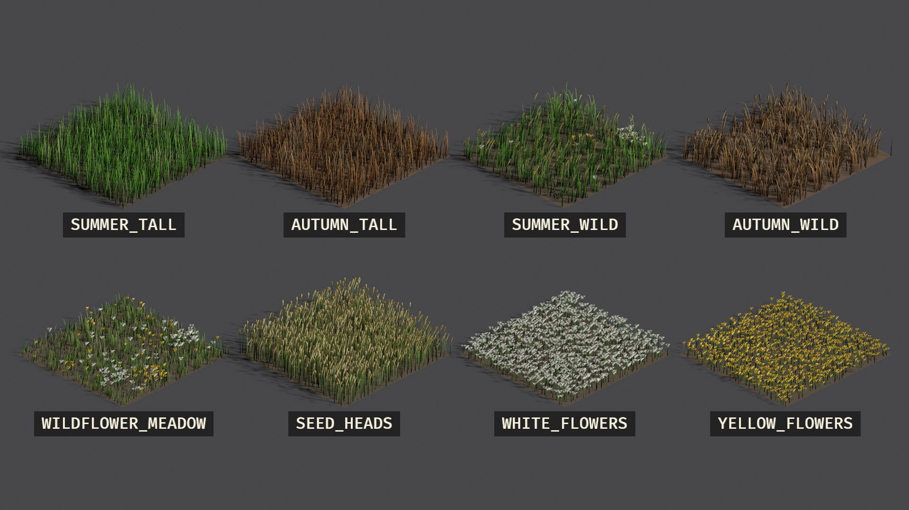
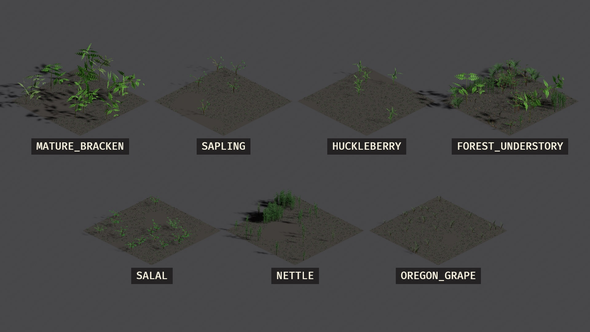
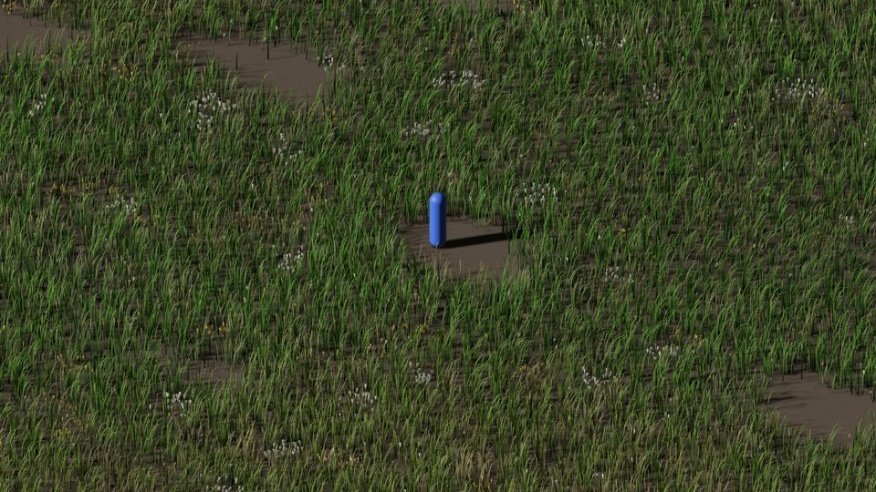

# Presets

procgena_plant ships 40 field presets, from lawn to prairie to wildflower meadow,
forest-floor moss and ferns, understory bushes, a Baltic bog, a reed marsh, dunes, pampas,
spinifex, frost, kelp, crystal and cel-shaded fields, and 26 plant presets to
build your own from. Each field preset is a `const` on `FieldPreset` and a
`.field.ron` file in [`assets/grass_fields`](../assets/grass_fields); each
plant preset a `const` on `PlantPreset` (and the same plant on `GrassPlant`)
and a `.plant.ron` file in [`assets/grass_plants`](../assets/grass_plants).
[Plants and fields](fields.md) shows how to change one or load one from a
file.

A preset has a `key` (its constant's name, `"MEADOW"`), a display `name`
(`"Meadow"`), a `description` and the `group` it is listed in.
`FieldPreset::all()` and `PlantPreset::all()` list them all, for a menu or an
inspector, `GROUPS` lists them group by group, and `named(key)` finds one by
its key.

The pictures show every preset, two rows per picture, each on a square of
about 6 m of its own ground (sand, snow, peat, a pond, the seabed) under a
top-down ARPG camera. Run `cargo run --release --example showcase` for page 1;
`--page 2` to `--page 6` draw the rest (`--fixed-time --screenshot PATH` saves
one). To fly around the forest, understory, biome, fantasy and toon presets up
close, run `cargo run --release --example gallery`.

|  |  |  |
| --- | --- | --- |

## The groups

Field presets:

| Group | Presets |
| --- | --- |
| `FieldPreset::GENERAL` | `MEADOW` (the default), `TALL_PRAIRIE`, `WHEAT`, `DRY_SAVANNA`, `LAWN`, `STYLIZED` |
| `FieldPreset::SEASONS` | `SUMMER_TALL`, `AUTUMN_TALL`: the same tall field, 0.7–1.3 m, green and brown, to mix or blend between |
| `FieldPreset::WILD` | `SUMMER_WILD`, `AUTUMN_WILD`, `WILDFLOWER_MEADOW`: every kind of variation |
| `FieldPreset::FOREST` | `FOREST_MOSS`, `FOREST_FERNS`, `FOREST_FLOOR`, `FOREST_BRACKEN`: short, wide forest-floor plants in clumps, with fallen leaves and branching ferns mixed in |
| `FieldPreset::UNDERSTORY` | `SALAL`, `SAPLING`, `HUCKLEBERRY`, `OREGON_GRAPE`, `NETTLE`, `MATURE_BRACKEN`, `BRAMBLE`: one kind of knee- to head-high branching plant each, over moss (`BRAMBLE`'s canes arch over and root their tips in the ground); `FOREST_UNDERSTORY` mixes all but the bramble with ferns and fallen leaves |
| `FieldPreset::SHRUBS` | `BROOM` (clumps of tall, upright green rods on short brown trunks, through meadow grass): open-country shrubs growing through grass |
| `FieldPreset::BIOMES` | `COTTON_BOG` (red sphagnum, sedge tussocks, cotton grass, pools), `REED_MARSH` (2 m reeds and cattails), `DUNE_MARRAM` (blue-grey clumps on sand), `RYE_AND_CORNFLOWERS` (rye with cornflowers and poppies), `PAMPAS` (arching fountains under cream plumes), `SPINIFEX` (stiff splayed hummocks), `ELEPHANT_GRASS` (2.4–3.6 m, to hide in), `FROSTED_MEADOW` (stiff, glinting, out of snow), `BURNT_REGROWTH` (charcoal stubble and new shoots), `LAVENDER` (bushes; plant them in rows with a striped density mask) |
| `FieldPreset::FANTASY` | `CRYSTAL_SPIRES` (rigid, faceted, glassy), `CORKSCREW_ALIEN` (ribbons twisted two turns, toon), `KELP_BED` (soft ribbons for under water; pair with a slow, lively wind), `BLIGHTED` (corrupted violet grass with bone-white heads) |
| `FieldPreset::TOON` | `CEL_FIELD` (chunky two-band tufts and flowers), `COZY_PASTEL` (soft pastel grass and flowers, four bands) |

Plant presets, to grow alone with `GrassField::new` or to mix into any field
as a `FieldPlant`:

| Group | Presets |
| --- | --- |
| `PlantPreset::GRASSES` | `MEADOW_GRASS`, `SUMMER_TALL_GRASS`, `LAWN_GRASS`, `WHEAT`, `MARRAM` |
| `PlantPreset::GROUND_COVER` | `SEED_HEADS`, `WHITE_FLOWERS`, `YELLOW_FLOWERS`, `CLOVER`, `BROAD_LEAF`, `MOSS`, `FERN`, `BRACKEN`, `LEAF_LITTER`, `COTTON_GRASS`, `CATTAIL`, `CORNFLOWER`, `POPPY` |
| `PlantPreset::UNDERSTORY` | `SALAL`, `SAPLING`, `HUCKLEBERRY`, `OREGON_GRAPE`, `NETTLE`, `MATURE_BRACKEN`, `BRAMBLE`: the branching plants of the understory presets |
| `PlantPreset::SHRUBS` | `BROOM` |

A field preset named after a plant, such as `SALAL` or `BROOM`, grows that
plant with the moss or grass around it; the other fields mix them in. Most
field presets grow a grass of their own that is not a plant preset; copy it
from the field (`FieldPreset::TALL_PRAIRIE.field.plants[0].plant`).

## Sizes

How tall each preset grows, how dense it is, and how many plants grow in it.
The tallest plant is before the mask's green channel, and includes every plant
of the field and their accents: flowers, seed heads, plumes, ferns and bushes.
A grass blade or flower counts its full length. A fern or bush counts the
highest point of its stems and branches at rest, with no wind: broom's long
upright rods reach well above its short trunk, while bramble's canes arch over
far lower than their length. To keep grass below a unit or a character, pick
by the tallest plant, then shorten the field's plants if you need to
([Plants and fields](fields.md#how-tall-the-grass-grows)). For a plant preset,
the plants per m² are its own density, which a field scales; the height is
its own range and the top its highest point.

<!-- preset numbers: written by `BLESS_PRESETS=1 cargo test`, do not edit -->
| Field preset | Name | Plants | Tallest plant (m) | Plants per m² | Spacing (cm) |
| --- | --- | --- | --- | --- | --- |
| `MEADOW` | Meadow | 1 | 0.60 | 60 | 12.9 |
| `TALL_PRAIRIE` | Tall prairie | 1 | 1.40 | 40 | 15.8 |
| `WHEAT` | Wheat | 1 | 1.20 | 90 | 10.5 |
| `DRY_SAVANNA` | Dry savanna | 1 | 1.00 | 25 | 20.0 |
| `LAWN` | Lawn | 1 | 0.12 | 250 | 6.3 |
| `STYLIZED` | Stylised | 1 | 0.80 | 30 | 18.3 |
| `SUMMER_TALL` | Summer tall | 1 | 1.30 | 40 | 15.8 |
| `AUTUMN_TALL` | Autumn tall | 1 | 1.30 | 40 | 15.8 |
| `SUMMER_WILD` | Summer wild | 5 | 1.40 | 40 | 15.8 |
| `AUTUMN_WILD` | Autumn wild | 3 | 1.40 | 40 | 15.8 |
| `WILDFLOWER_MEADOW` | Wildflower meadow | 4 | 0.70 | 60 | 12.9 |
| `FOREST_MOSS` | Forest moss | 1 | 0.07 | 220 | 6.7 |
| `FOREST_FERNS` | Forest ferns | 3 | 0.83 | 28 | 18.9 |
| `FOREST_FLOOR` | Forest floor | 5 | 0.83 | 140 | 8.5 |
| `FOREST_BRACKEN` | Forest bracken | 3 | 1.02 | 24 | 20.4 |
| `SALAL` | Salal | 2 | 0.83 | 122 | 9.1 |
| `SAPLING` | Saplings | 2 | 1.17 | 121 | 9.1 |
| `HUCKLEBERRY` | Huckleberry | 2 | 1.17 | 121 | 9.1 |
| `OREGON_GRAPE` | Oregon grape | 2 | 0.45 | 123 | 9.0 |
| `NETTLE` | Nettles | 2 | 1.01 | 125 | 8.9 |
| `MATURE_BRACKEN` | Mature bracken | 2 | 2.41 | 121 | 9.1 |
| `BRAMBLE` | Bramble | 2 | 0.77 | 120 | 9.1 |
| `FOREST_UNDERSTORY` | Forest understory | 9 | 2.41 | 123 | 9.0 |
| `BROOM` | Broom | 2 | 1.53 | 61 | 12.8 |
| `COTTON_BOG` | Cotton bog | 3 | 0.55 | 200 | 7.1 |
| `REED_MARSH` | Reed marsh | 2 | 2.40 | 45 | 14.9 |
| `DUNE_MARRAM` | Dune marram | 1 | 0.95 | 45 | 14.9 |
| `RYE_AND_CORNFLOWERS` | Rye and cornflowers | 3 | 1.60 | 80 | 11.2 |
| `PAMPAS` | Pampas | 1 | 2.60 | 70 | 12.0 |
| `SPINIFEX` | Spinifex | 1 | 0.70 | 130 | 8.8 |
| `ELEPHANT_GRASS` | Elephant grass | 2 | 3.60 | 40 | 15.8 |
| `FROSTED_MEADOW` | Frosted meadow | 1 | 0.32 | 130 | 8.8 |
| `BURNT_REGROWTH` | Burnt regrowth | 3 | 0.90 | 90 | 10.5 |
| `LAVENDER` | Lavender | 1 | 0.60 | 160 | 7.9 |
| `CRYSTAL_SPIRES` | Crystal spires | 1 | 1.00 | 30 | 18.3 |
| `CORKSCREW_ALIEN` | Corkscrew alien | 2 | 1.30 | 14 | 26.7 |
| `KELP_BED` | Kelp bed | 2 | 3.00 | 14 | 26.7 |
| `BLIGHTED` | Blighted | 1 | 1.00 | 45 | 14.9 |
| `CEL_FIELD` | Cel field | 3 | 0.90 | 22 | 21.3 |
| `COZY_PASTEL` | Cosy pastel | 4 | 0.45 | 60 | 12.9 |

| Plant preset | Name | Plants per m² | Height (m) | Top (m) |
| --- | --- | --- | --- | --- |
| `MEADOW_GRASS` | Meadow grass | 60 | 0.30–0.60 | 0.60 |
| `SUMMER_TALL_GRASS` | Summer tall grass | 40 | 0.70–1.30 | 1.30 |
| `LAWN_GRASS` | Lawn grass | 250 | 0.05–0.12 | 0.12 |
| `WHEAT` | Wheat | 90 | 0.90–1.20 | 1.20 |
| `MARRAM` | Marram | 45 | 0.50–0.95 | 0.95 |
| `SEED_HEADS` | Seed heads | 40 | 0.80–1.40 | 1.40 |
| `WHITE_FLOWERS` | White flowers | 30 | 0.35–0.70 | 0.70 |
| `YELLOW_FLOWERS` | Yellow flowers | 40 | 0.30–0.60 | 0.60 |
| `CLOVER` | Clover | 100 | 0.08–0.20 | 0.20 |
| `BROAD_LEAF` | Broad leaf | 20 | 0.20–0.45 | 0.45 |
| `MOSS` | Moss | 200 | 0.02–0.07 | 0.07 |
| `FERN` | Fern | 2 | 0.50–0.95 | 0.83 |
| `BRACKEN` | Bracken | 4 | 0.60–1.10 | 1.02 |
| `LEAF_LITTER` | Leaf litter | 40 | 0.05–0.15 | 0.15 |
| `COTTON_GRASS` | Cotton grass | 30 | 0.30–0.55 | 0.55 |
| `CATTAIL` | Cattail | 30 | 1.60–2.40 | 2.40 |
| `CORNFLOWER` | Cornflower | 20 | 0.70–1.10 | 1.10 |
| `POPPY` | Poppy | 20 | 0.80–1.25 | 1.25 |
| `SALAL` | Salal | 1.5 | 0.45–0.85 | 0.83 |
| `SAPLING` | Sapling | 0.6 | 0.80–1.20 | 1.17 |
| `HUCKLEBERRY` | Huckleberry | 0.5 | 0.60–1.05 | 1.17 |
| `OREGON_GRAPE` | Oregon grape | 2.5 | 0.25–0.50 | 0.45 |
| `NETTLE` | Nettle | 5 | 0.60–1.00 | 1.01 |
| `BRAMBLE` | Bramble | 0.4 | 1.60–3.00 | 0.77 |
| `MATURE_BRACKEN` | Mature bracken | 1 | 1.60–2.40 | 2.41 |
| `BROOM` | Broom | 0.7 | 0.35–0.60 | 1.53 |

<!-- end of preset numbers -->

## Adding a preset to the crate

Every preset is declared once, in [`src/presets/`](../src/presets), one file
per group. Adding one is a single entry in the `preset_group!` block (field
presets) or `plant_preset_group!` block (plant presets) for its group: the
constant, its key, name, group and description, the group array, the list
`all()` walks and the embedded asset are all generated from it, and
`BLESS_PRESETS=1 cargo test` writes its `.field.ron` file in
`assets/grass_fields` or its `.plant.ron` file in `assets/grass_plants`.
There is no second list to update.
